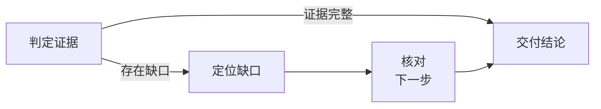

# Plush Capability Evidence Audit

只读回答“现在做到哪里、还缺什么、能不能使用或交付”。只核对当前问题需要的证据类型，不为简单状态题展开固定层级、全仓扫描或新建第二份台账。

## 按问题选真源

1. 范围或仓库入口不清时，才用 `README.md` 与 `docs/当前真源与交接顺序.md` 定位；能力已明确时直接从 `docs/product/产品能力进度台账.md` 进入对应专题、代码、migration 和测试。
2. Workflow / ProcessRuntime 问题补读台账聚合能力行和 `docs/architecture/状态工作流事实边界.md`。
3. 客户状态问题读取对应客户受控资料和当前目标证据；历史 changes、`progress.md`、聊天和截图只作辅助。

## 按问题选择证据

| 证据类型 | 什么时候需要 | 典型依据 |
| --- | --- | --- |
| 产品事实 | 问“做了吗、代码支持什么” | 当前代码、schema/migration、API/RBAC、页面和能力台账 |
| 本地验证 | 问“这次改动测过吗” | 当前 worktree、实际命令、执行数、fail/skip 和浏览器/数据库环境 |
| 目标运行与交付 | 问“某环境能用吗、发布或恢复了吗” | commit/image、config、migration、health/smoke、readback、backup/restore 和 rollback |
| 客户结果 | 问“甲方认可或使用正常吗” | 固定版本、反馈记录、UAT、问题闭环和签收 |

这些证据相互独立。产品事实不能推出目标环境已发布；本地绿色不能推出恢复可用；自动化和内部判断不能替代客户实际使用结果。只检查和报告本题需要的类型，省略无关类型。

结论词使用 `confirmed`、`partial`、`blocked`、`absent`、`not checked`。`passed` 只描述实际执行的验证；`skipped`、`0 tests executed` 和环境阻断必须单列。

## 工作流

1. 把问题改写成可判定命题，例如“采购主路径已具备产品事实”或“固定版本已在目标环境可用”。
2. 选择命题真正需要的证据类型和停止条件，不默认要求客户确认技术实现、架构或测试内部键。
3. 检查 current revision 与 worktree，区分 committed truth、local WIP 和其他任务改动。所有 status、diff、ref 与 index 只读盘点都设置 `GIT_OPTIONAL_LOCKS=0`；共享 dirty Local 直接读取 HEAD、index、`index.lock`、`GIT_OPTIONAL_LOCKS=0 git status --short --untracked-files=all` 与 scoped diff，不用会刷新 index 的普通 status 盘点制造可避免的锁。
4. 从能力台账定位范围，再回到当前代码、migration、测试或目标证据核对；发生冲突时报告漂移。
5. 状态题默认只读。不要为补证据自动迁移、写库、发布、清理、提交或推送。
6. 给出结论、已核证据、缺口和最小下一步；不要用“继续开发”概括所有问题。

## 停止条件

- 需要生产凭据、真实写入、migration apply、发布、恢复演练或签收时，核对当前任务已有授权并切 `$plush-operations-governance`；缺少时只暂停对应动作，已授权范围不重复询问。
- 需要修业务真源、schema/API/RBAC 时切 `$plush-domain-boundary-governance`；需要补测试时切 `$plush-test-governance`。
- 无法取得目标或客户证据时准确写 `not checked`，不根据旧记忆或本地绿色补齐。

## 输出

结论先行；需要比较多个证据类型时使用紧凑表格：`证据类型 | verdict | 当前证据 | 仍缺什么`。只列与问题有关的类型，并说明 current revision/worktree、实际检查、未检查项和最小下一步。

## 执行流程 / Execution Guide

### 范围与取证 / evidence

先明确要证明的命题，收集与该命题有关的现有证据；本专题不访问目标环境或执行写入。

- `scope` [界定问题](#audit-question)
  - 前置条件：用户已给出能力、版本或环境问题。
  - 具体操作：把问题写成可判定命题，列出范围、当前版本和不需要检查的类型；入口不清时再查真源索引。
  - 完成标准：能明确回答要证明什么，并区分产品实现、本地测试、目标运行与客户结果。
  - 失败处理：信息不足时先核对仓库与已有回执；仅缺用户独有信息时询问，不扩大成全仓审计。
- `identity` [固定现场](#audit-evidence)
  - 前置条件：审计范围已明确，当前工作区可读。
  - 具体操作：只读检查 HEAD、index、锁、status 和精确 diff，Git 查询使用 `GIT_OPTIONAL_LOCKS=0`；标出未提交与范围外改动。
  - 完成标准：每份代码或测试证据可绑定当前版本，WIP 与已提交事实分开。
  - 失败处理：现场漂移时重新核对受影响路径；保留其他任务内容，不为审计暂存、回退或提交。
- `collect` [收集证据](#audit-evidence)
  - 前置条件：已有范围与版本身份。
  - 具体操作：从台账定位后回查代码、schema、API、权限和页面；按问题补充执行摘要、目标回执或客户反馈，记录来源与时间。
  - 完成标准：所需证据可回查，执行数、失败、跳过和目标身份没有被省略。
  - 失败处理：来源缺失或只剩历史记录时保留缺口，不凭截图、旧记忆或本地绿色补造目标结论。
- `compare` [核对一致性](#audit-evidence)
  - 前置条件：已取得本题需要的证据。
  - 具体操作：逐项比较版本、对象、时间和结论；检查任务完成是否被误当事实入账，测试是否被误当发布或客户签收。
  - 完成标准：已确认一致项及冲突项，能够进入“结论与交接”专题。
  - 失败处理：冲突无法解释时回到证据来源查差异；无法取得的新证据标为未检查。

### 结论与交接 / verdict

按证据下结论；缺口和下一步继续保留各自的授权与事实边界。

- `classify` [判定证据](#audit-evidence)
  - 前置条件：已完成范围与取证。
  - 具体操作：对每个命题标明 confirmed、partial、blocked、absent 或 not checked；passed 仅用于确实执行的验证。
  - 完成标准：结论与来源逐项对应，跳过、零执行和环境阻断单独列出。
  - 失败处理：证据不足时降低结论范围；不能用“应该可用”填充缺口。
- `gap` [定位缺口](#audit-output)
  - 前置条件：存在未实现、未验证、目标证据缺失或客户未确认项。
  - 具体操作：区分代码缺口、测试缺口、运行核验与人工确认，说明缺失的最小证据及负责入口。
  - 完成标准：下一步具体可执行，不把所有问题都归为继续开发。
  - 失败处理：无法区分时回查唯一真源；不自动访问生产、造数据或变更运行状态。
- `handoff` [核对下一步](#audit-stop)
  - 前置条件：已找到需要实现、测试或运维的后续动作。
  - 具体操作：核对当前授权；业务真源改动交领域治理，补测交测试治理，实时核验、发布或恢复交运行治理。
  - 完成标准：授权内动作有明确入口；未授权动作和客户确认保持待处理。
  - 失败处理：缺少授权只暂停相应动作，保留证据；不以审计结论代替写入或签收授权。
- `report` [交付结论](#audit-output)
  - 前置条件：证据、缺口和下一步已核清。
  - 具体操作：先给结论，再列 current revision、实际检查、未检查项与最小下一步；只有需要比较时才列证据表。
  - 完成标准：读者能区分已实现、已验证、已发布和已验收，来源可回查。
  - 失败处理：发现表述超出证据时修正对应结论，不修改原始历史回执。
