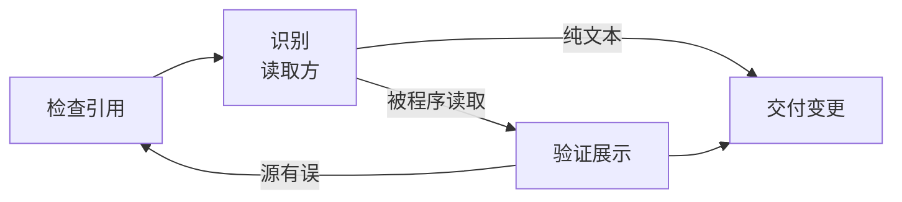

# Plush Docs Governance

维护 plush 文档的真源、读者路径和项目命名。按目标选择分支，不把普通文案修订扩展为业务或运行改造。

## Scope and Truth

- 范围、文档职责或读者入口不清时，按需读取 `docs/当前真源与交接顺序.md` 及相关目录 README；范围明确时直接检查目标文档、消费者与 scoped diff。已读且未变化的入口不重复加载。
- 正式 docs 描述合同；当前实现核对代码、Ent schema、Atlas migration 和测试；目标交付需运行证据。`progress.md`、`docs/archive/**`、外部规划和客户样本不能替代当前真源。
- 外部 GPT / 其他项目原文不进入产品仓；采纳结论先核实，再写成项目自身合同。客户原件与私密 manifest 继续留受控私有存储。
- 普通文档维护不编辑 AGENTS；用户明确要求治理长期规则时直接在授权范围内完成，保留 Workflow / Fact、RBAC、迁移、隐私、Git 与恢复门禁。
- 本次目标确实需要行为修改时，切换对应领域、页面或 operations 分支并继续已授权工作；只对新增范围或缺少授权的动作暂停。

## Writing and Organization

- 结论、读者、范围、当前状态和主路径前置。业务文档用岗位语言；T0-T8 是验证层级，L/内部状态键不作普通业务摘要。
- 按[文档写法](../../../docs/README.md#文档写法--writing-rules)选择短文、并列清单、编号步骤、对照表或 Mermaid。修订时从读者需要找的答案回查正文，核对条件、例外与来源是否仍在对应位置。
- 不新增重模板、平行 metadata、过程目录或重复负面清单。frontmatter 仅在真实 viewer / generator / index 消费时使用；命令注明工作目录和有用的成功信号。
- 长期文档默认中文文件名、中文主体及 English anchor；README / AGENTS / CHANGELOG、archive、生成和外部稳定路径例外，不机械改名。
- AGENTS 留长期项目特例，业务事实进专题，机械门禁留现有 QA，按需 SOP 进 Skills。删改规则须有具体影响依据，授权语义变化单列说明；体积治理不删除有效保护。

## Conditional Sync

- 新增、删除、重命名、重分类长期 Markdown 或改变标题 / 职责时，同步 `docs/文档清单.md`、目录 README、入口、锚点与引用；仅改正文通常不动清单。
- 一级目录 / 长期子系统变化才同步相关结构导航。行为、配置、接口、使用方式变化时同步对应专题；普通缺陷、样式或测试补强不更新能力台账。
- 能力边界 / 产品状态 / 关键阻塞实质变化才更新能力台账；客户启用、发布或验收状态变化才更新客户矩阵；主路径入口变化才更新当前真源索引。
- progress 严格按 AGENTS 的跨会话、阻塞 / 风险、schema / migration、发布 / 回滚、重大决策或用户要求条件更新；先检查 600 行 / 80 KiB，达到后显式归档并保留活跃事项和索引。
- 文档被 DEV viewer、帮助页、原型索引或生成脚本消费时，同步实际消费者与必要测试，不建第二份真源。

## Validation and Output

运行 scoped diff 格式及定向路径 / 锚点 / 旧术语检查；改项目 Skills 时运行 `node scripts/qa/skill-health.mjs`，这是[维护与验证](../README.md#skill-validation)定义的项目 validator。改文档清单或消费者时运行对应检查，Mermaid 变化检查语法与标签。纯治理不执行 migration 或无关全量 QA。

报告关键修改、AGENTS 是否变化、必要同步、验证及盲区；未涉及的图表、metadata、目录或运行层不逐项填报。

## 执行流程 / Execution Guide

### 真源与同步 / maintain

先确认文档职责，再按正文、目录或合同变化选择同步范围；完成后进入“消费者与验证”。不需要过程记录时跳过对应节点。

- `scope` [核对职责](#docs-scope)
  - 前置条件：本次需要维护的文档或行为变化已明确。
  - 具体操作：区分 README 导航、专题合同、progress 过程与历史记录，回查代码和正式来源；普通维护不改 AGENTS。
  - 完成标准：当前事实与历史过程分开，允许修改范围明确。
  - 失败处理：来源冲突时先核对当前实现；外部资料不直接复制为本项目真源。
- `edit` [修订正文](#docs-writing)
  - 前置条件：已有可核实的新事实或表达问题。
  - 具体操作：先整理结论与读者路径，去重后补条件、步骤、证据与链接；单一规则集中维护，引用稳定章节。
  - 完成标准：内容能指导目标读者，命令工作目录、成功信号及边界明确。
  - 失败处理：缺证据时保留待核对，不把推断写成已实现或已发布。
- `sync` [同步入口](#docs-sync)
  - 前置条件：已知道本次是否改变文件、职责、接口或用法。
  - 具体操作：增删改名、重分类或职责变化同步文档清单、README、入口和锚点；只改正文通常不动清单。
  - 完成标准：受影响导航与消费者齐全，无失效旧路径。
  - 失败处理：发现引用漂移时修正正式入口；无关目录与台账保持原范围。
- `progress` [判断过程记录](#docs-sync)
  - 前置条件：改动涉及跨会话、阻塞、重大决策、迁移发布，或用户要求记录。
  - 具体操作：仅在适用时更新 progress；达到 600 行或 80 KiB 先显式归档并保留活跃事项与索引。
  - 完成标准：需要的过程有记录，当前事实仍归正式专题。
  - 失败处理：无法确认历史归属时保留原事实，不清空或让 hook 自动改写。

### 消费者与验证 / validate

文档被工作台、帮助页或生成器使用时，验证实际消费结果；普通文字修订只做对应检查。

- `links` [检查引用](#docs-validation)
  - 前置条件：正文和必要入口已同步。
  - 具体操作：核对 scoped diff、路径、章节锚点和旧术语；项目 Skill 运行 `node scripts/qa/skill-health.mjs`。
  - 完成标准：结构、metadata 和引用检查通过，缺失来源已说明。
  - 失败处理：逐项修复本轮失效链接，保留范围外改动；不通过删除有效规则换取检查通过。
- `consumer` [识别读取方](#docs-sync)
  - 前置条件：文档可能被 viewer、帮助页、原型或生成脚本读取。
  - 具体操作：沿实际导入和解析入口确认字段、标题、图示和引用如何展示，选择对应定向测试。
  - 完成标准：确定实际消费者与无需运行检查的纯文本范围。
  - 失败处理：没有消费者证据时继续查入口，不新建第二份目录或平行配置。
- `runtime` [验证展示](#docs-validation)
  - 前置条件：本次改变可执行消费者读取的内容。
  - 具体操作：运行对应生成与只读检查；图示检查解析和标签，页面检查实际展示、节点与返回，必要时修正同源消费者。
  - 完成标准：展示与正文一致，引用可达，当前任务路径可完成。
  - 失败处理：解析或展示失败时修正源或唯一读取逻辑，不隐藏错误或仅凭文档检查宣称完成。
- `finish` [交付变更](#docs-validation)
  - 前置条件：适用检查已完成。
  - 具体操作：报告关键修改、必要同步、实际验证及盲区；需要 Git 交接时列精确路径和授权状态。
  - 完成标准：已执行与未验证清楚，范围外文件未被纳入成果。
  - 失败处理：检查仍失败时说明原因和受影响范围，不能以另一类绿色结果替代。
