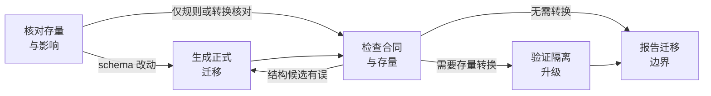
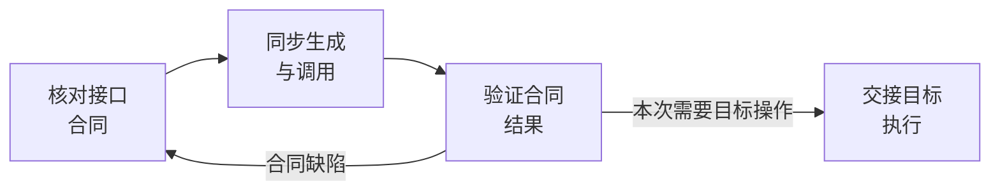

# Plush 业务边界治理 Domain Boundary Governance

用这个 skill 在实现 `plush-toy-erp` 功能前收敛 domain ownership、source of truth、API/RBAC、frontend/backend responsibility 和 customer/template-specific boundary。

后端边界：这是 plush 后端业务实现前的主治理入口，覆盖 schema / migration / repo / usecase / JSON-RPC / API / RBAC / transaction / idempotency / error code / Workflow-Fact boundary。页面治理 skill 只核对可见能力是否有真实后端支撑；一旦需要新增或修改这些后端能力，应切换到本 skill。

## Truth Routing / 真源路由

- 范围、模块责任或入口不清时，才用 `README.md` 与 `docs/当前真源与交接顺序.md` 定位；否则直接读取相关 module docs、代码、schema/migration 和测试。
- 代码、schema/migrations、tests、formal docs 强于聊天规划或旧 reference notes。

## 项目规则 Project Rules

- 先按 `MasterData / Workflow / Fact / RBAC / API-UI / Productization` 分层定位责任。
- `Workflow task done` 不等于 `Fact posted`；`WorkflowUsecase` 不直接写库存、出货、财务事实。
- 单客户私有化边界遵循项目 AGENTS；SaaS 多租户、license 等只有用户明确提出并完成专项评审才可扩展，客户字段不硬编码进 Product Core。
- 后端实现先确认 schema/migration、repo、usecase、JSON-RPC/API、RBAC、transaction、idempotency、error code 和测试责任，不让前端或临时脚本承接业务事实一致性。

## 项目边界门禁 Project Boundary Gates

- 新增 schema、migration、repo、usecase、API、RBAC 权限、状态、字段或配置前，先证明现有真源不能承接，并说明新增复杂度的收益和退出边界。
- 优先主路径修复：不要用页面私有逻辑、脚本补写、兼容 fallback、重复派生字段或宽松校验掩盖 usecase / repo / API 合同缺口。
- Workflow / Fact、客户差异、字段残值 / 缺值、幂等和事务边界必须可测试、可解释、可回滚；不能只让当前 happy path 通过。
- 当前目标所需的 schema、API、UI、文档和测试按同一闭环连续完成；只排除任务外扩展，发布仍核对独立授权。

## 工作流 Workflow

1. 写出 single domain outcome 和 owning layer。
2. 找到 source-of-truth fields、states、identifiers、permissions、derived values。
3. 检查现有 table/usecase/API/helper 是否已经拥有该行为。
   查询、统计、导出、批处理或热点并发受规模影响时，按[数据规模与并发](#data-scale-and-concurrency)评估；未触及规模敏感路径的字段与文案调整不单独触发容量分析。
   涉及版本字段或模块版号时，按[版本边界](../../../docs/engineering/跨层公共契约与生成规范.md#版本边界--version-boundaries)核对独立读写需求及存量消费者，再决定删除、复用现有身份或保留必要格式版本。
   配置启动失败时先区分运行边界错误与人工版号漂移，不用递增包名或维护“当前 / 上一版”白名单解堵。配置内容身份复用现有内容 revision 生成器；同次构建的临时响应同步生产者、消费者和结构校验。新增或保留格式版本须说明真实跨发布读写者及不兼容差异；已有持久化字段不自动产生保留理由。
4. 按字段影响检查 defaults、edits、source switch/clear 和相关 list/detail/print/export/search；旧实验不构成兼容对象，已落库残留按正式 migration 清理。
5. UI 不补造 backend facts；客户/模板特例不污染 generic core。
6. 按影响面选择 unit、integration、contract、browser、migration validation。
   数据库改动按[项目部署与迁移规则](../../../AGENTS.md#部署迁移与收口)完成适用的生成、工作区迁移合同检查、登记开发库只读审计、seed / fixture 核对和隔离升级验证；生成或验证通过不表示已迁移。需要执行目标库迁移时转运行治理。
   版本治理至少运行现有命名门禁及相关回归：内容变化 / 不变、跨配置启动、冻结身份的回滚 / 完成检查 / 密码轮换、错误环境和标记拒绝。沿生产者、消费者及回执链复查，区分落盘原件与同次构建的展示投影；新写入校验不能误用于历史读取。涉及冻结快照、哈希、回执或 Schema 的删除时，补齐存量转换与回放证据，不用放宽测试代替治理。

### 目标环境执行 / Target Runtime

客户配置任务若进入 validate / publish / transition check / activate / readback、目标环境 migration 或 rollback，由本 skill 先确认 Product Core 与字段真源，再切 `$plush-operations-governance` 执行运行态步骤；不要另造页面私有配置真源或直接改库。

## 数据规模与并发 / Data Scale and Concurrency

先区分数据总量、单次扫描与返回范围、批次大小、读写比例、并发和热点；结合部署资源与响应目标说明当前规模和有依据的增长假设。规模未知时记录缺口，不把“亿级”等数量直接作为分库、缓存或队列的选型依据。

沿真实 repo/usecase/API 检查分页与排序、索引与过滤、汇总和导出、逐项查询与内存占用；批处理与并发写入同时守住事务、幂等、权限、冻结快照和失败恢复。前端分页或压测成功不能替代数据库查询成本及事实一致性核对。

优先调整受影响主路径；引入缓存、异步任务或分区等能力前，说明已有方案的瓶颈依据、新增一致性与运维成本，以及何时需要升级。容量假设、设计取舍和升级条件归所属模块正式设计；按 `$plush-test-governance` 选择验证，未实测的规模保持未验证；新增架构仍按当前目标与授权边界判断。

## API 合同与工作台同步 / API Contract Sync

新增、删除、改名接口，或变更请求 / 返回、权限、状态条件、幂等及错误行为时，按[公共契约维护步骤](../../../docs/engineering/跨层公共契约与生成规范.md#修改步骤--maintenance)完成同轮同步；纯实现调整且调用合同未变时核对生成零漂移。

- 从实际分发、参数解析、返回映射及所属 usecase 核对合同；维护 `server/docs/api.md` 的中文名称、用途与业务约束，以及 `server/cmd/public-contracts/testdata/rpc_examples.json` 的模拟值和来源。提取不支持实际结构时扩展生成器并验证，不手改生成物或在文档中补造后端行为。
- 运行现有生成与只读检查，使正式 API 文档、公共 RPC 标识、DEV 源码索引和“接口与集成”保持同源；删除或改名时清理旧合同、样例、调用方及失效来源关联，不留平行目录。
- 同步实际权限登记与相关回归来源，按行为影响验证；来源关联、模拟样例和生成一致不等于已执行通过。涉及工作台解析、展示或交互时验证对应消费者及浏览器行为，普通接口变更不扩成全工作台回归。

## 输出 Output

汇报 ownership decisions、source truth、changed layers、intentionally untouched layers、stale/missing paths、validation 和 residual risks。

## 执行流程 / Execution Guide

### 真源与业务实现 / domain

先确定业务归属和唯一写入入口，再完成同一目标的各层实现。

- `outcome` [确定业务结果](#domain-boundaries)
  - 前置条件：用户目标和当前模块可定位。
  - 具体操作：写清业务结果、负责层和允许范围，区分 MasterData、Workflow、Fact、RBAC 与 API/UI；客户差异先查配置入口。
  - 完成标准：谁拥有规则、字段和写入口清楚，Workflow 完成与事实入账没有混淆。
  - 失败处理：模块责任不清时读正式设计与代码，不能先新增相近表、状态或配置。
- `truth` [复查既有真源](#domain-workflow)
  - 前置条件：已识别本轮字段、状态、权限和标识。
  - 具体操作：沿 table、repo、usecase、API、helper 及真实消费者核对复用机会；涉及规模时检查分页、排序、汇总、导出与并发成本。
  - 完成标准：确定要复用、修正或新增的唯一位置，新增复杂度有现实收益。
  - 失败处理：发现别名、重复派生或未采用实验路径时核对公开合同和落库情况后清理，不增加双轨兼容。
- `implement` [完成受影响实现](#domain-workflow)
  - 前置条件：领域归属、数据合同与事务边界明确。
  - 具体操作：在正式 repo/usecase/API 完成校验与编排，同步权限、错误码、页面和输出；覆盖默认、编辑、来源切换、清空与历史缺值。
  - 完成标准：同一业务动作事务完整，前端不代写事实，真实消费者已更新。
  - 失败处理：状态、权限或映射不一致时修所属主路径，不用临时 SQL、页面脚本或宽松测试补救。
- `verify` [核对行为边界](#domain-workflow)
  - 前置条件：实现和必要生成物可检查。
  - 具体操作：按触达面验证正常、非法状态、无权限、幂等、回滚、冻结快照及输出；数据库与 API 变化继续对应专题。
  - 完成标准：本轮业务结果与不可发生的事实均有证据，未测容量和目标状态保持未验证。
  - 失败处理：检查失败时按责任层修复并复验；未完成生成、审计或存量升级时报告 incomplete。

### 数据库与迁移 / database

本专题负责工作区生成和升级验证；目标库 apply 继续走运行治理及正式授权。

- `baseline` [核对存量与影响](#domain-workflow)
  - 前置条件：本次涉及 schema、精度、枚举约束或数据转换。
  - 具体操作：核对当前 schema、已执行迁移、存量规则与 seed；列出冻结快照、已过账事实和历史缺值的升级风险。
  - 完成标准：知道是否需要生成迁移和存量转换，历史迁移不被改写。
  - 失败处理：来源或迁移状态未知时保留现场，暂停依赖判断，不以空库测试代替存量调查。
- `generate` [生成正式迁移](#domain-workflow)
  - 前置条件：已授权修改 schema，目标结构设计明确。
  - 具体操作：修改 schema 后在 `server/` 执行 `make data`，审查 Ent、Atlas migration 和 atlas.sum，再运行 `bash scripts/qa/db-guard.sh`。
  - 完成标准：生成物与源一致，有正式迁移或生成零漂移证据。
  - 失败处理：生成失败、缺迁移或出现无关变更时先修原因并核对范围，不手改生成物或宣称完成。
- `audit` [检查合同与存量](#domain-workflow)
  - 前置条件：工作区迁移候选已确定。
  - 具体操作：在 `server/` 执行 `make migrate_check` 检查工作区合同，再用 `make migrate_audit` 只读核对登记开发库；检查 seed 是否仍生成违规数据。
  - 完成标准：迁移合同与当前存量审计通过，seed 约束一致。
  - 失败处理：审计失败时修数据转换或构造逻辑；未取得完整证据时标 incomplete，不留给下次启动才发现。
- `upgrade` [验证隔离升级](#domain-workflow)
  - 前置条件：涉及存量转换，已有受控现库备份及隔离库入口。
  - 具体操作：按隔离库生命周期验证升级，覆盖已过账事实、冻结快照、历史缺值与附件恢复；核对前后数量、关系和候选业务。
  - 完成标准：实际存量升级、业务读回和清理有记录，空库结果没有替代它们。
  - 失败处理：转换或对账失败时保留隔离证据，修候选再验；不直接在共享或生产库试错。
- `boundary` [报告迁移边界](#domain-output)
  - 前置条件：适用的生成、合同、审计和升级检查已有结论。
  - 具体操作：列明候选 migration、验证范围、剩余缺口和是否 apply；需要目标执行时转运行治理，沿用既有准备与确认链。
  - 完成标准：实现验证与真实 apply 分开，目标写入身份和授权没有被推定。
  - 失败处理：缺授权、恢复条件或目标证据时只暂停对应 apply；其他已授权实现继续。

### 接口与运行交接 / contract

公开合同变化同步全部正式消费者；配置激活、迁移和发布交运行治理执行。

- `contract` [核对接口合同](#domain-api)
  - 前置条件：新增、删除、改名接口或改变请求、返回、权限、状态、幂等与错误行为。
  - 具体操作：从真实分发、参数解析、返回映射及 usecase 核对合同，更新 API 文档与模拟样例；纯实现调整核对合同未变。
  - 完成标准：公开字段、权限、状态与错误含义有唯一来源。
  - 失败处理：提取工具不支持当前结构时扩展工具，不手改生成物或在文档里补造能力。
- `generate` [同步生成与调用](#domain-api)
  - 前置条件：正式合同和源实现一致。
  - 具体操作：运行现有生成及只读检查，同步公共 RPC 标识、DEV 源码索引和接口工作台；删除旧调用方、样例与失效关联。
  - 完成标准：生成零漂移，真实调用方和权限登记都已同步。
  - 失败处理：发现遗漏消费者时补齐同一目标，不保留无来源 alias 或双写。
- `verify` [验证合同结果](#domain-api)
  - 前置条件：生成与调用更新已完成。
  - 具体操作：验证正常、边界、权限、状态和错误行为；工作台解析或交互变化时核对对应页面与浏览器。
  - 完成标准：实际结果匹配合同，来源关联和样例不被当成执行通过证据。
  - 失败处理：失败时回查真实业务入口和返回映射，按影响修复再验。
- `runtime` [交接目标执行](#domain-runtime-boundary)
  - 前置条件：本次还需要配置激活、目标迁移、发布或回滚。
  - 具体操作：固定候选版本与配置身份，说明已完成的实现验证、未 apply 项和运行前提，由运行治理核对授权、计划、恢复及读回。
  - 完成标准：后续执行有正式入口和可审候选，领域实现授权没有被扩成发布授权。
  - 失败处理：没有目标身份、授权或写前检查证据时保留交接，停止相应目标写入。
