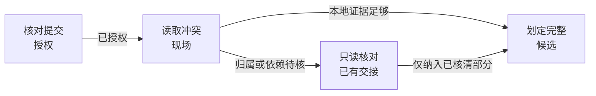
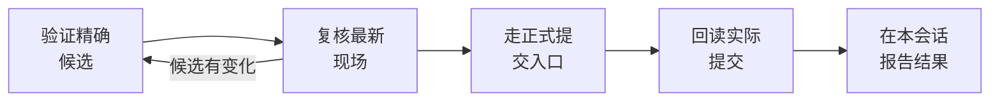

# Plush Git Conflict Coordination

当前提交会话负责读差异、核清依赖、验证候选和报告结果。即使另一会话仍在运行，提交过程也不联系、唤醒或等待它。入口、互斥与错误含义见[本地提交入口](../../../scripts/README.md#git-commit-entry)。无冲突时直接使用该入口。

## 读取已有交接 / Handoff Evidence

只有具体片段的归属或依赖仍有疑问时，才按需只读查看相关会话已有的交接，再与当前 Git 差异核对。无需查询对方是否在线。缺少交接或聊天读取工具时，继续处理本地证据足以核清的部分。

## Trigger and Authority

- 当前目标已获本地提交授权，且出现混合 hunk、跨会话依赖或入口输出 `[commit-scope:coordination]` 时，核对对应路径。诊断本身不产生提交、联系其他会话或推送的授权。全局 `$git-closeout-coordination` 负责精确提交和原生锁核验，项目入口仍为唯一共享 index 写入入口。
- “先别提交 / 不要提交 / hold”按批次和 hunk 生效，验证通过、依赖需要或其他会话说 ready 均不解除。可读取暂缓批次以核清依赖，不能修改、暂存或提交其内容；不能分离时只停依赖它的目标，继续独立目标。仅用户明确解除对应暂缓后才能纳入。

## 核对当前差异 / Inspect Changes

1. 先让失败的提交进程退出并释放互斥。在当前会话只读核对 HEAD、index、原生锁和冲突片段。以入口诊断定位，再核实实际内容；仅更换 `--base` 不足以重试。
2. 同文件按 hunk 判断。能证明在授权范围内且依赖完整的部分，直接准备候选。已经被其他提交纳入的部分回读 SHA，避免重复提交。
3. 同一片段仍在写入、归属未清或必要依赖无法分开时，保留该片段和已有暂存。在本会话记录路径、具体缺口及影响，只继续能独立完成的目标，不向其他会话派活或催办。

## Resolve and Validate

- 按实际 diff 建立最小完整依赖：实现、调用方、测试、文档和必需生成物。相关作者的交接用于核对，不直接等同于提交范围；排除 HOLD、无关功能和已经提交的内容。
- 需要补验证或修复授权范围内的问题时，由当前会话在固定 HEAD 的一次性独立副本中完成。必要回写只应用已审查的最小补丁，前后核对指纹，避免整文件覆盖他人的混合改动。
- 在隔离的“当前基线 + 本组候选”上完成最小充分验证。旧工作树或包含其他批次的绿色结果不能证明候选完整；混合生成物须从候选源码生成并核对语义范围。按独立目标分批，紧密依赖不拆成不可运行的中间提交。
- 原生 `index.lock` 先按全局 Git Skill 核验；活动锁、非预期 index、分支变化或未知写入先确认实际操作者。不能以协调为由删除锁、清空他人暂存、stash 或回退文件。

## Commit and Close

1. 根据新的归属、依赖或文件证据，重读 HEAD / index / lock 与 scoped diff，核对授权和 HOLD，审阅新的候选与基线。没有新证据不得原样重试；发现已提交则回读 SHA，避免重复提交。
2. 必要回写先核对前后指纹，保持范围外内容。用 `python3 scripts/git-hooks/commit-scope.py --base <已审查完整SHA> --message '<中文提交说明>' --patch <精确补丁>` 提交；不用裸 stage/commit、跳过 hooks 或外部脚本写共享 index。工具报告的冲突原因不是合并、提交或扩大范围的授权。
3. 验证实际提交树、文件 / hunk、hooks、剩余工作树与暂存区。只在本会话报告 SHA、验证边界和保留项，不向其他会话发送完成回执，也不推送。
4. 需要用户决定范围、补授权或解除 HOLD 时，在当前会话说明具体选择。其余未完成项留被动交接，不启动后台监控。

## 执行流程 / Execution Guide

### 授权与冲突核清 / coordinate

只处理已授权本地提交中的真实重叠或依赖；无冲突提交使用项目正式入口。

- `authority` [核对提交授权](#git-authority)
  - 前置条件：当前目标已获本地提交授权。
  - 具体操作：核对当前目标的 commit 授权、精确批次和 HOLD；实现、验证绿色与交接都不产生提交或 push 授权。
  - 完成标准：允许与暂缓范围明确，无冲突目标可走正式提交入口。
  - 失败处理：未授权或暂缓内容保持原状；只有用户能补授权或解除 HOLD。
- `identity` [读取冲突现场](#git-contact)
  - 前置条件：本地提交已授权。
  - 具体操作：只读核对 HEAD、index、index.lock、精确 diff 和已有交接；先结束失败提交进程并释放互斥，再判断重叠与依赖。
  - 完成标准：已定位具体文件与片段，能判断哪些可以独立提交。
  - 失败处理：现场变化、活动锁或 index 异常时保留现场，按全局 Git 流程核验，不删锁或只改 base 重试。
- `handoff` [只读核对已有交接](#host-capabilities)
  - 前置条件：当前差异留下具体的归属或依赖疑问。
  - 具体操作：将已有交接中的路径、片段、授权和暂缓项与当前差异对照。
  - 完成标准：能说明哪些片段属于本组，哪些仍需保留。
  - 失败处理：缺少交接或证据矛盾时，保留受影响的片段，在当前会话说明原因。
- `candidate` [划定完整候选](#git-authority)
  - 前置条件：当前会话已核清候选的归属与授权。
  - 具体操作：按实现、调用方、测试、文档和必要生成物形成最小完整依赖，排除无关与暂缓 hunk，进入候选验证专题。
  - 完成标准：候选可解释、边界明确；作者 ready 不替代授权。
  - 失败处理：不能分离 HOLD 或归属不明的依赖时只暂停对应目标，不回退或暂存他人内容。

### 候选验证与提交 / commit

在固定基线验证精确候选，再由单一操作者通过 commit-scope 串行提交；本流程不推送。

- `isolate` [验证精确候选](#git-validation)
  - 前置条件：授权、归属与完整依赖已核清。
  - 具体操作：使用一次性独立副本验证“当前基线加本组候选”，生成物从候选源码生成；核对最小充分检查与前后指纹。
  - 完成标准：候选独立验证通过，不依赖混合工作区或历史绿色。
  - 失败处理：在当前会话修正授权范围内的候选并复验，保留共享原件、index 与暂缓内容。
- `review` [复核最新现场](#git-closeout)
  - 前置条件：隔离候选与必要回写已验证。
  - 具体操作：重读 HEAD、index、锁、授权、HOLD 和 scoped diff，核对候选与已审基线；如内容已提交则回读 SHA。
  - 完成标准：待提交范围与现场仍一致，确认单一 index 操作者。
  - 失败处理：版本、分支或写入漂移时停止相关提交；没有新证据不原样重试。
- `commit` [走正式提交入口](#git-closeout)
  - 前置条件：最新现场、候选与基线均已审查且本地提交已授权。
  - 具体操作：使用 `python3 scripts/git-hooks/commit-scope.py --base <已审查完整SHA> --message <中文提交说明> --patch <精确补丁>`，由入口处理暂存、互斥和 hooks。
  - 完成标准：入口成功生成预期提交，hooks 有完整结果。
  - 失败处理：冲突、hook 或锁检查失败时保留现场并读取原因，不裸 stage/commit、跳过 hooks 或清空他人暂存。
- `readback` [回读实际提交](#git-closeout)
  - 前置条件：提交入口报告成功。
  - 具体操作：核对实际 SHA、提交树、路径/hunk、hooks、剩余工作区和暂存，确认范围外内容未纳入。
  - 完成标准：实际提交与授权候选一致，保留项明确。
  - 失败处理：发现异常先保全并说明，不擅自 reset、rebase、强推或改写历史。
- `receipt` [在本会话报告结果](#git-closeout)
  - 前置条件：提交与剩余现场已核对。
  - 具体操作：在当前会话记录 SHA、验证结果、保留项与未推送状态。
  - 完成标准：用户能查到本次提交包含的改动，以及保留了哪些片段。
  - 失败处理：无法核清的部分记录具体路径和原因，不触发跨会话追问。
