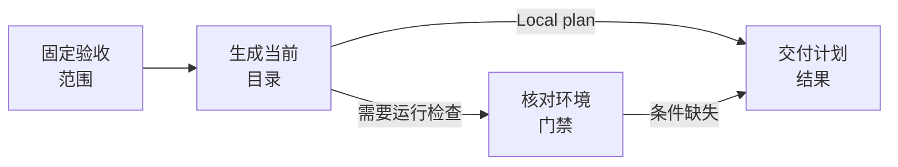
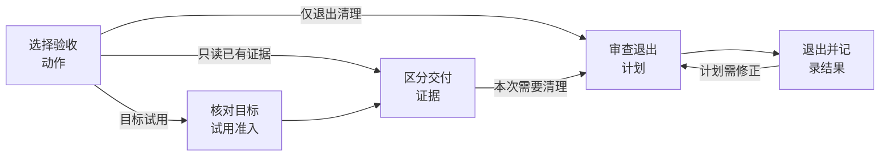

# Plush Manual Acceptance Governance

本 skill 编排 plush 的人工验收工具链。它负责选择档位、标注写入边界、绑定同一数据批次、收集证据并安全退出；不把模拟数据、浏览器可打开、本地报告或目标试用自动写成正式发布与客户签收。

## Truth Routing / 真源路由

- 范围、客户或验收入口不清时，才用 `README.md` 与 `docs/当前真源与交接顺序.md` 定位。
- 生成或执行验收计划时读 `scripts/qa/README.md` 和当前 `scripts/qa/manual-acceptance-*.mjs` 的 `--help` / tests；脚本合同优先于本 skill 中的示例。
- 客户验收任务读取 `docs/customers/<customer-key>/试用人员全页面手工验收清单.md`、`客户交付矩阵.md` 和 `客户闭环交付验收清单.md`。
- 目标环境、客户配置或发布任务再读 `server/deploy/README.md`、`scripts/deploy/README.md` 与正式 release evidence。

验收项数量、账号数、模板数和数据版本会变化。每次从 `manual-acceptance-catalog.mjs --format json` 与当前脚本合同读取，不在 skill 中写死。

## Profiles / 档位选择

| 档位 | 允许动作 | 证据边界 |
| --- | --- | --- |
| Local plan | catalog、dataset plan、dry-run、静态边界检查 | 不连接服务、不证明数据已准备 |
| Local simulated apply | 经精确确认词向已核本地环境写模拟数据，并读回 | 只证明指定本地批次，不是客户真实数据 |
| Local browser/PDF | 登录正式试用账号，按脚本合同做只读页面与 PDF 检查 | 登录/审计可能写痕迹；不证明目标发布 |
| Target trial/UAT | 经 target attestation、隧道和独立凭据执行允许的目标试用动作 | 与正式 release evidence、生产写入分开 |
| Release/customer acceptance | 读取正式发布、恢复与签收证据 | 自动化不能代替业务负责人签收 |

每一步必须标注 `no-write`、`simulated-write`、`target-write` 或 `human-only`。不清楚时按高风险档位处理。下方流程只执行当前 profile 所需步骤：Local plan 不读取运行凭据或连接服务，已有批次的只读检查不重新准备数据；apply、目标访问、签收和 cleanup 各自核对需要与授权。

整批模拟数据验收按完整覆盖要求核对图片、异常恢复和纠正证据；单页或局部验收只检查清单命中的项目。

## Workflow / 工作流

1. 冻结 scope：customer、target、profile、dataset key/data version/run id、允许写入、禁止路径、验收与停止条件。先运行 `GIT_OPTIONAL_LOCKS=0 git status --short`，保留其他会话改动。
2. 生成当前目录与数据计划。按当前脚本说明运行 catalog 的 JSON 模式；不要复制旧清单数量或依赖历史报告。
3. 检查环境门禁：URL/host、DB、migration、active customer config revision、账号/RBAC、凭据分离、报告目录和精确确认词。凭据只经环境变量传入，不写入命令记录、报告或仓库。
4. 按当前脚本能力准备 source data、账号、任务、附件和 source-driven Fact。计划入口与 apply 入口分开；脚本声明 plan-only、retired 或 unsupported 的阶段立即停止，不用旧报告、generic RPC、直接 SQL 或局部事实代替。
5. 每次写入后以同一 dataset/version/run id 做 readback。校验数量、状态、权限、幂等与报告绑定；单个子链绿色不能扩写为完整验收就绪。
6. 运行 readiness，再按清单做浏览器/PDF 与人工判断。按[完整模拟数据覆盖](../plush-seed-import-governance/references/full-dataset-coverage.md#coverage-contract)核对默认页实际取图，以及异常恢复和纠正的前后证据。分别记录页面可达、数据满足、交互正确、PDF 合同和人工结果；未执行的动作标为未验证。
7. 目标试用与正式发布分开归档：目标报告绑定 target attestation；正式 release 仍需 commit/image、migration、health/ready、smoke、backup/restore 和 rollback evidence。
8. 先 dry-run 再 retire/cleanup。只取消、归档或停用允许的模拟源数据；已过账事实和审计记录不物理删除。报告保留路径、未清对象与后续 owner。

## Stop Conditions / 停止条件

- target、DB、active revision、数据版本或 run id 对不上；确认词、独立凭据或 attestation 缺失。
- 脚本/README 标明 plan-only、unsupported、retired，或报告合同版本不匹配。
- 需要直接改生产数据库、绕过 RBAC/usecase、上传真实客户原件、执行 migration/release 或删除已过账事实。
- readiness 有 blocker、浏览器/PDF 产生 4xx/5xx、关键 readback 不一致，或人工验收项尚未确认。

遇到这些条件要停止对应写入并报告证据，不通过放宽识别、复用旧 report、跳过阶段或伪造空报告继续。

## Validation / 验证要求

- 变更人工验收脚本时运行对应 `node --check`、定向 `node --test`，再由 `$plush-test-governance` 选择 affected/full 范围。
- 验收执行至少保存 catalog、plan/apply/readback、readiness、browser/PDF、retire 的适用报告，并核对它们绑定同一批次。
- 报告默认写入 ignored `output/**` 或正式指定 evidence 目录；不得包含密码、token、完整 DSN、真实客户原件或未脱敏 PII。

## Output / 输出合同

汇报本次 profile 实际涉及的 target、批次、写入分类、执行结果、readback、浏览器/PDF 或人工结果、报告与 cleanup。只列适用 verdict；涉及交付时再分开本地准备、目标试用、正式发布、恢复证据和客户签收，未触达层级不机械枚举。

## 执行流程 / Execution Guide

### 计划与环境准入 / plan

按验收目标选 profile，冻结范围与写入分类；Local plan 到计划输出即结束，不连接服务。

- `scope` [固定验收范围](#acceptance-profiles)
  - 前置条件：目标客户、能力或验收问题已明确。
  - 具体操作：确定 customer、target、profile、dataset/version/run id、允许写入、禁止路径和停止条件；保留其他会话改动。
  - 完成标准：本轮验收边界与无写入/模拟写入/目标写入/人工判断分类清楚。
  - 失败处理：范围或写入性质无法确定时先核对合同，不拿默认 profile 代替授权。
- `catalog` [生成当前目录](#acceptance-workflow)
  - 前置条件：范围与 profile 已明确。
  - 具体操作：读取当前脚本帮助和测试，生成 catalog JSON 与数据计划；数量、模板、账号与支持阶段均从现行合同读取。
  - 完成标准：清单和计划绑定当前范围，没有复制历史统计。
  - 失败处理：入口标明 retired、unsupported 或 plan-only 时保留该限制，不用旧报告替代。
- `gate` [核对环境门禁](#acceptance-workflow)
  - 前置条件：所选 profile 确实需要运行服务；Local plan 不进入此步。
  - 具体操作：核对 URL/host、DB、migration、客户配置 revision、账号/RBAC、独立凭据、报告目录和必要确认词。
  - 完成标准：环境、批次、凭据与允许动作相符，准备进入本地检查或目标专题。
  - 失败处理：身份不一致、凭据或 attestation 缺失时暂停相关执行，凭据不写命令日志、报告或仓库。
- `planout` [交付计划结果](#acceptance-output)
  - 前置条件：本轮仅要求 Local plan，或运行条件尚未就绪。
  - 具体操作：报告目录、数据计划、写入边界、阻断与下一步，明确没有准备数据或连接目标。
  - 完成标准：计划可审查，未执行项没有被写成验收就绪。
  - 失败处理：需要补充条件时只保留对应缺口；不自动升级 profile。

### 数据与本地验收 / local

按已选 profile 复用或准备同一批数据，先 readiness 再执行清单内页面、PDF 和人工检查。

- `dataset` [准备或复用数据](#acceptance-workflow)
  - 前置条件：环境门禁通过，需要模拟批次或已有批次检查。
  - 具体操作：已有批次只读检查不重造；需要 apply 时核对确认词与允许范围，通过当前脚本准备账号、任务、附件和 source-driven Fact。
  - 完成标准：当前脚本支持的批次已准备或可复用，数据身份唯一。
  - 失败处理：脚本不支持或只提供计划时停止该写入，不能用临时 SQL、泛用 RPC 或局部事实填空。
- `readback` [核对同批读回](#acceptance-workflow)
  - 前置条件：批次已有数据，或本轮写入已结束。
  - 具体操作：用同一 dataset/version/run id 核对数量、关系、状态、权限、幂等和报告绑定，运行 readiness。
  - 完成标准：所需数据满足且没有 blocker，模拟与真实事实区分。
  - 失败处理：关键读回不一致或 readiness 阻断时先修批次原因，不进入后续检查伪造空报告。
- `checks` [执行页面与纸面检查](#acceptance-workflow)
  - 前置条件：readiness 满足本次清单，正式试用账号可用。
  - 具体操作：按清单登录并核对默认页图片、业务任务、异常恢复、纠正和必要 PDF；分别记录可达、数据、交互、纸面与人工判断。
  - 完成标准：每项实际结果与同批证据对应，未执行明确标记。
  - 失败处理：4xx/5xx、错图、权限或交互失败时停止受影响路径并记录前后证据，修复后定向复验。
- `report` [形成验收结果](#acceptance-output)
  - 前置条件：适用检查完成或已明确阻断。
  - 具体操作：保留 catalog、plan/apply/readback、readiness、browser/PDF 等实际报告，说明失败、未验证与待人工确认项。
  - 完成标准：本地批次结论可回查，未扩写为目标发布或客户签收。
  - 失败处理：缺少人工结果或完整证据时保持未完成，不由自动化替业务负责人确认。

### 目标证据与退出 / target

目标试用、正式发布和客户签收分别取证；清理只处理允许的模拟对象。

- `route` [选择验收动作](#acceptance-profiles)
  - 前置条件：本次目标与已选 profile 已明确。
  - 具体操作：区分进入目标试用、只读已有发布或签收证据、退出模拟批次；按实际目标选择分支，不要求无关环境访问。
  - 完成标准：需要的动作及写入分类清楚，只读证据检查不会被升级成目标操作。
  - 失败处理：无法确定 profile 或授权时先核对当前合同，只暂停对应执行，不读取无关凭据。
- `target` [核对目标试用准入](#acceptance-stop)
  - 前置条件：本次确需 Target trial/UAT，目标访问与动作已授权。
  - 具体操作：核对 target attestation、隧道、独立凭据、批次及允许操作；迁移、发布与恢复的实际步骤由运行治理负责。
  - 完成标准：目标身份与本轮范围一致，访问和写入分类清楚。
  - 失败处理：缺证明、身份漂移或需要绕过权限时停止相关动作，不把本地配置当目标授权。
- `evidence` [区分交付证据](#acceptance-profiles)
  - 前置条件：已有目标试用或正式交付材料。
  - 具体操作：目标报告绑定 attestation；正式发布另核对 commit/image、migration、health/ready、smoke、备份恢复与 rollback；签收读取真实业务负责人结果。
  - 完成标准：目标试用、发布、恢复和客户确认分别有依据。
  - 失败处理：只有本地或历史报告时保留目标未验证，不拼接成当前已交付。
- `plan` [审查退出计划](#acceptance-workflow)
  - 前置条件：本轮需要 retire/cleanup 且范围已授权。
  - 具体操作：先 dry-run，核对对象、引用、批次和生命周期；只取消、归档或停用允许的模拟源数据。
  - 完成标准：计划不会物理删除已过账事实、审计或其他批次。
  - 失败处理：目标、引用或归属不清时保留对象，不扩大清理或规避正式入口。
- `close` [退出并记录结果](#acceptance-output)
  - 前置条件：退出计划有效且仍符合授权。
  - 具体操作：通过正式入口执行适用退出并读回，保存报告路径、未清对象、后续负责人和各层实际 verdict。
  - 完成标准：退出结果可核对，敏感资料未进入报告，剩余事项明确。
  - 失败处理：部分成功或未知结果先读回再恢复；没有完成证据时不能宣称已清理或已签收。
