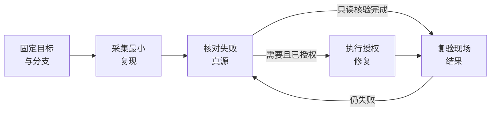
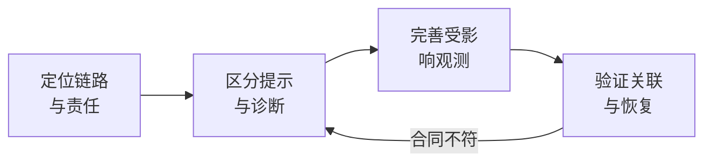
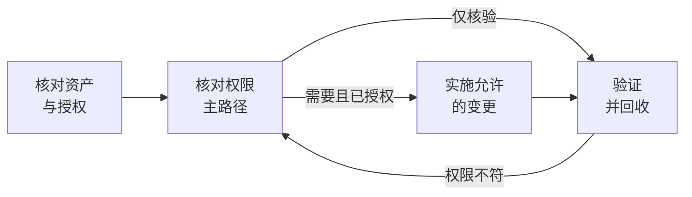
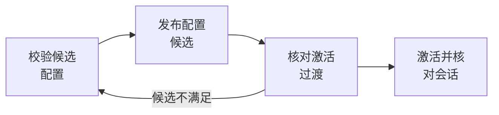
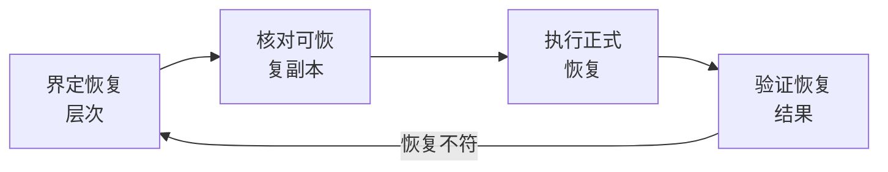

# Plush 运行与发布治理 / Operations Governance

只读回答“现在做到哪里、已有证据能证明什么”时切 `$plush-capability-evidence-audit`；本 skill 从实时运行态核验、敏感访问或任何配置、数据、migration、发布、回滚动作开始负责。

## Truth Routing / 真源路由

- target、模块责任或运行入口不清时，才用 `README.md` 与 `docs/当前真源与交接顺序.md` 定位。
- 诊断或错误治理按需读相关服务 README、错误码真源、日志、代码和测试；发布、迁移或回滚才读取部署约定、发布门禁、deploy README 和当前 Compose/config。
- 发版前按[发布令牌复用与轮换](../../../scripts/deploy/README.md#release-credential-lifecycle)核对现有 GitLab 发布凭据，并按该合同处理换发和同用途凭据清理。
- 诊断先确认 environment 和最小请求/错误证据，再按失败层补查版本、config、DB/migration 或日志；发布/回滚结论须完整绑定制品、配置、迁移和目标运行证据。
- 本地启动或共享开发库迁移按[项目部署与迁移规则](../../../AGENTS.md#部署迁移与收口)及[迁移入口](../../../scripts/README.md#推荐顺序)执行。启动预检失败或超时时保留恢复页，不自动迁移；登记共享库使用同一次 ready 计划，经确认后才执行。隔离库和正式目标走各自登记入口。

## Project Rules / 项目边界

- 先定位 browser、API/RPC、usecase、DB/migration、RBAC、config/deploy 中的失败层，再决定改代码、数据或部署。
- 后端 RBAC 是安全边界；secrets、客户资料、生产 env、导出和日志截图按敏感信息处理。
- 关键链路保留可检索的 `request_id / trace_id / task_id / domain id`；用户提示使用场景化中文，不透传原始异常。
- 发布绑定 commit、image、migration、目标环境、health/ready、业务 smoke 和 rollback point。
- 低配目标机只加载本地或 CI 构建产物，不执行重构建；Atlas 及发布流程遵循项目正式部署文档。
- 下载资源缓慢或停滞时，先按[来源与代理选择](../../../docs/部署约定.md#下载缓慢时的来源与代理选择--download-routing)比较可信来源、直连与已授权代理的实际吞吐，选择最快且稳定、校验通过的组合，再继续发布。
- `full/strict`、本地 hook、仓库 workflow、历史 release note 都不是当前目标运行态；backup 存在也不等于 restore 已演练。
- 客户配置运行态必须走 validate / publish / transition check / activate / effective-session readback 的正式链路；不直接改数据库或只改 live config。

## Router / 分支路由

| 分支 | 先回答 | 配套全局 skill | 最低证据 |
| --- | --- | --- | --- |
| Diagnose | 失败在 browser、API/RPC、usecase、DB/migration、RBAC 还是 config/deploy？ | `$runtime-diagnostics` | 可复现请求、时间窗口、request id、日志/Network、只读状态 |
| Observe / Error | 内外错误语义、日志字段、trace、脱敏和告警是否一致？ | `$observability-error-governance` | 成功/业务失败/系统失败、错误码同步、用户提示与内部诊断 |
| Secure / Privacy | 资产、权限、secret、客户资料和审计边界是什么？ | `$security-privacy-governance` | RBAC、secret scan、最小权限、脱敏、访问与回收记录 |
| Release / Migration | 哪个不可变制品进入哪个 target，DB/config 如何推进？ | `$release-governance` | preflight、commit/image、migration lock、health/ready、smoke |
| Rollback / Recovery | 回退代码、配置或 migration 的安全点是什么，数据如何恢复？ | `$release-governance` | rollback point、备份、restore drill、对账、恢复后 smoke |

先由本 Skill 固定 plush 真源与 target；表中配套 Skill 仅在当前分支需要其专项步骤时加载，已有充分规则和证据时直接完成。真实跨分支才组合。

## Shared Workflow / 共用工作流

1. 明确分支、target/environment、允许写入、验收和停止条件。诊断默认只读；发布、migration apply、secret 变更、恢复和清理必须有明确授权。
2. 按当前分支取证，不同时加载无关分支；只记录支撑本次判断需要的 revision、请求窗口、配置/迁移与凭据来源，不输出 secret、完整 token/DSN 或不必要 PII。
3. 写动作前运行对应 preflight 并保留 before evidence；target、数据归属或 migration 状态不清时停止对应动作，不顺手修数据。
   普通升级先核对所用发布入口能否将基础服务差异绑定到确认计划并在执行前复核。入口尚未支持时报告该次升级受阻，不在同一入口反复准备。入口支持时，按[晋级执行合同](../../../scripts/deploy/README.md#promotion-与传输)绑定镜像、资源及配置差异；执行前发现差异缺失、无法核实或发生变化，停止目标写入，待范围可核实时重新准备并确认。
4. 从目标环境采集 after evidence；本地 QA、制品、migration/config、target runtime、recovery 和客户验收分开判定。
5. 只按正式保留策略清理明确制品；不无条件 prune，不碰 volume、数据库、`/data`、env、证书或运行依赖。正式真源变化时同步相关文档与 `progress.md`。

## Stop Conditions / 停止条件

- 拟执行的写入/发布/恢复所需 target、commit/image、config revision、DB 或 migration 序列无法唯一确认；只阻断依赖该身份的动作。
- 生产/共享数据需要修复、破坏性 migration、历史改写、强推或不可逆 secret 轮换，且未获得明确授权和恢复方案。
- preflight、migration status、health/ready、业务 smoke、readback 或数据对账失败；不得跳过失败继续宣称发布完成。
- 只有本地 QA、历史报告或仓库配置，没有当前目标环境证据。此时最多报告本地/定义层完成。

## Output / 输出要求

先给分支结论和证据链，再说明实际动作、验证、目标环境、敏感信息处理、回滚/恢复点及剩余盲区。发布结论必须分开 `local QA`、`artifact`、`migration/config`、`target runtime`、`recovery` 与 `customer acceptance`。

## 执行流程 / Execution Guide

### 现场诊断与修复 / diagnose

实时问题先只读取证；只有核对目标与既有授权后，才进入相应写入或修复路径。

- `scope` [固定目标与分支](#operations-scope)
  - 前置条件：用户提出运行问题或实时目标核验。
  - 具体操作：核对环境、入口、允许动作与停止条件，区分已有证据审计和当前现场；只查历史证据时转能力审计。
  - 完成标准：本次目标与分支明确，诊断默认只读，写入范围没有被扩大。
  - 失败处理：目标或授权不明时先保留最小现场，只暂停依赖它的动作。
- `reproduce` [采集最小复现](#operations-routing)
  - 前置条件：目标环境可确认并允许读取。
  - 具体操作：记录请求、时间窗口、request/trace id、错误和只读状态，核对当前版本、配置与数据库迁移身份。
  - 完成标准：问题可定位到 browser、API、usecase、DB、权限或部署中的一层。
  - 失败处理：无法复现时保留实际样本与缺口，不凭旧日志猜当前根因或反复重启。
- `cause` [核对失败真源](#operations-workflow)
  - 前置条件：已有最小请求与失败层证据。
  - 具体操作：沿正式入口核对代码、配置、权限、依赖和迁移状态，比较同一时间与版本的日志，确定修复责任层。
  - 完成标准：根因、影响对象与最小修复明确。
  - 失败处理：证据冲突时补读相关来源；不顺手改数据、跳过迁移预检或叠加盲目重试。
- `repair` [执行授权修复](#operations-workflow)
  - 前置条件：根因已核实，拟执行动作在已有授权内。
  - 具体操作：按所属入口修代码或配置；涉及数据、apply、发布、secret 或恢复时先满足对应写前检查与恢复条件。
  - 完成标准：执行范围与候选一致，before evidence 和动作结果可回查。
  - 失败处理：缺授权、目标身份或恢复条件时保留候选并暂停相应写入；启动预检失败保留原进程与恢复页。
- `verify` [复验现场结果](#operations-output)
  - 前置条件：修复或只读诊断已有结果。
  - 具体操作：复现原请求并核对日志、健康与业务结果；本地启动变更实测 `pnpm start`、故障下迁移页可达和恢复后业务入口。
  - 完成标准：当前结果与修复目标一致，代码启动、数据库状态和业务恢复分别有证据。
  - 失败处理：仍失败时回到失败层补证；无法核验的目标保持未验证，不把编译或本地 QA 当恢复完成。

### 日志与错误治理 / observe

只为受影响链路补充必要观测，用户提示、内部诊断与业务审计各守边界。

- `trace` [定位链路与责任](#operations-routing)
  - 前置条件：本次涉及错误语义、日志、trace、指标或恢复行为。
  - 具体操作：沿入口、usecase、外部依赖与返回路径找已有 request/trace/domain id 和统一组件，确定缺失关联与结果分类。
  - 完成标准：知道应复用的链路标识、错误码与日志归属，不重复埋点。
  - 失败处理：链路身份不一致时先修统一入口，不在各页临时拼接派生 ID。
- `contract` [区分提示与诊断](#operations-rules)
  - 前置条件：错误来源和已有注册表已明确。
  - 具体操作：维护一码一义和跨层生成合同，区分成功、业务拒绝、系统失败；用户用岗位语言，内部保留必要诊断。
  - 完成标准：错误含义、严重度、恢复动作与消费者一致。
  - 失败处理：未知外部差异只在正式边界处理，不直接透传 err.message、stack 或用通用成功隐藏错误。
- `implement` [完善受影响观测](#operations-workflow)
  - 前置条件：新增观测确有缺口且实施已授权。
  - 具体操作：复用统一日志、trace、timeout/retry 和健康机制；仅记录必要字段，检查 secret、完整 token/DSN 与客户 PII 脱敏。
  - 完成标准：失败可检索、可分类并能指导恢复，没有无必要敏感数据或重型后台设施。
  - 失败处理：发现泄漏或重试副作用时停止相关输出或动作，修主路径并按真实边界恢复。
- `verify` [验证关联与恢复](#operations-output)
  - 前置条件：观测或错误处理改动已完成。
  - 具体操作：覆盖成功、业务拒绝、系统失败、超时和恢复，核对端到端关联、结果分类、提示与脱敏；业务审计单独核验。
  - 完成标准：技术观测与业务结果一致，日志可支持复现和故障定位。
  - 失败处理：关联丢失、重复写入或脱敏失败时修复后定向复验，不用日志存在代替审计完成。

### 权限与隐私操作 / security

敏感访问和变更按资产、目标、最小权限及既有授权核对，用户独有验证不能绕过。

- `assets` [核对资产与授权](#operations-routing)
  - 前置条件：本次确需访问权限、secret、客户资料或生产配置。
  - 具体操作：识别资产、目标、允许动作、授权来源与凭据入口，确认当前工具真实具备需要的能力。
  - 完成标准：最小访问范围明确，客户资料保持受控，读取和变更分开。
  - 失败处理：缺凭据、登录、信任或用户确认时只暂停对应步骤，不探查无关账户或扩大权限。
- `boundary` [核对权限主路径](#operations-rules)
  - 前置条件：资产与目标可确认。
  - 具体操作：核对后端 RBAC、角色、owner/assignee 和敏感动作；客户端隐藏不是安全边界，日志与导出只保留必要信息。
  - 完成标准：允许与拒绝路径、审计和隐私边界可验证。
  - 失败处理：发现授权或泄漏缺口时固定证据并修所属边界，不用前端开关代替后端校验。
- `change` [实施允许的变更](#operations-workflow)
  - 前置条件：动作已有明确授权，必要 preflight 与恢复方案就绪。
  - 具体操作：通过正式配置、凭据或权限入口执行最小变更，保留脱敏 before evidence，不在仓库或报告记录完整密钥。
  - 完成标准：变更身份、范围与结果可追溯，恢复与回收条件仍有效。
  - 失败处理：不可逆轮换、生产修复或范围变化缺授权时暂停相应写入；失败不清空未知配置或凭据。
- `readback` [验证并回收](#operations-output)
  - 前置条件：变更已执行或访问工作已完成。
  - 具体操作：分别验证合法与无权限请求、目标会话有效结果、审计与脱敏；按本次允许范围回收临时访问并报告残留。
  - 完成标准：有效权限与预期一致，敏感输出和临时能力已核对。
  - 失败处理：读回不符时保留证据并按正式恢复路径处理，不能以 UI 显示正常宣称权限闭环。

### 迁移与发布 / release

固定候选、目标与恢复点，按正式计划执行；低配目标只加载制品，不在目标机临时构建。

- `candidate` [固定发布身份](#operations-workflow)
  - 前置条件：本次明确授权迁移或发布准备。
  - 具体操作：核对 commit/image、config revision、目标 DB、migration 序列、备份闭环和 rollback point，绑定基于当前真源的候选。
  - 完成标准：候选、目标与恢复点可唯一确认，本地 QA 与目标证据分开。
  - 失败处理：身份、备份或恢复依据缺失时先补只读准备，暂停依赖的写入。
- `prepare` [生成可审计划](#operations-workflow)
  - 前置条件：正式发布或迁移入口与候选已确定。
  - 具体操作：运行对应 preflight；共享开发库非交互路径先 `make migrate_prepare`，沿同次 ready 输出准备执行；发布计划绑定镜像、基础服务资源和配置差异。
  - 完成标准：计划完整且检查通过，可核对允许写入的实际内容。
  - 失败处理：入口不支持差异绑定、预检失败或状态未知时停止相关执行，不反复准备或跳过检查。
- `confirm` [复核执行前条件](#operations-stop)
  - 前置条件：已有具体计划及相应用户授权。
  - 具体操作：执行前再核对目标、候选、配置/基础服务差异和授权；同次 ready 或确认计划必须仍有效，已有未变授权不重复索取。
  - 完成标准：身份与计划未漂移，实际动作仍在明确授权内。
  - 失败处理：差异缺失、无法核实或已变化时暂停写入，重新准备具体候选后按风险确认。
- `execute` [通过正式入口执行](#operations-workflow)
  - 前置条件：执行前复核全部满足。
  - 具体操作：按项目 Compose、制品与串行迁移入口执行；共享库按同次 ready 的 `make migrate_execute`，目标只 load、迁移、启动和检查。
  - 完成标准：每个动作有明确结果，制品、迁移与配置身份一致。
  - 失败处理：失败、超时或结果未知时先读回状态，停止后续依赖动作；不得自动 apply、无条件重试或降级为低层 SQL。
- `smoke` [核对目标结果](#operations-output)
  - 前置条件：正式执行完成或需要判定部分结果。
  - 具体操作：从目标读取 migration/config、health/ready、业务 smoke 与日志，按版本和环境保存回执，必要恢复走对应专题。
  - 完成标准：当前目标真实运行结果可回查，发布与客户验收没有混为一谈。
  - 失败处理：健康、smoke 或对账失败时不得宣布发布完成，保留失败证据和已授权恢复入口。

### 客户配置激活 / config

客户配置沿 validate、publish、transition check、activate、effective-session readback 的正式链路推进。

- `validate` [校验候选配置](#operations-rules)
  - 前置条件：本次客户、配置目标与允许变更范围明确。
  - 具体操作：读取唯一配置源与当前 revision，执行正式 validate，核对 Product Core、功能、菜单、角色及字段边界。
  - 完成标准：候选通过校验，客户 key 不承担多租户语义，差异可审。
  - 失败处理：来源冲突或非法差异先修正式配置，不直接写库或只改 live config。
- `publish` [发布配置候选](#operations-rules)
  - 前置条件：候选有效，发布动作在授权内。
  - 具体操作：通过正式 publish 入口固定候选身份，保留发布结果与可回查 revision。
  - 完成标准：发布记录与候选内容一致，尚未激活状态没有被写成已生效。
  - 失败处理：发布失败或响应未知先核对已有结果，不重复制造多个未知候选。
- `transition` [核对激活过渡](#operations-rules)
  - 前置条件：候选已发布，需要进入目标有效配置。
  - 具体操作：执行 transition check，核对目标当前 revision、变化影响、授权和恢复条件；只推进明确允许的过渡。
  - 完成标准：过渡检查通过，目标与计划身份一致。
  - 失败处理：条件不满足或目标漂移时暂停 activate，保留现有有效配置。
- `activate` [激活并核对会话](#operations-rules)
  - 前置条件：过渡检查与激活授权有效。
  - 具体操作：通过正式 activate 入口执行，再用 effective-session readback 核对真实会话中的菜单、权限、配置身份与业务结果。
  - 完成标准：目标会话实际使用预期配置，发布与生效证据分开。
  - 失败处理：读回失败或结果不符时按正式恢复链处理，不以本地文件或 UI 刷新代替生效证明。

### 回滚与恢复 / recovery

先确认要回退的层次与恢复点，完成目标恢复与对账。只有本次另需清理制品时，才进入“制品清理”专题。

- `scope` [界定恢复层次](#operations-stop)
  - 前置条件：用户明确要求恢复或发布失败需要已授权恢复动作。
  - 具体操作：区分代码、配置、migration 和数据恢复，核对目标、影响、允许动作、备份与 rollback point。
  - 完成标准：恢复边界明确，数据回退没有被当作代码回退自动包含。
  - 失败处理：恢复点、归属或授权不足时保留现场，暂停受影响写入并给具体缺口。
- `prepare` [核对可恢复副本](#operations-workflow)
  - 前置条件：目标与恢复范围已确认。
  - 具体操作：按正式备份恢复合同核对当前副本、完整性、恢复回执、所需制品与配置；固定执行前证据和停止条件。
  - 完成标准：恢复依赖可用，不能只凭 backup 存在推定能恢复。
  - 失败处理：副本或恢复演练证据不足时补核验，不能在唯一现场上试错。
- `restore` [执行正式恢复](#operations-workflow)
  - 前置条件：恢复方案有效且操作已授权。
  - 具体操作：按对应代码、配置或数据恢复入口串行执行，保留原始事实与审计，记录实际完成和未完成动作。
  - 完成标准：恢复动作范围与计划一致，结果可以继续核验。
  - 失败处理：失败、部分完成或未知结果时停止依赖动作并先读回，禁止无条件重放或擅自扩大数据回退。
- `verify` [验证恢复结果](#operations-output)
  - 前置条件：恢复执行已有结果。
  - 具体操作：核对目标版本、配置、migration、health/ready、业务 smoke、数量与关系对账，并读取恢复回执。
  - 完成标准：目标恢复到预期安全点，数据与业务结果一致。
  - 失败处理：任一关键检查失败都保留恢复未完成，回查对应层而非仅重启服务。

### 制品清理 / cleanup

仅在本次明确需要清理制品时执行；普通清理不要求先做回滚或数据恢复。

- `inventory` [核对保留范围](#operations-workflow)
  - 前置条件：本次清理目标与授权明确，当前环境可确认。
  - 具体操作：记录磁盘、Docker 占用和容器状态，核对当前版本、需保留的回滚包与正式回执；识别数据库、上传、配置、证书和其他运行依赖。
  - 完成标准：必须保留的对象与可重建候选清楚，实际运行版本可回查。
  - 失败处理：版本、归属或恢复保留策略不明时先补核对，不以空间不足为由全删。
- `plan` [审查清理对象](#operations-workflow)
  - 前置条件：保留范围已经核清。
  - 具体操作：通过项目正式脚本或清单确定明确过期、可重建的制品，检查候选是否仍被容器、回滚或运行依赖使用。
  - 完成标准：每个待清对象有归属与理由，当前版本、必要回滚和回执均被排除。
  - 失败处理：发现唯一副本、引用或授权变化时移出候选并保留现场，不默认 image prune -a 或扩大范围。
- `execute` [执行受控清理](#operations-workflow)
  - 前置条件：候选清单与当前现场一致，动作仍在已有授权内。
  - 具体操作：按正式入口清理本次已核实对象；禁止 volume prune，不删除数据库、data、env、上传、证书与运行依赖。
  - 完成标准：实际清理对象与计划相符，部分成功和失败有记录。
  - 失败处理：发生异常时停止后续依赖清理，先读回已完成状态，不盲目重跑或扩大删除。
- `verify` [核对运行状态](#operations-output)
  - 前置条件：清理已完成或明确中断。
  - 具体操作：记录清理后磁盘、Docker 占用与容器状态，确认当前服务、保留制品和必要恢复证据仍可用，报告释放量与保留项。
  - 完成标准：运行状态与保留合同满足要求，实际结果可核对。
  - 失败处理：服务或保留对象异常时保全证据并按已授权恢复流程处理；无法核验时不宣称清理闭环。
