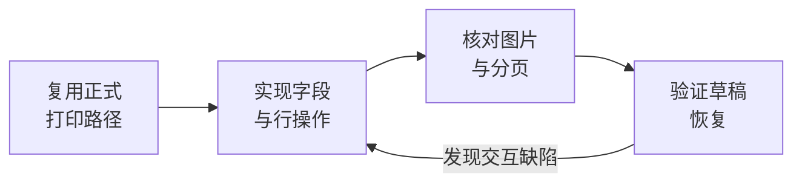
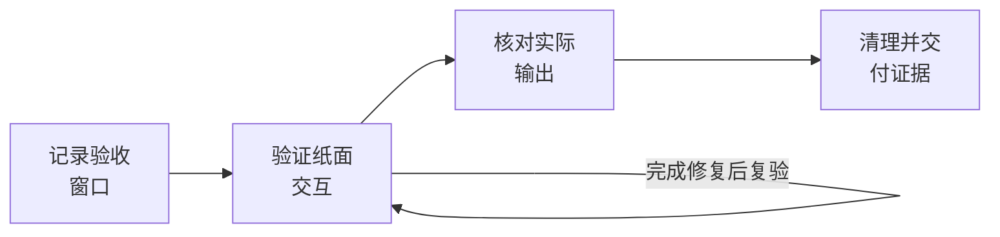

# Plush Print Template Source Governance

从当前任务的 checkout / Worktree 内用 `git rev-parse --show-toplevel` 核对仓库根；下文命令以该根目录为工作目录，仓库内引用也相对它解析。

本技能负责本项目的源文件识别、纸面编辑和 PDF / print 保真。直接使用本项目规则，不预先加载内容等价的通用打印技能。

## Truth Routing / 真源路由

按任务范围读取，不机械全量展开：

- 范围、模板职责或入口不清时，用 `README.md` 与 `docs/当前真源与交接顺序.md` 定位。
- 修改模板 runtime 时读 `web/README.md`、打印模板字段与编辑行为清单、打印模板实现原理以及相关代码和测试。
- `docs/product/ui-design/README.md`；涉及 UI 交互时再读交互设计说明中的打印合同
- `scripts/import/README.md` 和 `scripts/import/customerSourceManifestCheck.mjs`；涉及客户原件时，由客户 Private 仓库显式传入 `<private-root>/manifests/source-manifest.json` 与 `<private-root>/sources`，不在 Product Core 猜测路径
- `config/customers/<customer-key>/README.md`；涉及 runtime samples、extracted image assets 或 `printTemplateDefaults` 时必读

## Project Rules / 项目边界

- 当前正式模板包括 `采购合同`、`加工合同`、`物料分析明细表`、`色卡`、`作业指导书`。新增或改变正式模板时，必须同步检查 `fieldRequirements`、`moduleKeys`、`factBoundary: read_snapshot_only` 和服务端 PDF 模块门禁。
- yoyoosun raw sources 的当前真源在兄弟 Private 仓库 `plush-toy-erp-customer-yoyoosun-private`。必须先按其 `manifests/source-manifest.json` 核对 path、sha256、size、media type、source kind、structuredExtract policy 和 duplicate group，并向 Product Core 工具显式传 `--manifest`、`--raw-dir`；不要 glob 私有 sources，也不要把截图当正式 source chain。
- 打印输出真源是当前独立打印窗口里的右侧纸面 DOM；左侧字段面板、附件上传条和工具栏只是编辑入口，不是第二套模板。
- 打印模板只读业务快照和当前窗口草稿，不创建、确认、过账或反写采购、委外、生产、库存、质检、出货或财务事实。
- 客户源文件、私密 manifest、客户公司名、真实联系人、真实电话、真实签字人、客户图片和原始资料路径不能自动进入 Product Core 默认样例。真实原件及未脱敏提取物留在客户 Private 仓库；仅经评审的脱敏配置、模板与 public assets 才进入 Product Core 对应客户配置边界。
- 不要为了当前截图补页面私有真源、额外草稿 key、第二套 PDF HTML 或客户硬编码。
- 模板质量同样是交付边界：不要为某个截图堆一批一次性 CSS/JS 补丁、无限 base64 图片快照、整页截图型模板、重复测高循环或第二套隐藏 PDF DOM；优先复用 `printWorkspace.js`、`PrintWorkspaceShell`、工程模板 normalizer、共享图片槽和 scoped CSS。
- 正式模板变化时维护本项目覆盖矩阵：template key、source version、field requirements、mapper、renderer、PDF module gate、图片槽、browser / PDF checks 和盲区；以当前代码、正式 docs 和测试核对。
- Runtime limits 是正确性的一部分。复用现有 engineering row / image limits 和 server PDF payload / concurrency / timeout；如果新增 row / image / vector 路径，要补上对应 bound 或说明为什么现有 bound 足够。
- 职业任务文案是打印模板交付的一部分：模板标题、按钮、导出/PDF、帮助提示和正式打印件要使用岗位能理解的任务、影响和下一步；不要把 `mapper`、`snapshot`、`DOM`、`payload`、`source noise` 等开发术语直接暴露给业务用户。

## Select the Relevant Detail

| 当前任务 | 必要读取 |
| --- | --- |
| 引入、替换源文件，判断版本、重复区域、噪点或图片锚点 | [Source Analysis](references/source-analysis.md) |
| 修改模板字段、布局、编辑、图片、分页或 PDF，或执行打印窗口交互验收 | [Template Runtime](references/template-runtime.md) |
| 只改说明或技能本身 | [项目 validator 与维护检查](../README.md#skill-validation)及本次触达的文档检查 |

仅加载命中的分支。局部模板修订可复用未变化的源版本证据；源基准或字段 / 版式解释受影响时才重新解析客户原件。模板内编辑属于当前技能；触达共享页面壳或普通业务页面时才补 `$plush-page-design-governance`，字段真源、API、RBAC 或业务事实变化使用 `$plush-domain-boundary-governance`。按 `$plush-test-governance` 选择验证及高成本授权。

## Workflow

1. 用 `GIT_OPTIONAL_LOCKS=0 git status --short` 核对当前任务现场，明确目标模板、源版本、现有运行路径和本次影响面。
2. 按上表读取来源或实现分支，复用当前真源和已有工具完成已授权改动。
3. 按影响面选择来源、字段、真实浏览器、DOM / box metrics 和 PDF / print 验证；新增正式模板或改变实现路径时同步本项目覆盖记录、文档与测试。

## Output

报告完成内容、实际验证及剩余盲区；仅展开本次相关的来源版本、字段映射、编辑恢复、图片或性能证据。客户资料保持受控，不能以本地绿色替代实际打印或客户验收。

## 执行流程 / Execution Guide

### 源文件与字段识别 / source

引入、替换或重新解释原件时执行；局部修订复用未变化的来源证据。

- `identity` [核对来源身份](#print-boundaries)
  - 前置条件：已明确模板与允许读取的受控来源。
  - 具体操作：按 Private manifest 核对 path、sha256、size、media type、source kind、提取策略及重复组；通过显式 manifest/raw-dir 入口读取。
  - 完成标准：源版本可追溯，产品仓没有新增真实原件、PII 或私密 manifest。
  - 失败处理：校验漂移或来源不明时暂停源解释，不 glob 私有目录或把截图当正式来源链。
- `structure` [解析结构与图位](#print-routing)
  - 前置条件：来源身份已核对，需要理解版式或字段。
  - 具体操作：检查 sheets/pages、print area、真实内容区、合并、隐藏区域、重复模块、字体边框及 drawing/image anchors，分类模板、样本与辅助资料。
  - 完成标准：模板边界与图片锚点独立明确，样式撑大的维度没有误当业务内容。
  - 失败处理：结构不明确时回查 workbook/PDF 与相邻区域，不因图片在 used range 外就丢弃或无限扩大模板。
- `map` [定义字段映射](#print-boundaries)
  - 前置条件：稳定结构、噪点与客户样本已区分。
  - 具体操作：把头部、明细、章节、图片、备注映射到现有字段、行模型和图片槽；保留来源位置、比例和来源追溯。
  - 完成标准：每个正式元素有语义与数据来源，重复源块、扫描噪点和真实客户值未进入默认样例。
  - 失败处理：无法证明的噪点或歧义保留说明；不靠客户硬编码、整页截图或第二套 HTML 兜底。
- `baseline` [形成实现基线](#print-workflow)
  - 前置条件：字段、版式与图片映射可解释。
  - 具体操作：确定 template key、source version、field requirements、mapper、renderer 和 PDF gate；需要实现时进入纸面编辑专题。
  - 完成标准：本次影响范围、源对照与未决项清楚，来源可以供运行验证使用。
  - 失败处理：字段或业务事实不属于打印层时转领域治理；普通页面壳交页面治理，保留当前授权边界。

### 纸面实现与编辑 / editor

打印输出以当前独立窗口右侧纸面 DOM 为准；编辑只作用于快照与当前草稿。

- `reuse` [复用正式打印路径](#print-boundaries)
  - 前置条件：模板基线与实施目标明确。
  - 具体操作：核对 printWorkspace.js、PrintWorkspaceShell、现有 normalizer、草稿/mapper、图片槽和 scoped CSS，确定唯一改动位置。
  - 完成标准：没有新增事实写入、额外草稿 key 或第二套隐藏 PDF DOM。
  - 失败处理：既有模型不能承接时说明真实差异并扩展归属层，不加单页临时补丁。
- `edit` [实现字段与行操作](#print-workflow)
  - 前置条件：共享模型与字段合同已确定。
  - 具体操作：让可编辑层覆盖实际纸面单元格，区分选择与编辑；行插入、删除、图片增删、富文本撤销及清空按真实能力实现。
  - 完成标准：目标操作与岗位文案对应，章节行和普通行复用规则，草稿修改可恢复。
  - 失败处理：焦点遮字、选择误触或恢复失败时核对 DOM 与存储主路径，不能隐藏按钮之外仍宣称具备能力。
- `images` [核对图片与分页](#print-boundaries)
  - 前置条件：本次影响图片、重复行、分页或运行成本。
  - 具体操作：保持源锚点、比例和明确尺寸，多图换行与长表增长走现有规则；默认样例用少量代表行，长清单另用 fixture。
  - 完成标准：图片不变形、不裁掉必要内容，行与图片数量、payload、并发和超时有界。
  - 失败处理：溢出或成本超限时修模型与布局，不能无限 base64、反复整页测高或用 hidden overflow 掩盖。
- `draft` [验证草稿恢复](#print-workflow)
  - 前置条件：编辑实现完成，尤其触达草稿或窗口交接。
  - 具体操作：按现有 IndexedDB 草稿合同检查保存、恢复、来源切换与窗口交接；核对业务快照保持只读。
  - 完成标准：草稿修改不丢失，不串对象，不反写采购、库存、出货或财务事实。
  - 失败处理：存储不可读、损坏或写入失败时保留现有草稿并明确提示，不覆盖未知内容或假报保存成功。

### 浏览器与纸面验收 / verify

按本次改动核对源、运行页面与必要的 PDF/打印；临时窗口按真实归属清理。

- `windows` [记录验收窗口](#print-workflow)
  - 前置条件：需要打开独立打印或 PDF 预览窗口，工具能识别与控制。
  - 具体操作：记录本次打开动作返回的窗口/标签句柄和用途，后台串行验证当前窗口；先核对用户原有页面。
  - 完成标准：本轮临时窗口归属明确，能关闭并读回。
  - 失败处理：工具不能控制原生弹窗时停止继续打开，不重复点击或关闭整个浏览器。
- `browser` [验证纸面交互](#print-workflow)
  - 前置条件：当前窗口与测试数据明确。
  - 具体操作：结合源图、运行图、DOM 和 computed style 验证列宽、行高、字体、焦点、长值、增删行及宽高图片；只验触达状态。
  - 完成标准：操作、几何、图片与恢复满足合同，证据对应具体问题状态。
  - 失败处理：真实遮挡、缺字或错图需修并复验；抗锯齿、压缩与微小 subpixel 噪点不升级为业务规则。
- `output` [核对实际输出](#print-boundaries)
  - 前置条件：本次影响 PDF、打印或正式模板覆盖。
  - 具体操作：核对实际 PDF/print 的分页、图片、字段、页尾与岗位文案，并同步模板覆盖矩阵、模块门禁、文档和测试。
  - 完成标准：纸面结果与当前草稿及源基线一致，浏览器通过没有替代实际输出证据。
  - 失败处理：输出失败或未检查时保留明确盲区；不以截图数量或本地单测代替打印验收。
- `close` [清理并交付证据](#print-workflow)
  - 前置条件：本轮窗口验证完成或被中断。
  - 具体操作：先关闭本轮 PDF 子窗口，再关闭本轮打印窗口并核对消失；保留用户指定页面，报告来源、实际验证和剩余风险。
  - 完成标准：临时窗口已按句柄核清，客户资料仍受控，完成与未验证分开。
  - 失败处理：归属或关闭状态不明时保留现场并说明，不能用标签列表为空宣称原生窗口已清理。
