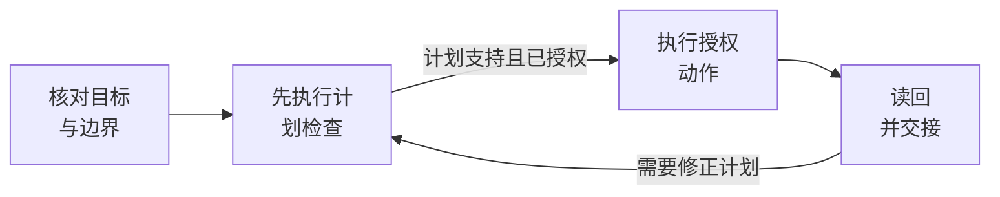

# Plush Seed / 导入治理 Seed Import Governance

用这个 skill 处理 `plush-toy-erp` seed data、fixtures、demo data、import dry-runs、manual-test data 和 cleanup，保证数据可查、可回收、可增量复用且不冒充产品真源。

## Truth Routing / 真源路由

- 范围、数据入口或模块责任不清时，才用 `README.md` 与 `docs/当前真源与交接顺序.md` 定位；否则直接读取相关 module docs、代码和测试。
- 写数据前确认 target DB/env、schema/migration state、run id/prefix 和 cleanup path。
- 登记整批模拟数据时，按 [Full Dataset Coverage](references/full-dataset-coverage.md) 核对图片入口、正常流程、异常恢复、纠正和复用范围；普通单测 fixture 或单模块 seed 直接使用对应测试、helper 或 runner，不加载整批验收合同。从甲方资料提取业务特征并生成脱敏模拟场景时读 [Customer Source to Synthetic](references/customer-source-to-synthetic.md)。
- 当前阶段、依赖、业务链、场景、页面和数量必须从 runner、合同与测试读取；Skill 只保存判断方法，不复制会漂移的当前统计。

## 项目规则 Project Rules

- 试用模拟只使用 seed、fixture 或手工构造数据；当前没有可直接导入的 yoyoosun 真实客户数据。
- 模拟数据不得写成真实导入、客户字段确认、出货、库存或财务事实。
- seed/import 要可定位、可回收、可复跑；不要污染 Product Core、RBAC 或长期 schema。
- 正式业务数据只能通过现有 Go repository/usecase/API 或登记 runner 构造；不得用临时 SQL、浏览器脚本或直接复制表行补齐场景。
- 登记整批 runner 的造数逻辑按现有阶段模块维护。新增或修改其中的阶段入口、helper、常量或合同文件时，把影响文件登记进阶段逻辑指纹，并维护依赖图与回归测试；普通 fixture 沿用所属测试的构造和隔离机制。
- 纯 UI、样式、文案、性能或 release SHA 变化不触发业务重造。验证合同变化只重验；数据合同或阶段逻辑变化只刷新直接变化模块及登记依赖闭包；无法证明局部影响时再扩大到完整业务阶段。
- 需要编排跨页面人工验收目录、岗位账号/任务、附件、source-driven Fact、readiness、浏览器/PDF、目标试用或退出清理时，使用 `$plush-manual-acceptance-governance`；本 skill 负责数据来源、批次和写入/回收边界。

## 工作流 Workflow

1. 定义用途和数据范围：单测 fixture、单模块 seed、登记整批模拟数据、导入演练、初始化或清理；人工验收编排切到 `$plush-manual-acceptance-governance`。
2. 确认来源、允许写入和隔离/恢复边界。实际访问数据库或服务时再核对 target environment、migration 与所用批次身份；纯内存 fixture 不要求运行环境凭据。
3. 普通 fixture 或单模块 seed：复用所属测试/helper/runner，按本模块适用范围核对图片关联、正常状态、异常恢复、纠正及清理。只有被登记整批 runner 消费的共享构造逻辑变化，才补查对应阶段影响；不为独立 fixture 新建 profile、dataVersion 或阶段回执。
4. 登记整批模拟数据：读取当前业务链摘要、验证摘要、阶段 registry / fingerprint / dependency 和上一批回执，形成 `reuse / reverify / reseed` 判断。`reseed` 按直接变化模块和登记依赖闭包刷新；`reverify` 保留同批数据并重跑相关合同、readiness 与浏览器验证；`reuse` 仍实时核对 target、core 与 readiness。
5. 复用现有 seed/import runner 和适用的 stable prefixes/run ids；import、清理或共享环境写入前先 dry-run / plan，不另建平行造数体系。
6. 实际写入后用 API/page/query/test 读回业务关系、状态、数量、权限与隔离，并给出 cleanup/rollback。登记整批 runner 的回执额外保留 reuse 判断以及 `reusedStages`、`logicChangedStages`、`dependencyRefreshedStages` 和 `refreshedStages`。

## 输出 Output

普通 fixture 汇报构造变化、实际测试、隔离/清理与盲区。接触环境或登记批次时，再按本次适用范围补充 target、来源、profile/dataVersion/run id、复用或刷新判断、dry-run/write/readback、影响记录及恢复路径，不填报无关批次字段。

## 执行流程 / Execution Guide

### 单测与模块数据 / module

普通 fixture 和单模块 seed 走所属测试与 runner，不自动升级为整批验收准备。

- `scope` [定义数据用途](#seed-workflow)
  - 前置条件：用户目标涉及 fixture、模块 seed、导入演练或清理。
  - 具体操作：确定用途、对象、正常与边界场景、允许写入和退出路径；纯内存 fixture 不要求运行环境凭据。
  - 完成标准：数据范围与验证目的明确，模拟与真实数据区分。
  - 失败处理：需要人工验收目录或目标试用时转对应治理，不把数据准备当验收或发布完成。
- `reuse` [定位既有构造入口](#seed-rules)
  - 前置条件：场景与所属模块明确。
  - 具体操作：复用现有测试 helper、Go repository/usecase/API 或登记 runner，检查正式命名、图片、关系与状态合同。
  - 完成标准：构造逻辑有唯一归属，未旁路写业务表或污染 RBAC/schema。
  - 失败处理：缺正式入口时先核对系统能力；不通过临时 SQL、浏览器脚本或复制表行补场景。
- `build` [构造并测试场景](#seed-workflow)
  - 前置条件：允许范围和隔离机制就绪。
  - 具体操作：构造本模块需要的正常、异常、纠正、缺值与图片样例，运行对应测试并核对关系、数量、权限和幂等。
  - 完成标准：样例能证明本次目标，结果是虚构模拟且可定位、可复跑。
  - 失败处理：失败时修所属构造或业务规则；不把不支持能力伪装成已支持。
- `cleanup` [核对隔离与清理](#seed-workflow)
  - 前置条件：构造与检查已有结果。
  - 具体操作：按所属测试/runner 清理本轮临时数据，确认没有残留写入其他批次，报告实际测试与盲区。
  - 完成标准：隔离与回收完成；未清内容和正式事实边界明确。
  - 失败处理：实际环境或批次身份不明时停止清理，保留证据，不扩大为全库重置。

### 整批复用与刷新 / batch

登记整批模拟数据按当前摘要、指纹和依赖判断 reuse、reverify 或 reseed。

- `identity` [核对批次身份](#seed-workflow)
  - 前置条件：本次针对登记整批 runner 或既有模拟批次。
  - 具体操作：读取目标、migration、dataVersion/run id、业务链与验证摘要、阶段指纹、依赖图和上一批回执。
  - 完成标准：比较基线可识别，当前阶段与数量来自正式 registry。
  - 失败处理：身份或合同版本不一致时暂停受影响写入，不依赖旧报告强行复用。
- `decision` [判断变化范围](#seed-rules)
  - 前置条件：当前与基线摘要、指纹均可核对。
  - 具体操作：仅 UI/文案/性能/发布 SHA 变化不重造；验证变化只重验；数据或造数逻辑变化按直接模块和登记依赖闭包刷新。
  - 完成标准：每个模块明确复用、重验或刷新及原因。
  - 失败处理：无法证明局部影响时补查依赖，必要时扩大到完整业务阶段，不随意新建阶段版本。
- `plan` [审查运行计划](#seed-workflow)
  - 前置条件：已确定本批复用或刷新范围。
  - 具体操作：使用现有 runner 生成计划，检查阶段逻辑文件指纹登记、依赖、稳定批次前缀和清理边界；共享写入按授权核对。
  - 完成标准：计划只含必要范围，可在执行前明确检查。
  - 失败处理：依赖缺失、计划不支持或授权不足时保留计划并暂停相应写入。
- `run` [执行适用动作](#seed-workflow)
  - 前置条件：计划有效且动作在授权内。
  - 具体操作：reuse 核对 target/core/readiness；reverify 保持同批数据重跑相关检查；reseed 仅刷新变化模块及依赖并读回。
  - 完成标准：复用与刷新阶段及业务结果有回执，正常、异常、纠正和图片覆盖满足当前承诺范围。
  - 失败处理：部分失败先按回执定位已完成与未完成阶段，修复后按幂等合同恢复，不重复写入未知结果。
- `receipt` [核对结果与回收](#seed-workflow)
  - 前置条件：runner 已完成或明确中断。
  - 具体操作：核对数量、状态、关系、权限与图片实际显示，保存 reusedStages、logicChangedStages、dependencyRefreshedStages、refreshedStages 及退出路径。
  - 完成标准：同一批次证据完整，模拟 Fact 不被描述为客户真实业务。
  - 失败处理：缺少前后对账或退出证据时报告缺口，不以一个子链绿色宣称整批就绪。

### 客户来源到模拟场景 / source

只将经核实的脱敏业务特征转为模拟配方，真实原件继续保存在受控 Private 来源。

- `source` [冻结来源身份](#seed-sources)
  - 前置条件：已授权读取明确的私有来源。
  - 具体操作：记录 manifest、摘要、页/表引用与读取时间，复用正式 extract/dry-run 工具；不把原件复制进 Product Core。
  - 完成标准：来源可回查，产品仓和日志没有真实原件、凭据或不必要 PII。
  - 失败处理：来源、版本或访问范围不明时停止读取受影响内容，不扩大搜集私有资料。
- `classify` [区分观察与推测](#seed-sources)
  - 前置条件：已提取字段、关系、单位和业务用语。
  - 具体操作：将 source_observed、inferred、coverage_designed、confirmed 分开，歧义词先标 unresolved，再与当前业务合同核对。
  - 完成标准：可用于模拟的事实与待确认推断分开，未支持能力明确。
  - 失败处理：无法映射的含义不自动升级为需求，也不从提取结果直接写业务表。
- `recipe` [形成脱敏配方](#seed-rules)
  - 前置条件：结构特征已映射到现有字段、状态、权限与 Workflow/Fact 边界。
  - 具体操作：用明显虚构值保留结构与数量关系，替换公司、人员、订单号、金额与自由文本，归入唯一现有造数阶段。
  - 完成标准：配方可复用、不可还原客户身份，来源类别与断言清楚。
  - 失败处理：存在稀有组合或隐私回溯风险时继续脱敏；客户映射细节留受控派生区。
- `verify` [隔离验证并读回](#seed-workflow)
  - 前置条件：配方、阶段归属与允许写入已明确。
  - 具体操作：先在专用批次或隔离库 dry-run，核对幂等、恢复、关系、数量和权限，再用 API、页面与测试分别读回。
  - 完成标准：模拟场景与现有能力一致，是否进入长期批次有依据。
  - 失败处理：验证失败时修配方或报告能力缺口；不把模拟结果写成真实导入或客户确认。

### 导入演练与退出 / retire

导入、初始化、共享写入和清理都先审查计划，回收必须绑定明确批次与生命周期。

- `boundary` [核对目标与边界](#seed-workflow)
  - 前置条件：本次明确需要导入演练、初始化或清理。
  - 具体操作：检查 target DB/env、migration、run id/prefix、数据归属、允许动作和隔离恢复路径。
  - 完成标准：目标、批次及授权一致；当前没有可直接执行的 yoyoosun 真实数据导入。
  - 失败处理：身份未知、真实导入未获授权或需要旁路写表时停止对应动作。
- `dryrun` [先执行计划检查](#seed-workflow)
  - 前置条件：目标边界已核清，已有正式 runner。
  - 具体操作：先 dry-run/plan，核对将写入或退出的对象、引用和事实生命周期；标明不支持或退休入口。
  - 完成标准：计划具体可审，未包含其他批次、已过账事实物理删除或长期运行依赖。
  - 失败处理：计划越界或脚本仅支持计划时保留结果，不转用直接 SQL 或通用 RPC 绕过。
- `execute` [执行授权动作](#seed-workflow)
  - 前置条件：计划与授权仍一致，正式入口支持该动作。
  - 具体操作：经受控入口执行适用的模拟写入或取消、归档、停用；沿用幂等和批次身份。
  - 完成标准：实际动作范围与计划相符，过程有可核对回执。
  - 失败处理：超时、部分成功或结果未知时先读回已执行状态，再按正式恢复路径处理，不盲目重放。
- `readback` [读回并交接](#seed-workflow)
  - 前置条件：动作结束或明确停止。
  - 具体操作：核对 API/page/query/test 的关系、状态、数量与隔离，说明实际写入、未清对象和 cleanup/rollback。
  - 完成标准：结果与退出范围清楚，审计和已过账事实保留。
  - 失败处理：无法证明清理完成时记录缺口和负责人，不宣称已清空或继续扩大删除。
