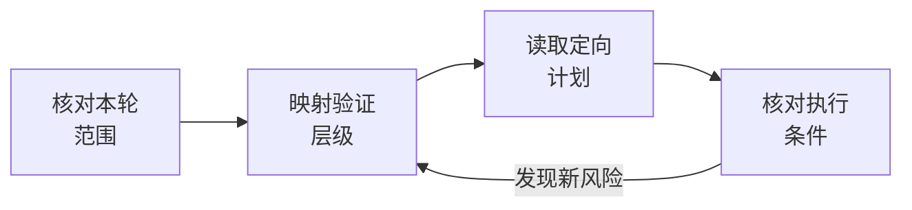
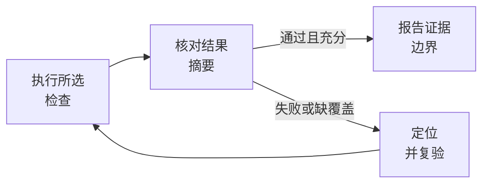

# Plush Test Governance

按改动影响面为 plush-toy-erp 选择最小充分验证，并准确说明证据能证明什么。不要把测试数量、内部验证键或全量命令本身当作目标。

`T0-T8` 只是在开发工作台和报告中使用的稳定追踪键，不是开发阶段，也不要求从低到高逐级执行。面向用户先写“文档与边界、领域逻辑、API 与权限、页面与浏览器、真实数据库、发布与恢复”等业务名称。

## Truth Routing / 真源路由

- 需要判断覆盖层级或证据边界时读 `docs/product/自动化测试策略.md`。
- 需要运行命令、解释当前 CI/push 证据或修改 QA 脚本时，才读 `scripts/qa/README.md`、相关脚本 `--help` 与测试。
- 修改 CI 依赖、分片、缓存或 Runner 并发时，读 [CI 变更与提速](../../../scripts/qa/README.md#ci-变更与提速--ci-change-safety)，据此选择合同检查、真实 CI 证据和停止条件。
- 代码行为：当前代码、schema/migration 和对应测试；历史报告或聊天不能覆盖当前树。

## QA / Hook 图文同步

修改 QA、Git Hook、full / strict 或 CI 的调用、触发条件、顺序、并行、失败与恢复时，按[门禁图文同步](../../../scripts/qa/README.md#quality-gate-guide-sync)核对工作台的对应流程、节点说明、Hook 索引和已有 CI 指引，同轮更新并验证。规则说明以当前执行代码为准；图存在、Hook 已启用与某次检查通过分别取证。

测试增删、改名或分组变化维护正式目录与发现器，不复制文件清单或数量。只调整断言、测试数据且不改变执行流程时，核对影响后不机械重画。说明的语义由修改者复核；不为图示重写 runner、自动推导全部代码或新增一套测试引擎。

收口检查 Mermaid 解析、节点与来源引用、相关行为测试及受影响浏览器路径。新增入口或删除来源须同步清理失效索引；未核验内容明确保留，不把图文校验当成执行证据。

## Node Test Safety / Node 测试运行保护

Node 测试使用项目统一门禁取得完整摘要：按需检查由 `affected` 选择；单文件或具名集合使用 `node scripts/qa/run-test-gate.mjs --kind node --label focused -- node --test --test-reporter=tap <测试路径>`；完整 Web 和分组脚本测试继续使用 `pnpm --dir web test` 与 `run-node-tests.mjs`。macOS 的[原生启动保护](../../../scripts/qa/native/README.md)同时接住裸命令，共享单机预算和跨会话准入；源码与已安装版本不一致时停止依赖测试并协调维护会话，冻结副本同步相同的 C / Bootstrap / 通用保护器。修改原生保护后，先隔离验证，再在已授权范围内安装并读回。资源阈值、外部超时、清理及失败诊断以[测试资源保护](../../../scripts/qa/README.md#node-test-resource-limits)为准。

DOM 测试比较存在性、文本、属性、数量或节点身份的布尔结果，不把 DOM / Window / React Fiber 等运行对象传给相等或深比较断言，也不序列化完整运行对象作为日志。失败路径同样须有界；只让成功路径通过不能证明断言输出安全。故障注入仅在资源受限的隔离子进程夹具中制造这些错误。资源超限、超时或检查失败均保留失败，不通过放宽断言、移除用例或原样重跑绕过保护。

## 工作流

1. 先看 `GIT_OPTIONAL_LOCKS=0 git status --short`，确认本轮路径、其他 writer 和当前 repository identity。
2. 按项目 `AGENTS.md` 的验证授权规则，以用户目标和实际改动为边界选择最小充分验证；当前目标必要的静态、同名测试、受影响模块、浏览器和 PDF 验证直接执行。共享环境配置、真实数据写入、Git 和发布动作仍按各自授权边界处理。
3. 按实际风险选择验证：文档/Skill 做链接与合同检查；schema/migration 做生成、迁移和数据测试；领域/API/RBAC 做正常、边界、异常和权限；页面做 Web 与真实浏览器；发布做目标环境证据。
4. 改动适合现有 affected 路由时，用 `bash scripts/qa/affected.sh --plan` 选计划再按需 `--run`；共享工作区的局部任务可用 `--file <仓库相对路径>`（可重复）按本轮文件和必要依赖选测。`--file` 只限定选测依据，实际命令仍读取所在工作区。需要证明混合工作区中的某组改动可独立交付时，在对应基线加精确候选的隔离副本验证。未匹配 affected 时直接运行相关专项检查。
5. `full.sh`、`strict.sh`、Full Acceptance、全量页面或 PDF 回归只在目标和风险需要时执行。明显超出任务范围或资源预算时，一次说明新增范围、预计开销和停止条件；名称或覆盖数量本身不构成额外门禁。
6. 任务涉及已授权的 commit/push、远端 exact-SHA CI、发布或 GPT 镜像审查时，按 `scripts/qa/README.md` 的当前合同收口；本 skill 不复制 remote、Runner、机器型号或镜像拓扑。失败修复后按受影响范围复验；CI 编排或缓存实验的同 SHA 复验按专项规则判断，不机械重复全量门禁。
7. 对 `affected` 无法选择的生成命令、真实数据库、浏览器、migration 或发布检查显式补充；环境不具备时报告 `blocked` 或 `missing`，不要用另一类测试绿色代替。
8. 记录实际命令、执行数、pass/fail/skip、证据环境和相关未覆盖项。缺 summary、`0 tests executed` 或意外 skip 一律不能写成通过。

## 风险边界

| 触达面 | 最少要守住 |
| --- | --- |
| Workflow / ProcessRuntime | 状态、reason、版本/幂等、owner/assignee/RBAC、终态和 Workflow 不代写 Fact |
| Fact 与 Source Document | 合法/非法状态、重复提交、事务回滚、取消/冲正、余额与事实一致性 |
| Schema / migration / 数据转换 | 按[项目部署与迁移规则](../../../AGENTS.md#部署迁移与收口)完成适用的 `make data`、生成零漂移及 seed / fixture 核对。`make migrate_check` 检查工作区迁移合同，不连库；`make migrate_audit` 只读核对登记开发库的存量规则。涉及存量转换须用现库备份在隔离库验证升级，空库通过不能替代；实际 apply 单独报告 |
| API / RBAC | 未登录、disabled、无权限、角色边界、super admin 和前端隐藏不是安全边界 |
| 页面与样式 | 默认态、交互态、恢复态、相邻区域、长文本/异常数据和真实浏览器 |
| Seed / Import / Config | 模拟与真实数据、dry-run、批次身份、readback、cleanup 和失败关闭 |

本地验证、远端 exact-SHA CI、制品/发布、目标运行、恢复和客户验收是不同证据；一种绿色不能替代另一种。具体 CI/push 编排以当前脚本和 `scripts/qa/README.md` 为准。

## 增长与容量验证 / Growth and Capacity Validation

仅在动作或数据规模、查询、统计、导出、批处理、并发控制等受影响时选择增长验证。页面功能增长由对应浏览器场景覆盖；数据与负载增长复用[核心业务压力测试](../../../scripts/qa/README.md#核心业务压力测试--pressure)和[工作台压力入口](../../../docs/engineering/研发效能工作台设计.md#pressure-workbench)，按假设选择必要规模与档位，不机械跑全部组合。

比较规模时保持源码、负载和环境可比，分别说明数据总量、单次处理范围与并发；核对延迟、吞吐、错误、资源消耗以及业务对账、恢复和清理。容量结论绑定源码、实际数据与负载、环境和阈值；有界模拟、短档通过或有限样本只证明对应范围，不能外推亿级、生产容量或长期稳定性。现有配方无法覆盖目标规模或链路时明确缺口及最小验证方案。

## 输出

结论先行，再列出：

- 选择了哪些可读验证范围，必要时括注内部键；
- 实际命令、测试形态、证据环境和 pass/fail/skip 数量；
- 与本次目标相关的状态或环境覆盖；
- 相关未执行项、原因、剩余盲区和最小下一步。

## 执行流程 / Execution Guide

### 影响面与选测 / select

按当前目标和真实风险选择验证，常规必要验证直接执行，显著扩域再说明与确认。

- `scope` [核对本轮范围](#test-workflow)
  - 前置条件：已有明确目标、改动或待验证问题。
  - 具体操作：只读检查版本、status 和精确差异，区分本轮文件、必要依赖与其他任务；明确需要证明的行为。
  - 完成标准：验证候选和证据环境可识别，不把混合绿色当独立候选证据。
  - 失败处理：归属不清时先核对路径和依赖；需独立证明时使用基线加候选的隔离副本。
- `risk` [映射验证层级](#test-risk-boundaries)
  - 前置条件：已知业务、接口、页面、数据库或交付影响。
  - 具体操作：按实际触达面组合检查：正常、边界、异常、权限、事务、幂等、恢复与真源；页面和存量转换补真实浏览器或隔离升级。
  - 完成标准：每个实质风险有对应验证层级，缺少环境的部分已列出。
  - 失败处理：不能用静态、空库或模拟结果替代运行、存量、发布和客户证据。
- `plan` [读取定向计划](#test-workflow)
  - 前置条件：本轮路径与必要依赖明确。
  - 具体操作：适用时运行 `bash scripts/qa/affected.sh --plan --file <仓库相对路径>`，核对计划后按需运行；未匹配的专项验证显式补充。
  - 完成标准：计划符合目标，所需生成、数据库、浏览器等检查没有遗漏。
  - 失败处理：计划明显超出资源预算时说明新增范围与停止条件；不静默升级 full、strict 或真实外部写入。
- `environment` [核对执行条件](#test-workflow)
  - 前置条件：验证计划与已有授权范围明确。
  - 具体操作：确认环境、数据、账号、工具和资源保护；独立检查与依赖缺失环境的检查分开，记录执行命令与输出位置。
  - 完成标准：可执行检查具备真实前提，未就绪项标明缺口。
  - 失败处理：缺凭据、环境或能力时只暂停相应检查；不伪造通过或用另一环境替代未验证目标。

### 执行与结果判断 / run

通过统一测试入口运行检查，完整读取摘要；失败处理和复验依据新证据。

- `run` [执行所选检查](#test-node-gate)
  - 前置条件：检查条件具备，测试资源保护与当前源码一致。
  - 具体操作：Node 定向测试使用 `node scripts/qa/run-test-gate.mjs --kind node --label focused -- node --test --test-reporter=tap <测试路径>`；其他检查走已有正式入口。
  - 完成标准：命令真实执行并输出完整摘要，资源、超时与清理有界。
  - 失败处理：保护器版本不一致、资源超限或超时即保留失败，停止依赖检查；不裸重跑绕过保护。
- `summary` [核对结果摘要](#test-output)
  - 前置条件：检查进程已完成或明确失败。
  - 具体操作：读取执行数、pass/fail/skip、退出码与证据环境，核对日志完整性、实际版本和目标覆盖。
  - 完成标准：非零执行且无意外跳过；成功、失败、未验证清楚分开。
  - 失败处理：缺 summary、零测试或意外 skip 不算通过，先查选择范围、运行器与环境。
- `repair` [定位并复验](#test-workflow)
  - 前置条件：存在失败、缺覆盖、新改动或未解决风险。
  - 具体操作：区分代码、测试、环境和数据问题，修根因后按受影响范围复验；DOM 断言只输出有界的文本、属性或布尔值。
  - 完成标准：复验解决对应失败，未通过项仍保留，未扩成无关全量重跑。
  - 失败处理：不放宽断言、删用例、序列化巨大 DOM 对象或原样重跑隐藏失败。
- `report` [报告证据边界](#test-output)
  - 前置条件：相关结果与覆盖范围已核清。
  - 具体操作：报告实际命令、验证形态、执行数量、环境与未执行原因；区分本地、远端 CI、制品、目标运行、恢复和客户验收。
  - 完成标准：结论只覆盖实际验证，盲区与最小下一步明确。
  - 失败处理：证据仍不足时报告 blocked 或 missing，不把其他层的绿色合并成完成。

### 增长与容量验证 / growth

仅在功能、数据规模、查询、导出、并发或资源路径受影响时执行本专题。

- `assumption` [确定容量假设](#growth-capacity-validation)
  - 前置条件：触达增长敏感路径，或用户要求验证容量。
  - 具体操作：列出数据总量、单次处理范围、批次、并发、热点、目标延迟和部署资源，明确已知依据与未知量。
  - 完成标准：负载与通过标准可解释，未实测规模没有被承诺支持。
  - 失败处理：缺少真实规模依据时记录假设与最小验证方案，不直接引入缓存、队列或分库。
- `recipe` [选择受控配方](#growth-capacity-validation)
  - 前置条件：已明确要验证的风险与资源预算。
  - 具体操作：复用现有压力测试和浏览器增长场景，选择必要档位、数据与负载，固定源码、环境、隔离和清理方案。
  - 完成标准：配方能覆盖目标链路，正常、失败恢复与业务对账都有检查点。
  - 失败处理：现有配方不能证明目标时说明缺口；超预算或触及共享写入先按授权边界处理。
- `measure` [执行并核对](#growth-capacity-validation)
  - 前置条件：配方、环境、数据与停止条件就绪。
  - 具体操作：读取实际延迟、吞吐、错误、资源占用及数量/事实对账，同时验证取消、恢复与清理，保存同版本报告。
  - 完成标准：性能与正确性都有真实样本，负载与环境可比较。
  - 失败处理：资源、错误率或对账失败触发停止，保留现场证据；不只挑成功样本报容量。
- `result` [限定容量结论](#growth-capacity-validation)
  - 前置条件：完整报告和清理结果可回查。
  - 具体操作：说明源码、数据、负载、环境、阈值与边界，记录未覆盖规模和需要升级的条件。
  - 完成标准：结论只适用于本次实际验证，短档不外推生产或长期稳定性。
  - 失败处理：样本不足、环境不可比或清理未完成时保留缺口，不给无依据容量数字。
