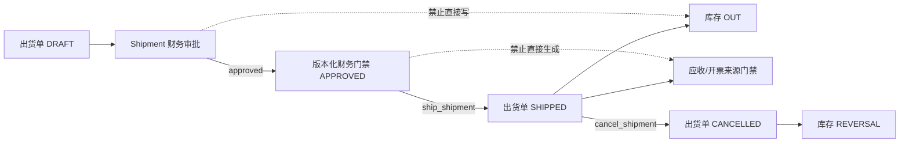

# 状态、Workflow 与 Fact 边界 / Status, Workflow And Fact Boundary

本文定义状态分层与 Workflow / Fact 的目标合同。系统按新系统设计收口：运行时只接受正式目标集合，不保留旧 AI 方案的读取、映射、退出或别名路径。

## 结论

```text
流程管协同，源单管承诺，事实单管发生，余额和完成度由事实计算。
```

- `workflow task done` 只表示协同动作完成，不等于库存、质检、出货或财务已经过账。
- 当前 Shipment 流程的财务 approval 只触发版本化放行门禁；门禁 `APPROVED` 不等于真实出货。
- 真实出货由 `OperationalFactUsecase.ShipShipment` 把出货单推进到 `SHIPPED`，并在同一事实链写库存 `OUT`；取消已出货单写 `REVERSAL`。
- `RECEIVABLE / INVOICE` 必须引用真实 `SHIPMENT`，且来源出货单已经 `SHIPPED`。
- `PAYABLE` 必须引用已过账采购入库或已过账委外回货；委外回货还必须存在唯一有效且已通过、结果为合格或让步接收的正式质检。单笔对账必须引用已过账应收、应付或发票事实。
- 生产领料引用发布时冻结的 BOM 物料需求行，生产完工报告引用生产订单行并先形成 `DRAFT`，仓库确认 `POSTED` 后才成为成品入库；返工引用已过账完工事实。来源存疑时 fail closed，不由前端补造。
- 客户配置、责任池和流程变体可以收窄入口或改变协同分工，不能改写事实语义。

## 状态分层

| 层 | 负责什么 | 唯一真源 | 不能替代 |
| --- | --- | --- | --- |
| MasterData 生命周期 | 主数据启用、停用、归档和对象专属版本状态 | 对应 master data usecase、schema 与状态 registry | Source Document 审批、Workflow 任务或 Fact |
| Source Document 生命周期 | 销售订单、采购订单、加工合同等业务承诺的草稿、提交、生效、关闭、取消 | `server/internal/core/status/`、对应 usecase 与 Schema CHECK | 库存、质检、出货、财务事实 |
| Workflow task | 某个责任人或责任池的任务处理状态 | `workflow_tasks`、`workflow_metadata.go`、`WorkflowUsecase` | 业务对象生命周期和事实过账 |
| Process Runtime | 流程实例、节点、分支、等待事件和白名单领域命令 | `process_instances`、`process_node_instances`、`ProcessRuntimeUsecase` | 任意脚本执行器或通用单据状态机 |
| Business workflow projection | 跨岗位协同进度的只读投影 | `workflow_business_states` 与受控生产者 | 事实表、余额表、应收应付台账 |
| Fact / Ledger | 实际入库、退货、调整、质检、库存、出货和业务财务记录 | 各领域事实表与 usecase | Workflow payload 或页面本地状态 |
| Derived result | 可用量、履约进度、对账结果等计算结果 | 事实查询或受守卫的查询加速表 | 新的重复事实真源 |

`workflow_business_states` 中的 `shipped / reconciling / settled` 是协同投影 key。真实出货、对账或结算必须回到对应事实表，不能只读该投影。

Business Projection 是跨来源共用的阶段词汇表，不是所有 `source_type` 必须经历的统一状态机。只有受控任务动作、Process Runtime 或领域 usecase 可以生产投影；前端选项、任务快照、seed 和 fixture 不能生产正式业务状态。

当前状态不是状态历史。状态历史只有在后端持久化了对象、前后状态、动作、操作者、版本、原因和顺序时才能查询；不得从现值、`updated_at`、页面标签或 Workflow payload 倒推。系统不建立万能 `business_status`；运行链与缺失证据规则见 [业务链与运行轨迹边界](业务链与运行轨迹边界.md)。

## Workflow 目标合同

### 任务状态

任务状态唯一登记在 `server/internal/biz/workflow_metadata.go`，完整集合为：

```text
ready / blocked / done / rejected / withdrawn
```

公共创建固定得到 `ready`。允许的状态迁移只有：

| 起点 | 终点 | 业务动作 |
| --- | --- | --- |
| `ready` | `blocked` | 提交非空阻塞原因 |
| `ready` | `done` | 完成当前协同任务 |
| `ready` | `rejected` | 提交非空退回原因 |
| `blocked` | `ready` | 提交非空解除说明并恢复 |

`withdrawn` 不在公共迁移表中。它只由 ProcessRuntime 在来源取消、流程终止或上游补偿恢复时，把仍处于 `ready / blocked` 的关联任务原子撤回；同时写撤回原因、操作者、版本和任务事件。集合外 key、同状态写入、`blocked → done / rejected`、用户手工写 `withdrawn` 以及任何终态出边都必须明确拒绝。请求重试走 receipt replay，不能靠状态自环伪装幂等。

`done / rejected / withdrawn` 都是终态。`rejected` 表示人工退回，`withdrawn` 表示系统撤回，两者不得混算或共用文案。终态任务不会被新 intent 再次处理或催办；需要返工或重新协同时创建新任务或新节点 attempt，不修改原终态。

`blocked` 不是终态。正式 `resume` 固定执行 `blocked → ready`，清理任务及 payload 的旧阻塞原因；任务的 `business_status_key` 与 `workflow_business_states` 投影继续保持 `blocked`。当前没有“阻塞前业务阶段”的可审计真源，因此恢复动作不得携带新业务状态或业务副作用，后续阶段只能由来源 usecase 的受控动作显式推进。

任务看板是运营投影，不是第二套生命周期。查询只接受：

```text
all / ready / blocked / rejected / withdrawn / done / overdue / dueSoon
```

`overdue / dueSoon` 由截止时间派生，不是 canonical 状态。看板不提供“待处理”等聚合状态别名；响应中的 `task_status_key` 必须始终是任务真实 key。

普通任务以 `workflow_tasks.version` 做乐观并发控制，以 `workflow_task_events` receipt 做网络重放真源。正式动作提交 `expected_version + idempotency_key`；repo 以 ID、旧状态和 version 做条件更新，赢家在同一事务写状态、version、事件 receipt 与受控业务投影。相同 intent 精确重放首次结果，不同 intent 明确冲突。

客户端把一次业务意图冻结为同一 attempt。超时、网络中断、5xx 或结构不合法的成功响应都保留同一个 `idempotency_key`；同一 task 的动作还需使用 task 级 in-flight lease，避免完成、阻塞、退回、恢复和催办并发双发。

### 流程运行时

| 对象 | 状态集合 | 初始状态 |
| --- | --- | --- |
| Process Instance | `active / completed / blocked` | `active` |
| Process Node | `waiting / active / completed / blocked / withdrawn` | `waiting` |

#### 节点职责

| 节点 | 执行边界 |
| --- | --- |
| `human_task / approval` | 按责任池、能力 key 和客户 active revision 解析责任人 |
| `domain_command` | 只执行白名单 handler，由领域 usecase 写事实；同 intent 重放持久结果，不同 intent 冲突 |
| `wait_event` | 只响应流程定义登记的事件 |
| `end` | 结束正式分支；completed 只表示到达 end，不统一代表审批通过 |

客户 manifest 不能注入 SQL、任意函数或前端回调。分支、fan-out、join、return-to 与结束都由后端推进；重试核对 version、fingerprint、已完成节点和已创建下游。

销售 / 采购拒绝进入命名拒绝 end，不激活 / 批准来源；Shipment 财务拒绝先由领域命令写 `REJECTED` 门禁再结束。调用方必须读分支 outcome 及 Source / Fact 权威状态。

#### 事务、阻塞与恢复

1. 领域事务原子保存业务结果和 durable result，再结算节点、激活下游；结算可重放，已补偿结果失败关闭，不重复领域副作用。
2. 阻塞记录类型、原因码、文本、时间和操作者。恢复只继续原 attempt，记录解除原因并清当前阻塞字段。
3. 来源取消或终止恢复时，把未结算的 `waiting / active / blocked` 节点写为 withdrawn，不伪装成完成或拒绝。

有界对账只处理以下可重放缺口，按主键游标与批量上限扫描：

| 缺口 | 核对依据 |
| --- | --- |
| 终态任务对应仍 active、或已完成但未写路由回执的人工 / 审批节点 | Workflow 终态与节点持久状态 |
| active 人工 / 审批节点缺 linked task | 已冻结节点与任务关联 |
| active 领域命令已有 durable result | 已持久领域结果，不能重做副作用 |
| 已完成领域命令 / end 缺路由回执 | `routing_completed_at / routing_completed_by` |

该对账不另建通用 outbox，也不补造 Fact。

#### 当前与下一责任岗位

回执只投影 active 人工 / 审批节点实际 linked task 的 `owner_role_key`，不返回或冻结 assignee。缺 linked task 时显示“责任正在确认”，不能从责任池、节点名或前端角色表猜测。active 领域命令显示系统处理，到达正式 end 才显示流程结束。

### 公共 API 边界

所有正式动作都检查 RBAC、owner role、assignee、责任池、模块状态、`expected_version` 与 `idempotency_key`。服务端推导 `actor_role_key`、`business_status_key` 和系统动作字段，客户端不能通过 payload 覆盖。

#### 已有任务动作

| API | 前置状态 | 结果与附加条件 |
| --- | --- | --- |
| `complete_task_action` | ready | 完成协同任务 |
| `block_task_action` | ready | 记录非空阻塞原因，进入 blocked |
| `reject_task_action` | ready | 记录非空退回原因，进入 rejected |
| `resume_task_action` | blocked | 非空解除说明，回到 ready；业务投影恢复边界见[任务状态](#任务状态) |
| `urge_task` | ready / blocked | 留催办事件，不改变状态 |
| `get_task_assignment_options / reassign_task` | ready / blocked | 受控转交；要求 `workflow.task.assign`、原因、version 与幂等键 |

没有公开 start、cancel、close 或 `upsert_business_state`。投影只能读，不能由客户端直接写业务阶段。

转交目标须为同 owner role 下启用、具有读取 / 更新 / 完成或审批能力的账号，或 `assignee_id=null` 回原岗位池。只改 `assignee_id / updated_by / version`，同事务留事件、receipt 和审计；不改 owner / pool、payload、流程锚点或 Fact。

super admin 可受控转交，但全权限不产生接收岗位身份；supervise 只读监督。受审计 break-glass 只能绕过 owner / assignee 人员范围，不能绕过状态、版本、幂等、事务、流程结算或 Fact。

#### 创建独立任务与单据跟进

| 入口 | 可创建的内容 |
| --- | --- |
| `create_task` | 独立协同任务，固定 ready；流程锚点仅由 ProcessRuntime 内部创建 |
| `get_task_create_options / create_followup_task` | 销售订单、采购订单、加工合同、生产订单和草稿出货的手工跟进；复用 `workflow.task.create/read/update/complete` |

手工跟进按以下顺序约束：

1. 后端校验来源读取权、启用模块，查询可用岗位、在职办理人及允许来源状态。
2. 创建事务重新核对来源与接收资格；单号从来源读取，不接受客户端快照、任务身份、领域状态或流程锚点。
3. 服务端生成 `business_followup` 组与 `FOLLOWUP-` 身份，普通 create_task 不得占用。必须提供幂等键；同意图返回原创建回执，改变意图拒绝复用。
4. 来源之后结束或接收人停用，也允许有权发起人核对原请求回执。

发起人保留这组任务的查看与催办，不扩大本人待办或完成权。接收人按 owner / assignee 及动作权限办理，完成须填写处理结果；要求与反馈存 payload，不派生领域任务或业务事实。

#### 查询与数量

| 查询 | 合同 |
| --- | --- |
| `get_workbench` | 同一只读快照返回待处理、风险、审批计数，仅返回当前队列有界分页；切队列或翻页再读取 |
| `get_task_board` | 先按当前管理员可见性和精确条件统计全量，再返回互斥泳道的有界分页 |
| `get_task_process_context` | `current_responsibilities` 仅含 `node_instance_id + owner_role_key`，逐项锚定 current_nodes 的人工 / 审批节点，不暴露个人或把责任池当岗位事实 |

前端不按岗位 / 视图扇出请求，不循环拉全量自行计数。


## Source Document 与 Fact

销售订单、采购订单、生产订单和加工合同表达业务承诺。只有 `draft` 可编辑；提交、批准、发布或确认后的更正必须走对应生命周期动作，不能继续覆盖表头或明细快照。

### 来源关闭与拒绝

销售订单、采购订单和加工合同的取消、正常关闭与提前关闭使用各自独立权限和同一强动作信封：`expected_version + idempotency_key + reason`。正常关闭要求全部行已由权威事实结清；提前关闭必须保留未履约数量。

事务同时写来源状态、每行终态、结算动作 / 模式 / 原因 / 操作者，以及 `source-order-lifecycle-result/v1` 行级结果回执；取消还会先校验并补偿冲突效果，再把关联流程以 `cancelled` resolution 收口。页面不能用普通编辑保存模拟这些动作。

销售 / 采购审批拒绝先把 Workflow task 结算为 `rejected`，再由命名领域命令把来源单据和未结行写成拒绝终态证据，最后进入命名 rejected end。Workflow task 本身仍不能直接修改来源；来源改变来自这条已登记领域命令。

### 事实写入

事实写入遵守以下共同边界：

1. 后端 usecase 校验状态、引用、数量、权限和幂等键。
2. repo 在数据库事务内写事实头、事实行、流水和查询加速表。
3. 已过账记录不物理删除、不改回草稿；纠错走取消、冲正或调整。
4. 页面、打印和 Workflow payload 只展示正式数据或冻结快照，不补造事实字段。

### 出货主链



财务 approval 和 `shipment.finance_release` 只推进 Shipment 门禁并结束 `finished_goods_delivery`；正式 `ship_shipment` 才由 `OperationalFactUsecase` 承接真实出货、库存和后续来源门禁。

历史 `shipment_release / shipping_released` 只保留既有协同读取，不能继续作为新单的真实出货前置。只有装箱、物流、签收、退货或出货规则复杂到需要独立聚合边界时，才评审拆分；不能为了目录整齐增加转发 usecase。

### 采购、质检与库存

- 采购入库、退货和入库调整使用各自正式 Fact 生命周期；取消已过账记录通过 `REVERSAL` 恢复库存。
- 质检单与库存批次状态是事实，Workflow 的 IQC / 成品检验任务只负责交接；领域命令必须调用质检 usecase。批次 HOLD、复检放行、让步接收、质量拒绝、取消恢复、纠正待检和零余额关闭均在同一事务写命名动作、前后状态、原因、版本、质检引用和操作者事件，不能只靠批次现值倒推历史。
- `inventory_txns` 是追加式库存事实，`inventory_balances` 是查询加速结果；防负库存、批次和幂等在库存事务内守住。
- 仓库入库任务完成不自动等于采购入库单 `POSTED`，成品入库任务完成也不自动补造库存。正式成品入库由仓库核对 `FINISHED_GOODS_RECEIPT / DRAFT` 后显式确认 `POSTED`，并在同一事实链写库存 `IN`。

### 来源驱动的生产、委外、预留与财务

- 生产订单发布时在同一领域事务冻结 BOM 物料需求；已发布历史单只对 BOM 头、版本、明细、物料和单位都可唯一确定的行回填，其余标记 `NEEDS_REVIEW` 并拒绝领料。累计已过账领料与完工不得超过冻结需求或订单数量。
- 生产完工报告和委外回货必须在源单上选择既有批次或输入新批次，两者互斥；生产领料和委外发料只允许选择既有可用批次。新批次创建、草稿事实和幂等 receipt 在同一事务内落库；完工报告草稿不变更库存，仓库确认入库后才写库存 `IN`。
- 委外回货质检、采购不合格退货、采购入库调整和财务来源生成都是独立领域命令。它们在事务内锁定源单 / 事实并派生技术字段，不允许页面自报 `source_type / source_id / source_line_id`、往来方、库存对象或幂等键。委外应付在事务内复核唯一有效质检，只有 `PASSED + PASS / CONCESSION` 可继续；缺质检、进行中、不合格或多条有效质检均失败关闭。
- 一条有效来源只允许一条对应类型的有效财务事实；取消后是否可以重建由当前领域合同和来源唯一性共同决定，不能仅靠更换幂等键制造重复事实。

## 数据、迁移与发布边界

- 中央 registry / transition 已与跨层调用方、Ent generated、versioned migration 收口到本地 Product Core；当前 Workflow / Fact 和上述来源生成合同也已落入代码、Ent schema 与测试。可执行层仍必须根据冻结 revision 的 migration status、PostgreSQL 事务门禁和浏览器证据复核，不能由文档单独推出。
- 运行时只接受目标状态集合；集合外 key 读写均失败，不建立别名、动态映射、双读或永久 fallback。
- 上线前必须先审计现存数据。非生产数据重置或重新 seed；必须保留的正式业务记录走单独评审的一次性转换，要求明确映射、人工确认、审计记录、回滚点和失败条件。
- 一次性转换只服务迁移窗口，完成后不留在 usecase、repo、API、UI 或查询筛选中。
- 正式 Atlas migration 链由 `20260714055504` 建立目标任务状态约束，`20260811122746_migrate.sql` 再将 Workflow CHECK 扩为五个目标状态；ProcessRuntime、来源单据强动作和批次证据由同轮更早的 versioned migrations 承载。

  migration 文件和本地 fresh / upgrade 不能证明任一目标数据库已迁移，必须以具体数据库 status、apply 与读回为准。
- 本地代码和测试不能证明目标环境已经加载对应制品、执行 migration 或完成业务验收；在发布证据形成前，结论是 **未发布**。

## 状态真源入口

查询某个对象的 canonical key、合法流转、数据库约束、显示映射和代表性测试，统一进入 [`状态字典与生命周期索引.md`](状态字典与生命周期索引.md)。

UI 文案不是状态判断真源；客户可以调整低风险显示标签，但不能改变 canonical key、允许流转、权限或事实含义。

## 客户配置与角色边界

- 客户 module state、角色 capability、责任池、页面/动作投影和批准的流程变体只决定“谁能看到、谁来处理、走哪条已批准协同路线”。
- 客户配置只能与后端 RBAC 取交集，不能给账号增加未授予的权限。
- 当前质量岗位为读取委外回货产品补充 `product.read`，但未开放产品菜单；这只是现有质量检验页的最小读取投影，不扩大产品维护权限。
- `read_only` 模块可保留读取页面和只读字段投影，但不能产生写动作、责任池任务或领域命令。
- 任何客户都不能配置允许负库存、跳过质检、把放行当出货、无来源生成应收/开票或绕过审计。

## 新增状态或流程的门禁

新增状态、节点或自动流转时必须同时回答：

1. 它属于 Source Document、Workflow、Process、Fact 还是派生结果？
2. canonical key 的唯一代码或 Schema 真源在哪里？
3. 谁能触发，后端校验哪些 RBAC、owner / assignee 和模块状态？
4. 是否写事实；若写，调用哪个白名单领域 usecase，事务和幂等键是什么？
5. 阻塞、退回、取消、冲正、重复提交和并发竞争如何处理？
6. 页面只展示什么，不能在前端补造什么？
7. 哪些 unit / repo / service / PostgreSQL concurrency / browser tests 锁住边界？

## 最小验证

- Workflow：状态集合精确等于五个 key；创建默认值、四条公开转换、内部撤回、集合外 key、同状态、终态、原因清理、resume 投影、权限、owner / assignee、幂等和并发竞争。
- Process Runtime：instance / node 的精确集合、初始状态、完成 / 阻塞 / 恢复 / 撤回路径、路由回执、节点 outcome、来源取消和领域副作用重放。
- Source Document：仅草稿可改、提交与保存竞争、取消 / 正常关闭 / 提前关闭、行级剩余量回执、快照由服务端生成、失败整体回滚。
- Fact：正常路径、非法状态、重复提交、取消 / 冲正、事务失败、并发、防负数和来源追溯。
- Customer config：模块状态、RBAC 交集、责任池、流程 manifest、active revision 和 customer key 隔离。
- UI：默认态、可处理态、只读 / 无权限态、失败恢复、中文业务文案和真实页面证据。
