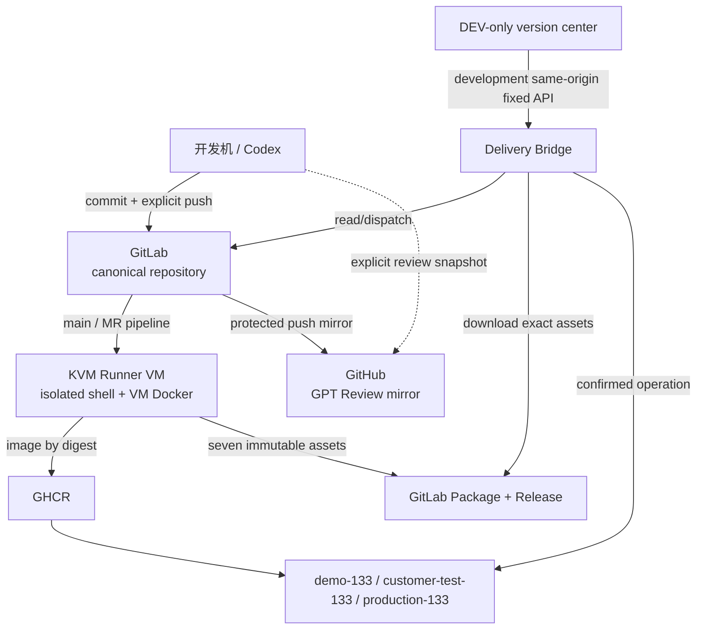

# 持续交付设计 / CI/CD Design

本文说明如何验证固定提交、生成不可变制品并交付到登记目标。工作台页面和操作合同见[研发效能工作台设计](研发效能工作台设计.md)。

## 结论

本项目采用一条主链：

**GitLab 代码真源与 CI/CD + 独立 KVM Runner VM + GitHub 单向 GPT Review 镜像 + GHCR digest 镜像 + GitLab Release 可移植制品 + 开发态同源 Bridge + 固定目标 operation。**

GitLab 独立承担 main CI。GitLab 负责 protected main、merge request、七分片 exact-SHA aggregate、`CI Gate`、Generic Package 与 Release；GitHub main 只接收 protected-main push mirror，供 GPT 审查和外部只读浏览。工作台读取 GitLab 证据，不复制一套 CI 状态机。原生 CI 任务明细、日志和历史直接跳转 GitLab，工作台保留 exact-SHA 资格、近期摘要、项目耗时与运行检查。

GitLab、KVM Runner、公网入口、protected main 和 mirror 已是实际主链，但仓库定义和历史绿灯都不能代替当前读回。每次结论仍分别绑定当前 pipeline/job、CI evidence Package、Release Package、Runner 配置、backup/restore、目标 operation 与 UAT。

## 拓扑与职责

| 层 | 唯一职责 | 明确禁区 |
| --- | --- | --- |
| GitLab repository | main、MR、保护规则、pipeline 与 Release 目录 | 不替代业务字段、schema、migration 或 UAT 真源 |
| Runner VM | 候选验证、一次性数据库、镜像构建与发布 | 不挂宿主 Docker socket，不保存长期业务数据 |
| GitHub mirror | GPT Review、外部只读浏览 | 单向接收 GitLab main |
| GHCR | 保存按 digest 固定的 Server/Web 镜像 | tag 不能替代 manifest digest |
| Delivery Bridge | 固定 Provider、固定动作、operation 与目标执行器 | 浏览器不能传 repo、host、path、shell、SQL、Docker 或 secret |
| 研发效能工作台 | 展示证据、选择固定版本、显式确认 | 不成为 CI、部署、数据库或凭据真源 |
| demo / test / erp 目标 | load/pull 制品、migration、运行与 readback | 不从源码构建，不共用持久数据，不把 smoke 冒充客户验收 |

## GitLab 宿主存储与进程隔离

GitLab 的 PostgreSQL、repositories、artifacts、config 与日志放 SSD `/srv/gitlab`。RAID5 `/srv/raid5/gitlab/backups` 只放应用备份、config archive 和 checksum；RAID 能容忍部分磁盘故障，但不能替代异机/离线备份。

Runner 使用独立 KVM VM 和独立 qcow2，不直接跑在 GitLab 容器或现有业务容器旁。VM 内可以使用自己的 Docker daemon 构建镜像和启动一次性 PostgreSQL；GitLab 宿主 `/var/run/docker.sock` 永不传入 job。Runner cache 可重建，不作为 release、测试结果或业务数据真源。

GitLab HTTP 只绑定 GitLab 宿主 `127.0.0.1:8929`，由 FRP 到阿里云 `18226`，再由 Nginx 为 `gitlab.saurick.me` 终止 TLS。Git over SSH 默认只开放 LAN `192.168.0.133:2224`。详细安装、备份和公网切换见 `server/deploy/gitlab/README.md`。

## CI 主链

### main 与 merge request

`.gitlab-ci.yml` 是唯一 canonical 编排：

1. `plan` 根据 MR base、push before SHA 或手工范围建立 diff；main 的历史密钥扫描从已审计检查点覆盖到本次 SHA，MR 使用可信 diff base。完成扫描和 diff/log 检查后生成 `ci-plan` / range / trust，信任回执绑定实际扫描范围与规则对象。
2. MR 保留 plan-driven affected/full 单 job。

   main 完整 CI 先由唯一 `prepare` cache writer 预热 locked pnpm/Playwright/Go 依赖，再由 Runner 已登记容量调度 static、Node contracts、Web、Server/PostgreSQL、resource-sensitive、browser 和 security 七个固定外部分片。

   Server 内部把 schema 零漂移、存量升级、普通测试/构建和关键 PostgreSQL 合同拆为四条独立 lane；只有升级与关键合同持有受管 PostgreSQL，只有普通测试/构建消费 Chromium。browser 等待同 SHA Web build，以及升级和关键 PostgreSQL Job 清理完成；其余依赖以当前 CI 编排为准。
3. `quality_aggregate` 要求七个回执、阶段并集、分类执行数、source archive、依赖审计、`make data`、Web build digest、PostgreSQL/Chromium/browser 清理全部同 SHA 且通过，再签发标准 v3 strict terminal。
4. `CI Gate` 按入口依赖文档检查、main aggregate 或 MR quality，并核对对应的成功证据。main 完整 CI 才会把 terminal、receipt 和 manifest 固化到 exact pipeline/job/SHA 的 `plush-ci-evidence` Package，作为 protected main 的稳定 required job 和后续 release 唯一可复用证据。

普通 Markdown main push 使用 `plan → quality_docs → CI Gate` 三个 Job；任意非 Markdown、混合改动、首次推送与生成数据字典走完整 CI。文档绿色只证明文档检查，不产生 strict Package，也不授予发布资格。

需要发布该 SHA 时，在 GitLab 新建受保护 main 流水线并设 `QA_MODE=full`，保留真实 `web` provenance；完整 Job 集合由工作台与发布复用共享，具体范围和入口见 [QA 合同](../../scripts/qa/README.md#门禁完整性与-ci-边界)。

默认 `origin/main` 的实际推送地址核对为项目 GitLab 后，本地 `prepare-push` 以该地址的 ref 为基线，执行并签名 clean HEAD/tree、remote/ref/range、git-log、严格 secrets、源码完整性及 affected 选择的短 Node 检查；完整验证交给 Runner。

短检查范围、并发、截止时间和回执合同见 [QA 入口](../../scripts/qa/README.md#门禁完整性与-ci-边界)。该回执只允许普通非强制 push，不表示 CI 已成功；Release、Package 显式版本提升（Explicit Promotion）和任何受保护部署必须读回同一 40 位 SHA 的不可变终态成功 `CI Gate`。

生产目标只加载 CI 构建的不可变制品或镜像并执行正式 migration、health/ready 与 smoke，禁止现场重建。

缓存只缩短依赖和浏览器准备时间，不能跳过 checksum、locked/offline install、门禁、source archive 或 clean-tree 读回。分片只 pull cache，不并发回写同一 key。pipeline artifacts 是本次运行内证据；只有 `CI Gate` 上传且经 release 服务器端重新校验的 exact Package 才能跨 pipeline 复用，仍不等于不可变 Release。

性能核对分别记录 GitLab 宿主与 Runner guest：冷 / 热缓存、Job 时长、关键路径、CPU / 内存 / IO 峰值、中位数、波动和近似 P95。

| 指标 | 判断与动作 |
| --- | --- |
| 执行 Job ≤ 90 秒 | 目标线；仍按样本核对覆盖与稳定性 |
| 执行 Job 90–120 秒 | 进入优化复核 |
| 执行 Job > 120 秒 | 拆分候选，结合近 20 次有效样本的中位数、近似 P95、覆盖和重复成本，不凭单次慢拆分 |
| plan / prepare、领域 fan-in、aggregate、CI Gate | 不套执行 Job 拆分线 |
| 排队 > 30 秒 | 先查 Runner 容量和资源争用，不用拆 Job 掩盖等待 |
| 阶段耗时目标 | 普通 CI 7–9 分钟，热缓存提交到部署 10–15 分钟；有实测余量时继续优化至 6–8 与 8–12 分钟，稳定更快也接受 |

调整 Runner 并发、DAG shard 或语言测试并行度前，须确认没有排队、IO 争用、OOM、flaky 或波动扩大。资源饱和或维护复杂度收益失衡才停止优化；覆盖、失败关闭、exact-SHA、数据库 / 浏览器 / 端口隔离及清理不能降级。

### exact-SHA release

release 只能从受保护 main 的 web/API/trigger pipeline 发起，且满足：

- `RELEASE_SHA == CI_COMMIT_SHA`；
- customer 固定 `yoyoosun`；
- 版本号由 Bridge 服务端以 `Asia/Shanghai` 日历日和当前 Release catalog 唯一推导为 `YYYY.MM.DD-N`，浏览器只读且不得手工改写；
- 可回读同 SHA 的 protected-main 完整 push / web pipeline、全部分片、`quality_aggregate`、`CI Gate` 与 exact evidence Package；
- protected environment `release` 与 masked/protected secrets 可用。

`publish_release` 从 `plush-ci-evidence` 恢复完整 push / web CI 的 v3 terminal，其 provenance job 固定为 `quality_aggregate`，不重跑 strict。

`plush-release-candidate/artifact-<sha>/candidate.tar` 不存在时才构建一次 Server/Web bundle；后续重试只恢复同一 archive。

同一候选包完成 migration、health/ready、smoke、备份恢复、重启恢复和零残留演练，回执在 `plush-release-rehearsal/artifact-<sha>` 冻结。

只有这三层 exact 身份通过后，registry publisher 才把候选包内的同一镜像推到 `ghcr.io/saurick/plush-toy-erp-{server,web}` 取得 digest，并生成绑定演练摘要的发布清单和固定七项制品：

创建 pipeline 时 Bridge 同时传入带时区的版本参考时刻；GitLab 在首次候选构建前重新读取 catalog，只接受与 pipeline 创建时刻相差不超过 10 分钟的同一下一版本。已冻结候选的显式重试保持原版本，不再发号；无候选且 catalog 已前进时必须新建发布，不得占用旧序号。

1. `checksums.sha256`
2. `release-artifact.json`
3. `release-manifest.json`
4. `sbom.cdx.json`
5. `server-image.tar`
6. `web-image.tar`
7. `release-rehearsal.json`

Generic Package version 与 Release tag 固定为 `artifact-<40sha>`。重试时先逐项校验现有制品的名称、大小和 SHA-256，只续传完全一致子集所缺的资产，并在创建或复用 Release 前读回完整七资产；未知文件、重复文件、同名异内容、同版本异 SHA、同 SHA 异版本或演练不完整均失败关闭。

Release、Package、GHCR digest、manifest、`release-rehearsal.json` 和目标显式版本提升（Explicit Promotion）必须指向同一 SHA、同一 artifact/rehearsal digest。

历史发布档案留供审计。当前发布、部署、重建与回滚统一消费 GitLab 制品。

## GitLab 交付边界

`scripts/deploy/gitlab-delivery-provider.mjs` 固定 GitLab base URL、项目、Generic Package、release tag、pipeline API 和本地下载根。它从服务端环境读取 `PLUSH_GITLAB_TOKEN`，限制 JSON 大小、asset 名、文件大小、URL、SHA、版本和符号链接路径，返回值不含 token。

质量门禁与版本中心读取 GitLab pipeline / job、不可变版本目录、发布状态和控制制品时使用独立的 `PLUSH_GITLAB_READ_TOKEN`，不复用发布与部署写凭据。macOS 本地启动从固定钥匙串项加载；Linux 从当前服务用户的受控凭据文件加载，来源与权限合同见 [前端启动脚本](../../web/scripts/README.md)。

服务端只把令牌映射给不暴露发布方法的只读 GitLab Provider，浏览器、本机质量门禁和部署子进程均不得继承。创建新发布使用专用 `PLUSH_GITLAB_TOKEN`。缺少发布凭据时停用该按钮并在发布区说明，读取功能按自身状态展示。读取凭据缺失、API 失败或目录未通过核对时，页面明确显示读取未就绪；版本与流水线分别按实际取得的证据展示。

发布凭据复用、有效期和换发按[发布令牌复用与轮换](../../scripts/deploy/README.md#release-credential-lifecycle)执行。

GitLab Jobs API 是 Job 运行事实真源。质量门禁只为当前提交读取完整 Pipeline / Job，核对全部必要分片、聚合、零跳过与 CI Gate，同名重试取最新 attempt。最近 20 条 main 流水线仅从列表接口读取编号、SHA、原生结果和链接，不抓取历史 Job；历史“成功”不等于已证明完整门禁。原生测试报告复用同次选中的 Pipeline / Job，并发页面请求共用一次读取；历史列表或报告失败单独提示，不覆盖已取得的当前 CI 证据。详细性能、排队、依赖和趋势跳转 GitLab，不另存 CI 历史库。

目标部署与回滚通过原有执行器登记 GitLab Environments / Deployments，三环境名称和 tier 从 target registry 派生。项目 operation / receipt 是执行事实，GitLab 原生状态是自动投影；本地仅新增可恢复的远端引用缓存，不建第二套 CI 库。工作台“操作记录”提供同环境汇总、原始时间、项目检查、GitLab 跳转和仅登记的补录入口；已有迁移、回滚、数据库重建、准备与显式执行保持原合同。历史补录、状态映射、未知创建结果、归档与凭据详见 [部署登记协议](../../scripts/deploy/README.md#gitlab-部署登记与回执归档)。 三个现役目标的历史合并本机操作与已校验 GitLab 终态归档，按 UUID 去重；归档只供查阅，不复制为本机可执行状态。跨执行端的回执同样绑定原始 SHA、迁移与备份恢复，读取失败或冲突保留缺口。

GitLab 的耗时按 pipeline 和 job 展示。缺少步骤耗时时，steps 返回空数组。

## GitHub 单向镜像与 GPT Review

GitLab 项目使用 push mirror 将 protected main 同步到 `github.com/saurick/plush-toy-erp`。GitHub main 禁止人工直接更新；镜像凭据使用专用最小权限 deploy key/token。仓库不维护 GitHub 审查分支或审查 CI。

需要 GPT 审查时，先让 GitLab `main` 的 exact SHA 通过正式 `CI Gate` 并镜像，再按该次推送前后的 base/head SHA 审查 GitHub `main` 提交差异。

GPT Review 的 finding 是审查输入，不是仓库事实。修复仍回到 GitLab main 主链，经正式测试、commit/push 授权和 pipeline 证明。

## 目标环境与真实数据

当前登记启用的 target 为 `demo-133`、`customer-test-133` 与 `production-133`，唯一清单为 `scripts/deploy/deployment-targets.json`；登记启用不证明目标此刻运行正常。显式版本提升（Explicit Promotion）只 load/pull 已发布 digest，随后执行固定 preflight、backup、migration、Compose、health/ready、公网 SHA 和资源读回；它必须由使用者明确发起，`main` push 不会自动部署。失败、blocked 或 `not_proven` 不自动重试。

| 环境 | 公网入口 | 数据与用途 | 重建边界 |
| --- | --- | --- | --- |
| demo / `demo-133` | `demo.yoyoosun.net` | 项目方造数、演练、培训和回归；允许 seed/fixture/模拟业务事实 | 只走受控重建，必须保留自己的备份与回滚点 |
| test / `customer-test-133` | `test.yoyoosun.net` | 甲方测试/验收；普通部署不 rebuild、不 seed 并保留数据；基础单位 / 仓库只走显式一次性 bootstrap | 清理与 promotion 分开；重建前必须有可恢复备份、恢复验证和精确回滚点 |
| erp / `production-133` | `erp.yoyoosun.net` | 正式业务，必须显式选择；独立数据与凭据 | 支持受控初始化、部署与代码回滚，不提供测试数据重建 |

demo 与 test 使用同一候选时须核对相同 release digest；三个目标的数据库、上传目录、Compose project、宿主端口、运行 env、备份、回滚点、preflight、operation 和 smoke 全部独立。demo 造数不得进入 test 或 erp；test 普通 promotion 保留现有数据且不调用任何 seed，显式重建不得影响其他目标。

test 的一次性 core bootstrap 只写精确 allowlist 的 8 个标准单位和 4 个仓库，要求当前任务明确授权、fresh backup、实时 target 身份、exact release / migration 和写后读回，不构成真实客户导入。

根域 `yoyoosun.net` 临时 `302` 跳转到 `erp.yoyoosun.net` 只是导航行为，不能证明生产启用或健康；目标身份仍由 registry 与实际回执证明。`admin.yoyoosun.net` 退役后绝不进入 CI/CD 环境矩阵、数据清理、健康检查、发布验证或回滚流程。

真实资料进入客户 Private 仓或经确认的受控存储，不进入 Product Core、CI artifacts 或公开 GitHub 镜像。

## Secrets、权限与审计

- GitLab root、Runner registration token、project API token、GitHub Packages token、mirror key 和 SSH key 不入仓库、不进浏览器、不写 operation message。
- `GITHUB_PACKAGES_TOKEN` 只给 Packages read/write；`GITLAB_RELEASE_TOKEN` 只给当前项目 Release/Package 所需 API。
- main 禁止 force push；release environment、variables 和 Runner 都设 protected/locked。
- pipeline 日志不打印 token；curl 只通过 header/stdin 使用秘密。
- GitLab、Runner、mirror、Nginx/FRP 和 backup 的远端设置必须单独读回，仓库 YAML 不能替代运行证据。

## 备份、恢复和回滚

每日 GitLab backup 与 `/etc/gitlab` config archive 从 SSD 复制到 RAID5 并生成 checksum；保留策略只删除受管且超期的精确文件。在线 verify 只证明 archive 和当前应用检查；每季度仍需在一次性同版本 VM 完成 restore drill，并读回登录、clone、pipeline artifact、Generic Package 与 Release。

GitLab 升级固定镜像 digest，遵循官方逐版本路径。升级前固定当前 digest、最新验证备份和维护窗口。失败时恢复同版本容器与备份，不删除 `/srv/gitlab`、RAID5、业务数据库或现有容器。

业务发布回滚继续按 release manifest、migration 序列和客户配置源指纹判断；GitLab 回滚、代码 rollback、数据库恢复和客户配置 rollback 是四种不同动作，不能相互冒充。

## 证据分层

| 状态 | 能证明 | 不能证明 |
| --- | --- | --- |
| 仓库定义已实现 | YAML、Provider、脚本、文档和测试合同存在 | GitLab 已部署 |
| 本地定向测试通过 | 受影响代码合同当前可执行 | Runner、mirror、域名、备份运行正常 |
| GitLab pipeline 通过 | 固定 SHA 的远端 QA/strict 与 artifact | 目标环境已发布 |
| Release/Package 完整 | 七项制品、GHCR digest、manifest 与同一演练回执身份 | migration、health、UAT |
| target operation passed | 目标制品、migration、运行和公开入口读回 | 客户业务结果与签收 |
| 客户 UAT | 指定岗位与数据在固定版本的真实使用结果 | 下一版本或其他环境 |

## 明确不做

- 不让 GitLab 容器兼任 Runner。
- 不给 Runner VM 挂 GitLab 宿主 Docker socket。
- GitHub 没有发布写路径；任何恢复 proposal 必须先证明不会与 GitLab canonical release 并行。
- 不在 133 或客户 UAT 目标构建源码。
- 不把 GitLab 改造成业务多租户、license、计费或客户工单系统。
- 不因双环境复制 Product Core 或字段/流程真源。
- 不以 RAID、pipeline 绿色、Release 存在或基础 smoke 替代恢复演练与客户 UAT。

## 验收证据 Acceptance Evidence

实现与运行分别验收，不能根据实施勾选推定当前目标状态。GitLab CI/CD 搭建完成需要同时具备：

1. 当前提交的定向合同与 YAML / Shell 静态检查，以及获准的 commit / push。
2. GitLab、KVM Runner、DNS / FRP / Nginx、保护规则、最小权限变量和单向 mirror 的实际读回。
3. 同一 SHA 的 main `CI Gate` 与 release pipeline 成功证据。
4. GHCR digest、GitLab Package / Release 的 七项制品、同一演练回执与工作台读回一致。
5. 同批 application backup / config archive、checksum、在线 verify 与一次性同版本 VM restore drill；恢复后可登录、clone 和读取 artifact / Package / Release。
6. 现有业务容器、持久数据、端口和公网入口没有回归。

demo / test 分别绑定同一候选 SHA / digest 验证运行和数据隔离；test 重建与生产发布各自核对范围和授权。安装顺序、前置证据、故障停止和恢复见 [GitLab 与隔离 Runner](../../server/deploy/gitlab/README.md)。
