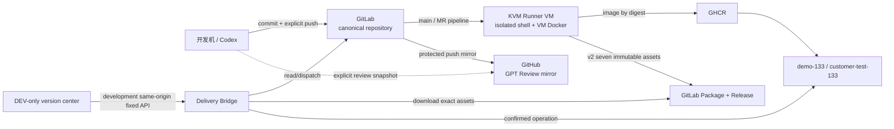
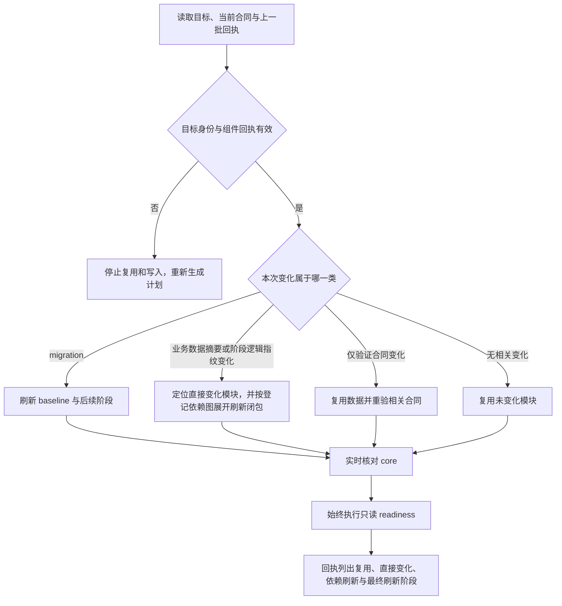
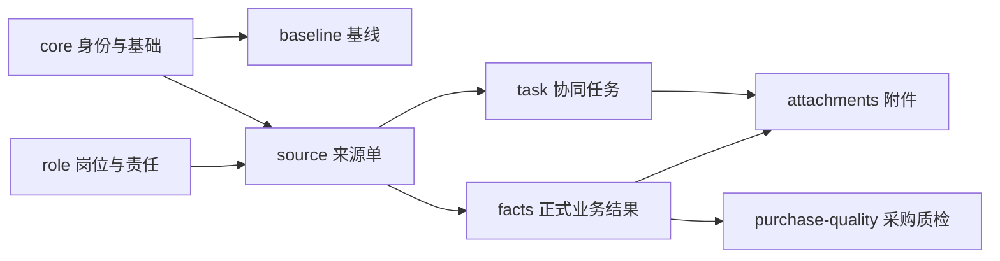

# 研发效能工作台与 CI/CD 设计 / Engineering Workbench And CI/CD Design

## 结论

本项目采用一条主链：

**GitLab 代码真源与 CI/CD + 独立 KVM Runner VM + GitHub 单向 GPT Review 镜像 + GHCR digest 镜像 + GitLab Release 可移植制品 + 开发态同源 Bridge + 固定目标 operation。**

GitLab 独立承担 main CI。GitLab 负责 protected main、merge request、七分片 exact-SHA aggregate、`CI Gate`、Generic Package 与 Release；GitHub main 只接收 protected-main push mirror，供 GPT 审查、外部只读浏览和历史 Release 读取，不运行仓库 CI，也不保留发布写路径。工作台读取 GitLab 证据，不复制一套 CI 状态机。原生 CI 任务明细、日志和历史直接跳转 GitLab，工作台保留 exact-SHA 资格、近期摘要、项目耗时与运行检查。

GitLab、KVM Runner、公网入口、protected main 和 mirror 已是实际主链，但仓库定义和历史绿灯都不能代替当前读回。每次结论仍分别绑定当前 pipeline/job、CI evidence Package、Release Package、Runner 配置、backup/restore、目标 operation 与 UAT。

## 按任务阅读 / Reader Paths

| 要解决的问题 | 阅读入口 | 实际核对 |
| --- | --- | --- |
| 代码、CI、镜像与目标之间如何衔接 | [拓扑与职责](#拓扑与职责)、[CI 主链](#ci-主链) | `.gitlab-ci.yml`、Provider 与正式发布脚本 |
| GitLab、GitHub 与审查镜像如何分工 | [双 Provider 边界](#双-provider-边界) | 当前保护规则、镜像和不可变制品 |
| 工作台页面、工具与受控操作如何维护 | [本地开发入口](#本地开发入口-dev-only-surfaces) | 对应页面、Bridge、命令与 operation 回执 |
| 独立工作台如何运行 | [独立部署说明](../../server/deploy/workbench/README.md) | 登录、资源与工具 API 的实际可达性 |
| 备份、恢复和回滚如何核对 | [备份恢复](#备份恢复和回滚)、[GitLab 运维](../../server/deploy/gitlab/README.md) | 固定目标、备份身份与恢复演练 |
| 什么能证明完成 | [证据分层](#证据分层)、[验收证据](#验收证据-acceptance-evidence) | 当前 SHA、pipeline、制品、目标读回与客户验收 |

具体工具章节保留稳定的路由与锚点；维护一项工具时只读其对应章节和实际消费者。

## 拓扑与职责

| 层 | 唯一职责 | 明确禁区 |
| --- | --- | --- |
| GitLab repository | main、MR、保护规则、pipeline 与 Release 目录 | 不替代业务字段、schema、migration 或 UAT 真源 |
| Runner VM | 候选验证、一次性数据库、镜像构建与发布 | 不挂宿主 Docker socket，不保存长期业务数据 |
| GitHub mirror | GPT Review、外部只读浏览、历史 Release 读取 | 不接受直接 main 写入，不运行仓库 CI，不创建新 publication |
| GHCR | 保存按 digest 固定的 Server/Web 镜像 | tag 不能替代 manifest digest |
| Delivery Bridge | 固定 Provider、固定动作、operation 与目标执行器 | 浏览器不能传 repo、host、path、shell、SQL、Docker 或 secret |
| 研发效能工作台 | 展示证据、选择固定版本、显式确认 | 不成为 CI、部署、数据库或凭据真源 |
| demo / test 目标 | load/pull 制品、migration、运行与 readback | 不从源码构建，不共用持久数据，不把 smoke 冒充客户验收 |

## GitLab 宿主存储与进程隔离

GitLab 的 PostgreSQL、repositories、artifacts、config 与日志放 SSD `/srv/gitlab`。RAID5 `/srv/raid5/gitlab/backups` 只放应用备份、config archive 和 checksum；RAID 能容忍部分磁盘故障，但不能替代异机/离线备份。

Runner 使用独立 KVM VM 和独立 qcow2，不直接跑在 GitLab 容器或现有业务容器旁。VM 内可以使用自己的 Docker daemon 构建镜像和启动一次性 PostgreSQL；GitLab 宿主 `/var/run/docker.sock` 永不传入 job。Runner cache 可重建，不作为 release、测试结果或业务数据真源。

GitLab HTTP 只绑定 GitLab 宿主 `127.0.0.1:8929`，由 FRP 到阿里云 `18226`，再由 Nginx 为 `gitlab.saurick.me` 终止 TLS。Git over SSH 默认只开放 LAN `192.168.0.133:2224`。详细安装、备份和公网切换见 `server/deploy/gitlab/README.md`。

## CI 主链

### main 与 merge request

`.gitlab-ci.yml` 是唯一 canonical 编排：

1. `plan` 根据 MR base、push before SHA 或手工范围建立可信 diff，先做 diff/log 检查和可信基线 gitleaks，再生成带 digest 的 `ci-plan` / range / trust。
2. MR 保留 plan-driven affected/full 单 job。

   main 完整 CI 先由唯一 `prepare` cache writer 预热 locked pnpm/Playwright/Go 依赖，再由 Runner 已登记容量调度 static、Node contracts、Web、Server/PostgreSQL、resource-sensitive、browser 和 security 七个固定外部分片。

   Server 内部把 schema 零漂移、存量升级、普通测试/构建和关键 PostgreSQL 合同拆为四条独立 lane；只有升级与关键合同持有受管 PostgreSQL，只有普通测试/构建消费 Chromium。browser 等待同 SHA Web build，以及升级和关键 PostgreSQL Job 清理完成；其余依赖以当前 CI 编排为准。
3. `quality_aggregate` 要求七个回执、阶段并集、分类执行数、source archive、依赖审计、`make data`、Web build digest、PostgreSQL/Chromium/browser 清理全部同 SHA 且通过，再签发标准 v3 strict terminal。
4. `CI Gate` 按 plan 范围分别等待文档检查、main aggregate 或 MR quality；main 完整 CI 才会把 terminal、receipt 和 manifest 固化到 exact pipeline/job/SHA 的 `plush-ci-evidence` Package，作为 protected main 的稳定 required job 和后续 release 唯一可复用证据。

普通 Markdown main push 使用 `plan → quality_docs → CI Gate` 三个 Job；任意非 Markdown、混合改动、首次推送与生成数据字典走完整 CI。文档绿色只证明文档检查，不产生 strict Package，也不授予发布资格。

需要发布该 SHA 时，在 GitLab 新建受保护 main 流水线并设 `QA_MODE=full`，保留真实 `web` provenance；完整 Job 集合由工作台与发布复用共享，具体范围和入口见 [QA 合同](../../scripts/qa/README.md#门禁完整性与-ci-边界)。

默认 `origin/main` 推送前，本地 `prepare-push` 执行并签名 clean HEAD/tree、remote/ref/range、git-log、严格 secrets、源码完整性及 affected 选择的短 Node 检查，不重复 Runner 的 affected/full、数据库、浏览器或构建。

短检查范围、并发、截止时间和回执合同见 [QA 入口](../../scripts/qa/README.md#门禁完整性与-ci-边界)。该回执只允许普通非强制 push，不表示 CI 已成功；Release、Package 显式版本提升（Explicit Promotion）和任何受保护部署必须读回同一 40 位 SHA 的不可变终态成功 `CI Gate`。

生产目标只加载 CI 构建的不可变制品或镜像并执行正式 migration、health/ready 与 smoke，禁止现场重建。

缓存只缩短依赖和浏览器准备时间，不能跳过 checksum、locked/offline install、门禁、source archive 或 clean-tree 读回。分片只 pull cache，不并发回写同一 key。pipeline artifacts 是本次运行内证据；只有 `CI Gate` 上传且经 release 服务器端重新校验的 exact Package 才能跨 pipeline 复用，仍不等于不可变 Release。

性能核对分别记录 GitLab 宿主与 Runner guest：冷 / 热缓存、Job 时长、关键路径、CPU / 内存 / IO 峰值、中位数、波动和近似 P95。

| 指标 | 判断与动作 |
| --- | --- |
| 执行 Job ≤ 90 秒 | 目标线；仍按样本核对覆盖与稳定性 |
| 执行 Job 90–120 秒 | 进入优化复核 |
| 执行 Job > 120 秒 | 拆分候选，结合近 20 次有效样本的中位数、近似 P95、覆盖和重复成本，不凭单次慢拆分 |
| plan / prepare、领域 fan-in、aggregate、CI Gate | 不套执行 Job 拆分线 |
| 排队 > 30 秒 | 先查 Runner 容量和资源争用，不用拆 Job 掩盖等待 |
| 阶段耗时目标 | 普通 CI 7–9 分钟，热缓存提交到部署 10–15 分钟；有实测余量时继续优化至 6–8 与 8–12 分钟，稳定更快也接受 |

调整 Runner 并发、DAG shard 或语言测试并行度前，须确认没有排队、IO 争用、OOM、flaky 或波动扩大。资源饱和或维护复杂度收益失衡才停止优化；覆盖、失败关闭、exact-SHA、数据库 / 浏览器 / 端口隔离及清理不能降级。

### exact-SHA release

release 只能从受保护 main 的 web/API/trigger pipeline 发起，且满足：

- `RELEASE_SHA == CI_COMMIT_SHA`；
- customer 固定 `yoyoosun`；
- 版本号由 Bridge 服务端以 `Asia/Shanghai` 日历日和当前 Release catalog 唯一推导为 `YYYY.MM.DD-N`，浏览器只读且不得手工改写；
- 可回读同 SHA 的 protected-main 完整 push / web pipeline、全部分片、`quality_aggregate`、`CI Gate` 与 exact evidence Package；
- protected environment `release` 与 masked/protected secrets 可用。

`publish_release` 从 `plush-ci-evidence` 恢复完整 push / web CI 的 v3 terminal，其 provenance job 固定为 `quality_aggregate`，不重跑 strict。

`plush-release-candidate/artifact-<sha>/candidate.tar` 不存在时才构建一次 Server/Web bundle；后续重试只恢复同一 archive。

同一候选包完成 migration、health/ready、smoke、备份恢复、重启恢复和零残留演练，回执在 `plush-release-rehearsal/artifact-<sha>` 冻结。

只有这三层 exact 身份通过后，registry publisher 才把候选包内的同一镜像推到 `ghcr.io/saurick/plush-toy-erp-{server,web}` 取得 digest，并生成带演练 digest 的 `plush.release-manifest/v2` 与固定七资产：

创建 pipeline 时 Bridge 同时传入带时区的版本参考时刻；GitLab 在首次候选构建前重新读取 catalog，只接受与 pipeline 创建时刻相差不超过 10 分钟的同一下一版本。已冻结候选的显式重试保持原版本，不再发号；无候选且 catalog 已前进时必须新建发布，不得占用旧序号。

1. `checksums.sha256`
2. `release-artifact.json`
3. `release-manifest.json`
4. `sbom.cdx.json`
5. `server-image.tar`
6. `web-image.tar`
7. `release-rehearsal.json`

Generic Package version 与 Release tag 固定为 `artifact-<40sha>`。重试时先逐项校验现有 v2 文件的名称、大小和 SHA-256，只续传完全一致子集所缺的资产，并在创建或复用 Release 前读回完整七资产；未知文件、重复文件、同名异内容、同版本异 SHA、同 SHA 异版本或演练不完整均失败关闭。

Release、Package、GHCR digest、manifest、`release-rehearsal.json` 和目标显式版本提升（Explicit Promotion）必须指向同一 SHA、同一 artifact/rehearsal digest。

旧 v1 六资产只允许精确读取、展示、校验和既有回滚点兼容，`promotionEligible=false`；不得补传、重新封装或作为新版本提升输入。

## 双 Provider 边界

`scripts/deploy/gitlab-delivery-provider.mjs` 是默认 Provider，固定 GitLab base URL、项目、Generic Package、release tag、pipeline API 和本地下载根。它从服务端环境读取 `PLUSH_GITLAB_TOKEN`，限制 JSON 大小、asset 名、文件大小、URL、SHA、版本和符号链接路径，返回值不含 token。

质量门禁与版本中心读取 GitLab pipeline / job、不可变版本目录、发布状态和控制制品时使用独立的 `PLUSH_GITLAB_READ_TOKEN`，不复用发布与部署写凭据。macOS 本地启动从固定钥匙串项加载；Linux 从当前服务用户的受控凭据文件加载，来源与权限合同见 [前端启动脚本](../../web/scripts/README.md)。

服务端只把令牌映射给不暴露发布方法的只读 GitLab Provider，浏览器、本机质量门禁和部署子进程均不得继承。创建新发布仍只使用短期 `PLUSH_GITLAB_TOKEN`；缺失时停用该按钮并在发布区说明，不作为全局读取故障。读取凭据缺失、API 失败或目录未通过核对时，页面明确显示读取未就绪；版本与流水线分别按实际取得的证据展示。

实例强制的最大有效期届满前需要按同一最小权限重新登记，不能以扩大为写权限换取自动轮换。

`scripts/deploy/github-delivery-provider.mjs` 继续读取 GitHub 历史 Release，并把 v1 六资产投影为只读、可回滚但不可用于显式版本提升（Explicit Promotion）。

仓库不保留 GitHub Actions workflow、发布 publisher 或 strict 复用 writer；adapter 的发布方法在调用 `gh` 前固定拒绝。恢复 GitHub 写路径必须重新专项评审 canonical v2 七资产、同一演练回执、Provider 并发与凭据边界。浏览器不知道 token，也不能选择 Provider。

GitLab Jobs API 的 job `duration` 和 `queued_duration` 是运行与等待真源。工作台读取当前流水线与最近 20 次 push / 手动完整 CI 的全部 job，同名重试保留最新 attempt 并单列重试次数；页面只派生中位数、近似 P95、失败与排队趋势，不另存一份 CI 历史库。

目标部署与回滚通过原有执行器登记 GitLab Environments / Deployments，三环境名称和 tier 从 target registry 派生。项目 operation / receipt 是执行事实，GitLab 原生状态是自动投影；本地仅新增可恢复的远端引用缓存，不建第二套 CI 库。工作台“操作记录”提供同环境汇总、原始时间、项目检查、GitLab 跳转和仅登记的补录入口；已有迁移、回滚、数据库重建、准备与显式执行保持原合同。历史补录、状态映射、未知创建结果、归档与凭据详见 [部署登记协议](../../scripts/deploy/README.md#gitlab-部署登记与回执归档)。

GitLab 未提供 step timing 时继续返回空 steps，不推算或伪造 GitHub 式 step timing。显式选择历史 GitHub Provider 时只展示既有 release / Actions 运行，不提供发布动作，也不把历史审查 CI 当作当前流水线证据。

## GitHub 单向镜像与 GPT Review

GitLab 项目使用 push mirror 将 protected main 同步到 `github.com/saurick/plush-toy-erp`。GitHub main 禁止人工直接更新；镜像凭据使用专用最小权限 deploy key/token。仓库不维护 GitHub 审查分支或审查 CI。

需要 GPT 审查时，先让 GitLab `main` 的 exact SHA 通过正式 `CI Gate` 并镜像，再按该次推送前后的 base/head SHA 审查 GitHub `main` 提交差异。

GitHub 不保留仓库 workflow 或发布写入 helper；历史 Actions 运行只作审计，不能证明当前候选。恢复任何 GitHub publication 能力都必须重新进入专项设计、代码与远端权限评审，不能把旧 workflow 直接补回。

GPT Review 的 finding 是审查输入，不是仓库事实。修复仍回到 GitLab main 主链，经正式测试、commit/push 授权和 pipeline 证明。

## 工作台信息架构

工作台按任务组织工具，运行结论按来源分别展示。

| 要完成的任务 | 页面 | 展示依据 |
| --- | --- | --- |
| 查本次 CI、定位慢 Job 或本机问题 | [质量门禁](#质量门禁-__devquality-gates) | GitLab 当前 SHA 的 Pipeline / Job；本机诊断另列 |
| 生成不可变制品、部署或回滚 | [版本发布](#版本发布与部署中心-__devversion-center) | Release、Package、固定目标与 operation |
| AI 不可用时手动操作 | `/__dev/version-center/guide` | 同源操作指引；章节目录、锚点与全部展开正文，不依赖实时读取成功 |
| 恢复本地业务入口 | [本地数据库恢复启动](#本地数据库恢复启动) | runtime preflight、health / ready、迁移状态 |

本地绿色、CI、Release、目标 smoke、备份恢复、岗位矩阵与客户 UAT 不合并为“全部完成”。各层显示自身来源与事件时间，缺失或非法时间显示“未证明”。页面加载时间不能代替运行读回。

### 本地数据库恢复启动

#### 启动与日常重启

| 入口 | 行为与成功条件 |
| --- | --- |
| `pnpm start` | 数据库预检通过且登记后端未运行时，按需构建、启动并验证当前工作区，再开放业务；已有监听进程保留并预检。冷启动构建最多 10 分钟，不占用只读预检时限 |
| `make run` | 确保日常后端运行 |
| `make dev_restart` | 检查迁移、构建当前后端，未变化输入复用制品；验证通过再切换 |
| `make dev_rebuild` | 强制构建 |
| 仅前端调试、停止命令或非登记后端 | 不触发自动启动；数据库迁移始终独立确认 |

启动、重启、停止和迁移共用操作锁，内部停服校验持锁身份；日志与状态查询不占锁。日常候选固定后端、运行配置和 migration 快照，迁移准备仍固定完整前后端与附件。组件版本、制品身份和操作编号分别记录，复用制品也重新核对数据库与进程。

命令、日志与进程保护见[前端启动脚本](../../web/scripts/README.md#本地启动与进程范围)和[服务端入口](../../server/README.md#快速开始)。

#### 故障时保留恢复入口

普通启动的只读 preflight 最多 15 秒，超时取消。pending、数据库连接 / 配置、db-guard、Atlas、安全检查或后端启动失败时，保留受限 Vite：

1. 电脑、手机与登录页保持原地址，显示服务不可用并暂停业务组件；“检查并恢复服务”新开迁移页，不强制跳 `/__dev/`。
2. 工作台保留完整页面路由，菜单、深链与前进后退可正常使用，文档、设计等本地资料不受迁移状态限制；恢复页不依赖 GitLab 钥匙串。其他 DEV API、`/rpc`、`/templates` 继续阻断，相关页面显示实际不可用状态。
3. 等待页读取同源 GET `/__dev/api/runtime-status`，一次结束后等 3 秒再查，并发共用同一次检查。
4. 后端健康后重新通过完整启动检查及同目标 health / ready，解除限制并回到当前业务页。

状态读取不启动后端、不迁移或执行恢复。外部 `API_ORIGIN`、非法代理、依赖缺失及端口冲突不属于本地数据库恢复范围。

运行中停服或数据库等依赖失去就绪状态也进入同一等待页，保留路径、query、hash 和登录会话；原业务请求不自动重放。业务入口与状态读取共同检查 health / ready，并发请求共用一次探测；任一失败即关闭业务，恢复仍须完整启动检查。development-only Vite 插件在应用模块前注入检查，通用 RPC 不导入 DEV 源码，生产构建不包含它。仅前端和外部后端不启用本机停服检查。

#### 工具、计划与并发

迁移前检查兼容 Docker CLI/socket 的容器环境、Atlas v1.3.0、PostgreSQL 18 `pg_dump / psql` 及备份恢复命令。按能力接受 Docker Engine / Desktop、Colima、Rancher Desktop、OrbStack 或兼容 Podman；不自动启动本机应用或 apply。

| 现场 | 处理 |
| --- | --- |
| 数据库已到 head | “无需迁移”，准备停用；刷新只读核对，不因代码包变化要求再次备份或 apply。后端故障不抹去已到 head 的读回 |
| 旧 ready 计划仍有 pending | 可显式重新准备，原确认失效；会话失效后下次显式操作重取，不自动重放写请求 |
| 迁移或重启占锁 | 新请求显示“未开始”与原因，保留原锁及操作；未开始的准备不覆盖上次升级证据 |
| 另一条日常重启占锁 | `make dev_restart` 有界串行等待后重新读取当前工作区；真实迁移或迁移恢复则立即阻断，不等待重试 |
| 构建中后端输入变化 | 丢弃未激活候选，有界重读、重建；切换与验证期间再变化时保留已验证候选服务，继续构建最新快照 |
| 持续多轮写入 | 只有切换后指纹匹配才报最新后端已启动；否则明确无法证明 |
| apply 或写后读回中断 | 缺零写入证明时记 `not_proven`；已证明迁移但启动失败，只恢复该固定后端版本 |

前端始终由 Vite 热更新，单独前端变化不触发后端重建。迁移计划的固定输入与失效范围按[数据库迁移](#数据库迁移-__devdatabase-migration)核对；恢复页可达和后端重启成功都不等于原库已迁移。

## 目标环境与真实数据

当前可执行 target 只有 `demo-133` 与 `customer-test-133`。显式版本提升（Explicit Promotion）只 load/pull 已发布 digest，随后执行固定 preflight、backup、migration、Compose、health/ready、公网 SHA 和资源读回；它必须由使用者明确发起，`main` push 不会自动部署。失败、blocked 或 `not_proven` 不自动重试。

| 环境 | 公网入口 | 数据与用途 | 重建边界 |
| --- | --- | --- | --- |
| demo / `demo-133` | `demo.yoyoosun.net` | 项目方造数、演练、培训和回归；允许 seed/fixture/模拟业务事实 | 只走受控重建，必须保留自己的备份与回滚点 |
| test / `customer-test-133` | `test.yoyoosun.net` | 甲方测试/验收；普通部署不 rebuild、不 seed 并保留数据；基础单位 / 仓库只走显式一次性 bootstrap | 清理与 promotion 分开；重建前必须有可恢复备份、恢复验证和精确回滚点 |
| erp | `erp.yoyoosun.net` | 未来正式生产 | 当前未登记、未启用，不能从工作台执行 |

demo 与 test 必须使用同一 release digest，但数据库、上传目录、Compose project、宿主端口、运行 env、备份、回滚点、target registry、preflight、operation 和 smoke 全部独立。demo 造数不得进入 test；test 普通 promotion 保留现有数据且不调用任何 seed，显式重建不得影响 demo。

test 的一次性 core bootstrap 只写精确 allowlist 的 8 个标准单位和 4 个仓库，要求当前任务明确授权、fresh backup、实时 target 身份、exact release / migration 和写后读回，不构成真实客户导入。

根域 `yoyoosun.net` 临时 `302` 跳转到 `erp.yoyoosun.net` 只是导航行为，不把未来生产域名加入 target registry。`admin.yoyoosun.net` 退役后绝不进入 CI/CD 环境矩阵、数据清理、健康检查、发布验证或回滚流程。

真实资料进入客户 Private 仓或经确认的受控存储，不进入 Product Core、CI artifacts 或公开 GitHub 镜像。

## Secrets、权限与审计

- GitLab root、Runner registration token、project API token、GitHub Packages token、mirror key 和 SSH key 不入仓库、不进浏览器、不写 operation message。
- `GITHUB_PACKAGES_TOKEN` 只给 Packages read/write；`GITLAB_RELEASE_TOKEN` 只给当前项目 Release/Package 所需 API。
- main 禁止 force push；release environment、variables 和 Runner 都设 protected/locked。
- pipeline 日志不打印 token；curl 只通过 header/stdin 使用秘密。
- GitLab、Runner、mirror、Nginx/FRP 和 backup 的远端设置必须单独读回，仓库 YAML 不能替代运行证据。

## 备份、恢复和回滚

每日 GitLab backup 与 `/etc/gitlab` config archive 从 SSD 复制到 RAID5 并生成 checksum；保留策略只删除受管且超期的精确文件。在线 verify 只证明 archive 和当前应用检查；每季度仍需在一次性同版本 VM 完成 restore drill，并读回登录、clone、pipeline artifact、Generic Package 与 Release。

GitLab 升级固定镜像 digest，遵循官方逐版本路径。升级前固定当前 digest、最新验证备份和维护窗口。失败时恢复同版本容器与备份，不删除 `/srv/gitlab`、RAID5、业务数据库或现有容器。

业务发布回滚继续按 release manifest、migration 序列和客户配置源指纹判断；GitLab 回滚、代码 rollback、数据库恢复和客户配置 rollback 是四种不同动作，不能相互冒充。

## 证据分层

| 状态 | 能证明 | 不能证明 |
| --- | --- | --- |
| 仓库定义已实现 | YAML、Provider、脚本、文档和测试合同存在 | GitLab 已部署 |
| 本地定向测试通过 | 受影响代码合同当前可执行 | Runner、mirror、域名、备份运行正常 |
| GitLab pipeline 通过 | 固定 SHA 的远端 QA/strict 与 artifact | 目标环境已发布 |
| Release/Package 完整 | v2 七资产、GHCR digest、manifest 与同一演练回执身份；或明确标记不可用于显式版本提升（Explicit Promotion）的 legacy v1 六资产 | migration、health、UAT |
| target operation passed | 目标制品、migration、运行和公开入口读回 | 客户业务结果与签收 |
| 客户 UAT | 指定岗位与数据在固定版本的真实使用结果 | 下一版本或其他环境 |

## 明确不做

- 不让 GitLab 容器兼任 Runner。
- 不给 Runner VM 挂 GitLab 宿主 Docker socket。
- GitHub 没有发布写路径；任何恢复 proposal 必须先证明不会与 GitLab canonical release 并行。
- 不在 133 或客户 UAT 目标构建源码。
- 不把 GitLab 改造成业务多租户、license、计费或客户工单系统。
- 不因双环境复制 Product Core 或字段/流程真源。
- 不以 RAID、pipeline 绿色、Release 存在或基础 smoke 替代恢复演练与客户 UAT。

## 验收证据 Acceptance Evidence

实现与运行分别验收，不能根据实施勾选推定当前目标状态。GitLab CI/CD 搭建完成需要同时具备：

1. 当前提交的定向合同与 YAML / Shell 静态检查，以及获准的 commit / push。
2. GitLab、KVM Runner、DNS / FRP / Nginx、保护规则、最小权限变量和单向 mirror 的实际读回。
3. 同一 SHA 的 main `CI Gate` 与 release pipeline 成功证据。
4. GHCR digest、GitLab Package / Release 的 v2 七资产、同一演练回执与工作台读回一致。
5. 同批 application backup / config archive、checksum、在线 verify 与一次性同版本 VM restore drill；恢复后可登录、clone 和读取 artifact / Package / Release。
6. 现有业务容器、持久数据、端口和公网入口没有回归。

工作台验收还要覆盖只读令牌缺失、写令牌缺失、非法时间 / SHA、未知版本资产、Provider 显式选择和 production build 排除 DEV / Bridge。只读令牌缺失不能制造绿色证据；仅写令牌缺失时仍可浏览已有发布。发布操作要求 clean HEAD 与 GitLab main 精确匹配，只创建不可变版本，目标部署仍由独立 operation 执行。

demo / test 分别绑定同一候选 SHA / digest 验证运行和数据隔离；test 重建与未来生产发布各自核对范围和授权。安装顺序、前置证据、故障停止和恢复见 [GitLab 与隔离 Runner](../../server/deploy/gitlab/README.md)。

## 本地开发入口 Dev-only surfaces

效能工作台也支持[独立测试部署](../../server/deploy/workbench/README.md)：使用单独的前端制品、Node 工具 Bridge 与 HTTPS 域名，登录会话覆盖页面、资源和所有工具 API。它与 ERP 业务构建、业务账号和本地 Vite 生命周期分离；本地 `private-network` 开发继续免工作台登录。独立服务不会自动执行发版、迁移或造数，工具继续沿用各自目标、确认与预检合同。

开发工作台页面、会话、状态读取和全部执行 / 取消 API 先检查访问模式。默认 `local` 只允许本机 loopback，无工作台登录；显式 `operator` 使用独立运维身份，身份缺失失败关闭，远程仅通过受控 SSH 隧道、真实 TLS 私网连接或显式配置的本机 HTTPS 代理。

个人受控内网可显式配置 `PLUSH_DEV_WORKBENCH_ACCESS=private-network`，直接打开数字内网地址且无需额外工作台登录。HTTPS 域名使用单个 `PLUSH_DEV_HTTPS_ORIGIN` 和只允许内网客户端的本机 TLS 代理，Vite 仅放行指定域名，HMR 跟随页面使用 WSS。各模式均保留网络、同源、CSRF、确认和预检，业务权限仍由后端控制。

配置、边界与可用性端点例外见 [开发服务 Bridge](../../web/dev-server/README.md#边界)。

下列页面在本地开发与独立工作台制品中可访问，不进入 ERP 侧栏、`seedData`、RBAC、产品内文档 registry、ERP 生产构建或正式菜单。除受控同源 Bridge 明确登记的客户配置、版本交付、测试数据和共享开发库迁移操作外，页面不直接写后端业务。

总览 `/__dev` 提供工具检索、常用工具与使用指南，导航真源为 `devRoutes.mjs`，用途和边界在 `devHub.mjs` 维护。

### 产品与业务

| 路径 | 职责 | 维护真源 |
| --- | --- | --- |
| `/__dev/product-engineering` | 产品与业务的四个工具入口 | `web/src/dev-workbench/config/devRoutes.mjs`、`devHub.mjs` |
| `/__dev/product-core` | 当前 Product Core 能力、归属、范围和边界 | `docs/product/产品能力进度台账.md` |
| `/__dev/status-flows` | 业务链、协同、运行、事实与状态规则只读观察 | 代码合同、三类 dev-only 配置目录与正式架构文档 |
| `/__dev/permission-relationships` | 当前账号、岗位、最终功能、页面、仓库范围和审批责任 | 工作台独立只读入口、登记开发库与正式权限解释 |
| `/__dev/ui-design` | HTML 交互稿、两端界面说明与设计依据 | `docs/product/ui-design/**`、`web/src/dev-workbench/config/devWorkCenterDesign.mjs` |

### 开发资源

| 路径 | 职责 | 维护真源 |
| --- | --- | --- |
| `/__dev/development-resources` | 开发资源工具清单与项目关系图 | `devRoutes.mjs`、`devRelationshipPerspectives.mjs`、`devProjectGraph.mjs` |
| `/__dev/integration` | 生成接口清单、搜索、权限关联、合同与验证缺口；辅助接入边界图 | 公共契约生成物、现有权限只读投影、正式 API 文档及质量门禁 |
| `/__dev/docs` | 当前工作区 Markdown 查看器 | 仓库 Markdown 文件本身 |
| `/__dev/project-skills` | 项目 Skill 的任务选用、职责引用与结构健康 | `.agents/skills/` 与既有 `skill-health.mjs` |

### 测试验证

| 路径 | 职责 | 维护真源 |
| --- | --- | --- |
| `/__dev/quality` | 测试验证任务入口；按本轮目标进入测试执行、质量门禁或测试数据 | `web/src/dev-workbench/config/devHub.mjs` |
| `/__dev/testing` | 默认总览测试维度、执行入口和已有报告；按任务进入验证、报告、压力测试与指引 | `docs/product/自动化测试策略.md` |
| `/__dev/business-chain-audit` | 从测试执行的“测试总览 / 测试报告”按需查看链路实跑批次、逐步结果、问题与执行证据，只读下载 | 本地 `output/qa/business-chain-audit/<batch>/report.json` 与证据清单 |
| `/__dev/quality-gates` | CI 结果、本机诊断、门禁目录与改动缺口 | 正式 QA runner、门禁回执、affected 与本地 operation |
| `/__dev/data-preparation` | 固定数据范围检查、计划确认、执行与回执 | 既有 Core seed、统一本地验收 lifecycle 与 operation store |
| `/__dev/business-usability` | 页面说明检查；从测试执行按需进入 | `web/src/erp/config/businessUsabilityCatalog.mjs` |

### 交付运维

| 路径 | 职责 | 维护真源 |
| --- | --- | --- |
| `/__dev/delivery` | 交付运维任务入口与四类环境 / 验收事实对比 | 数据准备摘要、Delivery Bridge 与固定目标 operation 回执 |
| `/__dev/customer-config` | 已登记客户配置包预检、测试应用与发布门禁 | `config/customers/<customer-key>/*` 及 customer config 脚本 |
| `/__dev/database-migration` | 共享开发库迁移准备、执行、读回与重启 | 高层 CLI、迁移 operation service、备份恢复与 operation store |
| `/__dev/version-center` | exact-SHA 发布、固定 133 部署与回滚 | GitLab Release、固定目标预检与 operation 回执 |
| `/__dev/version-center/guide` | 章节目录同页定位发布原理、手动顺序与应急边界 | 同一 CI/CD 指引组件与正式发布合同，不读取实时目标状态 |
| `/__dev/drill-recovery` | 安全核验要求、演练周期、恢复证据与事件处置指引 | 应用安全合同、固定目标预检与恢复 / operation 回执 |

### 页面任务与内容归属

分类按用户要完成的任务逐层展开。页面内同级 Tab 表达可切换的任务或内容，显示方式和筛选条件使用独立控件；最多两层内容导航。当前对象、目标环境、证据身份、异常和未结束操作保持可见，说明、原理与低频明细按需查看。减少重复入口和说明时保留真实操作、证据来源与返回位置。

| 页面或入口 | 主要任务与内容组织 | 辅助内容与边界 |
| --- | --- | --- |
| 总览与四个责任区 | 总览查找工具；产品与业务、开发资源、测试验证、交付运维按职责分流 | 常用入口和使用指南保留；目录不产生执行结果或完成进度 |
| 产品能力 | 按能力状态筛选，选中能力核对范围与边界 | 完整说明进入详情，不新增无必要 Tab |
| 业务链路 | 业务结构与实例跟踪分别表达定义和运行记录 | 技术详情、搜索定义、打印与实测报告保留上下文入口 |
| 权限关系 | 按岗位或员工选对象，关系图、实际菜单、明细核对表达同一授权范围 | 结果性质与读取异常常显，来源与版本按需看 |
| 交互设计 | 可交互设计、设计说明、设计依据区分试用、理解与设计理由 | 预览对象和电脑 / 手机属于范围与显示方式；演示不等于已验收 |
| 开发资源中的项目关系图 | 默认按项目主题选图，节点说明就近展示 | 按图模型浏览保留为另一目录方式，图模型原理按需读；不表示运行成功 |
| 接口与集成 | 接口清单、本轮变更、接入指引；方法详情分请求、返回、权限与证据 | 参数格式是显示方式，业务域是筛选；返回保留方法与清单条件 |
| 项目文档 | 按当前、评审与参考、历史选择资料，再按主题目录和关键词阅读 | 标题 / 全文属于搜索范围；章节定位不新增导航层级 |
| 项目 Skill | 按工程任务检索，选中后查看适用范围与调用方式 | 关联、引用、结构健康与原文按需查看，不复制执行状态 |
| 测试执行 | 测试总览对齐测试维度、执行与报告；本轮验证负责执行，测试报告负责证据，压力测试负责规模与负载，测试指引提供详细方法 | 专项命令、页面说明检查为辅助路径；Git 收口从交付区进入 |
| 链路实测报告 | 链路结果、问题与复验、执行与证据围绕同一批次 | 定义与运行结果分开；只读报告不提供重复执行入口 |
| 质量门禁 | CI 结果、本机诊断、门禁目录、改动缺口分别回答结果、排障、规则和待补证据 | CI Job 性能与历史留在 CI 结果；目录和缺口不产生通过结论 |
| 测试数据 | 准备数据、当前批次、执行记录围绕同一模拟范围 | 依赖、场景步骤与原理按需看，当前操作与真实阻断常显 |
| 客户配置 | 总览及检查、变化、预览、验证、发布交接形成办理顺序 | 目标、候选、验证方式和阻断独立可见；步骤访问不代表完成 |
| 数据库迁移 | 数据库升级、运行检查、操作记录分别办理升级、检查与追溯 | 固定开发库、候选和未完成操作常显；不改变迁移授权 |
| 版本发布 | 版本与部署、发布检查、发布与部署耗时、操作记录围绕候选与目标 | CI 执行细节归质量门禁，发布页保留 CI 摘要及制品、目标证据；未结束操作常显 |
| 安全与恢复 | 安全核验、恢复演练、应急指引按不同任务组织 | 实际状态与建议频率分开，缺证据不能视为安全或恢复通过 |
| 页面说明检查、专项命令与 Git 收口 | 各自处理说明完整性、复制固定命令与只读收口检查 | 明确返回所属任务；不升级为常驻菜单或新增业务操作 |

测试报告中的“门禁结果”是报告快照；质量门禁的“改动缺口”是当前改动与必要证据的比对；版本发布的“发布与部署耗时”覆盖 CI、制品发布和目标部署。相近内容共用原始证据，按当前任务展示必要摘要，不合并为一个全局成功状态。

### 开发导航 `/__dev`

- 首页默认展示工具表，包含名称、所属领域、简短用途与常用标记。搜索、领域筛选、结果数量放在同一操作行；工具名称直接进入页面，来源与边界通过具名信息按钮按需查看。
- “全部工具 / 常用工具 / 使用指南”使用保持挂载的共享 Tab。`view=tools|pinned|path`、`q` 和 `group` 写入 URL，刷新与前进后退恢复选择；未识别的视图回到全部工具。常用工具复用当前浏览器的置顶偏好，最多五项；没有常用工具时给出添加方法。
- 使用指南以任务、核对重点和工具入口组成简表，不设置步骤进度或推断已完成状态。工具独立使用，具体执行结果以版本、环境和回执为准。
- 左侧常驻总览及四个责任区，各责任区的工具始终展开；进入总览、切换页面或刷新均保留完整子菜单，菜单超出侧栏高度时滚动查看。页面使用与 ERP 桌面一致的主题、标题与控件尺寸和紧凑表格；页头保留当前页面与操作，不再重复教程、英文副标题或说明卡。外观设置常驻；复制当前链接、来源文档、工作台边界和工作台模式退出集中在一个“页面工具”入口，Escape 收起并恢复焦点。真实异常、未完成操作和确认条件仍就近可见。

| 一级菜单 | 二级菜单 |
| --- | --- |
| 产品与业务 | 产品能力、业务链路、权限关系、交互设计 |
| 开发资源 | 接口与集成、项目文档、项目 Skill |
| 测试验证 | 测试执行、质量门禁、测试数据 |
| 交付运维 | 客户配置、数据库迁移、版本发布、安全与恢复 |

“测试验证”一级页直接以工具表提供测试执行、质量门禁和测试数据入口，页头提供开始验证。链路实测报告从“测试执行 → 测试总览 / 测试报告”按需进入，不占常驻菜单。“交付运维”一级页分为“准备交付 / 环境证据”两个 Tab，默认比较四个交付工具，页头提供版本发布；选择环境证据后才挂载四类环境对照，默认视图不读取环境证据摘要。Git 收口由“核对 Git 收口”按需进入。

两者都不复制子页的详细 operation 历史；full / strict 运行结果、阶段和历史统一在“质量门禁”核对，当前 SHA 的 strict 发布资格统一在“版本发布”核对。

移动端全局菜单允许横向滚动，并保持单一当前页语义。

#### 工作台入口变更门禁

- 新入口先归入“产品与业务、开发资源、测试验证、交付运维”之一，并在 `DEV_SECONDARY_NAV_ITEMS` 维护唯一名称与归属；页头、浏览器标题、分类页和全部入口读取同一登记，不在总览阶段重复列工具。
- 新能力默认进入对应责任区域和“全部工具”；辅助工具可由任务页按需进入，不强制列入常驻导航。常驻导航按使用频率与责任归属调整；不为每个入口增加教程或重复快捷方式。
- 新增或调整入口时，同步核对入口 key、路由、标题、用途、维护来源、状态与边界，并运行配置单测及受影响的 Style L1 浅色桌面默认态、交互态、恢复态与相邻页面检查。仅在外部行为变化时更新本节。

### 链路实测报告 `/__dev/business-chain-audit`

从“测试执行 → 测试总览 / 测试报告”进入链路报告详情，无覆盖基线时仍可进入；详情页返回来源视图并保留查询条件，直接访问详情时返回默认报告视图。没有报告时隐藏结果页签和批次选择，说明尚未采集并提供本轮验证入口；单批次直接展示身份，多批次再选择。链路从结果表名称选取，保留结果与关键词筛选及“全部链路”复位。

报告详情保留原路由、全部工具登记及按链路查看入口，不列入侧栏和责任区工具清单，以实跑批次为单位读取既有结果。批次、生成时间、客户、模拟环境、报告源码与当前工作区身份常驻可见；提交不同标为历史证据，身份读取失败标为未知。该报告格式没有绑定完整工作区指纹，即使提交相同也不声称当前源码已验证。

| Tab | 默认内容与交互 |
| --- | --- |
| 链路结果 | 执行时定义关系图叠加步骤结果、链路汇总与首个未通过环节；定义核对按链列出变化和未记录步骤；按链路、结果和关键词过滤逐步表，展开前置、动作、预期和事实边界；登记场景矩阵保留部分覆盖与未证明项 |
| 问题与复验 | 本批次问题的优先级、触发、实际结果、影响、定位、修复建议和原始证据；后续批次可登记有证据的定向复验及原失败批次入口，历史失败保持原样，复验结论不覆盖本次未执行的其他链路 |
| 执行与证据 | 创建编辑、移动协同、浏览器、数据库与打印分别展示，提供 JSON、Markdown、HTML、截图、PDF、日志及完整证据包下载 |

Tab 条持续挂载；`batch`、`view`、`chain`、`status`、`q` 保存选择，刷新可恢复。Tab、搜索和筛选只使用已读报告；批次切换和离页取消读取并忽略旧响应，目录或报告错误不保留可被误读为成功的旧结论。“业务链路”按既有稳定 chain key 双向跳转：当前目录负责定义，报告中的步骤与图只保留执行时快照。

新报告从执行前的验收计划或执行回执携带 `definitionSnapshot`；节点、步骤、条件、责任、场景和链间关系复用业务链目录，不另写一份拓扑。服务端核对快照摘要与报告引用后返回 `definitionComparison` 和 `definitionDiagram`，按冻结定义生成图，按当前定义显示新增、移除、变化及本批次未记录步骤。

缺少快照的历史报告保留原图，标明无法判定定义一致；不回填新定义、不改历史结果。链级状态与步骤聚合不符时拒绝读取；缺步骤不能在图上标为全部通过。维护规则见[业务链与运行轨迹边界](../architecture/业务链与运行轨迹边界.md#观察台与实测报告的一致性--definition-consistency)。

报告根固定为 `output/qa/business-chain-audit`，只供 development serve 使用既有工作台访问保护。

`GET /__dev/api/qa/business-chain-audit` 列举批次，`/report?batch=...` 读取报告，`/artifact?batch=...&file=...` 下载证据；不提供运行、改状态、业务写入或自动复跑接口。

每批次包含 `report.json` 和 `artifact-manifest.json`，清单 `files[]` 使用相对路径、字节数和 SHA-256；可选 `bundle-receipt.json` 用 `archive`、`bytes`、`sha256` 绑定 ZIP。清单与报告摘要不一致、格式损坏或计数矛盾的批次显示不完整，不消失或变绿。

读取拒绝符号链接、路径越界、未登记文件、重复参数和超限内容；JSON 上限 8 MiB、单个下载上限 64 MiB、目录最多 200 个批次。下载再次核对摘要，使用 attachment、nosniff 和 sandbox；完整 HTML 随证据包解压后打开，工作台不以内嵌 HTML 执行报告脚本。本地输出不会随源码自动同步，其他 checkout 没有批次时显示空状态，不生成假数据。

### 产品与业务入口 `/__dev/product-engineering`

工具表按“产品能力、业务链路、权限关系、交互设计”组织，分别回答系统具备什么、业务怎样流转、岗位能做什么和界面怎样使用。名称直接进入现有工具，用途就近显示，正式来源与边界从具名信息按钮查看。分组不表示执行顺序。

### 开发资源入口 `/__dev/development-resources`

该页使用持续挂载的“工具清单 / 项目关系图”同级页签。工具清单提供“接口与集成、项目文档、项目 Skill”，分别用于查调用合同、阅读正式依据和选择工程任务方法。项目关系图作为开发资源页的辅助视图，不新增常驻二级入口。

原 `/__dev/product-engineering?view=relationships` 深链转到本页，完整保留查询参数与章节片段；其余既有工具路径、工具 key、常用入口和页内深链保持有效。总览仍接受旧工具名称搜索，显示统一的新名称。

“项目关系图”（`?view=relationships`）默认使用“项目主题 → 关系图 → 节点解释”布局；目录按项目与目录、开发与交付、权限与业务分组，直接选择全部十个图例。需要研究结构时可切换“按图模型”，继续按模型选择项目示例；切换目录方式保留图例、节点与显示选项。有向图下区分 DAG 与含回路图，无向图用于关联投影；树／森林按父 → 子定向时作为 DAG 的层级特例说明。默认查看项目整体关系，可切换 CI、权限授予、版本交付、业务主链、接口契约与接入边界、状态退回、模块关联、产品目录树和分区目录森林，共十个结构示例。示例不读取或推断实际账号、业务事实、CI、发布或验收状态。

目录、示例定义、节点与连线在 `devRelationshipPerspectives.mjs` 登记；`devProjectGraph.mjs` 从同一数据生成 Mermaid、分类判断和节点前后关系。目录树可叠加跨目录引用，展示多来源节点使整体从严格目录树变成一般 DAG；退回回路可切换强调，节点和分支始终保留。图表复用共享 Mermaid 查看器，支持缩放、布局切换、全屏和鼠标或键盘选中节点；主题目录、图模型选择与说明区复用当前工作台主题与密度；图模型原理收在“图模型说明与对应工具”，当前主题、结构分类和节点解释直接可见。

`view / model / example / node / references / loops` 继续保存视图、模型、示例、节点、跨目录引用和回路强调，`catalog=models` 保存按图模型浏览，默认按主题省略；刷新及前进后退可恢复。切换模型或示例会清空旧节点和不再适用的选项；无效或不匹配的查询显示该模型的默认示例，不回显无关节点。返回工具清单时释放图表。正式业务链、权限和质量页面继续维护各自的实际关系、运行查询和证据；本页从按需展开的依据区进入对应工具。

“接口契约与接入边界”（`?view=relationships&model=dag&example=integration`）复用同一图模型、节点说明与依据入口，说明现有 ERP 入口、授权、领域事务、回执和检查职责。入口标签消费公共契约生成的 `RpcTransport`；外部接入节点与虚线明确标为待建设。

接口字段、重试与权限依据进入正式 API 文档和公共契约规范，实际检查结果回到质量门禁，不增加完成度、运行状态、接入方配置或写操作。未知字段 / 非整数 ID 与版本、身份伪造、越权、同意图并发和不同意图冲突由所属接口与 PostgreSQL 测试验证；图本身不将测试存在、代码存在或静态结构显示为已通过。

### 接口与集成 `/__dev/integration`

页面只维护**查接口、核对本轮变更、阅读接入规则**三个任务，目录与规则来自公共契约和正式文档。

#### 页面与恢复

| 页签 | 内容与读取 |
| --- | --- |
| 接口清单 `inventory` | 同源 `RpcMethod / RpcTransport`；按业务域、域名、中文名称、用途和多关键词检索，分页查看方法 |
| 本轮变更 `changes` | `rpc-contract-review` 用同一生成器比较 HEAD 与工作区 / 暂存快照，集中显示差异、字段检查、暂存范围和样例结果 |
| 接入指引 `guide` | 直接读取[系统接入规范](跨层公共契约与生成规范.md#接入方式选择--integration-selection)；关系示例和边界图按需展开 |

`view / domain / q / page / rpc / detail / section / format / example` 保存位置，`contractRange / change` 保存差异范围和方法。重复参数忽略，无效方法提示未登记；只有 `node` 的旧深链进入指引。切页签保留筛选、页码和图节点，关闭方法详情；离开清单取消权限与证据读取，指引不触发这些查询。

筛选栏只保留业务域、一个搜索框、结果数量；有筛选时才显示重置，只有一页时不显示分页。改变筛选回第一页，清除条件不关闭当前详情；详情不在结果中时提供定位入口。窄窗口按组换行，不压文字或控件高度。

#### 清单与详情

清单保留“方法、关联权限、合同与验证”三列。方法显示中文名称和完整标识，多权限显示数量，完整条件进详情。每行只有方法名称打开详情，权限与合同 / 验证显示可比较摘要，表头不叠加说明按钮。正式文档、权限关系和质量门禁入口集中在按需展开的依据区，不另建接口或权限目录。

| 内容 | 真源与缺失处理 |
| --- | --- |
| 名称与用途 | 正式 API 的业务域标题和方法表，中文目录覆盖全部生成方法 |
| 权限关联 | `/__dev/api/permission-relationships` 中 `permissions[].usage.backend_methods` 精确匹配；未登记与读取失败分开，不从方法名猜授权 |
| 正式合同 | 直接解析 `server/docs/api.md`；精确方法表给入参、授权及并发重试，章节引用只算章节说明，其余标未逐项登记 |
| 验证来源 | 正式 API 表格和逐方法样例关联的测试源码、模拟场景；静态关联不等于运行通过 |
| 门禁证据 | 复用既有质量门禁读取，保留结果、提交、读取时间及是否覆盖当前工作区；缺证据身份明确提示 |

详情从清单右侧展开，页头、页签、筛选及对应高亮行仍可见。清单扩展到视口剩余高度，详情上方地址与页签固定，资料区内部滚动；页头唯一的“返回接口清单”保持可达。

返回、背景点击或 Esc 关闭并恢复入口焦点；直接深链则回搜索框。若用户已操作筛选，动画结束不抢焦点。深链未指定页码时定位方法所在页；显式页码保留，不在筛选内时只有点击定位才调整条件。

详情可按账号核对权限并直达身份与授权规则；方法授权优先取正式合同，通用权限登记条件不能替代它。详情用 `detail=request|response|governance` 保存“请求参数 / 返回结果 / 权限与证据”，`section=permissions|contract|evidence` 定位对应资料。

字段表、JSON、cURL 从同名正式 API 章节读取；`format=json|curl` 保存请求格式。只复制已校验示例，失败提供已选中只读文本；切方法、资料或格式清旧反馈并忽略迟到复制结果，不在线执行业务接口。

#### 字段生成与样例证据

公共契约生成器从 handler、解析器、DTO 和返回映射生成逐方法字段及 JSON。字段表保留必填条件、数组、元素类型、嵌套对象和 `null`；解析调用、拒绝表达式与源码位置按需展开。未知字段、错误类型、缺必填与样例漂移由生成检查拒绝。

表内管道符编码后，消费者先保留单元格边界再解码，防止联合类型错列。阅读页与详情共用正文；长文档使用有界缓存与标题栈线性解析。动态 JSON 和领域校验边界见[字段生成规范](跨层公共契约与生成规范.md)。

| 样例或结果 | 允许的结论 |
| --- | --- |
| 真实 handler 隔离夹具 | 标注测试来源，不能直接当第三方联调或验收 |
| 按后端形状构造 | 标注构造依据，不冒充执行成功；返回按主要字段核对，完整字段仍查表，允许正式封装的对象、空 data 或无 data |
| 关键 PostgreSQL 场景 | 读取 `output/dev-workbench/database/` 的最新 critical-postgres lifecycle 回执及 SHA-256 绑定 Go JSON，核对源码、完成时间、隔离库和清理 |
| 身份不符或执行不完整 | 历史、无结果、零执行、未终结、失败、跳过与读取失败分别显示；最新失败不回退旧绿色 |

模拟上下游场景唯一维护在[正式 API](../../server/docs/api.md#模拟消费者与接入验证)。方法只关联自己参与的场景，不另存结果数据库、不轮询或上传报告。修改本人密码样例使用隔离账号夹具，不改真实运行密码；SQLite、测试源码和静态结构都不升级为 PostgreSQL 或外部验收证据。

#### 本轮样例执行

本轮变更只保留一个结果与运行区，当前结论必须匹配源码身份；历史结果与执行消息单列。没有接口变化时仍显示整体检查；无相关暂存只表示“暂无相关暂存”。刷新、换范围、离页取消旧请求。

样例执行与测试执行共用固定 `rpc-examples` operation、同源 / CSRF、幂等、源码身份和 QA 排他锁；浏览器不传命令、测试名、路径或环境参数。暂存视图禁用工作区执行；结束后重读合同回执，离页停止状态读取。命令与原始报告 digest 核对见[接口差异与执行证据](跨层公共契约与生成规范.md#接口差异与执行证据--rpc-review)。

接入关系图与项目关系图共用定义，`node` 保存选择并在直访时展开。`example` 选择[正式关系示例](跨层公共契约与生成规范.md#接入关系展示--integration-relationships)，未知值回到首例；实际关联与未实施示例分开。未登记适配器保持未关联，内部 RPC 不等于对外开放。合作方只读合同和 A/B 隔离场景复用同一证据入口，真实第三方接入与合作方写入仍未开放。

### 产品能力 `/__dev/product-core`

该页只读解析全局唯一的 `docs/product/产品能力进度台账.md`。能力按状态分组，目录只列名称，不重复逐行状态标签或默认展开长文。点击能力后在抽屉同时查看完整可用范围与边界；页头只保留一个返回能力目录操作；关闭回到原筛选、滚动位置和入口焦点。台账入口由页面工具与能力详情提供，页头不再重复；空结果沿用筛选栏清除。

`capability` 使用能力名称保存详情选择，刷新可恢复；搜索和状态筛选不自动打开详情，无效选择清空。页面把台账状态翻译为“已进入内核（可试用）、部分进入（部分可用）、当前不纳入”，支持按归属筛选和搜索能力、范围或边界，筛选条件写入 URL。台账和页面都不登记实施动作、后续候选或默认优先级；边界不构成待办、实施授权或发布计划。

页面不维护第二份能力状态，不根据文件存在、菜单出现或测试数量自行推断完成度；进入 Product Core 也不等于目标环境已发布、恢复可用或客户已验收。字段、状态、Workflow / Fact 和实现细节继续通过台账中的正式证据入口核对。

### 权限关系 `/__dev/permission-relationships`

“实际菜单”与正式 ERP 共用客户菜单展示模式、侧栏可见性过滤、业务模块合并和分组顺序，不固定套用岗位推荐布局。当前客户默认四区菜单及可选布局边界见[菜单与正式入口合同](../product/菜单与正式入口合同.md#入口颗粒度)。授权页面数来自最终权限解释，侧栏入口数来自菜单投影；模块合并、仅路由可达的内部页面与登录后附加的历史记录、帮助中心会使两者不同。仅路由可达的页面继续在权限图和明细核对，不生成侧栏入口。

该页通过工作台独立只读入口读取登记开发库的员工账号、岗位、最终功能解释、可进入页面、仓库数据范围和已启用审批责任，并复用正式 Go repository、权限解释、DTO、菜单目录与导航布局。查看资格采用工作台既有运维身份或显式个人内网访问模式，与 ERP 是否登录、当前业务岗位及岗位切换无关；被查看对象的权限规则仍与正式业务一致。进入页面或点击刷新时重新读取，不实时订阅。

默认打开“关系图”，“实际菜单”和“明细核对”为同级视图。关系图和明细可按功能模块筛选；顶部统计始终按所选对象的全部模块计算。“仅岗位相关”排除未授予的功能与页面，“包含未授予”再展示产品权限全集；岗位已授予但被当前配置限制的项目才标为受限。同一功能经多个岗位获得时去重，不同时计入可用和受限数量。

菜单、关系图、明细和统计共用读取完整性判断：岗位身份、岗位版本、客户配置与产品版本必须匹配。读取失败、产品默认预览和未保存草稿不能作为最终结果，也不能把缺失结果写成“未授予”或零权限。停用账号和停用岗位不显示可用菜单；超级管理员没有独立有效会话时不推导菜单或显示零权限。员工有多个岗位时，仅展示明确标识的岗位合并参考；后端实际会话还会计算跨岗位授权组合，本页不将岗位解释的并集声明为账号完整最终权限。

审批设置与岗位权限版本不一致时单独要求刷新审批责任；仓库名称读取不完整时保留缺失提示。正式权限配置页同样在等待、读取失败和切换岗位期间清除旧结果，并按当前岗位版本重新核对。

`mode / target / tab / module / scope` 写入 URL，可刷新、分享及前进后退恢复。结果性质与读取异常直接可见；来源、客户配置版本、产品版本、岗位版本、审批设置版本和最近读取时间集中在“来源与版本”中。

页面只消费 `GET /__dev/api/permission-relationships`；该入口使用已核验的只读审计账号与数据库只读连接，不接受外部目标、命令、路径或写请求，不返回手机号、口令、token 或数据库连接信息。读取失败清除旧结果并保留重试，不引导开发人员登录 ERP。页面不保存岗位、员工或客户配置；具体任务、单据状态、负责人及事实是否生效仍由业务主路径判断。

顶部以一行展示关联账号、岗位、功能、受限项目、页面与审批责任数量，结果性质与异常保持可见；图例放在功能范围旁按需展开。功能权限、数据范围及关联账号汇总与实际操作主体的区别收在“查看与配置”说明，区分工作台访问身份与被查看账号。正式配置在 `/erp/system/permissions` 办理，保存后返回本页刷新。该页随研发效能工作台排除在生产构建之外。

### 改动规则速查

`docs/项目治理地图.md` 作为项目文档中的速查资料，按常见改动列出参考依据、同步检查和误判边界。需要时从 `/__dev/docs` 搜索或直接打开；总览使用指南中的“明确改动”也直接链接这份文档。规则选择、影响范围判断和最小充分验证由 Codex 按当前任务、代码及项目 Skills 执行，不要求开发者每次先浏览分类。

### 业务链与运行观察台 `/__dev/status-flows`

观察台总图、子流程、业务专题与客户校对稿继续复用现有目录。桌面总图与详情并排，窄屏上下排列；17 个环节分别提供正常与异常入口，多方案主动选择，跨环节复用同一处置。业务目录与异常目录共用详情区，相关任务及单据入口保留。工程用料、生产发布、采购补价、逐关质检及库存操作按[业务与协同流程地图](../workflow/业务与协同流程地图.md#岗位流程与异常查看入口)维护；不另建图专用业务规则或执行入口。

- 主导航保持“业务结构 / 实例跟踪”两个稳定 Tab。业务结构默认 `view=chain&chain=all`，先展示订单全流程和一个关注岗位下拉框；选择岗位保留主链骨架，突出相关环节。技术专题和关系图在次级入口按需查看。实例跟踪为 `view=tracking`，按来源单号、任务名称或编号查找可见任务，再按业务环节展示关联任务；异常分支独立可见，可直接筛选待处理、异常或具体环节。

  “定位业务”搜索框及查询反馈仅在实例跟踪展示；离开该视图取消未完成查询。搜索定义放在侧栏，客户选择仅在导出客户校对稿时出现。Workflow、ProcessRuntime、Fact 与状态规则保留原 `view`，从技术详情或上下文动作进入；内部 key、代码和完整合同按需查看。
#### 定义目录与状态规则

- `devFlowStateCatalog.mjs` 汇总状态机和流程 variant，`devBusinessChainCatalog.mjs` 是业务链目录，`devFactLedgerCatalog.mjs` 是 Fact / Ledger 定义目录。三者都是 dev-only 只读投影，不是新的业务真源；构建器校验唯一 key、引用、覆盖和图可达，未知引用或缺失覆盖 fail closed。

  生产异常决策属于来源单据，不进入 Fact / Ledger 定义；拒绝或取消、超领额度、报废或在制让步执行分别按正式流程合同展示。合同测试还会扫描 Ent schema 中持久化的状态所有者字段，并要求与状态目录的 canonical 引用及少量显式 schema 映射全等：业务侧或观察台任一侧先改，另一侧未同步时都会失败关闭；事件前后值和来源快照不算状态所有者。
- 观察台页面保留路由与视图编排；`src/dev-workbench/components/flow-state/` 按业务链、任务、运行路径、事实和状态规则拆分视图，共用目录与任务上下文，继续只读消费同一真源。
- 状态规则视图直接消费同一状态目录登记的转换与异常路径分类，把正常推进、暂停与恢复、不通过与终止、纠正与退回、返工与再处理分组说明；图内用同一分类的彩色线、线型和动作短标签辅助扫读，图例与清单再解释适用条件、转换结果、影响边界和内部证据，不只靠颜色判断。可按全部、异常与纠正或当前状态筛选，并跳转到目录已明确关联的业务链、任务、运行路径或事实定义；它不查询历史实例，不提供改状态动作，也不是跨对象的通用状态管理器。
#### 查询、恢复与导出

- 全局定义搜索按业务链、Workflow、ProcessRuntime、状态机和 Fact / Ledger 分组，搜索文字不写入 URL。`view / chain / node / flow / state / process / fact / task_id` 及岗位详情选择保存在 URL；`flow_tab / flow_topic / flow_role / flow_stage / flow_substep / flow_handling` 保存目录、业务主题、岗位与环节选择，`flow_exception / flow_exception_origin / flow_decision / flow_exception_step` 保存异常类型、来源、方案与步骤；每个视图只接受自己的对象参数，切换视图会清理无关对象参数并在返回业务链时恢复最近链和步骤。

  未知、重复、过期、当前视图无关的参数，或 `chain=all` 携带单链 `node` 时停止加载并提供恢复到业务总图的入口。
- 页头统一“导出”菜单提供当前视图和客户校对稿。当前视图直接打印当前 DOM，隐藏导航与操作控件，保留任务范围、查询时间和证据边界。客户校对稿先选择已登记客户，再从同一目录和客户投影生成。总览以三段主流程展示全部 17 个环节、岗位与关键结果，按约定办理的首款单列；专项异常保留处理方案与继续或终止出口。

  完整处理说明在页面查阅，当前视图导出保留所选环节的处理条件；客户校对稿不重复办理长表或附加其他专题。单链只导出所选链的流程图、岗位和关键业务条件。保留未绑定发布版本声明；本次图未全部成功生成时阻止导出，关闭打印后释放本次内容。两者均调用浏览器打印，可保存 PDF；不增加导出历史、PDF 服务、业务写入或外部发送能力。
#### 运行实例与事实证据

- 真实查询只使用当前已有的 `workflow.list_tasks`、`workflow.get_task`、`workflow.get_task_handling_chain`、`workflow.list_task_events` 和 task-scoped `workflow.get_task_process_context`。

  可按任务名称、任务编号、来源单号或既有 `task_id` 定位；同名候选必须显式选择，分页结果不完整时不自动选择。可见任务若两个 ProcessRuntime 锚点都为空，页面直接显示普通未关联摘要，不调用 context RPC，也不补造流程节点；后端返回“当前任务未关联正式流程”时使用同一正常边界。

  运行实例把 Product Core 版本化流程定义中的节点责任池、`current_responsibilities` 返回的运行中责任岗位和当前 Workflow 任务岗位分开显示并核对；三者缺失或不一致时明确保留差异，不按任务名称推断岗位或具体处理人，也不据此推断 Source Document / Fact 已生效。

   关联任务按当前账号范围最多返回 100 项，截断时明确提示；分组顺序不代表完整依赖链，不从缺失任务推算未发生或完成。
- 当前后端没有通用 ProcessRuntime 实例 ID 直查，也没有跨领域 Fact 凭证 ID 查询。运行实例只能从可见任务锚定；事实页只展示经代码核实的 21 个定义并标注“未提供运行凭证查询”，不放置伪造输入框或 mock 凭证。
- 页面不导入库存过账、付款、冲正、流程推进、通用 `set_status` 或数据库写入。Workflow task `done`、ProcessRuntime node `completed` 和 Fact `POSTED` 使用不同说明；结构图上的真实任务最多高亮所属链或一个流程节点；实例跟踪中的关联任务按实际查询结果展示，始终提示尚未证明上下游完成或业务事实已落账。

### 页面说明检查 `/__dev/business-usability`

- 从测试执行的“测试指引”进入，不占据产品与业务或测试验证的常驻二级导航。检查说明与边界默认折叠，页面保留返回测试指引入口；从指引进入时保留原主题、报告及任务返回位置。
- 页面只读消费正式业务页面目录、现有业务链目录、岗位帮助和 `businessUsabilityCatalog.mjs`，按页面检查“当前要做什么、做到什么算完成、完成后交给谁、办理顺序、名词、公式、字段来源和禁用原因”是否齐全；不复制权限、岗位责任或业务链矩阵。
- `已覆盖 / 部分覆盖 / 缺失` 只表示说明目录的完整程度，不表示页面已发布、客户已验收或员工已经会用。岗位标签只是岗位帮助中的常用入口推荐，实际页面与动作仍以后端权限和当前账号投影为准。
- 页面支持按覆盖状态、岗位帮助和通俗文字筛选，并可回到正式业务页、帮助中心或业务链路继续核对；它不调用业务写接口，不保存覆盖状态，也不建立 CMS、审批流或培训统计。
- 页面说明检查仅链接工作中心设计说明，不再展开另一套两端字段目录；图解不计入正式帮助覆盖率或客户验收状态。
- `q / status / role` 写入 URL；空白默认值省略，未知、重复或无关参数恢复到规范状态，避免刷新、分享或前进后退后出现不可解释的空结果。

### 项目 Skill `/__dev/project-skills`

从当前工作区 `.agents/skills/` 读取项目 Skill、metadata 和索引中的适用范围。左侧按任务或名称检索，右侧默认显示适用任务、复制调用名称和查看原文；`q / skill` 写入 URL，刷新与从文档返回可恢复选择。原文与 Markdown 引用统一进入已有项目文档查看器。

目录以任务名称为主，适用范围在选中详情中阅读；搜索继续匹配名称、摘要和范围。调用标识、相关 Skill、引用文档、关系图及检查时间统一放在“关联与引用”；结构问题仍在页面直接提示。关系图复用共享 Mermaid 查看器，展开才挂载、收起时释放图表。实线区分适用任务与引用依据，虚线只表示入口正文中的 Skill 提及；连线不推断强制依赖、执行顺序或已执行结果，具体条件以原文为准。

首次进入和显式刷新调用固定只读接口 `GET /__dev/api/project-skills`，复用 `scripts/qa/skill-health.mjs` 的 parser 与 validator，展示检查时间和原始结构诊断；不增加后台采集、独立清单或状态存储。结构检查只证明文件、metadata、索引与引用有效，实际执行、发布和验收仍按各自证据判断。文件缺失、结构异常、读取失败和无搜索结果分别显示，并提供恢复入口。

#### 增长评估与容量证据 / Growth and Capacity

“测试执行 → 测试指引 → 增长验证”直接读取[增长、并发与事务验证](../product/自动化测试策略.md#growth-and-correctness)，分别说明功能可扩展性、数据与负载可伸缩性、并发正确性、事务一致性及性能 / 资源 / 恢复的触发条件和证明边界，并链接既有关键规则与压力报告。目录登记和设计审查不产生运行通过状态。

关键规则目录包含销售导出的完整快照、行数 / 体积预算、准入与取消释放，沿用服务器 / PostgreSQL 原始事件、源码身份与清理门禁判定。压力混合读同时包含完整销售订单导出，按每阶段实际成功样本、完整集合与分方法延迟报告；数据规模区只在该次存在真实导出样本时显示导出范围。历史报告不补造新方法读数，容量档继续按明确目标与预算显式执行。

“项目 Skill”通过同一项目索引按“增长”或“容量”检索所属 Skill；方法与引用维护在下列来源，正文仍进入已有项目文档查看器。具体规模假设、设计取舍和升级条件归所属模块正式设计，工作台不保存另一份评估状态或评分。

| 评估对象 | 方法来源 | 工作台中的核对位置 |
| --- | --- | --- |
| 动作、导航与页面数据增长 | [页面增长](../../.agents/skills/plush-page-design-governance/references/page-semantics.md#page-growth) | 交互设计中的正式说明与依据；验证结果沿用对应浏览器报告 |
| 查询、统计、导出、批处理与并发 | [数据规模与并发](../../.agents/skills/plush-domain-boundary-governance/SKILL.md#data-scale-and-concurrency) | 项目文档中的所属模块设计与处理边界 |
| 数据与负载增长的实际表现 | [增长与容量验证](../../.agents/skills/plush-test-governance/SKILL.md#growth-capacity-validation) | [压力测试](#pressure-workbench)中的规模、负载、环境和完整报告 |

Skill 结构检查只证明入口及引用有效；设计说明不证明容量达标。压力测试结论只适用于报告绑定的源码、实际数据、负载与环境，未覆盖的规模或链路保留未验证。

### 项目文档 `/__dev/docs`

只读查看当前工作区 Markdown。首次进入打开[文档首页](../README.md)，按任务选择手册或专题；已有文档偏好和有效深链优先。收录不代表已纳入 Git，也不证明已实现或交付。

| 区域 | 阅读与交互 |
| --- | --- |
| 页头 | 文档首页、当前 / 评审与参考 / 历史、搜索与范围选择；检索进度和重试紧邻搜索 |
| 左侧目录 | 中文主题名称对应原目录，每个目录的 README 排在首位；文档名为主，完整标题与路径可悬停查看。搜索结果保留路径用于区分同名文档；置顶在目录与结果中均可操作 |
| 阅读工具栏 | 标题、可复制路径、置顶与回到顶部；参考或历史文档显示层级标记 |
| 章节 | 默认单行浏览，展开后按标题层级缩进；一至六级标题均可定位，展开区独立滚动 |
| 正文 | 限制阅读行宽，区分标题、段落、步骤和表格；宽表格在自身区域滚动，不压缩字号 |

标题保留完整检索值，导航中的中英对照标题只展示中文主体。目录、结果和置顶仅显示当前层级；打开文档自动展开父目录并定位当前项。首次默认收起置顶和多行章节，已有偏好继续恢复。

标题和路径在正文加载前即可检索；选中文档才加载正文。“全部”搜索按需读取当前层级完整正文并显示加载或失败重试，“仅标题”不批量加载正文。共用 `web/vite.docs.mjs` 从 Markdown 提取 metadata，正文按独立资源读取，不建立手写正文索引。文件准入沿用 Vite strict / deny 规则，客户反馈备忘不进入查看器。

`?path=<markdown-path>#<section-anchor>` 直达文档和章节。有效路径决定层级，跨文档链接留在查看器；相对路径、GitHub 标题锚点及安全的显式 `<a id="...">` / `<a name="...">` 别名共用现有解析器，不开放任意 HTML。切换层级清空搜索，页签保持挂载；刷新、前进和后退恢复对应文档及显式锚点。正文滚动只更新章节高亮，不增加 URL 历史。

目录由仓库入口、`docs/**/*.md`、`config/customers/**/*.md`、`.agents/skills/**/*.md` 及后端、脚本、部署 README 等来源生成。`docs/archive/**` 为历史，交互设计正文为评审参考；新文档同步规则见[文档治理](../README.md#索引同步--index-sync)。

Mermaid 复用共享查看器，保留布局、适配、缩放、拖拽、全屏与焦点恢复，详见[可视化规范](可视化表达规范.md#图形与交互--presentation)。

### 交互设计 `/__dev/ui-design`

效能工作台与业务端共用 206px 贴边侧栏、48px 紧凑顶栏、中性底色和蓝色主题，测试验证与交付入口也使用同一控件样式。页面名称由内容区唯一主标题承载，顶栏只保留全局操作，不重复同名标题。明暗模式、主题色、表格密度和线条使用工作台独立的浏览器偏好，刷新与同源标签页同步，不随 ERP 账号登录、退出或切换改变，也不回写账号。保存范围与恢复规则见[主题模式](前端实现与交互约定.md#主题模式--theme-mode)，深色与窄屏按实际影响验证。

完整页面的交互预览只读取 `docs/product/ui-design/index.html` 这一份最新可交互稿。稳定页签切换交互稿、设计说明和设计依据，预览页面使用选择框切换，切回预览保留演示现场；重置演示显式恢复样例。支持下载单文件 HTML 和全屏预览，使用隔离 sandbox、内存存储及网络限制。全屏圈定焦点，Escape 关闭后恢复触发按钮。设计稿不访问业务接口，也不作为菜单、权限、流程或事实真源。

HTML 预览、设计文档和共享控件按实际查看内容分别加载。直接进入说明或控件时不加载、运行隐藏原型；首次打开 HTML 后切换查看方式保留该 iframe，只有切换原型入口或重置演示才重新初始化。导航只在悬停或键盘聚焦时预取目标页面，避免未访问页面的正文与原型争用当前加载资源。

两端工作中心的界面值与布局说明整合进现有“设计说明 → 图解”。`devWorkCenterDesign.mjs` 集中维护少量问题主题、条件分支、布局原因和虚构样例，`DevWorkCenterDesign.jsx` 在原阅读器内一次展开一处解释。只标记容易误认的值与组合位置，不逐项补字段名、表单或来源信息；“设计依据”保留较深的选择理由与正式规则。

电脑与手机、当前编号通过 `page / topic / point` 恢复；撤下独立字段图解及其场景目录，普通业务页就地帮助保留。直接阅读说明不加载 HTML 原型，页签条切换时保持挂载。产品身份、来源与进度数字复用正式展示组件和 helper，仅在该说明文件中允许对应 ERP 组件及样式引用。

样例不携带可读取的产品或附件 ID，不请求业务数据或写入账号偏好；关联清单保留正式展示行为，复制仅输出虚构示例文字。边界、样例约束及高权限上下文渲染测试共同守住隔离，浏览器回归从首次加载起核对请求、两端切换、清单和返回恢复；不能将这些带有图片与复制依赖的组件笼统视为纯展示依赖闭包。

范围与维护见[工作中心的信息与布局](../product/ui-design/交互设计说明.md#work-center-information)。

工作台总览的“交互设计”进入设计查看器，可切换效能工作台预览（`?page=workbench`）。正式总览使用工具表、常用工具和使用指南，分组侧栏直达各工具；交互稿演示相同的导航、筛选及按需帮助，并保留验证、计划确认和结果读回。样例状态只留在隔离预览中，正式页面消费真实证据。

#### Tab、筛选与按钮 / Interaction Controls

页面内导航最多两层、筛选与导航分离，具体层级和关联明细规则见 [交互设计说明](../product/ui-design/交互设计说明.md#4-页签表格与密度)。按实际任务区分内容导航、显示模式和筛选条件；选项数量或原有组件名不能决定外观。手机任务、进度、流程跟踪、电脑待办的列表 / 日历以及测试验证主视图属于内容导航；电脑 / 手机、外观设置和结果范围使用分段或筛选按钮。共同遵守持续挂载、滑动、键盘和减少动态效果合同。

开发工作台 → 交互设计 → 可交互设计 → **控件设计**（`/__dev/ui-design?page=controls`）直接渲染项目共享组件，可切换浅深主题、页签、筛选和演示动作。该入口反映当前组件外观，不是单独维护的静态 HTML 原型，也不证明具体业务流程或目标部署已验收。具体业务实现按交互设计说明与正式组件共同核对。

反馈样例为复用正式弹窗的提交锁、表单校验、未保存提示和焦点行为，仅在 `DevUIFeedbackExamples` 精确允许引用 `BusinessFormModal`、`BusinessModal` 与尺寸常量，说明组件只读同一尺寸常量。边界测试同时限制这些弹窗的依赖闭包为 React、AntD 和展示常量，禁止网络、业务状态和存储依赖；工作台不直接导入 ERP 业务页面，展示组件只按对应文件的精确例外使用。样例操作只改变自身的内存状态。

组件选用直接读取[组件入口章节](前端实现与交互约定.md#组件复用与使用入口--shared-component-entrypoints)，展示正式组件及复用边界，不另建组件清单。

“文字与对齐”图解在 `DevUIDesignIllustrations` 中复用 `BusinessCellStack`，用虚构联系人展示信息齐全、缺少电话与长内容；该精确展示依赖只包含 React 和组件样式，不读取业务接口或写入存储。布局取舍沿用[复合信息何时上下排列](../product/ui-design/设计依据.md#composite-cell-layout)。

日期演示仅在 `DevUIInputExamples` 精确允许引用 `BusinessDateInputs.jsx`、`dateRange.mjs` 与 `workflowTaskTiming.mjs` 的截止快捷项构造函数；实际日期组件与格式解析保持展示依赖，样例不调用业务接口或持久化。打印专用组件从组件选用进入正式打印专题。

| 用户意图 | 复用入口 | 可见特征与边界 |
| --- | --- | --- |
| 切换同级内容区 | `SlidingTabs`；独立挂载内容使用 `SlidingTabList` | 使用透明底、1px 中性基线与 2px 主题色下划线，选中 650、未选 500。桌面选项至少 36px、手机至少 44px，下方间隔 9px。业务页大标题旁的内容切换统一使用下划线；销售订单、采购订单、库存与账款视图复用 `BusinessViewSwitch`。 |
| 选择工作方式、显示模式或设置值，如电脑 / 手机、表格 / 图形、主题与密度 | `SlidingSegmented` | 保留圆角底轨、主题浅色滑块与中性细描边。桌面整组高 38px、外圆角 9px，选项高 30px、滑块圆角 6px；手机选项触区至少 44px。桌面默认按内容宽度排列，登录等窄区域按需用 `block`。 |
| 独立挂载内容的导航，如手机任务 / 进度、流程跟踪、帮助与测试验证；移动底部导航、步骤等已有布局 | `SlidingTabList` | 内容导航使用受控 `options / value / onChange` 与 `erp-navigation-tabs` 下划线样式，`block` 表示整行均分；重复点击当前项不触发变更，方向键跳过禁用项。底部导航与步骤继续使用自定义子项及各自布局。 |
| 缩小当前结果，如逾期 / 到期 / 受阻 | `FilterChip` | 使用真实按钮与 `aria-pressed`，整组始终使用同一中性边框色；选中只增加底色和字重，不添加勾号、深色框或粗底边。数量是标签的一部分。可取消的快捷项选中后原位显示关闭图标，整项再次点击恢复该组默认值，不再生成重复摘要。 |
| 移动端搜索、筛选与连续结果 | `MobileSearchInput`、`erp-mobile-controls`、`FilterChip` 与现有筛选层 | 主搜索、快捷条件、页签隔离、连续读取及返回规则统一按[手机筛选合同](../product/ui-design/交互设计说明.md#手机筛选与条件清除--mobile-filter-controls)维护；本表只登记组件职责，不另存筛选字段与布局参数。 |
| 执行保存、刷新等操作 | Ant Design `Button`；原生移动控件复用 `erp-control-button` | 一组只突出一个主动作；主动作实心、次动作描边、辅助动作文字、危险动作采用危险色。图标按钮有可访问名称，提交中阻止重复执行。 |
| 打开任务、业务记录或目录条目 | `WorkflowTaskCard`、各模块现有条目组件与共享主题变量 | 支持鼠标悬停时使用 `--erp-interactive-bg-hover` 浅底色，中性边框使用 `--erp-interactive-border-hover`，以 160ms 过渡，不浮起或新增阴影。保留选中标记、风险边框和工序状态色；禁用项与触屏不启用悬停反馈，减少动态效果时关闭过渡。键盘焦点使用独立轮廓，不依赖悬停。 |
| 仅展示状态或数字 | 文本、Tag、统计展示 | 不绘制可点击反馈，不假装成按钮；需要操作时提供独立且明确的入口。 |

外观真源为 `web/src/erp/styles/app/control-affordance.css`，位移动画为 `tabs-motion.css`；页面只管背景、间距、宽度、排列与所需尺寸。不可用项弱化并禁用，聚焦必须有清晰轮廓，选择不能只靠颜色。长标签与大数量允许换行或局部滚动，不裁关键字，不造成整页横向溢出。

#### 阅读尺寸与工作台密度

桌面常规控件约 32–38px，手机触区至少 44px。压缩高度先删重复标题、空白与低频控件，不缩小触区或隐藏高频操作。手机筛选内容与容器使用上述正式设计，避免工作台说明继续复制过期规则。

手机阅读字号由 `design-tokens.css` 的 `--erp-font-*` 统一提供，屏幕宽度不超过 767px 时正文和表单使用 16px、次级内容 15px、辅助说明与数量徽标至少 14px，并保留相应行高。

该口径用于岗位手机端、窄屏业务页及其弹出层；Tailwind 的 `text-xs` / `text-sm` 与 Ant Design 主题同步映射，屏幕外的打印排版继续使用原有纸面尺度。手机导航、筛选选项、关闭和重试等动作至少 44px 高；长标签通过换行或局部滚动容纳。手机浏览器回归覆盖任务列表、筛选、详情、进度、风险和个人页。

研发效能工作台以桌面使用为目标，不单独建设或验收手机版。工作台正文、表格辅助信息、说明和代码文字至少 14px，原有 15px 及以上标题层级保留；字号限定在工作台页面及其弹出层，Ant Design 的小号文字同步到 14px，操作区保持桌面控件密度。桌面浏览器回归检查文字实际字号、换行、表格和页面溢出。

桌面独立操作区使用完整内容面，浅色为白底、暗色使用主题内容面；内边距上下 10px、左右 12px，边框 1px、圆角 10px。页面标题和主要 Tab 共用最小高度 48px 的紧凑页头，宽度足够时将标题、页签和操作放在同一行，窄窗口按内容换行；页面区块之间统一留 8px，不再叠加页头或子区块外边距。

卡片正文使用相同内边距，工具目录、产品能力及事实对照表的单元格上下留 6px，辅助说明和正文仍至少 14px。该密度覆盖总览、责任区、交互设计、测试验证与交付运维；内部切换继承内容面，不另套标题或导航卡。业务链总图复用节点实际盒模型重新计算连线，压缩节点空白和阶段间距，展开的异常路径仍保留标签与往返连线所需空间。

只读查询总数归分页，页头不堆叠总数和当前页数量；发布检查、质量门禁、权限解释等有判断意义的运行证据与指标保留各自范围、时间及缺失提示。工作台分页复用电脑版业务列表的记录范围与总数文案，表格和专项命令共用 `AppTable` / `AppPagination` 的紧凑页码、图标翻页与分隔线，各列表保留自身每页条数和筛选后的页码校正。

同一任务的范围信息、筛选和导航优先共用现有页头或操作栏。总览将搜索、分组和结果数量并入标题与主视图；产品能力的搜索、归属筛选和结果数量集中在目录上方；项目 Skill 的页头保留检查结论，检查时间并入“关联与引用”，目录显示搜索结果数量。安全与恢复将客户范围、页签与标题合并；客户配置将客户范围与紧凑步骤并入页头，步骤说明通过提示保留，操作中继续锁定切换。

数据库迁移将版本事实与视图切换合并；版本发布将客户及目标选择并入页头，交付运维首页的客户范围只在交付任务视图显示。测试执行的辅助返回与数量并入页头，正文不保留空操作栏。控件按宽度自然换行，异常提示完整展开；页面切换条持续挂载，既有 URL、禁用条件、操作记录和告警优先级保持各自合同。

#### 主题与验证

工作台页头统一使用主题浅底、细边框和主题图标；侧栏及 Skill 目录的当前项使用主题浅底、强调文字和下边标记，悬停保持选中提示。工具卡片与链接复用主题及悬停变量，不固定蓝色或绿色。内容页签、筛选继续由共享控件管理选中外观和焦点，页面只控制排列；状态与风险保留独立语义色。

机械防回退由现有 ESLint 与 Stylelint 承担：禁止直接使用 AntD Tabs / Segmented、自写原生 `tablist`，阻止页面覆盖共享 Tab / FilterChip 的选中色与边框。

浏览器回归 `global-tab-sliding-light/dark`、`dev-control-standards` 与移动进度场景同时检查实际边界和文字对比度、选中标记、键盘、禁用、稳定盒模型、动画中间帧及减少动态效果。样例或动画测试绿色不替代具体业务页面检查。

### 测试入口 `/__dev/testing`

测试选择和门槛由[自动化测试策略](../product/自动化测试策略.md)维护。本页负责生成计划、执行固定检查和读证据；完整 Markdown 仍在项目文档阅读。

#### 按任务进入

| 视图 | 要做的事 |
| --- | --- |
| 测试总览 `overview`（默认） | 直接比较各类测试、主要验证内容、执行入口与报告；查看当前报告状态及历史入口 |
| 本轮验证 `tiers` | 生成 affected 计划，查看固定检查与最近结果 |
| 测试报告 `coverage` | 读取当前工作区或历史隔离报告，按证据类别核对；工具栏按需打开链路实测报告 |
| 压力测试 `pressure` | 选择规模、显式运行、查看报告 |
| 测试指引 `guide` | 按 `methods / devices / growth / tiers / presets` 阅读方法、真机、增长、层级和复制预设 |
| 专项命令 `commands` | 从总览按测试类型进入或从指引检索，返回来源主视图 |
| Git 收口 `closeout` | 只读核对 hooks 与复制准备命令，从交付运维按需进入 |

主 Tab 为测试总览、本轮验证、测试报告、压力测试、测试指引，并持续挂载。无参数或无效视图默认打开测试总览；`view=overview|tiers|coverage|pressure|guide|commands|closeout` 均可直接到达。总览将正式策略中的 10 类测试与既有执行入口、报告位置按行对齐，命令入口带入对应检索条件，不自动运行检查。按改动选范围、增长 / 并发 / 事务与测试数据入口直接可见，详细方法、真机场景、复制预设和 T0–T8 继续在指引阅读。主视图切换保留指引主题、客户、报告与压力档位；`returnView` 仅用于专项命令，接受五个主视图，刷新后仍返回来源。full / strict 由质量门禁选择，Git 收口仍从交付运维进入。

总览与指引同源读取[测试方式](../product/自动化测试策略.md#test-methods)、[真机回归](../product/自动化测试策略.md#real-device-regression)和[证据分类](../product/自动化测试策略.md#evidence-categories)，无报告时仍可查。章节缺失或格式不合同时保留不可读提示及原文入口。真机固定 runner 未接入，不提供执行按钮；模拟 / 真机、探索 / 脚本回归各自取证。

总览复用覆盖报告接口和状态判定，读取当前工作区及历史隔离摘要，不新增执行器或汇总成功率。缺失、过期、读取失败保持原状态，历史绿色不能填充当前结果；关键规则仍进入独立证据核验。报告读取失败不阻断测试入口；重新读取只刷新摘要。链路实测报告可从总览或测试报告直接进入，返回原来源视图及查询条件。真机与探索没有集中报告时说明留证方式，不伪造自动执行或通过状态。

Git 收口读取 `core.hooksPath`、固定 hook 与执行权限，解释 pre-commit、commit-msg、prepare-push、pre-push；不执行、暂存、提交或推送。

#### 固定检查与执行边界

本轮验证提供 fast、九岗位权限与可见性、字段联动、接口文档样例四项入口。短名称、最近结果和操作同排，展开看用途、时间与边界；各项独立显示，不合成“全系统通过”。计划可重生，执行及覆盖基线共用全局 QA 锁，同一时间一项运行。

`/__dev/api/qa/testing` 提供 summary / plan / action / operation。浏览器只传固定动作 `fast / role-access / field-linkage / pressure-quick / pressure-capacity` 与幂等键，压测另传固定 `dataScale`；接口样例沿[接口工具](#接口与集成-__devintegration)办理。不能传 shell、路径、环境、URL、任意参数或凭据。

服务端映射既有脚本，运行前后核对 repository identity，刷新从私有 ignored operation store 恢复。岗位巡检仅在登记后端和九岗位演示凭据齐备时真实登录；凭据只由服务端环境继承，预期业务写入为零，不代表完整岗位协同。

报告和操作接口沿[开发服务访问边界](#本地开发入口-dev-only-surfaces)，返回 `no-store` 脱敏摘要；生产构建不含 `output/qa/**`，不从 `public/qa` 携带本机路径或报告。

#### 复制命令

来源只取白名单内的策略、scripts / web / server README 和部署说明，不读 archive 或外部参考原文。

| 规则 | 行为 |
| --- | --- |
| 分类 | 策略与口径、工程说明、执行脚本、部署与发布；不混入技术域或验证层级 |
| 恢复 | `view / role / q / commandsPage` 保存选择，每页最多 10 项，第一页省略 |
| 条件变化 | 回第一页；空结果或越界页规范化为第一页或最后可用页 |
| 复制 | 保留多行续行；不完整且以反斜杠结尾的命令不得复制；每块可回来源 |
| 布局 | 按内容高度显示，不裁命令；无关视图不显示来源筛选 |

#### 当前证据与历史证据

| 报告来源 | 读取与身份 |
| --- | --- |
| 当前工作区，默认 | GET `/__dev/api/qa/coverage` → `output/qa/coverage/latest.json`，核对实时源码；缺报告显示尚未验证 |
| 历史隔离验证 | GET `/__dev/api/qa/coverage/snapshot` → `snapshot.latest.json`，保留当时 commit / dirty / fingerprint，始终标隔离快照 |

只在主动切换后读历史；“重新读取”保留所选来源，失败不自动换另一个。请求分别处理失败、取消和迟到响应。归档及身份合同见[QA 输出边界](../../scripts/qa/README.md#输出与写入边界)。

覆盖用五个常驻标签区分代码覆盖、业务场景、关键规则、门禁结果、运行与验收；`coverage=business|rules|gates|acceptance` 恢复子视图，默认代码省略。`reportSource=snapshot` 保存历史隔离报告来源，默认当前工作区省略；`coverageDomain` 保存业务域明细，切换报告来源时清空旧业务域。刷新、跨 Tab 和指引返回均恢复选择。切换证据类型不重读报告，不隐藏非零异常；只有全部适用项通过才显示通过。

业务场景先按业务域比较执行 / 声明及通过、失败、跳过、受阻、缺失，点击业务域名称直接进入场景明细，并可返回总览；不再重复下拉选择、操作列或二次展开，没有记录时不提供空折叠。关键规则从同一目录筛选事务、数量、并发、权限 / 事实边界，关联具名测试与原后端 / PostgreSQL 门禁，按需展开同源校验图；不执行新命令或存第二份规则状态。

Go、Web、T0–T8、PostgreSQL、浏览器、readiness、目标与 UAT 分开计数，不合成总百分比。Go 全包可能含生成物，Web 只含实际加载模块，均不等于本轮改动覆盖。未采集、过期、失败、跳过、受阻、零执行或清理未证明不能算通过；静态关联不补造运行成功。

#### 采集本地覆盖基线

1. 浏览器提交 `collect + idempotencyKey`，服务端校验 Host、同源、CSRF 和 JSON，并取得持久化幂等索引与 QA 锁。
2. 使用项目锁定 Node / pnpm，固定运行 `node scripts/qa/test-coverage-collect.mjs --profile baseline --write`；页面展示 11 个脱敏阶段。
3. 先做 error-code `--check`，再用 Node 采 Web native coverage，不运行会改 tracked 生成物的 package pretest。
4. 运行中按钮禁用，换视图不取消后台任务，返回可恢复，终态重读报告。

源码变化、服务中断或终态无法证明时失败关闭并保留旧报告；旧报告仍按身份判定。真实采集完成但有失败、缺失或零执行时发布当前身份的 issues 报告，不能借旧绿色。字段联动 TAP / 报告也先 staging，测试、builder 和身份复核通过才原子替换。

基线在代码稳定的检查点采集，不必每次编辑重跑。它不写 PostgreSQL、不跑真实业务浏览器、不部署或做 UAT；未采集显示空值，不填 `0%`。备用命令仅在 DEV 操作接口不可用时复制供手工执行。

#### 压力测试与比较

先选基础 / 增长 / 高量规模及短档 / 10 分钟容量，再使用唯一运行按钮；完整说明归入维护规则。CLI、造数和页面共用配置。固定 `pressure-isolated-lifecycle.mjs` 每次创建专用 loopback PostgreSQL、S3、后端、历史背景与模拟订单池；背景按摘要保护，本轮按订单集合对账。

主段、构建、造数、清理分别计时，总取消时限 45 分钟并保留各调用超时。切页任务继续，刷新恢复原 operation；退出码零还须完整报告及清理读回才可成功。

| 核对项 | 规则 |
| --- | --- |
| 报告读取 | `/__dev/api/qa/testing/pressure-reports` 只扫固定 `output/qa/pressure/` 有界目录；只收报告标识，拒绝任意路径、符号链接和超限内容 |
| URL | `report / scale / load` 保存报告、规模与负载档位；`load=quick / capacity` 只恢复选择，不自动执行；无报告不显示空选择器 |
| 跨规模比较 | 源码、负载、当轮池、环境身份一致且两次完整通过，才计算吞吐与 API 延迟变化 |
| 原始读数 | 数据量、复杂度、背景、计划 / 实际查询、存储、竞争 / 重放、对账、资源、恢复与清理均取脱敏报告 |
| 统计口径 | 混合操作、实际 API 与完整流程分别计数；API 延迟阈值不套完整流程耗时 |
| 分页容量 | 主段区分销售订单整页与末页的成功/失败样本、p95/p99 和逐页最低样本；500 行持续验证选择高量 + 10 分钟容量（762 张订单）。不足整页或历史报告未记录分页样本时明确说明边界，不能据此认定满页容量 |
| 当前性 | 核对提交、后端构建、数据、断言、负载和 lifecycle 摘要；缺失或变化只能算历史结果 |
| 实时进度 | 原子 `progress.json` 按已完成阶段计数，不估剩余时间；失败、未完成、缺失和损坏分别显示 |

公开接口不返回凭据、DSN、原始异常、私有路径、PID 或终端原文。档位、门槛和维护细则见[核心业务压力测试](../../scripts/qa/README.md#pressure-testing)。

### 质量门禁 `/__dev/quality-gates`

质量首页 `/__dev/quality` 只分流任务；本页读取服务器证据或运行固定本机诊断，不复制 CI 状态机。

#### 视图与状态

| URL 视图 | 用户任务 | 唯一依据 |
| --- | --- | --- |
| `server` CI 结果，默认 | 查当前 SHA、Job 性能与 CI 历史 | GitLab push / 手动完整 CI |
| `run` 本机诊断 | 定位工作区问题，显式运行 full / strict | 正式 runner、operation 与本机回执 |
| `governance` 门禁目录 | 查风险、触发、引用、证据和退出条件 | 既有登记；只读，不编辑、跳过或禁用 |
| `gaps` 改动缺口 | 按当前 / staged 改动比较风险与门禁 | affected 与七类风险边界，保留原因和缺证据项 |

`DevTaskNav` 统一方向键、Home / End、roving tabIndex、焦点与主题。视图只接受固定 query，未知、重复、过期或跨视图参数失败关闭；切换清理无关参数，不取消或清空 operation。页面只保留一份仓库身份与 operation 状态，活动操作启用一个 polling；治理 / 缺口读取取消旧请求并校验序号。

#### CI 结果：先读证据，再画轨道

1. 首屏读取当前 committed SHA 的 Pipeline / Job，未登记只读 token 或 API 失败显示“GitLab 读取失败”；读取成功但无对应 CI 显示未产生记录，已有 Job 未启动显示等待。
2. 有实际证据才展示 `plan → prepare → 质量检查 → aggregate → CI Gate`、十一个主路径节点与耗时。阶段顺序从 runner 投影，由 shard 合同测试守住；不以静态图、本机结果或旧记录补造绿色。
3. exact-SHA CI Lint `needs` 与实际 Job 取交集生成 DAG；不可读或不一致时保留可靠耗时并关闭 DAG，不猜连线。
4. 同一次读取附带最近最多 8 条 main push 历史，只列结果、SHA、事件时间、墙钟、失败环节与 GitLab 链接，不触发 CI 或作为当前证据。

服务器区按实际证据提供“本次流水线 / Job 性能 / CI 历史”视图，无性能或历史数据时省去相应切换项，显式链接仍能打开相应空态。同 SHA 摘要始终可见。Job 按编排、执行、汇总、终态与领域分组；异常、未完成和最慢执行组默认展开，其他按需看。点击名称打开说明和证据，GitLab 链接留在详情。

实际 DAG、状态、时长和最近 20 次完整 CI 历史来自 GitLab。运行与排队以 Jobs API 为准，不伪造 step 时间；并行 Job 不能相加成墙钟。本机 dirty 与 full / strict 回执独立，只有干净当前 SHA 的合格 GitLab 完整 CI 才能令 `releaseEligible=true`。

#### Job 说明与排查

`scripts/qa/ci-job-guide.mjs` 只登记用途、检查、步骤、环境、证据路径和排查顺序，lane 与入口取 CI runner；不保存 needs、状态或时间。未登记 Job 仍展示并标“说明待登记”。历史 CI 须核对对应 SHA，CI 专用入口不能提示伪造身份在本机运行。

“流程与原理”和 Job 卡共用按需抽屉，无 GitLab 证据时仍可读。内容涵盖提交到部署、并行与资源、发布恢复；提交检查、hook / CI 覆盖、推送回执、触发执行与失败排查按需展开。每节给步骤、明细、来源与可复制指引，机制图不表达运行成功。

hook 是否启用须读当前 checkout；仓库文件存在不等于启用。当前 hook 与默认推送准备不含 Web lint，未启用、未选中、未运行和过期均不算通过。资源敏感 lane、Server 资源组及浏览器等待关系按当前 CI 配置核对。

可复制的排查信息只格式化公开投影：HEAD / dirty、CI SHA、Pipeline / Job URL、状态、执行次数、运行 / 排队、已读依赖、定义、证据与待补材料。完整错误、退出码和历史 attempt 从 GitLab 脱敏取得，不读取任意原始字段或凭据。首轮记录未读全不计算首次通过率；新 SHA 修复与同 SHA 重试分开。

#### 时间轴与本机诊断

Job 时间轴默认收起，只画有效 `startedAt / finishedAt` 的已结束最新 attempt。缺失和未结束单列，不按 duration 倒推；相接区间及零时长不增加重叠。最大重叠仅描述可见 Job，不代表宿主 CPU 峰值；排队单列，不推算依赖或锁等待区间。

本机诊断统一使用范围选择器与一个运行按钮，所选 `profile` 同步预览轨道和 URL；只接受 `full / strict + idempotencyKey`。显式 loopback 数据库 base 可用，否则从本机固定 `postgres:18.6` 创建专用容器、随机凭据与动态 loopback 端口；浏览器不传 DSN、凭据、镜像、命令或路径，不清理外部容器。正式回执与数据库、容器、进程组零残留都读回才可通过。

| 本机显示 | 合同 |
| --- | --- |
| 执行轨道 | 从服务端 `profiles`、`stageTimings` 和 runner 子步骤登记投影，不复制命令或猜实时状态 |
| 运行恢复 | 刷新恢复、精确取消、有界超时；第一失败、最长阶段、回执与清理就近显示，回执 / 清理不算 runner 阶段 |
| 耗时与趋势 | 阶段耗时不当墙钟；至少 3 份 profile、环境指纹、dirty / clean 相同的正式通过回执才画零基线趋势，保留精确历史表 |
| 历史与预测 | 最近 20 份脱敏本机记录独立于 GitLab；优先当前版本，dirty 不升级为发布证明，样本不足不估时，终态不显示预计剩余 |
| 托管库说明 | 一张默认折叠的生命周期图及有序说明；实时状态仍读 environment、operation 和正式回执 |

技术 ID、完整 SHA、指纹和原始 stage key 按需查看。治理与缺口链接[应用安全合同](../security/应用安全与验证边界.md)，不从文档生成安全状态。

页面与 `/__dev/api/qa/quality-gates` 不进入 ERP 生产构建；测试数据归独立工具，版本中心只读 exact-SHA 发布资格摘要及深链。本机通过不证明目标部署、回滚或客户验收。

### 测试数据中心 `/__dev/data-preparation`

先选择数据用途，再准备计划、确认目标、执行并读回。预选不产生写入；页面不提供共享开发库清空或普通“重置全部数据”。

#### 三种准备范围

| Profile | 目标与输入 | 结果与边界 |
| --- | --- | --- |
| `core-demo` 长期基础数据 | 登记 `192.168.0.133:5432/plush_erp` 或 `plush_erp_*_dev`，migration 到 head | 顺序准备十个演示账号、当前 V8 的 8 个标准单位及 4 个仓库；不生成业务主档、订单、任务或 Fact。稳定 upsert 不代表跨入口事务，也不能按 operation 删除 |
| `scenario-demo` 业务场景 | 固定本机 `127.0.0.1:8300` 对应登记 133 开发库 | 同一冻结批次准备正式来源、ProcessRuntime、模拟任务与来源驱动 Fact；长期保留，只能精确创建或读回，半批或身份 / 字段漂移阻断 |
| `full-acceptance` 完整回归 | clean exact commit、服务端 `LOCAL_ACCEPTANCE_DATABASE_BASE_URL` | 每次用统一 lifecycle 新建同批专用库，运行全部登记场景、migration、Source / ProcessRuntime / Fact、51 项只读验收及三条真实写流程；成败均停服、删库并读回零残留 |

完整回归的真实写流程为收付款、库存人工调整和生产超领；operation 记录墙钟，dataset 回执给出九个造数阶段起止和耗时。旧回执只证明旧计划。

`scenario-demo` 固定数据身份为 `yoyoosun-manual-acceptance / 2026.09.27-v8 / 20260927-V8`。确认后先准备岗位账号及至少 30 条由真实控制面操作产生的审计样例，再经正式 validate、publish、transition check、activate / rollback 和 effective-session readback 对齐本地测试配置，之后准备业务数据。

收付款样例覆盖已批准、两笔过账和冲销；红冲覆盖有效红冲及原 / 反向红冲。岗位到期时间是固定快照，不承诺长期“今天 / 本周”。数据准备不替代浏览器或岗位验收，也不是真实客户导入。

长期 scenario 使用 `volume`，隔离完整回归使用轻量 `acceptance`；两档共用业务合同，各核对自己的数据摘要。已有同批对象不匹配时写前阻断，不覆盖旧关系。demo 丢弃旧批次先走独立受控重建再 fresh apply，规模见[QA 数据合同](../../scripts/qa/README.md#全页面试用验收数据)。

#### 选择、确认与恢复

`view=scope|confirm|receipts` 对应准备数据、当前批次、执行记录。首次无明确用途时预选“长期业务场景数据 → 本地开发”，深链与已有批次优先。三列 Radio 表比较范围、保留方式和前置；只显示当前目标的阻断，未提交代码仅阻断完整回归。

1. 读取预检；读取失败或刷新中不能用旧结果执行，“重新检查”使用服务端权威刷新。
2. scenario 点击生成后自动准备并冻结 `planHash / runId`、仓库和目标摘要。
3. 核对固定目标、当前数据基线、范围与长期保留，确认生成。scenario 不手输长串，其他 profile 仍使用完整确认串。
4. 异步执行并读回；运行中禁止重复启动，未执行计划可重做，身份变化令原计划失效。
5. 刷新恢复最近 operation。中断或结果不明显示 `not_proven`，不自动重试；可显式准备更晚的同目标 scenario 计划，重新确认补齐同一批次。其他 profile、不同目标或活动 operation 仍阻断。

无批次不显示确认入口，直达空确认回准备页；成功准备后进入当前批次，终态直接转入执行记录并关闭当前批次入口。当前范围最近回执直接显示一次，其余记录按需展开，刷新可恢复。预检重试统一使用页头“重新检查”。业务链从名称进入步骤并可返回全部链路，不重复提供下拉与逐行展开按钮；选择只查看责任、前置、动作、结果与 Fact，不创建局部造数入口。API 只投影公开计划字段，不携带完整执行定义；浏览器仍核对必填、计数和摘要，写入目标与隔离清理由服务端守门。

#### 执行与凭据边界

Bridge 只接受固定 profile，沿[开发服务访问保护](#本地开发入口-dev-only-surfaces)核对真实连接、同源 Origin、CSRF、确认及 Fetch Metadata；缺该头不免除其余检查。不接收 shell、SQL、脚本路径、DSN、后端地址、密码或环境变量，也不冒充 ERP RBAC。

scenario 只有在固定 8300、登记开发库、migration 和 runtime identity 已证明后才使用后台开发账号约定；显式 Vite 环境覆盖优先，凭据不进浏览器、参数或回执。日常从本页操作无需重启后端；只有凭据环境改变才重启 `pnpm start`，后端代码 / 配置 / migration 改变按正式后端流程处理。

共享基础资料按账号 / 主数据生命周期退出，业务事实按取消、冲正或调整退出；只有专用验收库自动清理。Workflow done 不表示 Fact 生成。

#### 哪份回执算当前结果

| 分类 | 使用规则 |
| --- | --- |
| `currentOperations` | dataVersion、run id、semantic digest 与当前数据合同一致；完整回归另绑定当前业务链摘要，才参与恢复和环境结论 |
| `historicalOperations` | 旧数据或旧验证合同仍保留追溯，不升级为最新回归 |
| `unresolvedOperations` | 未知、字段不完整，或当前身份却未通过权威读回时失败关闭；不借最近成功替代 |

`dataVersion` 表示冻结业务基线，不是每次造数、Git commit 或 operation 的编号。

| 变化 | 复用与升级 |
| --- | --- |
| 数据和验证摘要均相同 | 继续使用同批数据 |
| 仅验证摘要变化 | 新 operation / batch 绑定 exact commit 复验，数据合同保持 |
| 数据摘要变化 | 先隔离修正验证；单位含义、结构、生命周期、业务链映射、稳定编码或数量不兼容，或冻结下一轮客户测试基线时集中升级版本 |
| 样式、重构、性能或不改数据结果的修复 | 不升级冻结版本；旧基线不静默改写 |

完整回归仍每次新建隔离批次，长期保留只服务 core / scenario 联调。

#### 模块增量续跑

九个阶段分别绑定登记入口、实现及显式依赖的逻辑指纹。未变写阶段复用原回执，变化只沿登记依赖闭包刷新；每次仍实时重验 core 和只读 readiness。

仅 release SHA 变化不重造数据；migration 刷新 baseline 及后续阶段，目标范围或组件 digest 漂移失败关闭。回执展示 `reused / refreshed`、直接变化及依赖刷新，不能把未重写说成未验证。新 helper、常量或合同须登记所属指纹和消费者依赖；无法证明局部影响时，在隔离批次刷新完整业务阶段。

下图与页面说明同源。实线表示刷新依赖，是否写入由各阶段合同决定；readiness 每次只读执行，不属依赖闭包。

阶段依赖只说明刷新关系：

### 数据库迁移 `/__dev/database-migration`

该页只操作登记的共享开发库，验证使用一次性恢复库。浏览器不传 DSN、SQL、路径、凭据或自定义目标；网络与写请求保护沿用[开发入口合同](#本地开发入口-dev-only-surfaces)。执行仍在开发服务主机完成。

#### 页面怎样读

| 标签 | 展示内容 |
| --- | --- |
| 数据库升级 `migration` | 候选结论、准备、确认与当前六步路径 |
| 运行检查 `runtime` | 日常后端、业务入口及迁移工具 |
| 操作记录 `history` | 独立分页的历史操作、演练与恢复证据 |

`view=migration|runtime|history` 保存在 URL，Tab 持续挂载。固定开发库、当前 / 候选版本和 pending 数量集中展示；未终态操作、恢复、只读、失败与确认常显。没有升级时显示流程说明，已完成升级和补充边界图按需展开。迁移准备仅在升级视图有待处理候选时显示；运行正常时不提供恢复按钮；“查看当前操作”只在其他视图显示。运行检查以页签为统一入口，真实阻断提示保留直达操作。

页面只编排范围和任务，读取、确认、动作及详情分模块维护，见[交付运维页面](../../web/src/dev-workbench/pages/delivery/README.md)。

#### 六步升级路径

1. **固定候选**：检查迁移合同和只读存量审计，冻结前后端、配置、migration / schema / 审计与 seed 实际内容。绑定内容指纹、目标集群 / 数据库、迁移基线、dump 及附件备份，不能只认 Git SHA 或空库检查。
2. **恢复演练**：准备不停止日常服务。新备份恢复到临时 PostgreSQL，验证事务回滚、带数据迁移、权限和附件恢复；启动同一候选，检查 health / ready（含 PDF 预热）、登录、客户配置和单位读取。
3. **确认并停写**：使用者只确认本次计划一次。执行前复核候选、目标基线及成套备份；消费确认后进入维护窗口，禁止应用账号登录并停止其连接，重新生成恢复点并再次验证恢复。
4. **原库迁移**：通过正式 Atlas 串行锁，在单事务执行一次 apply 后读回；准备期间允许正常写入，所以旧备份不能充当最终恢复点。
5. **业务验证**：恢复应用登录并启动候选制品，验证登录、health / ready 与业务读取。
6. **切换版本**：验证通过才原子更新后端指针，记录 PID、启动时间与日志路径。无 pending 时明确跳过迁移事务，日常代码变化只走构建和重启。

图和步骤只点亮有完成证据的节点；恢复库通过、后端重启成功或正在执行都不等于原库已迁移。备份、附件、后端验证和版本切换不属于原库 SQL 事务。流程图保留成功 / 失败分支、事务边界、缩放与全屏。

#### 固定内容与数据保护

| 对象 | 保护边界 |
| --- | --- |
| 运行配置 | 仅来自 `server/.env` 与登记环境变量，保存在私有快照 |
| 计划失效 | 后端、配置、迁移与恢复执行文件变化须重新准备；快照固定后，独立 Vite 页面和无关插件变化不使计划失效，但仍检查快照 / 构建依赖完整性 |
| 存量冲突 | 数量、单位、冻结单据冲突保留原值、原因和历史阻断；无具体处置授权不清理 |
| 数据量证据 | 记录备份内迁移前业务记录数，排除账号、权限、配置和审计；空业务库不能证明存量可升级，旧回执未记录则显示未知 |
| 数据库身份 | 使用 `plush_dev_app / plush_dev_migrator / plush_dev_backup` 三类专用账号，沿用部署权限策略；实际权限审计不能由 owner、superuser 或默认只读设置代替 |
| 凭据与占用 | 角色及密码仅存本机 `0600` 文件，其他连接按迁移 guard 处理 |

固定前端的构建证据不替代之后 Vite 热更新页面的验收。容器环境按 Docker-compatible 能力核对，OrbStack 仅为可选实现。

#### 中断与恢复

页面、`make migrate`、非交互 prepare / execute 和日常重启共用 operation 排他锁、`0600` 原子回执及幂等键。

| 结果 | 下一步 |
| --- | --- |
| 执行前失败且证明零写入 | 可恢复仍与当前数据库匹配的上一版 |
| apply 结果未知或进程中断 | 标记待核对，只读确认，不自动重试 apply；启动旧二进制不是数据库回滚 |
| 原库迁移已证明，启动失败 | 恢复该固定后端版本，无需重复迁移 |
| 原库已到最新版本 | 旧阻断仅留历史；后续代码、工具或备份故障不推翻已读回迁移，也不能掩盖尚未通过审计的数据冲突 |

提交前可事务回滚；提交后按正式修复或成套恢复处理，提交不明先只读核对。恢复页保留可用，启动命令缺失或超时不退出工作台。

#### 日常运行与日志

开发前端由当前工作区 Vite 热更新，`pnpm restart` / `pnpm restart:yoyoosun` 重启相应入口，旧静态制品不覆盖它。`make dev_restart` 先检查和构建，再停止旧后端；预检 / 构建失败保留旧进程，不能据此宣称新代码已运行。

人工启动终端显示日志；非交互启动与恢复在 macOS 复用可见日志终端。日志跟随新进程，退出查看不停止服务、不占迁移锁，也不启动或迁移数据库。具体命令与 CI / SSH 边界见[服务端入口](../../server/README.md)。

本页证据限已绑定的开发库与候选，不能替代正式发布、领域定向验证或客户 UAT。

### 客户配置包预检与发布 `/__dev/customer-config`

- 页面通过 `customer`、`view`、`section`、`action`、`release` query 和客户包选择器读取 dev-only registry，当前只登记 `yoyoosun`。直接进入页面或传入单个空白 customer 时规范化为当前登记的 `yoyoosun`；显式未登记或重复 customer 不 fallback，只显示状态与已登记列表。视图、当前任务和证据批次均可通过 URL 恢复。
- 常驻导航按下表组织真实办理顺序，另保留“配置总览”。数字只表达顺序，不根据访问过页面点亮完成状态。步骤页提供前后操作；运行中的操作锁定客户、步骤与验证方式。只有一个有效登记客户时直接显示名称；地址无效时保留选择入口。

| 步骤 | 当前任务 | 输出与范围 |
| --- | --- | --- |
| 1 检查配置 | 包结构、运行设置、流程策略、评审依据 | 核对工作区候选包及开放范围 |
| 2 核对变化 | 产品默认 / 现有实现与候选包对比 | 不冒充线上实时差异 |
| 3 预览界面 | 品牌、菜单、字段、编号与打印 | 按业务名称核对；长明细按需展开 |
| 4 测试验证 | 样本试跑、本地配置应用 | 前者生成导入评审报告，后者写登记的本地开发库；各自结果独立 |
| 5 发布交接 | 选批次、检查条件、交接执行器 | 正式配置生效与服务器版本部署分别交接 |

#### 视图与证据恢复

- URL 沿用稳定的 `view=overview|preflight|diff|assets|import`；`section=package|runtime|flow|evidence` 恢复第一步子任务，`action=dry-run|test-apply` 恢复第四步方式，第五步使用既有 `view=import&action=release`。默认值省略，重复、非法或跨视图残留参数会被规范化；前进、后退和刷新保持 URL 真源。
- 包结构默认按核对项与结果展示，阻断原因直接可见；操作范围、边界检查、资产与对象说明合并为一个“配置范围与依据”入口，展开后平铺阅读。客户配置以顶部任务栏统一切换，不重复上一步、下一步和页头部署快捷入口；部署入口留在发布交接及上线说明。试跑结果的文件、复制和摘要合并到“报告详情”；未登记批次时只显示补证据与刷新，当前检查通过后才显示执行器模板操作。

  配置总览显示工作区草案、结构检查、样本试跑与本次本地应用状态，并用按需展开的流程示意说明“本页准备配置 → 受控执行器应用正式配置 → 版本发布中心与 GitLab 部署”。测试服、正式服是否生效由版本发布和目标读回证明；本地未执行写操作时显示“本次未核验”，不据此判断目标从未配置。
- 页面配置预览按业务名称展示品牌和菜单目录；字段、编号和打印明细互斥展开。说明、审计边界、备用命令和证据路径按需阅读。实际阻塞原因、操作目标、写入范围和主操作直接可见。
- 历史发布检查只归属其显式证据批次，并显示为历史记录，不能直接开放当前工作区的执行器模板。本次检查通过后才可交接；切换批次使上一批次成功立即失效。历史读取不能覆盖正在执行的新试跑，页面离开后中止读取并忽略迟到结果。读取失败支持显式重试，写动作失败不自动重跑。
- 页面入口只负责编排；面板、路由、Bridge 操作和本地配置 CAS 写入按职责拆分，见[客户配置页面模块](../../web/src/dev-workbench/pages/customer-config/README.md)。
#### 固定输入与操作保护

- 页面只读取已登记 customer package，不提供 raw package、任意代码、SQL 或脚本上传。可视内容包括品牌 / 桌面菜单 runtime、字段和编号草案、流程 preview、`moduleStates`、打印模板字段、差异与版本门禁。
- Dry Run、runtime manifest 与 release readiness 统一通过持久化 operation store 执行：动作、customer 与幂等键共同确定一次意图，全局排他锁避免并发脚本写同一输出；Vite 重启时遗留的 `running` 会转成 `not_proven`，仍由存活进程持锁的操作除外。

  每次 Dry Run 使用独立 operation 输出目录，manifest 先写临时文件再原子替换，历史可在页面恢复但不会冒充当前包已发布。
- Bridge 的操作历史、已登记发布批次、会话和固定执行路由共用开发服务的本机 / 私有 IPv4 内网入口：数字入口的 Host、端口和协议绑定实际监听连接，HTTPS 域名入口遵循指定本机代理合同；两者拒绝跨来源 Origin / Referer / Fetch Metadata；无记录返回空列表。

  POST 要求精确同源 Origin、CSRF、JSON content type 和有界 body；HTTP 内网缺少 Fetch Metadata 时仍保留上述验证。客户列表来自 registry，不在 Bridge 复制 allowlist；浏览器不接收原始 stdout / stderr，发布诊断先按允许字段投影并脱敏。
#### 试跑、本地应用与正式发布

- UI Dry Run 只调用 `scripts/import/customerImportDryRun.mjs` 生成 ignored `output/customers/<customer-key>/ui-import-dry-run/<operation-id>` 证据，不写数据库。

  当前登记的 yoyoosun 原始包仍是 draft / preview-only，`runtimeEnabled / publishEnabled / activateEnabled` 均未开放；`localTestApplyEnabled=true` 只允许匹配的 loopback 开发入口编译本地测试 manifest 并应用到当前代理后端，不会把 preview manifest 升级成正式配置，也不产生正式发布资格。
- “测试配置应用”使用当前管理员登录态，通过 Vite `/rpc` 固定代理 `http://127.0.0.1:8300` 调用后端校验、发布、切换检查、激活和有效配置读回接口；

正式 readiness 则只从独立 `releasePackage.mjs` 编译 `release_ready` manifest，并要求 runtime / publish / activate 门禁及所选证据批次同时成立。

两条路径都不直写业务数据、不导入真实客户业务数据，也不绕过后端 RBAC；后端以 canonical hash 判断同 revision 幂等或冲突，前端不吞发布错误，并把同一 hash、产品版本和观测到的 active revision 作为 CAS 条件提交，最后按 customer、revision、hash、hash version 和来源读回确认。写入期间客户包和视图会锁定，离开页面不代表已发请求被撤销。
#### 配置职责与发布交接

- `moduleStates` 只是控制面输入预览，不安装或卸载模块。`printTemplateDefaults` 只声明甲方 / 委托方默认字段；当前正式消费方是采购订单 `material-purchase-contract` 和委外订单 `processing-contract`，不覆盖供应商 / 加工方业务快照，也不启用销售订单打印模板。
- release readiness 必须显式选择 `deployments/<customer-key>/evidence/releases/<release-batch>` 的已登记批次，不猜 `latest`、不接受父目录或路径穿越。

  受控 Bridge 先以 `compile` 模式从独立正式登记入口生成并原子写入 release manifest，再对所选证据批次运行只读 readiness gate；它不写目标环境、不发布、不激活“正式版”。

  备用命令只复制带精确批次的输入模板，不拼未替换的 `<release-batch>` 或旧 manifest 路径；正式执行器继续要求目标端点、令牌、确认短语、release report 和 authenticated readback。
- `rollback_customer_config` 只回滚已发布 compiled revision 并记录独立审计，不是 raw 包回滚或业务导入失败恢复；页面不提供裸回滚按钮。
- 维护真源是 `config/customers/<customer-key>/*`、`config/catalog/*`、`config/schemas/*`、`scripts/import/*` 和相关正式文档。

### 交付运维总览 `/__dev/delivery`

- 默认“交付任务”将四个任务入口分为“发布上线”和“日常维护”，各入口只保留动作名称与范围短句；“准备配置与制品 → 检查部署计划 → 确认执行并读回”的发布顺序按需查看。各入口保留客户范围，环境名称来自当前目标登记表；开发库维护和安全核验按需办理，不强制作为同一串行流程。Git 收口从同一区域进入。“环境证据”独立查看运行、候选、数据与验收结果，两个标签始终保持挂载。
- 总览只读汇合数据准备摘要与 Delivery Bridge 摘要，横向展示“本地开发、demo 项目演练造数、test 甲方测试环境、隔离完整验收”四行环境对照表；每行分别列运行状态、候选版本、数据基线和验收结果，不把四类证据压成一个绿色状态。下一步常显，四类证据的解释、身份和读回在原行下方展开，避免长说明挤入窄列；最近工作台操作放在环境对照表之后。
- demo 只有运行、当前候选、migration / 客户配置和当前数据合同 场景回执同时对齐才可显示数据已读回。test 即使 health / ready / 公网入口和当前候选都对齐，甲方验收仍保持“未证明”；运行正常不等于数据干净，也不等于 UAT。
- test 的“干净基线”只接受同一运行 SHA、逻辑数据库、fresh physical generation、重建 fingerprint / receipt、migration 读回、上一代保留和有效备份 hash / size 都齐全的 passed 重建回执；重建后如果又发生当前场景数据写入，干净基线立即失效。普通 promotion 继续保留现有数据。
- 环境时间只取各真源的 operation / target 事件时间，不使用页面加载时间或汇总生成时间冒充环境读回；详细写操作和历史仍回到对应子页办理。

### 版本发布与部署中心 `/__dev/version-center`

- 已登记目标的运行与初始化预检共用身份校验：Linux、短主机名、用户和本机 IPv4 同时匹配 registry 时直接在登记宿主机执行同一只读脚本，远端开发机继续使用严格 SSH。该选择不扩大目标或写操作合同。GitLab 版本与耗时同因读取失败只给出一次可处理的问题；只有独立耗时读取失败时才单独提示，不使用未加载发布写凭据制造全局告警。

- 客户与固定目标选择收口为紧凑范围栏；真实错误和未终态操作位于常驻 Tab 上方，切换后仍可核对。“版本与部署”默认进入四列分页清单，保留版本、制品状态、当前目标与适用操作；依据 Git 关系只显示部署或回滚，当前运行项不重复提供禁用按钮。发布时间、大小与缓存从“制品信息”查看；没有未结束操作时，列表下方提供按需展开的三步部署说明。

  “生成发布制品”仅在版本清单与发布检查视图显示，不等于服务器部署；发布范围在确认弹窗直接说明，不再另设发布说明浮层。“发布检查”集中展示本地候选、不可变版本、目标与公网摘要、严格门禁和 test 数据管理；已通过项目的容量、健康细节及历史时间集中按需查看，失败和未完成项仍直接显示；“发布与部署耗时”展示 CI、制品发布与目标部署的状态轨道与时间；“操作记录”独立筛选回执。读取失败明确显示读取失败，不解释为版本不存在。

- 页面只在 development serve 中存在，展示当前 HEAD/dirty、GitLab 不可变版本，以及 `demo-133`、`customer-test-133`、`production-133` 的当前 SHA、容量 blocker 和 operation 状态。它不把本地、CI、制品、目标 smoke 或验收合并成一个绿色结论；退役的 `admin.yoyoosun.net` 不是部署 target。
- 四个视图通过 `view=versions|overview|pipeline|history` 恢复；切换只改变内容，当前目标的未结束 operation 始终可见；制品发布属于共享操作，全局写入互斥仍核对所有目标。目标切换只展示当前目标的数据边界，写请求进行中锁定客户与目标。版本目录当前读取最近最多 100 个不可变版本、每页 6 条；已结束操作通过独立只读接口查询所有留存记录、每页 10 条，不受摘要最近 200 条窗口限制。切换视图不重新请求摘要，也不会停止未结束 operation 的轮询；进入历史或改变筛选 / 页码时读取对应历史页。

  历史默认当前操作目标；demo / test / erp 的列表、总数、统计、详情请求与缓存严格隔离，制品发布另列为共享证据。环境写入 `target` URL 参数，目标切换取消旧请求并关闭旧详情。历史计数和成功操作耗时中位数覆盖当前目标与筛选的全部匹配记录，明确包含准备与等待；列表及详情独立于远端摘要读取，失败保留同条件旧结果并标明过期，不串用不同目标或筛选的数据。损坏记录须显示完整性告警，不把部分统计标为完整。详情按原始回执显示检查、迁移和数据库恢复证据，并链接源码、同 SHA 的 CI/CD、不可变制品及已记录的发布 pipeline ID。旧回执未记录的字段不推断，范围与保留策略遵循[部署留痕合同](../部署约定.md#devops-records)。

#### 操作指引与发布部署耗时

- 顶部“操作指引”在当前标签页进入独立指引页；顶部标题栏铺满可用宽度，下方目录与正文齐顶；左侧显示章节目录，右侧全部章节直接展开，点击目录只做同页定位。CI/CD 小节沿用同一目录真源。章节锚点支持刷新与直接访问，正文随整页滚动，保留“返回版本发布”入口。

  指引只解释 AI 不可用或用户亲自操作时如何沿用同一正式链路：Codex / 本地终端负责验证和中文提交，GitLab 负责代码真源、CI 与不可变 Release，GitHub 只接收 GPT Review 镜像，当前页面负责发布制品、部署、回滚和查看回执。说明会先区分可继续与必须停止的证据，再给出固定顺序和禁止捷径；它不创建 commit、push、tag、凭据输入、后台调度或第二套发布动作。

自动续办 Mermaid 固定“等待心跳只读重查 → 全部会话与 writer 结束 → 先删除并读回心跳 → 同一次续办进入执行”的交接；删除失败不得开始实现、造数、Git 或部署，执行阶段也不重建同目的心跳，只有用户后来再次要求等待才新建。

Git 收口遇到 `index.lock` 时，指引用 Mermaid 展示活动 owner 判定、当前 index 备份、旧候选隔离、读回与继续条件；空锁和非空锁走同一证据流程，非空候选不会被直接删除或覆盖当前 index，已有提交 / 锁恢复授权也不会因候选非空重复询问。
- “发布与部署耗时”中的远端流水线读取固定 GitLab 项目最近 pipeline、job 与时间；GitLab Jobs API 不提供 GitHub 式 step 时间时，界面保持 job 级证据，不伪造步骤。页面分别显示统计读取时间及最近一次流水线、最近一次制品发布和构建制品的事件时间，并默认展示可见关键路径、最长可见环节和建议复核点；全部任务与步骤按需展开，不自动并发、重跑或复制 GitLab 状态。目标部署仍以工作台 operation 独立计时和读回。
#### 发布身份与制品读取

- 发布只允许当前 clean exact SHA；GitLab adapter 固定 `gitlab.saurick.me/saurick/plush-toy-erp`、受保护 main、Generic Package 和 `yoyoosun`。

  版本目录、流水线耗时、发布状态与控制制品下载使用只读 Provider；只有创建新发布调用 GitLab 写 Provider，未加载短期 `PLUSH_GITLAB_TOKEN` 时页面保持可读并停用该动作。显式 `PLUSH_DELIVERY_PROVIDER=github` 只启用 GitHub 历史只读 adapter，其发布方法固定拒绝。
- 命令行发布入口为 `scripts/deploy/gitlab-release-cli.mjs`，复用同一 Delivery Service 与 operation store；默认计划不读凭据、不触网，显式执行才按当前 clean SHA、完整 CI 与版本目录发起流水线。

  CLI 从独立 Keychain / 受控文件读取带到期日的项目发布身份，不把只读 token 当作写凭据，不调整既有 CI 机器人的权限；命令及凭据来源见 [部署脚本](../../scripts/deploy/README.md#命令行发起-gitlab-发布)。此入口只发布制品，目标提升仍独立执行。
- 版本列表不改写不可变版本号；GitLab adapter 提供带时区的 `publishedAt`，每行在版本号和 short SHA 下显示本地完整日期时间，并用 HTML `time/dateTime` 保留原始值。

  Provider 拒绝缺失或非法发布时间，前端摘要合同进一步拒绝无时区值；比 133 当前 manifest 新的版本只允许准备部署，旧版本只允许检查回滚，当前 manifest、migration 序列或客户配置源指纹不能证明时按钮禁用并说明原因。

  顶部严格门禁与最新不可变版本、当前 operation、历史记录、详情头部和事件流统一显示各自真源提供的完成、发布、开始或更新时间；没有对应真源时显示“时间未证明”，不拿制品发布时间推算目标部署或公网核验时间。
#### 执行、重试与结果读回

- 发布、部署与回滚先按动作、固定目标、Exact-SHA、版本和发布输入创建或复用 operation；不同窗口的相同意图会合并为一个 operation。同一目标只允许一个执行器；页面刷新从原子 operation store 恢复。

  test 普通部署保留现有数据且不调用 rebuild / seed；清空并重建测试数据使用独立的两阶段 operation，并固定到 test 当前运行的 exact SHA。只有当前 Codex 任务明确授权时才可另行执行一次性 test core bootstrap，且它不是 promotion 阶段。

  `failed / blocked` 可由用户显式创建带父 operation 和尝试次数的新 operation，旧终态不变；`not_proven` 必须先读回目标且不提供重试。幂等证据仍以现有“操作记录”和详情为唯一运行真源，不新增幂等写动作或第二套 operation 状态，也不显示原始幂等键或指纹；演练页只读引用其完成状态。
- Operation 列表同时展示开始时间、终态完成时间和工作台操作历时；未结束 operation 显示开始与最近更新时间。已结束记录只提供结果、动作、目标和版本 / SHA / 操作 ID 四类高价值筛选，筛选写入 URL 并在刷新、前进和后退后恢复；不增加低价值日期区间或技术字段筛选。

  详情按动作分型：制品发布只显示构建、制品和工作台发布操作历时，不把未执行的目标传输、备份或镜像加载写成“未证明”；部署、回滚和重建只显示真实读回的目标指标。技术 ID、重复请求识别依据、digest 和最近 100 条脱敏事件默认折叠；事件仍使用完整本地时间并在 `time/dateTime` 中保留原始带时区值。

  浏览器不接收本机路径、repo/workflow/target/SSH/shell/SQL/Docker 输入，也不持有 GitLab、GitHub 或 SSH 凭据。
- 效能工作台的质量门禁、测试、数据准备、数据库迁移和客户配置执行证据统一展示真源提供的统计读取、开始、完成、阶段、事件、计划、备份验证、发布或激活时间；ISO 值必须自带时区，后端 Unix 时间只在字段合同明确为秒时转换。缺失或非法值显示“时间未证明”，静态目录和没有权威快照时间的页面不使用页面加载时间冒充更新时间。
- 远端基础回执当前只证明制品、备份恢复检查、migration、Compose、health、ready、Web health 与运行 SHA；带凭据岗位矩阵、PDF、客户 UAT 和签收仍需独立完成。

### 安全与恢复 `/__dev/drill-recovery`

- 四类安全项默认呈现检查项、状态和短动作，点击动作直接展开完整要求、证据、回执标识、核验时间与指引；没有交付摘要时不推测目标或运行状态。部分核验仍明确标注范围，不能隐藏未核验结论。应急视图默认显示保全隔离、撤销身份、隔离恢复、确认切回的编号顺序，AI 接管指引保持按需阅读。

- 页面只读复用版本中心同一份摘要、固定目标 preflight、不可变 Release 和 promotion / rollback operation，不新增 Bridge action、后台任务、数据库或第二套状态真源。刷新只会重新读取固定目标状态；目标写入仍回到版本中心按既有准备、确认和读回合同办理。
- 页面先显示客户、固定目标、运行版本和公网证据，再由“安全核验、恢复演练、应急指引”常驻标签分流，`view=security|drills|emergency` 恢复当前任务。安全核验默认显示四类证据；演练建议与六项清单只在恢复演练展示；应急步骤按场景展开。未接入专门回执的项目保持“未核验”。有效数据库回执只显示“仅数据库恢复已核验”，不替代附件、离线或不可变副本及删除权限核验。

  指引与证据口径集中在[运维安全与勒索恢复](../security/运维安全与勒索恢复.md)，交付预检与安全判断分开。
- 交付记录直接进入版本中心的操作记录并保留甲方范围，不在恢复页重复列历史。六项演练使用优先级、演练和状态 / 风险三列表，当前建议在对应行标记；名称直接打开已有详情，不再重复顶部建议区和逐行查看按钮。目的、频率与可用动作集中在侧栏，并以编号列出完成证据，关闭后焦点回到原入口。尚未开放的动作显示为说明，不提供不可执行按钮。应急任务打开即显示处置步骤，无需再展开；疑似入侵或勒索的应急说明只提供保留证据、受控隔离、撤销身份、隔离恢复及批准后切回的步骤，不执行事件处置。
#### 演练证据与周期

- 演练按风险和优先级组织：P0 是目标身份与健康、相同 SHA 幂等、兼容回滚与再前滚；P1 是隔离数据库备份恢复及新服务器 / 正式环境切换；P2 是未来故障注入。普通成功部署不会自动冒充演练；相同 SHA 证据必须是 35 天内、时间不超前、明确 no-target-write 且仍绑定当前运行 SHA 的幂等回执。

  回滚 / 再前滚证据必须在 100 天内，由同一 `recoveryDrillId`、回滚 operation id、回滚 SHA 和最终当前 SHA 组成完整且有先后顺序的 lineage。
- 回滚准备会从本次幂等请求的 UUID 生成 `recoveryDrillId`；随后再前滚到回滚前 SHA 时，Delivery Bridge 自动绑定同一目标最近已通过的回滚 operation，并把 lineage 写入 promotion metadata。操作摘要只透出格式校验通过的 `currentGitSha`、`recoveryDrillId`、`recoveryRollbackOperationId`、`recoveryRollbackGitSha`，供恢复页读取同一正式链路，不透传其它执行元数据。缺少、过期、跨目标或字段不一致的链路只保留历史，不显示为“最近证据可用”。
- 每项同时展示建议频率、变化触发条件、完成证据和安全边界。稳定期不要求每次发布都跑完整演练：目标预检仍是每次发布门禁，幂等与隔离恢复建议每月或相关脚本变化后执行，回滚 / 前滚建议每季度及 migration 合同变化后执行。

- 恢复页在固定证据根同时读取专项数据库回执与成套 `backup-set-restore-report.json`，校验登记 project、客户、环境、运行版本、时间及清理结果。成套恢复单独展示数据库、附件和业务验证范围；业务检查未运行时保持待准备，不能显示完整演练通过。登录、配置、业务及附件读取全部通过并完成清理后才显示最近证据可用，侧栏保留回执 ID。安全页仍单列离线或不可变副本、删除权限等未核验项。
- Delivery Bridge 重新初始化时从既有受控凭据入口读取 GitLab 只读凭据，解决 Vite 重载后旧服务已清除进程环境而丢失版本目录的问题；凭据不进入浏览器，也不因此获得发布写权限。
#### 新目标与应急边界

- 服务器迁移或增加正式环境时，必须先在受控 deployment target registry 登记新的环境身份、路径、Compose、数据库、公网入口和容量合同，再为该目标建立独立 preflight 与 operation。页面使用“环境语义 + 技术 key”展示，不按 IP、机器名或菜单复制一套实现；未登记目标保持不可执行。
- 故障注入默认关闭。只有存在独立隔离环境、固定故障目录、明确恢复步骤和残留读回后才可扩展；页面不接受临时主机、路径、凭据、命令、SQL 或 Docker 输入，也禁止对当前试用或正式环境临时制造故障。
- AI 不可用时仍回到版本中心的“手动操作指引”，沿用 clean exact SHA、GitLab CI、不可变 Release、固定 operation 和结果读回；演练页不复制易漂移的命令清单，也不提供绕过门禁的应急按钮。

### 岗位履约流程导航

“交互设计 → 任务处理”（`/__dev/ui-design?page=task-handling`）提供分类筛选、异常跟踪、原业务表单办理与返回的交互原型，顶部“岗位流程与异常分支”展示完整岗位顺序与异常决策。移动端任务设计入口提供同一流程说明。

“业务链路”（`/__dev/status-flows?view=chain&chain=all`）默认展示“订单全流程”，用一个“关注岗位”筛选突出同一主链的职责，选择保存在 URL。专题页也沿用岗位分工与交接，应付、应收等后续动作从本专题正式合同补齐；岗位与所选环节保存在 URL，无匹配岗位明确提示而不隐藏上下游。单据、状态与系统衔接在专题下方展开。

总图与固定详情区并排；主节点看“流程”，独立异常入口看“异常”。重复的子图、步骤下拉和交接按钮合并为步骤列表；多方案主动选择，跨环节保留所选方案与步骤。“按业务查阅”在原位切换业务流程和去重的异常目录，共用详情区与岗位选择。系统衔接图按需打开，视图与选择随 URL 恢复。当前视图导出先准备 A4 横向布局并重算连线，打印结束恢复页面；客户校对稿保持独立。

目录由 `server/internal/biz/workflow_task_catalog.json` 经公共契约生成器提供，任务处理 / 移动端任务的岗位流程说明与唯一 HTML 原型同源。业务图不推定真实任务或库存已经完成。
