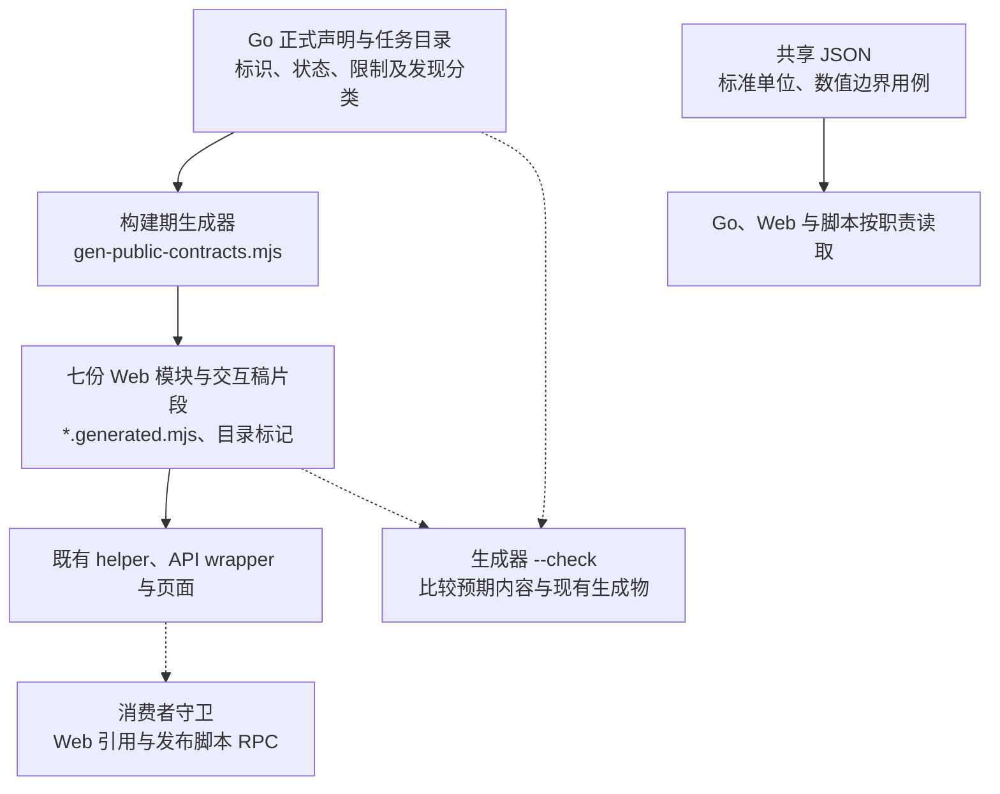
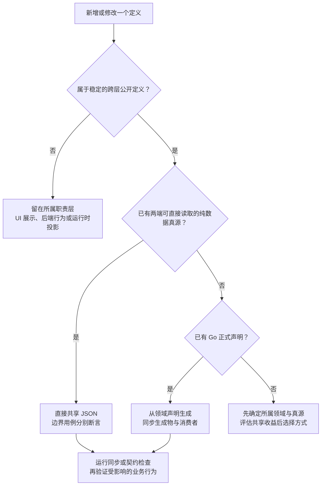

# 跨层公共契约与生成规范 / Public Contracts

本规范采用单一真源（Single Source of Truth，SSOT）与代码生成（Code Generation）。跨 Go、Web 和脚本重复使用的稳定标识、枚举与公开约束称为公共契约，由所属领域的一份真源维护，通过构建期生成或直接共享数据文件供各层使用。新增和修改契约必须同时更新消费者，并通过只读同步检查。本文面向 Codex 会话和项目维护者；实际值以表内代码为准。

优先收口多个消费者必须保持一致的稳定定义，局部常量留在所属模块。新增生成或提取逻辑应有明确的同步收益，并保持修改入口、生成结果和验证链路容易理解。

## 真源与入口 / Sources

#### 标识、状态与访问约束

| 契约 | 唯一维护入口 | 消费方式 |
| --- | --- | --- |
| 错误码 | `server/internal/errcode/catalog.go` | `scripts/gen-error-codes.mjs` 生成原始码表；前端 `errorCodes.js` 和 `errorMessage.js` 保留分组、岗位文案与处理逻辑 |
| 权限码 | `server/internal/biz/rbac.go` 的常量及正式权限登记 | `PermissionCode`，由 `permissions.generated.mjs` 提供；继续使用既有权限 helper |
| 业务状态与类型 | `server/internal/core/status/**` 及 `server/cmd/public-contracts` 登记的业务层正式声明 | `statuses.generated.mjs` 按领域导出单据及明细、财务、流程与节点、生产和质检状态；前端保留显示文案、颜色和场景分组 |
| 附件公开约束 | `server/internal/biz/business_attachment.go` | `AttachmentPolicy` 提供大小限制和扩展名到 MIME 的对应关系；上传选择器和预检派生集合 |

#### 分页、输入与输出预算

| 契约 | 唯一维护入口 | 消费方式 |
| --- | --- | --- |
| 工作中心分页 | `server/internal/biz/work_center_pagination.go` | `policies.generated.mjs` 的 `WorkCenterPaginationPolicy` 提供默认每页 20 条与单页上限 100 条；桌面完整列表可选 20 / 50 / 100 条，概览、日历与手机按各自读取预算 |
| 业务表格分页 | `server/internal/biz/business_pagination.go` | `policies.generated.mjs` 的 `BusinessPaginationPolicy` 提供默认每页 50 条与单页上限 500 条；普通业务列表和 Web 共用，明细、看板、引用选择器和导出各用所属预算 |
| 密码公开限制 | `server/internal/biz/admin_password.go` | `policies.generated.mjs` 的 `AdminPasswordPolicy`；Web 分别检查 Unicode 字符数与 UTF-8 字节数，后端继续负责校验 |
| 销售订单导出预算 | `server/internal/biz/sales_order_export.go` | 同一生成模块的 `SalesOrderExportPolicy`；Web 完整性校验复用行数和 JSON 字节预算，后端负责快照、并发与准备超时 |
| 打印输出预算 | `server/internal/server/template_pdf.go`、`template_pdf_security.go` | 同一生成模块的 `PrintPolicy`；Web 图片、字体及 HTML 预检引用服务端限制，上传与本地图片压缩仍按各自用途处理 |

#### RPC 协议与调用合同

| 契约 | 唯一维护入口 | 消费方式 |
| --- | --- | --- |
| RPC 域与方法 | `server/internal/service/jsonrpc_dispatch.go` 及域 handler 的实际分发 | `RpcDomain`、`RpcMethod`，由 `rpcMethods.generated.mjs` 提供；前端 API wrapper 继续校验请求和响应 |
| RPC 调用字段与报文 | 同一实际分发、参数解析器、服务返回映射及其消费的 DTO；模拟值保存在 `server/cmd/public-contracts/testdata/rpc_examples.json` | 同一生成入口补齐 `server/docs/api.md` 的逐方法请求字段、返回字段与 JSON 示例；工作台直接解析该文档 |
| RPC 传输入口与协议信封 | `server/api/jsonrpc/v1/jsonrpc.proto` 经 `make api` 生成的消息描述、HTTP binding 与 `jsonrpc.swagger.json` | 同一生成模块导出 `RpcTransport`；按实际消息描述检查路由、请求 / 响应信封，不另维护字段表；修改 proto 先走原有 API 生成链路，不据此宣称全部业务参数已具备强类型描述 |

#### 数值、偏好与内容

| 契约 | 唯一维护入口 | 消费方式 |
| --- | --- | --- |
| 十进制范围 | `server/internal/core/value/numeric.go` | Go parser、单位校验和生成的 `NumericContract` 共同引用精度、位数及最大值 |
| 数值边界用例 | `server/internal/core/value/testdata/numeric20scale6.json` | Go 服务接口、业务正数校验和前端数值 helper 分别验证同一批输入 |
| 标准单位目录 | `server/internal/unitpolicy/units.json` | Go embed 与 Web 直接读取；业务数量仍使用已保存的单位精度 |
| 账号外观偏好 | `server/internal/biz/admin_erp_appearance.json` | Go embed 与 Web 直接读取允许的明暗模式、主题色、密度、表格线条及默认值；色值与文案由前端消费层维护 |
| 任务发现目录 | `server/internal/biz/workflow_task_catalog.json` | Go embed；生成 `workflowTaskDiscovery.generated.mjs`，并同步 `docs/product/ui-design/index.html` 中有明确起止标记的目录片段 |
| 受控项目手册正文 | `docs/manuals/管理员与实施手册.md`、`技术维护与运维手册.md` | `scripts/docs/project-manuals.mjs` 生成后端内嵌 JSON；`admin.project_manuals` 按当前账号返回，Web 通过生成的 RPC 方法读取 |
| 数据库文档 | Ent 生成结构及 `server/docs/database/table-catalog.json` | `server/cmd/schema-doc` 生成数据字典并检查漂移 |

公共契约由 `scripts/gen-public-contracts.mjs` 调用 `server/cmd/public-contracts`，使用 Go AST 读取实际声明，不启动业务服务、不连接数据库。

权限、状态、附件、RPC、数值、公开限制、任务发现共七份生成模块位于 `web/src/common/consts/*.generated.mjs`，随源码提交；正式 Web 制品不需要 Go 或生成器。任务目录同时生成交互稿的指定片段，生成及 `--check` 都不得改写片段外的设计内容。

同一生成入口维护 `server/docs/api.md` 的全部已登记方法字段与报文，并为 DEV 工作台输出 `web/src/dev-workbench/config/rpcInspection.generated.mjs`。接口中文名称与用途继续集中在 API 文档的业务域方法表；原有人工业务说明、字段领域约束和报文中的业务值保留，逐方法表格补齐当前后端字段，其余章节写入唯一生成标记内。

人工请求类型可以反映 usecase 的更严格限制，但不能超出后端解析器接受的类型。成功提示取实际返回或可解析的服务端映射，不统一替换为固定文案。工作台解析正式文档，不另维护方法目录、报文或运行接口；源码索引留在 DEV 边界内，不进入生产 RPC 模块。

生成的字段表按所属对象分组，长表分段，保留完整字段路径。阅读器须合并同一请求 / 返回小节的全部字段表，忽略解释性表格；共同的权限和模拟样例说明只在章节开头维护。

字段提取沿选定方法的真实分支跟踪参数读取、共用解析器、嵌套对象和数组；返回形状沿服务层的成功返回映射解析，只有实际序列化的 DTO 字段进入文档，不直接公开 repository / Ent 结构。表内区分必填、可选、条件必填和可空；允许省略不自动表示允许 `null`，缺省值、十进制字符串和 Unix 秒沿所属解析器解释。白名单接受但未参与赋值的字段明确标注。

动态 JSON 保留为 JSON，不推断其业务键；领域存在性、枚举组合、权限、状态、单位精度和幂等条件继续由所属 usecase 与正式专题约束，不把源码形状当作授权或执行证明。

模拟样例逐方法保存请求和成功 `data`。`handler-fixture` 表示来自服务层隔离夹具的成功调用，生成时关联当前测试源码；`backend-wire-shape` 表示按当前参数解析与成功返回映射构造，尚无该样例的成功执行证据。响应示例允许主要字段投影和数组示例项，完整返回字段查同方法表格。

生成器核对全部方法覆盖、测试来源、已知字段、容器、类型、必填、条件及 `null`，缺失、未知或不一致即失败；不连接当前业务数据库，不执行写入接口。示例 ID、版本、引用及幂等键仍须按实际业务替换，样例不能升级为 PostgreSQL、外部身份或第三方验收证据。

生产 Web 直接导入的服务端 JSON 同时属于镜像构建输入。新增或调整这类导入时，同步 `server/Dockerfile` 的共享 Web 构建阶段和 `web/Dockerfile`，在构建前按原相对位置复制文件。`release-artifact-bundle.test.mjs` 从生产源码提取这类依赖并校验两处复制合同；实际 Docker 构建仍单独验证，仓库内 Vite 构建通过不能替代镜像构建。

下图展示正式声明、任务目录和纯数据的共享路径。实线表示生成或消费，虚线表示只读检查；错误码与数据库文档使用表中各自的生成入口。



生成器只支持当前明确的声明形态。重复值、名称冲突、缺少目录和不支持的表达式必须失败；RPC 的条件分发还须验证方法谓词与目标 handler 的集合一致。主方法 switch 之外的 handler 转发不能因增加日志、多条语句、嵌套或返回包装而被静默忽略；当前无法提取时明确失败。调整源代码结构时一并更新提取器和反例测试，不以忽略错误或正则猜测跳过登记。

## 选择共享方式 / Choosing A Mechanism

新增或修改定义时，先用下图判断共享方式，再按表格核对职责边界。共享的是稳定定义；后端授权、业务执行和运行时配置仍按各自主路径处理。



| 情况 | 做法 |
| --- | --- |
| 现有 Go 代码拥有规则，两端需要相同标识或静态值 | 从正式声明生成前端常量，不再维护手写镜像 |
| 两端都能直接消费的一份纯数据目录 | 共享 JSON，沿用单位目录做法；不为共享而添加运行时查询或缓存 |
| 页面文案、颜色、布局和场景提示 | 留在消费层，以生成 key 建立映射；用覆盖测试检查遗漏 |
| 权限、状态流转、来源归属、事务和真实业务事实 | 留在后端正式 usecase / repository；前端常量和显隐不构成授权或过账依据 |
| 客户配置和当前登录人的有效权限 | 继续读取正式运行时投影，不能用构建期目录替代当前配置和授权 |
| 两端有意不同的输入行为 | 共享边界值和测试向量，分别校验各自职责；不为统一代码而放宽接口 |

不同领域即使使用相同的 `DRAFT`、`CANCELLED` 或 `done`，也保持独立枚举和流转规则。当前目录包括任务与业务进度、销售 / 采购 / 委外单及明细、生产订单与 WIP、采购入库 / 退货 / 调整 / 拒收处置、质检、库存批次 / 操作 / 预留、出货与财务放行、收付款类型 / 方向 / 状态与核销、用料审批、生产异常、流程实例 / 节点 / 类型 / 结束结果。

完整提取清单以生成器为准。触达相应业务判断时引用所属枚举；Promise 结果、图片加载、页面办理结果、看板分组和语义色调仍由消费层维护。

核销与红冲保留原记录，用独立反向记录撤回影响；两者复用 `FinanceAllocationStatus` 表示过账与反向记录。收付款源单使用 `FinancePaymentStatus`，应收应付等财务事实使用 `OperationalFactStatus`；查询、回读和展示按所属对象引用。

附件契约描述服务端可接受的文件。产品图片的前端压缩目标可以更小；本地打印图片处理也有自己的渲染限制。按各自用途保留这些规则，服务端继续检查实际文件内容、归属和权限。

数值用例显式记录 `rpcAccepted`、`positiveAccepted` 和 `uiNormalized`。例如 `1,234.50` 可在页面整理为 `1234.5`，原始带逗号文本不能直接提交接口；负数是否可用由业务操作决定。修改精度涉及数据库时，仍必须执行正式 schema / migration 和存量升级验证流程。

## 系统接入边界 / Integration Boundary

当前产品采用分层单体和 HTTP JSON-RPC。协议适配留在 `service / server`，业务动作复用所属领域 UseCase 与 repository 事务。增加调用入口前，先核对已有接口和领域入口；具体字段、响应、错误及重试能力见[后端接口合同](../../server/docs/api.md)。接口存在只表示内部产品能力，不自动成为对外开放承诺。

| 边界 | 当前约束 | 验证依据 |
| --- | --- | --- |
| 接口来源 | RPC method 从实际分发生成；传输入口从 Protobuf 描述符读取并核对生成 HTTP binding、Swagger。Swagger 只描述通用信封，业务字段按所属 handler / parser / DTO 维护 | `gen-public-contracts.mjs --check`、`server/cmd/public-contracts/transport_test.go` |
| 身份与授权 | 操作主体由服务端当前账号和可撤销会话确认；员工通过岗位 / 角色获得权限，合作方只具有身份类别对应的订单只读能力及绑定单位范围，不能获得员工身份。账号状态、客户配置与已有对象范围继续收窄。actor 由后端注入，客户端不得通过字段选择身份或扩大范围。新的协议入口必须执行同等授权，不得仅因调用 UseCase 就视为已授权 | [身份注入与伪造拒绝回归](../../server/internal/service/jsonrpc_integration_boundary_test.go)、直接接口授权回归、既有仓库范围回归；不以页面隐藏代替检查 |
| 业务写入 | 正式变更经过领域 UseCase 与受控 repository；状态、来源、数量和事务由所属领域维护。Workflow 完成不能替代 Fact 过账 | 既有领域、来源动作与真实 PostgreSQL 回归 |
| 并发与重试 | 按动作合同保留 `expected_version`、业务意图及其幂等键；回执与副作用沿既有事务保存。网络中断后的结果可能未知，先用原意图重放或读取原对象；版本冲突不得自动改成新版本提交 | 同意图并发、不同意图冲突、过期版本、事务回滚和响应丢失后的回读 |
| 观测与业务证据 | `request_id / trace` 用于技术链路关联，不能作为业务幂等键或替代业务审计。日志继续脱敏，操作者、回执、来源和事实按各领域原有真源保存 | 现有请求日志、运行审计和领域事件 / 回执测试 |

代表性接口合同不外推为全部 RPC 已完成外部集成验证。复用当前公共契约生成器、`affected` 和已有测试：修改 proto、生成 binding 或 Swagger 会选择同一只读同步检查，业务授权与并发结果仍由各自行为测试证明。

接入层的可替换性按实际消费者验证：调用方经同一 HTTP 合同、当前身份与领域入口办理，ERP 的状态、数量、余额和业务回执只有所属 repository 一份真源。标准 HTTP 客户端与生成客户端可互换；测试以真实 PostgreSQL 验证订单校对、上游到货、WMS 调拨和核销，覆盖重复请求、并发、实际响应丢失、权限收窄、错误输入及事务回滚。

测试不复制 ERP 领域实现，不使用 SQLite 或 mock 代替这些事务，也不把模拟普通员工会话等同于合作方授权。具体场景和测试源集中见 [API 合同的模拟接入验证](../../server/docs/api.md#模拟消费者与接入验证)。

合作方人员账号复用现有账号与会话，供应商 / 客户绑定及订单只读范围见[正式 API 合同](../../server/docs/api.md#合作方身份与订单只读边界)。A/B 模拟验证不代表真实第三方联调。系统调用身份和合作方业务写入待首个明确接入场景再建设；外部编号映射只覆盖实际交换对象。独立消费者出现时再确定对外兼容合同；同步方向与时效明确后再选择有界拉取或可靠推送。当前不增加通用插件安装器、外部账号表、消息总线、Webhook / outbox 或全业务变更订阅。

效能工作台在“开发资源 → 接口与集成”从同一生成物展示可搜索的接口清单，关联已有权限登记、正式合同和回归来源，明确区分缺失、读取失败与未验证；接入边界图作为辅助说明。完整检查结果仍以质量门禁原始回执为准，整体通过不推断逐接口通过。能力台账只随已实现能力边界变化更新，不登记本节暂缓项为待办。展示与证据边界见[工作台设计](研发效能工作台与CI-CD设计.md#接口与集成-__devintegration)。

### 接入方式选择 / Integration Selection

当前优先保障 ERP 核心业务稳定、可扩展、可维护，通过清晰的领域边界、接口契约、后端授权、必要的并发幂等和可重复测试支撑后续扩展。

实际第三方及上下游对接，待明确业务需求、对接对象和数据交换规则后再实施，不作为当前完成条件。已有实现继续维护，不因“以后可能需要”提前扩建适配器、业务写入或消息机制。

| 核对层次 | 当前状态 | 判断边界与依据 |
| --- | --- | --- |
| 已有实现 | 已有接口及其合同内的授权、并发幂等能力，以及受限的合作方订单只读基础 | 保留现有实现，具体能力和限制见[正式 API 合同](../../server/docs/api.md#代表性接口合同与系统接入边界)及[合作方只读合同](../../server/docs/api.md#合作方身份与订单只读边界)；不表示所有接口均已完成集成验证 |
| 模拟验证 | 使用模拟身份、客户端及隔离数据调用 ERP 的真实业务逻辑 | 仅验证对应场景，结果以[既有用例和运行证据](../../server/docs/api.md#模拟消费者与接入验证)及其源码身份为准，不能替代真实联调或验收 |
| 真实接入 | 尚无真实第三方或上下游系统接入 | 已有实现和模拟通过不代表完成真实接入，也不构成对外开放承诺；满足上述实施条件后再确定实际范围和验收规则 |

后续满足上述实施条件时，按协议、数据结构和业务语义的实际差异选择接入方式；同属 ERP、供应商或仓储系统，不代表能共用同一适配器。

| 接入情况 | 选择方式 |
| --- | --- |
| 调用方能够遵守现有接口契约 | 直接调用已有 API；实际开放前确定调用方身份、允许动作与对象范围 |
| 多个对接方接口相同，仅地址、凭据等连接配置不同 | 共用接入代码，按对接方配置；各自身份与授权范围仍独立核对 |
| 协议、字段、编号或业务语义存在实际差异 | 增加小型适配器，转换请求与结果，复用已有受控业务入口；以实际契约差异划分复用边界 |

适配器负责协议和数据转换、必要的外部编号映射；授权、状态、数量、并发幂等、事务与业务审计继续由 ERP 正式入口及所属领域维护。共用接入代码时，外部单号与幂等意图须保留来源边界，避免不同对接方串单或误判重复。上游“准备发货”“已经发货”和本系统“实际收货”分别按各自业务含义处理。

实际出现适配器后，在既有 API 合同中关联其实现、授权边界与验证依据；工作台继续读取同一合同和运行证据。模拟验证只证明对应场景，合作方身份、真实联调和验收按实际接入另行核对。

### 接入关系展示 / Integration Relationships

当前生成清单包含员工业务接口与合作方订单只读入口；身份、对象范围和字段投影分别以同源正式合同为准。真实外部系统及合作方业务写入未开放。方法详情显示当前接入方式与实际适配器关联；未在正式合同登记的关联明确标为未关联，不能把内部接口标为第三方已可直连。实际出现接入时，在既有方法合同中关联调用方、方向、接入入口、适配器、复用业务方法与验证依据，不建立平行接口目录。

以下仅为关系展示示例，均未实施。同一个业务 API 可以被直接调用和适配器共同复用，接入方式属于具体对接关系；出站适配器可能只是调用客户端，并不新增本地 API。

| 接入方式 | 调用关系（未实施示例） | 说明 |
| --- | --- | --- |
| 直接调用 | 对接方（遵守现有契约） → 现有业务 API（统一身份与数据授权） → 所属领域业务入口（状态、数量与事务规则） | 调用方遵守现有契约，仍须明确身份、允许动作与对象范围；不能绕过授权。 |
| 适配后调用 | 对接方（协议或字段存在差异） → 入站适配器（协议、单位与外部编号转换） → 现有受控业务 API（同等授权和领域校验） | 适配器按实际差异转换协议、单位及外部编号；授权、状态、并发幂等和事务仍由 ERP 维护。 |
| ERP 主动对接 | ERP 领域（发起对接请求） → 出站适配器（转换请求并处理外部结果） → 第三方 API（由对方系统提供） | 适配器可以只是客户端，不一定新增本地 API；超时、结果不确定及重试按实际契约核对。 |

工作台将上述示例与实际接入关系分开展示；示例、规则、代码或测试链接都不能替代真实运行与验收证据。

## 命名 / Naming

| 对象 | 约定 |
| --- | --- |
| 技术术语 | 本规范统一使用“公共契约 / Public Contracts”；采购、委外等业务文件继续使用“合同” |
| 文件与入口 | 命令入口沿用 `gen-public-contracts.mjs`、`public-contract-consumers.mjs` 和 `server/cmd/public-contracts`；Web 生成模块按职责命名并保留 `.generated.mjs` 标记 |
| 导出名称 | `PermissionCode`、各领域的 `…Status`、`AttachmentPolicy`、`NumericContract`、`RpcDomain` 和 `RpcMethod` 表达各自职责；测试源码解析工具沿用 `publicContractSource.mjs` |
| 标识成员 | 枚举成员采用大写下划线，RPC 方法按实际域名分组；标识值、大小写及 `CANCELED` / `CANCELLED` 的领域拼写以正式声明为准，改变它们须按接口或数据变更验证 |

## 版本边界 / Version Boundaries

本项目统一构建和发布。页面、组件、helper、执行器、内部目录和配置模块按职责命名，代码修订由 Git commit / release 身份追踪；不为普通模块维护独立版号，也不为假设的未来兼容预置版本字段。共享定义需要唯一真源，不自动需要独立版本体系。

| 对象 | 版本处理 |
| --- | --- |
| 同次构建内的函数、组件、目录与内部数据结构 | 同步修改生产者、消费者和测试；不增加模块版本计数 |
| 跨发布持久化或由独立读写者交换的数据格式 | 只有实际存在不兼容识别或解释问题时才保留格式版本；集中在必要的读写边界，不逐层给内部对象重复编号 |
| 代码新鲜度、配置内容和验收证据身份 | 复用已有 commit、内容摘要、配置 revision、批次身份和逻辑指纹；不新增并行计数器，不因纯文案或代码重构递增数据批次 |
| BOM、包装、工艺路线修订、并发控制与数据库迁移 | 按业务冻结、CAS 和迁移追溯规则管理；业务修订号、`expected_version` 和 migration 序号不属于模块版号 |
| 外部协议、依赖包与独立发布制品 | 遵循外部接口或制品合同，内部模块不复制其版本计数 |

新增或保留格式版本前，在对应设计或变更说明中交代实际生产者 / 消费者、跨发布或独立读写边界、不兼容差异，以及为什么现有结构校验或身份摘要不足。仅改常量名、加 `schemaVersion` 字段，或已经写入过回执，均不能证明版本设计必要；命名门禁通过也不代替这个判断。

客户配置的 `packageKey`、`catalogKey` 是稳定身份，不带人工修订序号。

正式、local-test 和 customer-trial manifest 的 revision 由 `customer-config-runtime-manifest.mjs` 的同一函数生成：排除 revision 自身，对完整 manifest 的对象键排序后取 SHA-256 的前 24 位，保留数组顺序，并加客户及用途前缀。

预览、权限、流程选择、目录或目标标记改变都会生成新 revision；配置哈希仍由后端规范化发布输入计算，用于不可变校验和切换 CAS，二者职责不同。

启动读取数据库已激活配置，核对客户、用途、目标和 product / dataset 配对，以及明确的运行环境开关；不得用源码里维护的“当前 revision / 上一 revision”白名单决定能否启动。已发布记录和快照保持不变，新发布必须走内容 revision、当前登记数据合同和原有 validate / publish / transition / activate / readback 链路。配置修订不自动推进模拟数据批次，正式数据更新也不自动推进结构格式版本。

回滚、重试激活已发布配置和密码轮换按冻结记录核验，不套用新发布的 revision 命名或内容生成规则。manifest 审阅证据、配置执行器、读回摘要及完成检查须同时覆盖这条路径；保存的 manifest 摘要、后端原记录的客户 / 用途 / 目标、product / dataset 配对、内容哈希、状态与切换 CAS 仍须成立。

试用配置切换与轮换仍须符合当前登记数据合同；允许启动读取历史记录不代表允许切换到另一数据批次。不能用重命名旧记录或新增“上一版”列表修复回滚。凭据轮换保留该操作实际读取的配置身份，交付回执必须与同目标 smoke 读回一致，不能与当前源码重新编译的配置身份比较。

同次构建的 DEV 摘要、会话、计划、工具 / 恢复状态、环境合同、操作投影和 CI / 压力报告外层响应使用稳定 `kind` 区分类型，并继续校验结构、目标、CSRF 和操作身份；不单独维护响应版本。远端 CI 报告由本地适配器投影给页面时，外层投影也属于同次构建，不能借用内部报告的持久化理由保留计数。

落盘 operation、readback、幂等索引、执行锁、报告、发布 / 回滚回执及数据库 migration 仍按各自读写合同核实，不能与外层 HTTP 响应一起机械删号。现有 `config_hash_version` 和持久化模块快照字段属于单独的存储清理范围，删除前须核对哈希、回放与存量转换，不能只改字段名。

`scripts/qa/phase-label-boundaries.mjs` 在现有 fast 门禁中阻断配置包 / 目录人工计数、试用配置上一版白名单、未登记的 `plush.dev-*` 格式号及 DEV 门禁目录 / 治理投影的编号；不按有限响应名称匹配，新增临时对象也必须受检。

该脚本的持久化清单只保留当前跨进程 / 跨构建读取的操作、readback、幂等及锁文件；新增或改变格式必须核对真实读写者，不能自行套用通用例外。移除这些现存格式前须证明未结束操作恢复、重复执行保护及原回执回放不受损。配置回归覆盖内容变化 / 不变、键顺序、用途隔离、跨配置启动、冻结身份回滚与轮换、错误目标 / 标记及回执不一致。

新增其他版本字段仍须完成本节的语义判断，不能把正则未命中当成设计获准。

清理存量时，先检查持久化值、哈希输入、幂等重放、审计与回滚消费者。无必要的内部计数直接删除并同步调用方；影响真实存量时通过受控迁移或一次性转换收敛，不静默改写已冻结数据或已执行 migration，不删除有效回执，也不为未采用实验保留 alias、fallback 或多套实现。尚不能安全移除的字段须说明具体数据依赖与后续处置条件，不能把暂时保护存量变成永久保留模块版本的理由。

## 修改步骤 / Maintenance

1. 定位字段或标识的所属领域及现有声明；优先扩展该真源。只有生成器不能读取现有正式声明时，才补有明确范围的提取逻辑。
2. 修改真源与必要的业务实现、权限登记或状态流转测试。新增公共值须保持含义明确、无重复；删除或改名时同步全部实际消费者。
3. 在仓库根目录生成，并检查 diff。生成文件不能手改，不通过测试运行自动改写它们。

   ```bash
   node scripts/gen-error-codes.mjs
   node scripts/gen-public-contracts.mjs
   ```

4. Web 使用 `PermissionCode.SHIPMENT_READ`、`WorkflowTaskStatus.DONE`、`RpcDomain.INVENTORY`、`RpcMethod.inventory.LIST_INVENTORY_LOTS` 等导出值。请求包装、用户提示和业务动作仍沿用现有 helper；文档字段提取不生成生产 DTO 或通用状态机。
5. API 新增、删除、改名，或请求 / 返回字段、必填 / 可空、默认 / 清空、权限、状态条件、幂等及错误合同变更时，同轮完成下表同步，使“接口与集成”反映实际后端。纯实现调整且调用合同未变时核对生成零漂移，不制造文档差异。

   | 同步内容 | 维护入口与完成条件 |
   | --- | --- |
   | 名称、用途与业务约束 | 更新 `server/docs/api.md` 的业务域方法表及相关人工合同；usecase 的权限、状态、对象范围、幂等和错误限制需人工核对，不能仅靠字段提取推断 |
   | 字段与请求 / 返回示例 | 先修改实际分发、解析器、返回映射或 DTO，再更新 `server/cmd/public-contracts/testdata/rpc_examples.json` 的模拟值和来源；执行上述生成入口，审查 API 文档、公共 RPC 标识与 `rpcInspection.generated.mjs` 的生成差异。无法解析的实际结构须扩展提取与回归，不手改生成物绕过 |
   | 权限与回归来源 | 按实际授权逻辑同步既有权限使用登记及相关测试；核对工作台的来源关联，缺失仍明确显示缺失，不能伪造来源或把关联、样例及生成一致标为执行通过 |
   | 删除、改名与消费者 | 清理失效方法表、人工合同、样例、API wrapper、测试来源和其他实际引用；由生成器移除对应生成内容，不保留已移除接口的别名或工作台平行目录 |

6. 运行同步与引用守卫，再按受影响领域运行测试。以下命令不修改生成物、不写数据库：

   ```bash
   node scripts/gen-error-codes.mjs --check
   node scripts/gen-public-contracts.mjs --check
   node scripts/qa/public-contract-consumers.mjs
   node --test scripts/gen-public-contracts.test.mjs
   ```

7. 涉及生成器时在 `server/` 运行 `go test ./cmd/public-contracts`。数值契约变动还要运行 Go 的 `TestJSONRPCNumericSharedVectors`、`TestPositiveNumericSharedVectors` 和 Web `numeric20Scale6.test.mjs`，按业务影响补单位精度、舍入及 API 回归。

   涉及工作台解析、展示或交互时，验证对应消费者与浏览器行为；仅改接口合同不扩成全工作台回归。交付说明真源、消费者、生成结果、实际验证与盲区。
8. 来源、生成、消费或检查路径变化时，同步本文图示并验证 Mermaid 语法与标签。图形选用、层级与复杂度沿用[可视化表达规范](可视化表达规范.md)，具体值由真源和生成物维护。

## 接口差异与执行证据 / RPC Review

接口目录检查以实际 RPC 分发为准，双向核对正式业务域方法表、人工调用合同与模拟样例。名称或用途缺失、重复登记、已删除方法残留、未知方法和失效夹具来源均须失败。生成区内的旧字段由生成器更新；人工说明不得作为保留旧接口的理由。

仓库根目录使用同一生成入口读取变更和核对样例：

```bash
node scripts/gen-public-contracts.mjs --review
node scripts/gen-public-contracts.mjs --review --staged --json
node scripts/gen-public-contracts.mjs --verify-examples
```

`--review` 默认比较 HEAD 与工作区，`--staged` 只比较实际暂存快照。它将 HEAD 和必要的 index 内容导出到独立临时目录，以当前提取器读取真实声明，结束后清理；不暂存、不提交、不写 refs 或生成物。报告区分方法、类型、必填、可空、条件、默认值、样例与实现变化，忽略源码行号；调用方索引复用消费者守卫的语法树，按基线和当前目录共同识别删除接口的引用。动态调用、权限、状态及业务语义仍须人工和行为测试核对，不据静态索引推断完整覆盖。

可执行样例仍维护在原 `rpc_examples.json`，用 `verification.test / case` 关联 `TestRPCDocumented*` 服务测试及精确方法子用例；登记不能代替执行。

测试将文档请求送入真实 handler、授权与用例，通过确定性的隔离 repository 夹具比较实际序列化响应与样例投影；明确覆盖正常请求和适用的未登录、权限、非法参数、缺失 / 空版本及版本冲突。未登记接口继续只声明结构样例或夹具来源；这些隔离服务测试不能代替 PostgreSQL 事务、真实系统联调或客户验收。

`--verify-examples` 复用现有 Go JSON 校验器拒绝零执行、失败、跳过和缺少方法 / documented 子用例的结果。原始事件与回执只写 `output/dev-workbench/contracts/examples.go.jsonl`、`examples.json`，关联 digest 及执行前后 commit / dirty / fingerprint。

工作台复核原始事件和源码身份；历史、缺失、损坏与失败单独显示，工作区执行回执不升级为暂存快照通过。合同差异、检查、样例执行和暂存文件集中在“接口与集成 → 本轮变更”；“测试执行 → 本轮验证”只保留摘要与入口。当前结论依据源码身份匹配后的回执，历史结果按需查看。

## 自动守卫 / Gates

`fast.sh` 的仓库检查校验两类生成物，fast Node 组执行公共契约及消费者测试。检查只读；CI 缺少生成物或出现漂移必须失败，不在 CI 自动生成后当作通过。

涉及接口来源、样例、正式 API 文档或相关生成物的提交，`pre-commit` 在原有 index 快照中执行同一 `--check`；未暂存的正确工作区文件不能补足实际提交，失败也不改写或重新暂存文件。`fast` 与 `affected` 同时选择固定的样例执行入口；执行只写 ignored 证据，不改生成物或业务库。

`phase-label-boundaries.mjs` 在 fast 仓库检查及 affected 文件检查中阻断已知阶段文案、内部目录计数和可明确识别的模块版号命名，覆盖 HTML。它保留格式标识、业务版本、外部协议与历史证据；不凭 `V` 加数字判断所有字符串，也不自动改写文件。新增格式版本是否必要仍按上面的版本边界核实。

消费者守卫用 ESLint 的语法树检查 `web/src` 中非测试、非生成的 JS / JSX / MJS：阻断手写已登记权限值、直接权限调用中的未知值、无效生成常量、已识别 JsonRpc 客户端的手写域／方法，以及方法与客户端域不匹配。测试保留字面量作为独立预期。动态方法分发仍须有对应 wrapper 和行为测试，静态扫描不宣称证明所有运行路径。

引用检查按导入绑定和词法作用域识别生成常量，覆盖命名别名、命名空间和不可变局部别名，不误检同名局部对象；权限数组、数组展开和不可变数组的未知值也须失败。`policies.generated.mjs`、附件和数值约束与状态、权限、RPC 一同检查。

同一守卫另检查 `scripts/deploy`、`scripts/lib` 的非测试 JS / MJS 和 `scripts/local-runtime-rehearsal.mjs` 中可静态识别的 RPC envelope、分支方法及本地 transport wrapper。它对照生成 RPC 目录检查脚本中的实际值，保留部署脚本的独立分发能力，不为脚本运行增加 Web 依赖。

HTTP 的 `POST` / `GET` 等外部协议方法不属于 RPC 方法。动态操作回放仍由对应执行器行为测试证明。

`affected.mjs` 对登记的后端契约声明、JSON-RPC 分发、生成物及提取 / 检查工具选择 `public-contracts-sync`、`public-contract-consumers` 与生成器测试。直接共享的外观、标准单位 JSON 选择对应 Web 检查；标准单位另选择 Go 目录测试。这些步骤只读，不生成、不迁移或写入目标环境。

`businessStatusCoverage.test.mjs` 将实际状态标签、颜色、筛选项及流程响应校验集合与所属生成枚举比较，检查缺项、未知项和重复值；有意仅展示子集的页面继续由对应场景测试说明。源码合同测试复用 `web/scripts/test/publicContractSource.mjs` 解析真实导入与静态成员，保留独立字面量预期。所有状态流转、RBAC、响应完整性和附件内容测试继续保留。生成物一致只能证明标识和静态值同步，不替代这些行为验证。
