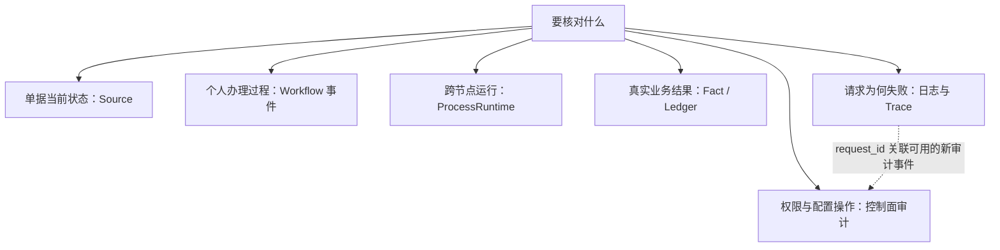

# 日志、审计与 Trace / Log, Audit And Trace

## 结论

plush-toy-erp 不建立一张万能审计表替代各领域事实，也不要求业务审计依赖 Trace 完整。当前证据按以下层次保留：

| 证据层                          | 当前真源                                                                                | 回答的问题                                                    | 不能替代                                       |
| --- | --- | --- | --- |
| Source Document 生命周期        | 各 Source 表、状态 / actor / reason 字段、领域 usecase 与部分领域事件                   | 单据提交、批准、拒绝、取消或关闭后当前是什么                  | 没有持久化事件时不能倒推完整状态历史           |
| Workflow 单任务事件             | `workflow_task_events`                                                                  | 一条任务何时创建、办理、阻塞、恢复、退回、催办或转交          | 跨节点完整审批链、ProcessRuntime 轨迹、Fact    |
| ProcessRuntime 运行证据         | `process_instances`、`process_node_instances`、linked task、durable result / effect ref | 某个来源流程执行到哪个节点、如何重试或结算                    | Source / Fact 权威状态和单任务处理记录         |
| Fact / Ledger                   | 采购、库存、质检、生产、委外、出货、收付款、核销和财务领域表                            | 哪个业务事实真实发生、取消、冲正或调整                        | Workflow done、控制面操作日志或 Trace          |
| 系统控制面审计                  | append-only `runtime_audit_events`                                                      | 账号、岗位 / 权限、客户配置、流程发起身份、任务转交、break-glass 等管理动作 | 采购、库存、质检、出货、生产或财务通用业务流水 |
| request_id / Trace / 结构化日志 | 请求上下文、日志与 OpenTelemetry span                                                   | 一次技术请求经过哪里、在哪一步失败                            | 业务审计、领域状态历史和客户验收               |

当前运行审计写入时会从服务端请求上下文取得非敏感 `request_id`，规范化后放入新事件 payload；调用方自报或大小写变体会被丢弃，输入 payload 不被修改。该关联没有回填历史记录，也没有独立 `trace_id` 审计字段或专用 request_id 查询合同。

链的对象范围、排序和缺失证据规则见 [业务链与运行轨迹边界](../architecture/业务链与运行轨迹边界.md)。

## 按问题定位证据 / Evidence Map

以下是查证入口，不表示所有业务对象都已有完整历史。虚线表示技术请求关联；业务结论回到对应的持久化记录核对。

## 关键原则

- 操作日志不是备注。备注可以解释背景；审计必须说明操作者、角色、对象、动作、前后状态、结果、时间和可用的 request_id。
- 当前状态不是状态历史。只有持久化的 transition / event 能证明中间状态。
- 审计记录不允许普通编辑或删除；纠错追加新事件，或执行领域取消、冲正、调整、恢复和补偿。
- Workflow task done 不等于 Fact posted；approval 只推进相应 Source 或决定，独立领域命令才写库存、出货、生产、核销或财务事实。
- ProcessRuntime 业务轨迹和单任务处理记录分开查询；单任务事件不能称为完整审批链。
- request_id / trace_id 用于关联技术请求。Trace 可能采样、跨服务中断或缺失，业务审计不能依赖它是否完整。
- 页面审计列表是只读投影，不是新的业务真源；前端隐藏也不是审计或权限边界。
- 领域审计与 Fact / Ledger 各自保留业务语义；不得用一张跨领域万能审计表覆盖它们。

## 审计记录最低字段

新增正式 mutation 时，应先判断证据属于 Source、Workflow、ProcessRuntime、Fact / Ledger 还是控制面；再按该层保存最低字段：

| 字段                  | 最低要求                                                                                   |
| --- | --- |
| actor                 | 认证管理员 / 用户 ID；系统动作使用明确系统 actor，不接受页面自报                           |
| actor role            | 服务端按当前有效角色、任务 owner / pool 或领域责任推导；不能只保存前端选择标签             |
| target                | 稳定对象类型和 ID；业务单号只作可读摘要                                                    |
| action                | canonical 动作 / 事件 key，一码一义                                                        |
| before / after        | 只保存必要的非敏感状态或受控摘要；Fact 纠错优先引用正反向记录                              |
| result                | success / rejected / blocked / failed / compensated 等明确结果，不能把请求收到写成业务成功 |
| reason                | 退回、阻塞、恢复、取消、冲正、转交、break-glass 等动作按合同必填                           |
| version / idempotency | 高风险写入保存或可关联 CAS version、intent / receipt，支持精确重放                         |
| request_id            | 从服务端请求上下文派生；缺失时不伪造，不能由调用方覆盖                                     |
| time                  | 数据库或服务端权威时间；不信任浏览器自报                                                   |

## 模块级覆盖矩阵

`confirmed` 表示已登记代码层证据；`partial` 表示只覆盖部分动作或字段；`absent` 表示没有正式持久化 / 查询合同。它们不表示本次已重新执行全部测试，也不证明目标运行状态。

### Source Document 生命周期

**权威业务证据**：销售、采购、生产、委外、FinancePayment、InventoryOperation 等对象状态、actor / reason 和领域事务

**控制面 / 任务证据**：关联 ProcessRuntime / WorkflowTask 只作协同证据

**当前覆盖**：`partial`

**主要缺口与边界**：各对象覆盖形态不一，没有通用状态历史链；没有 transition 记录时不能从现值倒推

### Workflow 任务创建与状态动作

**权威业务证据**：`workflow_tasks` 当前状态

**控制面 / 任务证据**：`workflow_task_events` 保存 created、状态、actor role、reason、task version 和 receipt

**当前覆盖**：`confirmed`

**主要缺口与边界**：只覆盖单任务；按事件 ID 最新在前，最多最近 100 条并返回 / 展示 `truncated`，不能冒充跨节点完整审批链；cursor 尚未实现

### 任务阻塞 / 恢复 / 退回 / 完成

**权威业务证据**：`workflow_tasks` + 当前业务投影

**控制面 / 任务证据**：`workflow_task_events` 前后状态、原因、版本；恢复清理旧阻塞原因

**当前覆盖**：`confirmed`

**主要缺口与边界**：`blocked`、`rejected`、resume、业务取消和流程补偿不是同一动作

### 任务催办 / 升级

**权威业务证据**：任务状态不变

**控制面 / 任务证据**：`workflow_task_events` 的 urge / escalate 类事件与原因

**当前覆盖**：`confirmed`

**主要缺口与边界**：不证明外部消息已送达；不存在独立通知链

### 任务转交 / 退回责任池

**权威业务证据**：`assignee_id / version` CAS

**控制面 / 任务证据**：task event + `runtime_audit_events`，保留 actor、目标、原因和 request_id

**当前覆盖**：`confirmed`

**主要缺口与边界**：只改变归属，不改变状态、owner pool、ProcessRuntime 或 Fact

### ProcessRuntime 节点与领域命令

**权威业务证据**：实例 / 节点状态、attempt、version、outcome、durable result / effect ref

**控制面 / 任务证据**：linked task 事件和结构化日志

**当前覆盖**：`confirmed`

**主要缺口与边界**：业务结果仍须回到所属 Source / Fact；通用跨流程审计查询不存在

### 销售 / 采购 / Shipment approval 责任

**权威业务证据**：active customer config immutable revision、审批责任投影和 frozen process revision

**控制面 / 任务证据**：publish / activate / save-and-activate 控制面审计；approval task event

**当前覆盖**：`confirmed`

**主要缺口与边界**：目标 active revision / effective session 和真实岗位 smoke 仍是环境证据，不由本地审计推断

### 收付款 / 库存调整 / 生产异常 approval

**权威业务证据**：各 Source 决定与后续领域 Fact

**控制面 / 任务证据**：固定责任池 approval / execution task、节点 result

**当前覆盖**：`confirmed`

**主要缺口与边界**：approval 不等于 post / execute；完整跨节点审批处理链仍无统一查询

### 库存

**权威业务证据**：`inventory_txns` 追加事实、balance / lot 权威读回、Source actor / reason

**控制面 / 任务证据**：关联任务 / 节点仅作协同证据

**当前覆盖**：`partial`

**主要缺口与边界**：各库存动作没有统一业务审计投影；不能用 runtime audit 替代流水

### 质检

**权威业务证据**：`quality_inspections` 来源、状态、判定、actor、时间及批次联动

**控制面 / 任务证据**：关联任务 / ProcessRuntime 仅在具体流程存在时保留

**当前覆盖**：`partial`

**主要缺口与边界**：模块级统一 before / after 查询和 request_id 关联覆盖未完整核对

### 出货

**权威业务证据**：Shipment 状态、财务门禁 actor / time / process anchors、`inventory_txns.OUT / REVERSAL`

**控制面 / 任务证据**：Shipment 财务 approval task / 节点

**当前覆盖**：`confirmed` 主链、`partial` 统一审计

**主要缺口与边界**：财务 approval / release 不能代替 `SHIPPED`；没有单一页面同时证明所有事实

### 生产 / 委外

**权威业务证据**：订单、WIP、生产 / 委外 Fact、异常决定 / 执行、库存反向记录

**控制面 / 任务证据**：排程 / 来源提醒 / 正式异常流程各自事件

**当前覆盖**：`partial`

**主要缺口与边界**：WIP、Fact、来源提醒和正式异常申请必须分层；模块级审计覆盖仍不统一

### 收付款 / 核销 / 财务

**权威业务证据**：FinanceFact、FinancePayment、Allocation、CreditNote 及不可变反向记录

**控制面 / 任务证据**：FinancePayment approval / execution task 和节点

**当前覆盖**：`confirmed` 主链、`partial` 统一审计

**主要缺口与边界**：银行直连、流水导入、总账和税控范围外；客户财务 UAT 未执行

### 账号创建、启停、注销、重置

**权威业务证据**：`admin_users / sessions / roles` 当前状态

**控制面 / 任务证据**：`runtime_audit_events` 非敏感 before / after、session revoke 摘要、request_id

**当前覆盖**：`confirmed`

**主要缺口与边界**：不记录密码、密码 hash、token；当前审计页不是用户行为分析平台

### 角色、权限、菜单 / 数据范围

**权威业务证据**：RBAC 表和 role settings version

**控制面 / 任务证据**：`runtime_audit_events` 保存非敏感变更摘要和 request_id

**当前覆盖**：`confirmed`

**主要缺口与边界**：super admin 不因此成为业务岗位；字段策略和业务权限不可混用

### 客户配置 publish / activate / rollback / 原子保存生效

**权威业务证据**：immutable revision、hash、active pointer 与完整投影

**控制面 / 任务证据**：`runtime_audit_events` 保存 actor、target、摘要和 request_id

**当前覆盖**：`confirmed`

**主要缺口与边界**：不保存 compiled snapshot / raw customer payload；目标环境读回另验

### 附件上传、下载与撤销

**权威证据**：`business_attachments` 保存 owner、文件元数据、SHA-256、`object_key`、上传和撤销审计；文件内容经统一 S3 存储读取。普通证据只可单向撤销，产品图片另按槽位替换或清空。

**覆盖与边界**：权限、owner、Workflow 冻结 revision、状态及版本检查沿所属对象执行；下载重验大小与 SHA-256。统一上传 / 下载动作审计仍是 `partial`，不能用存储成功代替完整业务审计。

撤销状态束、精确重试、普通下载拒绝、上传事务、遗留对象和配套备份只在[业务附件边界](../architecture/业务附件证据边界评审.md)维护；S3 故障日志与运行恢复入口见[集中日志](集中日志接入与运维.md)和[附件存储与恢复](../../server/deploy/compose/prod/README.md#附件存储与raid5)。目标恢复是否通过须读取对应回执。

### request_id

**权威业务证据**：结构化请求上下文；新 `runtime_audit_events.payload.request_id`

**控制面 / 任务证据**：服务日志和控制面审计可关联

**当前覆盖**：`partial`

**主要缺口与边界**：历史事件不回填；领域表没有统一 request_id；不得伪造缺失值

### trace_id / span

**权威业务证据**：OpenTelemetry runtime span / 结构化日志

**控制面 / 任务证据**：无统一业务持久化字段

**当前覆盖**：`partial`

**主要缺口与边界**：可能采样或缺失，不替代审计；是否持久化需独立评审

## Workflow 与 ProcessRuntime 事件口径

### 单任务事件

| 动作              | 任务事件要求                                                                                               |
| --- | --- |
| 创建              | 记录任务、初始状态、来源、owner role / pool、创建人和版本                                                  |
| 完成              | `ready → done`，记录 actor role、版本和 receipt；若 linked ProcessRuntime 后续结算失败，保留可重试未知结果 |
| 阻塞              | `ready → blocked`，非空原因；不结算为终态                                                                  |
| 恢复              | `blocked → ready`，非空解除说明并清理旧阻塞原因                                                            |
| 退回              | `ready → rejected`，非空原因；任务终态，不自动把 Source / Fact 写成 rejected                               |
| 催办 / 升级       | from / to 状态相同，记录实际 urge / escalate 动作、actor、原因和计数                                       |
| 转交 / 退回责任池 | 只更新 assignee / version，记录原 / 新归属和原因；不改 owner pool、任务状态或 Fact                         |

`list_task_events` 只查询当前任务的处理记录。公开 `limit` 最大为 100，服务端用第 101 条判断并返回 `truncated`，页面在存在更早记录时明确说明当前只是最近记录；cursor 尚未实现。ProcessRuntime 业务轨迹另由 `get_task_process_context` 根据实例 / 节点锚点查询；两条链必须保持独立错误状态。

### ProcessRuntime 与领域命令

- approval 节点只记录决定和责任；Source 的批准 / 拒绝由登记的领域命令写入。
- domain command 的业务 side effect 和 durable result / effect ref 在所属领域事务中一起提交。
- Workflow task 成功而节点对账失败时保留可恢复证据。服务端对账器使用两个有界游标：一条结算终态 linked task 与 active 人工 / 审批节点的缺口；另一条补齐缺失 linked task、已持久化领域结果的节点结算、completed 节点路由和 end / 实例完成缺口。只依据持久证据幂等恢复，单条失败不会永久占满首批。

  日志使用 `component=process_runtime_workflow_reconciler` 和 task / process / node ID，不保存 payload 或审批意见。
- 对账器可以结算已有 `domain_command` durable result，但不重新执行领域副作用、不按客户配置启动新流程，也不替代补偿恢复、逾期升级、通知或通用 outbox。
- 取消、冲正或补偿必须标记领域 effect；已完成节点读到已补偿结果时失败关闭，不重复副作用。
- Shipment 财务 release 只写版本化门禁；真实出货、库存 `OUT`、应收、发票和收付款分别由独立领域动作记录。

## 附件完整性边界

当前基础附件能力以 `owner_type + owner_id + attachment_type + slot_key` 绑定业务对象，保存文件名、MIME、大小、SHA-256、上传人、备注、时间和内容。产品内验证至少覆盖：

1. 上传前按所属对象读取 / 写入权限校验，不能只看附件菜单。
2. 下载按同一 owner 对象权限重新校验；返回长度和 SHA-256 必须与持久化元数据一致。
3. 普通业务证据附件没有通用删除；不得通过前端隐藏或直接 repo 删除绕过。
4. 产品图片槽 replace / clear 是窄版媒体生命周期，不外推成普通证据删除。
5. 文件名、MIME、大小和 hash 可记录；原始文件内容不得写入日志、Trace 或通用审计 payload。
6. 附件正文通过 S3 存储，PG 保留元数据；存储不可用时文件操作失败关闭，没有 PG 内容回退。备份与恢复按 [附件存储合同](../../server/deploy/compose/prod/README.md#附件存储与raid5) 保存配套 PG dump、文件及 manifest。病毒扫描、OCR、保留期或外链不因此视为已实现；目标恢复仍需独立证据。

## 日志与 Trace

- 服务端 JSON 日志保留 request / trace 等公共字段，请求完成摘要按 `success / canceled / rejected / error` 分类；JSON-RPC 内部入口的 DEBUG 消息仍以文本放入日志字段。

  系统故障统一由错误码真源的 `IsSystemFailureCode` 判断；短信服务不可用或额度耗尽也计入系统／依赖故障，验证码冷却、权限不足和业务条件拒绝保持 `rejected`。日志、错误指标和 Trace 共用该分类。业务错误类别与前端文案优先级见[API 错误合同](../../server/docs/api.md#默认返回结构)。

  仅请求上下文已取消且错误链全部为 `context.Canceled` 时，使用 `49900` 和 INFO / `canceled`，不重复输出内部 ERROR。超时、未取消请求中的依赖取消及混合真实故障仍保留系统错误。取消不表示业务成功或写入回滚，实际结果须读回权威对象。错误响应保留 `X-Request-Id`，用户界面展示岗位可理解的提示，不暴露 stack、SQL 或原始异常。
- SQL trace 不记录 SQL text、模板、bind args 或参数值。数据问题通过受控业务 ID、request_id、trace_id 和领域事实关联。
- Trace attribute 不记录用户名、账号搜索词、手机号、密码 hash、token、完整业务 payload、附件内容或客户原始资料。
- `/healthz` 和 `/readyz` 只证明服务与登记硬依赖的技术状态，不证明业务动作、migration、岗位 smoke 或客户 UAT。
- request_id 可以帮助找到同期日志，但业务结果必须读回 Source / Workflow / ProcessRuntime / Fact 权威对象。
- 前端读取作用域释放时，原生 `AbortError` 仅附带受控的 owner、原因和请求代次，不携带搜索词、业务 payload 或凭据，不改变取消时机、权限与业务结果。浏览器 QA 将此来源与实际请求、文档和原生终止证据关联，正常取消单列保留；缺证据、已先失败、HTTP 错误及写请求中断仍按异常核对。取消不代表业务成功，完整判定与反向验证见 [浏览器交易验证](../../scripts/qa/README.md#输出与写入边界)。

## 敏感数据禁止项

不得写入日志、Trace 或通用审计 payload：

- 密码、密码 hash、验证码、session、cookie、token、API key、Secret、完整 DSN。
- 完整客户配置、导入 raw payload、客户原始 Excel / PDF / 图片 / 邮件正文或附件内容。
- 无必要的姓名、手机号、地址、银行账号和其他 PII / 财务隐私。
- SQL bind values、完整请求 / 响应体、浏览器表单原文。

允许记录稳定内部对象 ID、canonical action / status、数量级摘要、耗时、错误码、request_id、经过脱敏或 allowlist 的 before / after 摘要。

## 验证与目标证据

| 证据                             | 能证明                                                                | 不能证明                         |
| --- | --- | --- |
| 单元 / service / repo tests      | payload 规范化、request_id 防伪、事件字段、权限、状态、幂等和事务边界 | 目标数据库已迁移或目标日志链可用 |
| 本地 / 隔离 PostgreSQL           | schema、约束、事务回滚和权威读回                                      | 当前目标制品已发布               |
| 浏览器回归                       | 页面术语、错误 / 空 / 无权 / 恢复态与接口消费                         | 客户真实岗位接受流程             |
| 目标 migration / release / smoke | 指定 commit / image、目标库和岗位技术路径                             | 客户 UAT / 签收                  |
| 客户 UAT                         | 客户按正式场景确认结果                                                | 不能由开发人员或自动化代签       |

本文只记录 Product Core 当前合同。目标 migration apply / 结构读回、当前客户 revision 发布 / 激活 / effective-session 读回、真实岗位账号 smoke、移动端岗位试用和客户 UAT / 签收均需独立证据。

## 服务端观测接入 Server Instrumentation

### 日志

集中采集、查询、Trace 关联与保留范围见[集中日志接入与运维](集中日志接入与运维.md)。RPC 错误指标复用请求完成摘要的系统失败分类，排除正常请求取消和业务拒绝。

- `cmd/server/main.go` 启动时会初始化全局 logger
- `service`、`biz`、`data` 层默认都会打日志
- HTTP 层已内置 `request_id` 过滤器，日志会自动带上 `request_id`
- 日志额外输出 `trace_sampled`；已采样请求的 `trace_link_id` 包含可跳转的 Trace ID，未采样时为空，Loki 仅使用非空值跳转 Jaeger
- 关键鉴权与后台账号链路已保留成功 / 失败日志；匿名管理员登录失败只记录稳定 reason，不记录原始用户名、密码、token 或 session key
- ProcessRuntime 的收窄后台对账使用 `component=process_runtime_workflow_reconciler`，只记录扫描 / 成功 / 失败数量、末次扫描 task / node ID，以及失败记录的 task / process / node ID，不记录任务 payload、审批意见或客户业务字段

### Trace 链路追踪 / Trace

- HTTP JSON-RPC 使用 `rpc.<domain>.<method>` 描述请求，记录 request ID、结果码与 `outcome`；格式非法的名称及未知路由 / 方法错误响应归并为 `unknown`。日志、指标和 Trace 共用结果分类；HTTP 200 内的系统失败也标记为错误，正常业务拒绝记录为 `rejected`，保持原有响应合同。
- 服务端、SQL、业务与附件调用沿用 W3C `traceparent` / `tracestate` 父子关系，不传播调用方 baggage。自定义 HTTP 路由继续使用统一观测、recover 与收尾日志。
- 管理员认证和管理分别使用 `biz.admin_auth`、`biz.admin_manage`。库存入账、采购收货 / 退货过账、生产 / 外发事实过账、实际出货、财务过账 / 结算 / 收付款 / 冲正，以及质检提交 / 通过 / 拒绝均有显式业务 span。
- PDF 有独立的排队与渲染 span；附件 S3 上传 / 读取使用 client span，覆盖对象操作和完整内容读取，但不记录对象 key、文件内容或存储凭据。
- ProcessRuntime 后台对账分别创建 workflow / node 批次根 span，记录扫描 / 完成 / 失败数量与结果；批次日志关联同一 Trace，单条 SQL 不再独立成为后台根 Trace。
- SQL tracing 仅在有效父上下文下记录耗时、错误和链路关系，不记录 SQL text、语句模板、bind args 或 SQL 参数值，避免客户、账号、手机号、业务 payload 或密码哈希进入 Jaeger。
- 业务 trace attribute 只记录 ID、数量、状态、耗时或已脱敏值；不记录用户名、账号搜索词、手机号明文、密码哈希、token 或业务 payload 明文。新增业务 / 附件 span 与 RPC 错误状态使用受控说明，不复制原始错误文本。
- `ParentBased` 采样保留上游决定；本项目创建的业务根 Trace 使用 `TRACE_RATIO`，开发配置为 `1`，部署默认 `0.1`。后台对账根 Trace 使用 `min(TRACE_RATIO, 0.1)`；无父上下文的 health / ready / runtime identity 探针不导出。
- 比例采样无法保证每个错误都有 Trace；请求完成日志、错误指标及持久化审计沿用各自合同。排障可临时提高 `TRACE_RATIO` 后通过正式重启 / 发布入口加载，结束后恢复原值。
- 初始化会创建 `startup-span`，是否导出仍受根采样率控制。部署 Trace 的持久化、7 天保留和内存预算见 [Compose 部署说明](../../server/deploy/compose/prod/README.md)。

### 关键业务入口的追踪 / Critical Business Entry Tracing

业务 span 必须覆盖页面实际调用的权限入口，以及 ProcessRuntime 的正式领域命令入口。流程命令在校验、执行、持久结果重放和节点结算之外包裹同一个 span；名称只使用已注册的命令，属性只保存服务端读出的 `process.instance_id`、`process.node_id` 和 `process.command`，不记录 payload、审批意见或幂等键。

| 业务 | 普通业务入口 | 正式流程命令入口 |
| --- | --- | --- |
| 采购收货入库 | `PostPurchaseReceiptForAccess` → `inventory.post_purchase_receipt`，保留仓库范围校验 | `process.inventory.post_inbound` |
| 正式出货 | `ShipShipmentWithActor` → `shipment.ship`，保留操作者及出货门禁 | `process.shipment.ship` |
| 收款 / 付款过账 | 直接过账仍被领域门禁拒绝 | `process.finance_payment.post`，执行批准后的收付款与核销 |

`server/internal/data/business_trace_postgres_test.go` 的 `TestInventoryPostgresBusinessTrace` 复用正式 pgx 驱动、业务 Ent hook 和 SQL 追踪配置，在迁移后的隔离 PostgreSQL 中验证上述六条入口。

每条入口覆盖业务拒绝、成功和原意图重放，检查业务 span 与 SQL 的父子关系，并读回收货入账、实际出库、收付款及核销事实，防止重放重复写入。测试还在驱动层独立观察 `INSERT / UPDATE / DELETE`，逐笔确认写入对应的 SQL span 属于当前业务 span；即使前置查询正常、写入因上下文丢失而没有生成 span，也必须失败。

观察器只保留操作类型和 span 标识，不保留 SQL 正文或参数。它已被现有 `TestInventoryPostgres` 关键数据库测试前缀纳入执行。

同一测试中的 `production_connection` 子用例单独调用正式 `NewData`，执行真实查询并检查 SQL span 与父 span 的关联，防止正式数据库初始化漏挂 SQL 追踪。

真实采集验证可在同一隔离测试中设置 `BUSINESS_TRACE_OTLP_ENDPOINT=127.0.0.1:<临时采集端口>`；该测试只允许 loopback 采集器，按测试日志中的 Trace ID 查询读回。未设置时只验证进程内 span，不证明 OTLP 导出或 Jaeger 查询。

HTTP/RPC 的父链透传和结果分类由 `safe_tracing_test.go`、`request_logging_integration_test.go` 单独验证；这些证据不代表浏览器操作已有独立 Trace，也不代表目标环境已发布。

### 运行时与系统控制面审计

- 新库首次生产 bootstrap 管理员时会写入 `runtime_markers` 和 `runtime_audit_events`，用于记录一次性初始化是否完成、重复初始化或同名账号拒绝原因。
- 管理员创建、角色绑定、手机号调整、账号启停 / 注销、重置密码和角色权限变更会与 `runtime_audit_events` 在同一事务提交。手机号只保存掩码；会话失效只记录数量和稳定原因；不保存密码、token、密码 hash 或 session key。账号状态原因保留在账号状态记录和受 `system.audit.read` 保护的控制面审计中，不复制到通用 Workflow payload 或入口日志。
- 后台只读入口为 `admin.audit_logs` JSON-RPC 和 `/erp/system/audit-logs` 页面，受 `system.audit.read` 权限控制。
- 流程创建在同一事务追加 `process_instance_created` 事件，稳定 key 为 `process_instance.created/<id>`，只记录创建人 ID、可确认的当时岗位和流程 ID；该事件用于发起身份审计，不承载业务状态或 Fact。任务创建沿用不可变 `workflow_task_events.created`。历史缺值不回填，重放不追加；流程跟踪仅投影与创建人及流程匹配的岗位，不开放控制面审计正文。
- `runtime_audit_events` 和 `runtime_markers` 通过 Ent hook 拒绝普通 update / delete；更正只能追加新的受控事件或通过后续专门恢复流程处理。
- 这组表只承接服务启动安全审计和系统控制面审计，不是采购、库存、质检、出货、财务等业务动作的通用 `audit_events` 事实表。

### 已知盲区

- 当前覆盖主要服务端链路，浏览器页面操作没有独立 Trace；普通业务读取通过 RPC / SQL 定位，关键业务写入的完整链路仍需结合对应真实场景验证。
- `/readyz` 失败时虽然已有结构化日志，但响应体仍是简单文本
- JSON-RPC 内部入口的 DEBUG 消息仍有文本摘要，正式请求完成日志已提供结构化结果字段
- 当前 `request_id` 自动生成只覆盖 HTTP 链路，异步任务还没有统一 request id 策略
- ProcessRuntime 后台对账没有 HTTP request_id；它依靠持久化 task / process / node ID 定位，当前也没有独立告警或 durable outbox 指标
- HTTP 已有服务级 BBR 限流，但密码登录尚无按账号 fingerprint 和可信来源的共享限速；多副本部署不能把单进程内存计数器当成完整防爆破能力
