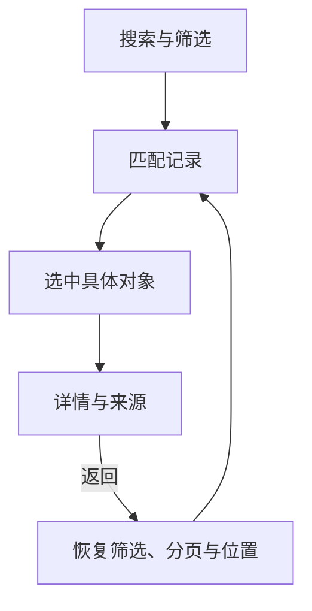
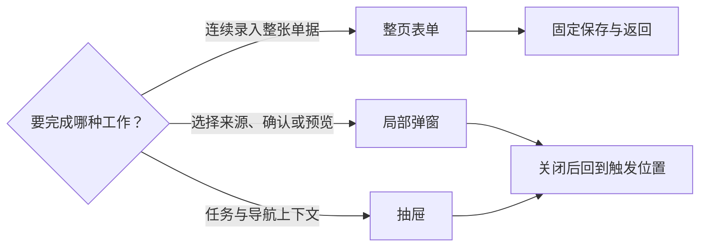
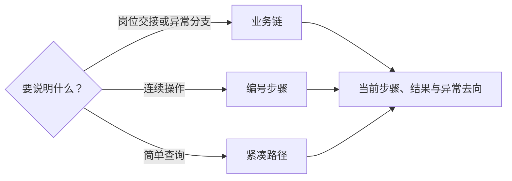
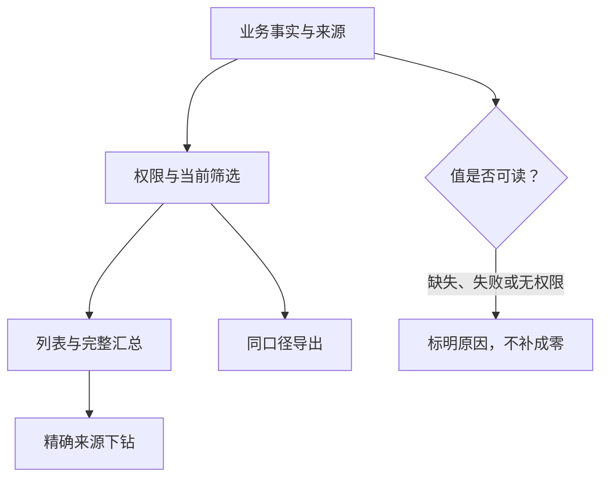
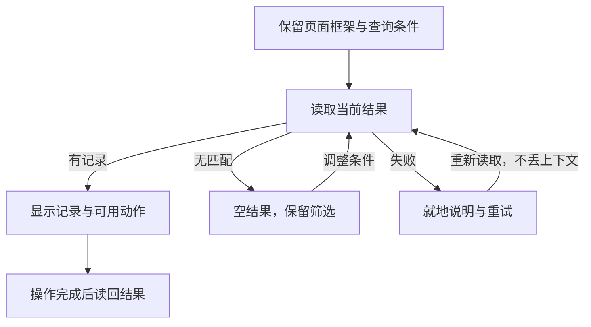
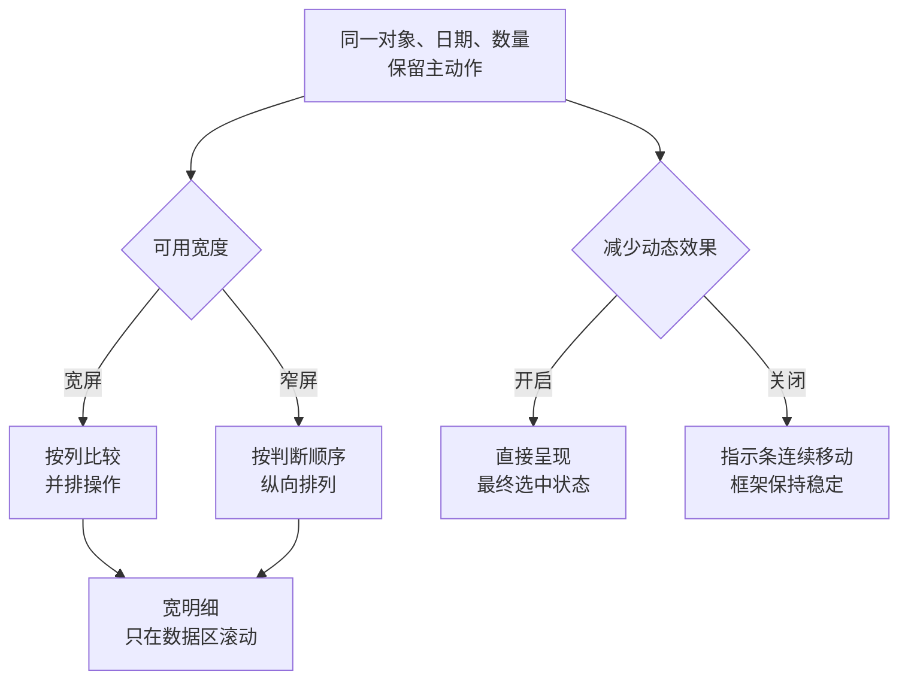
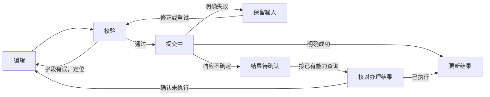
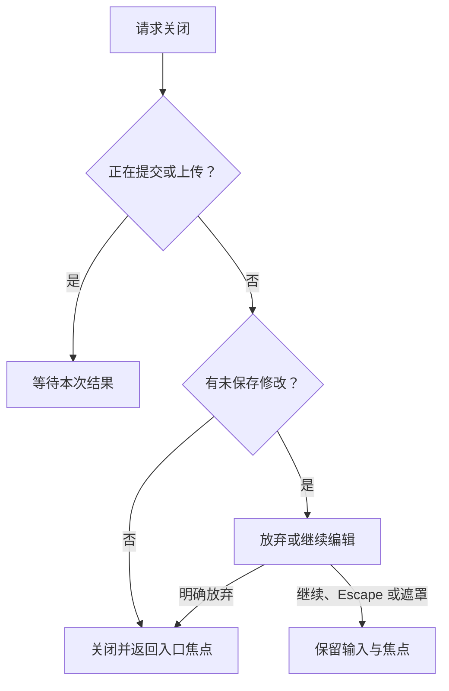

# ERP 交互设计说明 / ERP Interaction Specification

本说明定义统一 UI 的操作合同。读者是实现、测试及产品维护者；页面使用者只看到业务对象、状态和可执行动作。唯一交互参照为 [最新 HTML](index.html)，选择依据见 [设计依据](设计依据.md)。

| 要查的任务 | 对应章节 |
| --- | --- |
| 尺寸、主题、导航、控件与表格基线 | [视觉合同](#高保真视觉合同--visual-contract) |
| 整页表单、来源下钻和连续明细录入 | [页面结构](#页面结构--page-structure)、[明细编辑](#明细编辑--line-editing) |
| 桌面与手机任务、成品入库和异常处理 | [全端任务](#全端任务与成品入库--task-fulfillment) |
| 岗位指引、操作记录和历史查询 | [岗位帮助](#岗位帮助--role-help)、[记录中心](#操作记录与历史查询--record-centers) |
| 附件、弹窗、反馈、提交和关闭保护 | [附件管理](#附件管理--attachments)、[弹窗结构](#弹窗结构与尺寸--dialog-anatomy)、[反馈选择](#反馈选择--feedback-selection)、[提交恢复](#提交与恢复--submission-and-recovery)、[关闭与焦点](#关闭与焦点--dismissal-and-focus) |
| 工作台预览与实现核对 | [工作台演示](#效能工作台交互演示--engineering-workbench-preview)、[实现与验证](#实现与验证入口--implementation-and-verification) |

前端主题、偏好、共享样式与读取实现的职责由[前端实现与交互约定](../../engineering/前端实现与交互约定.md)维护；本文集中描述使用者可感知的交互合同。

## 图解阅读 / Illustrated Reading

先用图解理解机制，再按章节查完整规则。所有样例调整只影响讲解，不修改个人外观或正式页面。

1. **找主题**：在目录搜索布局、状态或规则，每次阅读一个主题。
2. **试变化**：点击图中位置或操作样例，观察布局与状态；尺寸对照和视觉分层在“设计依据”中体验。
3. **查规范**：切到“规范原文”，核对当前主题的具体条件。
4. **继续阅读**：主题、章节和搜索词保存在 URL 中，刷新及前进后退可恢复。

| 想弄清楚什么 | 阅读位置 |
| --- | --- |
| 页面由哪些区域组成，尺寸用在哪里 | “页面骨架”图解；“高保真视觉合同”章节 |
| 为什么采用当前边距、密度、颜色和层次 | [设计依据：空间与密度](设计依据.md#spacing-and-density)、[平面与层次](设计依据.md#flat-and-hierarchy) |
| 标题、状态、数量为什么这样排列 | “文字与对齐”图解；[设计依据：排版与阅读路径](设计依据.md#type-and-alignment) |
| 怎样下钻、选容器、恢复失败、核对来源及适配窄屏 | 对应主题的样例与关系图；具体业务见本说明及[可交互稿](index.html) |

| 图解内容 | 唯一来源 |
| --- | --- |
| 下钻、容器、恢复、来源和响应式关系图 | 直接读取本说明对应章节 |
| 206px 侧栏、48px 品牌栏、8px 页面边距 | `web/src/erp/styles/app/design-tokens.css` |
| 64px 收起侧栏 | `web/src/erp/styles/app/business-responsive.css` |
| 操作区内边距、页签、表格 | 对应共享布局、导航和表格样式 |

尺寸使用 CSS 像素；截图的物理像素还受浏览器缩放与 DPR 影响。

### 控件设计：在主内容区操作样例

“可交互设计”共用一条入口导航：业务界面、任务处理、手机版任务、效能工作台、登录页、岗位帮助、控件设计。任务处理由 `/__dev/ui-design?page=task-handling` 直达，复用同一 HTML 的业务外壳、任务列表与整页表单。控件设计由 `/__dev/ui-design?page=controls` 直达，在主内容区阅读和操作，不使用总览抽屉承载整套规范。

| 区域 | 内容与行为 |
| --- | --- |
| 左侧目录 | 按用途选择组件选用、业务表单与明细、来源选择、基础输入、日期与时间、弹窗与反馈、页签与视图、筛选与搜索、按钮与动作、页面状态和数字提醒；支持按组件名称或场景搜索 |
| 组件选用 | 直接读取《前端实现与交互约定》的组件入口章节，查看用途、正式入口和复用边界；同源生成操作样例与真实页面导航，通用、业务组合及打印组件沿用各自源码归属 |
| 当前示例 | 只渲染当前分类的共享组件；弹窗、消息、提交和恢复沿用正式组件 |
| 阅读辅助 | 三步核对、场景对照表、图解与设计依据入口；共享实现按需展开 |
| 状态恢复 | `control` 与 `controlq` 分别保存分类和搜索；刷新、前进后退恢复阅读位置 |
| 重置与主题 | 重置当前区域的样例；浅深模式只影响控件预览，不写账号偏好 |
| 页面预览 | HTML 页面预览仍可下载和全屏；切入控件设计保留原预览现场 |

目录和正文独立滚动。筛选计数与列表使用同一份虚构记录；示例不执行业务写入或真实上传。

基础输入使用 Ant Design `Button`、`Input` 和共享 `AppSelect` 与项目主题，演示选值、清空、禁用和错误。日期与时间直接使用正式 `DateInput`、`DateTimeInput`、`DateRangeFilter`，保留即时回填、分钟录入、同源快捷截止、日期类型与起止约束；倒置范围可以查看错误、清空并重置。样例状态保存在当前组件内存中，打印组件与输出边界从组件选用进入正式打印专题。

“业务表单与明细”（`control=business-form`）直接使用正式整页表单、分区、明细和长文本组件，演示字段校验、增删及空态、多行备注、全屏编辑、未保存离开保护与首次失败后的重试。“来源选择”（`control=source-picker`）直接使用正式来源选择弹窗，演示搜索、跨页多选、停用限制、取消及重开、加载、空列表和失败恢复。两类仅在进入对应分类时加载；所有结果保存在当前示例内存中。

各操作分类提供真实页面入口及核对任务，在新标签页打开并保留当前演示；组件选用由同一份分类生成导航。页面名称与路径沿用业务模块定义，独立工作台的业务站点由现有部署目标在构建时确定。演示通过不能证明真实数据、权限、上传、远程引用或过账链路已经验收。

## 高保真视觉合同 / Visual Contract

以最新 HTML 的外观和操作路径为基准，正式页面接入真实数据与权限，并补齐异常、恢复和键盘路径。尺寸调整须核对实际可用空间，不自行恢复旧绿色卡片或扩大留白。

### 1. 先核对布局尺寸

| 部位 | 当前尺寸 | 用途与边界 |
| --- | --- | --- |
| 桌面侧栏 | 展开 206px；收起 64px | 展开读名称，收起给业务内容让出宽度 |
| 侧栏品牌区 | 48px | 品牌、首页和侧栏收起；业务内容顶部不再单独占用全局工具行 |
| 页面边距 | 8px | 隔开壳层与工作内容 |
| 独立操作区 | 上下 10px、左右 12px；1px 边框、10px 圆角 | 最外层统一承载切换、搜索、筛选和摘要；内部不重复套卡片 |
| 操作区到数据区 | 6px | 保持条件与结果相邻、职责可辨 |
| 桌面输入框与按钮 | 高 34px、圆角 8px | 密度切换不改变命中范围 |
| 业务卡片与表头 | 圆角 10px；表头高 40px | 数据卡片裁切内部内容，圆角外保持页面底色 |
| 表内顶部内容 | 上方 10px、左右 12px | 共享顶部插槽提供；页签和说明不重复叠加 padding |
| 主表与卡片边缘 | 上方 10px、左右 12px | 表头、单元格继续保留各自内边距 |
| 业务分区标题 | 竖条宽 3px、高 15px、圆角 2px | 主题色竖条、完整文字、浅色横线；窄屏不压缩竖条，标题可换行 |

分区标题本身不暗示可点击；只有可折叠区域显示展开箭头。标题动作放在横线右侧。

### 2. 标题与导航各做什么

| 元素 | 应展示 | 应避免 |
| --- | --- | --- |
| 页面主标题 | 对象名称，必要状态、视图或主动作 | 顶栏与内容区重复同名标题 |
| 页面操作 | 刷新位于当前页标题或工具栏右侧；窄屏同处提供导航菜单 | 独立占一条全局顶栏或重复提供刷新 |
| 风险与说明 | 在对应字段、确认或正文中说明异常、提交后果和证据范围 | 长期占据模块页签旁的说明 |
| 设计稿标记 | 版本与样例范围放在外层查看器或证据上下文 | 在模拟品牌栏、顶栏重复标签 |
| 侧栏顺序 | 工作中心、业务模块、工具与查询、系统与帮助四区直接显示 | “更多功能”折叠及同模块重复入口 |
| 侧栏超高 | 菜单独立滚动；底部固定账号，进入页面和刷新后保持选中 | 将整个页面撑高或将账号滚出可视区 |
| 收起按钮 | 品牌栏右侧切换展开 / 收起 | 收起后丢失选中态或账号入口 |
| 收起状态 | 隐藏品牌文字、业务分组标题；保留图标和完整名称提示 | 将桌面收起状态带到手机文字抽屉 |

同级模块使用稳定的线性图标，绑定模块身份，不随岗位授权或默认页面改变：

| 模块 | 图标 | 模块 | 图标 |
| --- | --- | --- | --- |
| 基础资料 | 资料库 | 销售 | 购物袋 |
| 产品工程 | 结构图 | 采购 | 购物车 |
| 委外 | 双向协作 | 生产 | 工具 |
| 库存 | 收纳箱 | 质检 | 盾牌勾选 |
| 出货 | 货车 | 财务 | 账本 |

工作台、任务、进度、工具和系统入口也各有独立图标。展开、收起和手机抽屉复用相同图标，菜单名称保留为可访问名称。

模块从侧栏进入，模块内页面通过页签切换；底部仅保留账号入口。设计评审的状态模拟位于预览查看器工具栏，不进入员工页面。

### 3. 颜色、内容面和浮层

| 层次 | 浅色 | 暗色 |
| --- | --- | --- |
| 默认主题色 | `#0a66c2` | 随所选主题采用浅色强调色 |
| 页面底色 | `#f2f5f3` | `#050607` |
| 侧栏与顶栏 | 共享壳层变量 | `#080a0c` |
| 内容面 | 白色 | `#0d1013` |
| 浮层 | 共享浮层变量 | `#121619` |
| 弱分组 | 共享分组变量 | `#151a1f` |
| 分隔线 / 边界 | `#dce4df` | `#2a3138` |

1. 电脑、手机、效能工作台共用这些层次；卡片间隙沿用页面底色，不用半透明白色叠底。
2. 暗色保持中性黑阶，侧栏、内容、卡片与浮层靠明度和边界区分，不压成同一块黑。
3. 主题色用于选中、悬停、焦点和主动作；状态色保留业务语义，不随换色改变含义。
4. 条目导航使用简洁列表，当前项用浅底色；独立内容使用细边框卡片；有明确顺序的流程使用步骤导航。岗位归属与业务状态使用文字或标签，不用粗单侧色条代替。该规则同时覆盖桌面、手机与效能工作台，时间线、图表标记和键盘焦点按原有语义保留。
5. 暗色主按钮用浅色强调底与近黑文字；黄色主按钮也使用深色文字，不残留固定绿 / 蓝底块。
6. 吸顶工具栏和固定操作区使用不透明背景，滚动内容不能穿透；弹窗、抽屉、筛选和列设置同样随主题变化。
7. 打印纸张及模板缩略图的纸面保持白底；外围导航、工具栏和预览容器随主题变化。

### 4. 页签、表格与密度

页面内导航 Tab 优先一层，最多两层；侧栏与手机底部全局导航不计入页面内层级。第一层切换主要工作，第二层切换该工作下的内容，不再向下嵌套第三层。同一页面不能把统计明细或筛选改名成视图后继续堆叠同等视觉重量的切换条。

| 用途 | 控件与层级 |
| --- | --- |
| 第一层导航 | 切换主要工作；选中使用主题色与 **2px 下划线**，未选中使用普通文字色；两者均为 **500** 字重，保持文字宽度 |
| 第二层导航 | 切换同一工作下的内容时继续使用下划线页签，通过位置与间距表达从属关系；流程进度 / 异常跟踪、电脑待办列表 / 日历属于内容导航 |
| 工作方式、显示方式与设置值 | `SlidingSegmented`；使用圆角底轨、中性细边框和主题浅色选中滑块，适用于电脑 / 手机、表格 / 图形及外观选项 |
| 缩小当前结果 | `FilterChip`、搜索与筛选入口；状态用独立小型按钮与 `aria-pressed` |
| 数量统计 | 普通文字；只展示数量时不可点击 |
| 下拉选择 | React 页面使用 Ant Design `Select`，覆盖业务表单、打印工具与开发工作台；独立 HTML 使用共用的 `ui-select`，帮助页也复用同一控件。展开层沿用页面主题、选中标记和焦点样式 |
| 关联明细 | 带数量和箭头的文字按钮，按需进入明细并提供明确返回；保留来源搜索、筛选、分页、已加载范围与滚动位置 |
| 效能工作台原处折叠 | 标题整行可点击，桌面至少 38px、触屏至少 44px；箭头固定占位，仅旋转。展开与收起保持标题位置、字号、边框及内边距不变；补充内容在标题下方展开，后续内容自然下移，已有状态、数量、副标题和默认展开规则保留 |

页面布局须让第一条业务内容尽早可见；不通过压缩手机触摸区域来减少高度。新增切换先判断是导航、筛选还是关联入口；关联明细不重复来源筛选栏。

下拉选择的触发器与选项列表共同遵循设计系统，不使用操作系统原生菜单。保留选项分组、禁用、多选和清空的业务语义；方向键定位，Enter 确认，Escape 关闭当前选择层，Tab 继续下一项。弹层在视口内按可用空间向上或向下展开，长列表局部滚动，关闭后恢复触发器焦点；选择导致页面导航时按目标内容管理焦点。React 原生 `<select>` 由 ESLint 拦截，独立 HTML 由原型合同与浏览器回归检查。

#### 控件宽度与拉伸 / Control Width

控件宽度按内容、任务与所在区域确定。桌面窗口变宽时，新增空间优先用于结果、图表和阅读内容；短名称下拉框与普通操作按钮不为填满容器而无限拉长。以下宽度是 CSS px 的布局起点，按实际长文本、数量和相邻控件验证后调整，不作为所有页面的固定规格。

| 场景 | 宽度与排列 | 验证重点 |
| --- | --- | --- |
| 工具栏中的状态、类型等短选择 | 通常从 160–240px 起；文字与清空、展开图标均可辨认 | 切换短／长选项后布局稳定，不挤掉相邻操作 |
| 筛选浮层中的单值字段 | 桌面使用 260px 的可收缩字段列，剩余空间不自动分摊给单个下拉框；768px 及以下按可用宽度整行排列 | 客户、供应商、仓库、操作类型及办理人筛选一致；筛选项变少时不突然拉长 |
| 对象、流程或规则定义选择 | 通常从 240–420px 起，标签紧邻；业务链路的三个定义选择器共用 420px 的桌面列上限 | 宽屏不占据整条内容区；选择、搜索、清空和返回仍可用 |
| 带时间、规模和结果的报告选择 | 压力测试的运行报告与比较基准共用 560px 上限，空间不足时换行并收缩 | 元数据可读，报告切换、清空与刷新恢复一致 |
| 客户、物料、来源单据等较复杂选择 | 复用所属表单字段列或来源选择组件；必要时加宽选项浮层、换行显示说明或进入来源选择窗口 | 不用拉长触发器容纳整个选项说明；完整身份仍可读取 |
| 普通操作按钮 | 文字、图标和统一内边距决定宽度；操作组按可用空间换行 | 不被 `1fr`、`flex: 1`、Grid 默认拉伸或 `block` 意外铺满；冗长说明移到相邻帮助，动作和必要风险含义保留 |
| 列表主搜索与业务表单 | 搜索可使用工具栏剩余空间；字段填满其语义列，备注或长文本按需整行 | `width: 100%` 指所属区域，不能直接等同整个页面；无重复标签与无效空白列 |
| 日期范围、多选与明细添加行 | 筛选日期、直接点选组和多选可占整行；BOM“添加物料”沿用整行明细入口 | 有空间展示区间、多个已选项或连续明细，不按单值选择器统一限宽 |
| 手机主操作、窄表单、导航条目与折叠标题 | 有明确触控、输入或整行点击语义时允许整行或等宽 | 保留原有触区、完整文字和点击范围，不因“看起来长”统一缩短 |

修正时先核对父子 Grid／Flex、宽度上限与响应式覆盖，修改所属布局；不全局给 `.ant-select` 或 `.ant-btn` 设统一最大宽度。选项内容多由搜索、分组或浮层阅读解决，按钮文案长先澄清动作；均不靠缩小字号或裁掉关键文字处理。浏览器核对宽桌面、收窄窗口、实际长选项及打开／选择／清空／恢复状态，确认相邻操作可达且无整页横向溢出。

按实际任务选择控件，选项数量和已有组件名不能单独决定外观。手机的“待办 / 已办 / 流程跟踪”、进度的“订单交付 / 生产执行 / 经营统计”以及测试验证主视图均切换工作内容，使用下划线页签；结果范围、风险条件与设置值保留筛选或分段按钮。同页相邻的切换先区分职责：登录页上方“电脑 / 手机”选择工作方式，下方“密码 / 短信”切换表单内容，分别使用分段按钮和下划线页签。

效能工作台页头使用当前主题浅底与细边框。总览搜索与分组、产品能力筛选、Skill 检查结果、安全与恢复范围和主视图、客户配置范围和紧凑步骤优先与标题同行，宽度不足时在同一页头内换行；页签始终保留挂载。目录选中项使用主题浅底、强调文字与下边标记，悬停不覆盖当前选中提示；真实告警、操作锁与结果时间保持可见，不按静态说明折叠。

| 内容 Tab 部位 | 数值与行为 |
| --- | --- |
| 整组 | 透明底，无选中底块；**1px 中性淡基线**分隔内容，圆角 0、整组内边距 0 |
| 单个选项 | 桌面点击区域至少 36px，字号 14px，左右内边距 12px；手机至少 **44px**，登录等既有宽松入口可保留更大尺寸 |
| 选中与未选 | 选中与未选均为 **500**，避免切换时挤动相邻项；选中沿用当前主题强调色，禁用项沿用禁用色 |
| 下划线 | **2px** 主题色，宽度跟随选中项；仅切换当前项时连续滑动，快速反向切换不中断，减少动态效果时立即定位 |
| 共享实现 | `SlidingTabs`、`SlidingTabList` 的 `erp-navigation-tabs`；内容独立挂载时可用 `SlidingTabList` 的受控 `options / value / onChange` 接口，手机整行导航使用 `block`；样式真源为 `control-affordance.css` |
| 共享范围 | 登录方式、手机任务与进度、流程跟踪、业务模块、详情、岗位帮助及效能工作台的内容导航 |
| 分段按钮 | `SlidingSegmented` 与 `hierarchy="secondary"` 均保留圆角底轨和选中滑块，不套用内容 Tab 的下划线；桌面整组高 38px、外圆角 9px、滑块圆角 6px，手机选项触区至少 44px |
| 其他导航 | 状态筛选、手机底部导航、侧栏及带说明的步骤卡保留各自语义与布局 |
| 暗色与吸顶 | 使用对应深色变量；吸顶容器保持不透明，页签本身透明，不残留白底 |

同类内容 Tab 使用统一的字重与下划线，分段按钮使用底轨与滑块；先判断是在切换工作内容、显示模式还是筛选条件，再选择控件。一级与二级通过位置、间距及内容关系区分。切换、选择器、搜索和说明沿同一阅读边缘排列。

桌面业务页面统一采用紧凑布局，独立于个人的表格行密度选择。页面外围 8px、独立区块间隔 6px；共享页头与工具区上下 6px、左右 12px。模块页头只由父容器提供一次间隔。整页编辑和专项办理弹窗的正文上下 10px，字段间距 10px × 12px，标签至输入 4px；保留输入高度、辅助说明和校验空间。工作台、任务管理、业务模块、查询和系统页沿用同一尺度；阅读正文与打印按用途保持自身版式，手机保留既有触控合同。

| 表格事项 | 规则 |
| --- | --- |
| 字体 | 系统中文字体，正文 13px |
| 标准 / 紧凑密度 | 默认“紧凑”；行高基准 52 / 42px，单元格上下留白 9 / 4px；长内容可撑高 |
| 密度覆盖 | 桌面业务列表、任务、权限矩阵、操作记录和效能工作台数据表 |
| 编辑表 | 单据、BOM、联系人只收紧留白，保留输入与校验空间 |
| 表格密度不改变 | 表头、按钮、筛选、卡片、手机页面与打印纸面尺寸；页面和卡片本身始终沿用紧凑布局 |
| 阅读对齐 | 文字从阅读边缘对齐，数量 / 金额右对齐；表头沿对应列对齐 |
| 复合信息 | 同一对象的主次信息按[复合信息与上下布局](#composite-cell-layout)成组展示，联系人、收货、物流、产品与库存信息沿用同一规则 |
| 表头分列 | 浅色标题带与完整竖向分隔，帮助区分每列 |
| 排序与操作 | 排序紧邻列名，当前排序用主题色，焦点清楚；排序、记录选择、明细展开各自命中 |
| 列设置 | 集中在工具栏，保留已有能力，不另加常用列切换 |
| 表格线条 | 默认“网格”，给数据及合计单元格加 1px 中性淡竖线；“简洁”只保留横线 |
| 线条偏好 | 与主题色、密度独立保存；保留排序、选择、展开、固定列滚动 |
| 专用版式 | 已有带边框表、编辑明细、手机卡片、打印版式保留自身设计 |

列表从上到下依次是：**页名与主 Tab → 必要的二级视图 → 状态 / 搜索 / 筛选 / 整表动作 → 当前记录操作 → 表格 → 分页**。模块名称与主 Tab 共用紧凑页头，选中页签已经说明当前页面，不再追加重复标题卡；单页入口显示页名与其主视图。工作台、任务管理、进度看板及效能工作台沿用相同结构，窄屏允许按自然顺序换行，Tab 在自身区域滚动。

任务管理的任务分类与进度看板的风险分类放在搜索左侧，与搜索、筛选及必要辅助操作共用一行；宽屏横排，空间不足时自然换行，分类标签保持完整。已选条件摘要按需另起一行，主视图和列表 / 日历切换保留各自层级。

业务列表按作用对象分组：模块 / 视图导航一层，查询与页面动作一层，常驻当前记录操作一层。1440px 和 1280px 桌面优先保持 2–3 行；有实际用途的二级视图允许第 4 行。当前对象、清空选择、任务协作与直接动作共用一行，不增加分类标题行；600px 以下允许对象与动作分行，不压缩字号或触区。错误和恢复提示按实际状态出现，不计入常态行数。

| 操作范围 | 位置与显示条件 |
| --- | --- |
| 查找与状态 | 搜索、状态快捷按钮、筛选同行；状态与数量直接可见并可单击切换。空间不足时自然换行，保留搜索的可用宽度，不按状态项数自动改为下拉；客户、日期等细查条件收进筛选 |
| 整表工具 | “表格工具”内放导出筛选结果、列设置；导出仍按完整筛选范围，横向查看列按钮保留在工具栏 |
| 页面业务与管理 | 新建、登记、库存作业保留固定位置；库存的“仓库设置”直接打开设置弹窗，仅向有仓库管理权限的账号显示，与表格工具、记录办理分开 |
| 库存台账顶部 | 模块名称、采购入库 / 库存台账与刷新保留在第一行；库存余额 / 库存批次 / 库存变动记录、余额展示方式、搜索、筛选和页面操作共用下一行。余额明细 / 仓库分布使用共享分段按钮，仅在库存余额中显示；内容导航、展示方式与查询之间用轻量竖线及统一间距分组。搜索复用业务工具栏的弹性宽度，利用剩余空间；宽屏保持两行，空间不足自然换行，窄屏搜索占满一行并省去导航与展示方式之间的竖线。保留现有字号、触区、筛选、记录操作与吸顶能力 |
| 当前记录 | 有可选记录时常驻操作栏；未选时显示“请选择一条记录”及已授权的禁用入口，选中后在同一位置启用合法动作，清空后恢复禁用。选中对象不重复“当前操作”标题，清空使用有名称的叉号按钮；长标识可查看全文。空列表、全部不可选或没有记录动作时隐藏；加载期间只保留已有栏位的布局空间 |
| 任务协作 | 已有任务能力的来源列表独立保留“任务协作”直接入口，放在动作区最前，不随按钮增多收进更多。打开现有任务窗口，查看、办理、跟进和流程跟踪沿用真实能力与权限；不增加逐行任务统计请求或示意数量 |
| 主次与排序 | 按钮少且一行放得下时全部直接显示；按记录标识、实际文字、间距与剩余宽度计算，放不下才收纳。任务协作优先保留，其后为当前主动作、编辑、查看、一般办理与辅助；组内保持声明顺序，危险动作置后。正常关闭、提前关闭、取消不因被选为生命周期默认动作而使用填色主按钮；颜色和暂时忙碌不改变分配，选中记录时降低新建按钮的强调 |
| 分类与例外 | 直接显示的按钮也按任务协作、业务办理、查看与关联、打印与输出、其他操作、单据处理相邻分组；多个类别时在按钮上方显示轻量标题、组间细分隔，按钮保持同一基线，单一类别省去重复标题。关闭与取消集中在末尾。标题宽度与组间距参与实测，放不下的动作进入“更多操作”并保留分类，空组隐藏。确认和原因要求保持；真实读取失败的恢复提示与重新读取直接显示。菜单、弹窗或任务办理打开时暂缓移动入口，关闭后按最新宽度调整 |
| 动作归属与主次 | 分类按办理结果确定，与按钮主次、颜色及收纳优先级独立。订单提交 / 确认、纠正复检、采购退货、入库调整、生成应收 / 开票、复制 BOM 和主数据启停属于业务办理，可保留次要按钮；打印归打印与输出，详情、关联记录、附件、重新读取和只读用料汇总归查看与关联；关闭、取消、归档、冲销、撤销抵扣和释放库存预留归单据处理。任务完成、阻塞、退回、恢复、催办、核对 / 发起审批流程及恢复异常流程归任务协作；实际出货、收付和异常执行仍归业务办理。只读查看入口按实际能力归类，不因复用办理弹窗而归为业务办理 |
| 质检判定 | 待判定时合格 / 不合格并排；草稿提供提交，判定不合格后提供处置；已判定质检按现有权限与条件提供纠正复检，放在业务办理中并保留次要按钮样式 |

历史记录中心的“记录类型”放在查询栏左侧，与历史状态和搜索相邻，保持可见并显示当前类型；标题只显示页名。下拉按基础资料、业务单据与版本分组，只列出有权读取的来源。切换类型后清空搜索、状态、页码和所选记录，刷新保留地址中的当前类型；窄屏自然换行。

| 数量与指标 | 保留边界 |
| --- | --- |
| 查询总数与当前范围 | 由分页显示“第 X–Y 条 / 共 N 条”，不在页头重复总数或本页条数 |
| 普通业务表格 | 默认每页 50 条，可选 50 / 100 / 200 / 300 / 500 条；切换每页条数回到第一页，普通翻页保留目标页码。基础资料、业务单据、业务记录、历史记录与系统操作记录共用配置。服务端按页读取；工作台任务、进度看板、弹窗明细与权限管理保留各自受支持的每页条数；所有分页共用 `AppPagination` / `AppTable` 的紧凑外观、图标翻页、范围文案及右侧条数选择 |
| 工作中心完整列表 | 工作台队列、任务管理全部与分类列表、进度看板和流转记录默认每页 20 条，可选 20 / 50 / 100 条；修改条数回第一页。任务管理默认完整分页列表，日历与手机沿用分批加载 |
| 启用、草稿、已入账等状态数量 | 只有服务端按当前查询全量计算、并可筛选对应结果时才展示；不把当前分页的计数当作总量 |
| 待办、审批、阻塞、到期等分类 | 保留可操作的分类数量；任务分栏标题和“查看全部”入口不重复同一数量，日历与分页注明各自范围 |
| 金额、未交数量、库存、账龄、进度 | 与当前业务判断有关时保留，说明范围、单位、时间或数据来源；不为了统一页头搬走业务内容 |
| 功能预览 | 直接展示可进入的业务与系统设置；预览模式、未连接客户与无客户业务数据合为一句，页面身份由标题表达，保留具体业务边界 |
| 工作台运行证据 | 保留发布检查、权限解释、质量门禁等有判断意义的结果；加载失败、缺少证据不能展示为零 |

### 5. 宽表怎样滚动

每张宽表使用**顶部两个方向按钮 + 底部一条细拖动条**；横向滚动始终留在数据区。

| 时机或部位 | 行为 |
| --- | --- |
| 显示条件 | 同时存在数据和横向溢出才显示；到边界后禁用对应方向 |
| 顶部按钮 | 主表复用工具栏；无工具栏的明细使用紧凑按钮组。每次平滑移动最多 240px，窄屏按扣除固定列后的可视宽度缩小步幅，最小 80px；剩余距离不足时停在边界，减少动态效果偏好下直接移动 |
| 底部细条 | 不重复放箭头、百分比或说明；表尾留独立空间，避开分页 |
| 纵向滚动中 | 隐藏细条并暂停定位 |
| 纵向停止约 180ms | 按表格当前可视底边重新定位并显示 |
| 横向滚动或拖动中 | 细条保持可见 |
| 翻页加载 | 复用控件并保留表格占位高度；临时隐藏细条、禁用按钮 |
| 数据返回 | 恢复实际高度，在绘制前定位，避免清空数据时页面回跳 |
| 空结果 / 末页 | 空结果取消占位和横向控件；末页按实际行数收缩 |
| 悬停、键盘聚焦、拖动 | 轨道与滑块从 6px 加粗到 10px；外层高度保持 24px |
| 原生滚动条 | 启用细条时隐藏同区原生横向条；表底、最右端也只保留一条 |
| 固定表头与纵向滚动 | 表头和内容滚动边界一致；纵向条继续可用，保留原滚轮、拖动及键盘操作 |

桌面业务主列表共用主内容区的纵向滚动：页名与视图页签随正文滚走，状态、搜索、筛选、表格工具及新建所在的工具栏到顶后吸顶；当前记录的单号、清空和办理动作与工具栏一起保留。表头紧接工具栏下沿，按工具栏实际高度避让，列宽及横向位置与数据行同步。筛选、任务窗口和更多操作仍可正常打开，返回、清空和查询恢复保留各自状态。

工作台队列、任务管理与流程跟踪采用相同的贴边表格和吸顶规则：表格外层不重复留白，工具栏、单元格与分页保留各自内边距。电脑端“列表 / 日历”使用下划线页签，放在搜索工具栏内，与任务分类相邻，宽度不足时自然换行；切换条持续挂载。“流程进度 / 异常跟踪”与当前视图的状态、搜索和筛选共用一排，视图与查询条件之间用轻量竖线分组；窄屏自然换行，切换时保留页签节点和各视图的查询条件。进度看板保留自身列表滚动，表头固定在该容器顶部。

上述规则也覆盖独立页签和嵌套列表，包括加工明细、工作台业务汇总、库存各视图、员工账号与审批责任。经营统计、岗位页面访问与功能对应关系沿用各自的局部滚动区域，查询控件保持可达，表头固定在对应滚动区域内；纸面打印预览保留完整版式。

仅主列表启用上述吸顶，弹窗内表格和已限定高度的局部表格沿用自身滚动。宽度不超过 760px、高度不超过 500px，或工具栏下不足 240px 阅读空间时，取消这组吸顶，让完整控件随正文滚动并保持可达。固定区域使用不透明主题底色，不增加第二条纵向滚动条或重复的横向拖动条。

### 6. 日期、弹层与筛选

#### 下拉选择与清空 / Select Controls

下拉选择统一使用 `AppSelect`；结果筛选使用 `FilterSelect`，业务列表通过 `SelectFilter` 组合。底层 Ant Design Select 仅在共享入口使用。字段用途在选中后仍然可辨认，不要求使用者先清空才能知道含义。

| 场景 | 交互合同 |
| --- | --- |
| 普通输入 | 提供具体 placeholder；有值时提供可见的 ×，清空后显示提示。必填表单允许暂时清空，保存仍由原校验拦截；禁用、加载和冻结字段遵守原限制 |
| 结果筛选 | 清空表示取消该条件；空值回到原查询合同的空条件，不向 URL 或请求写入 `undefined` 文本。不在下拉菜单添加“全部……”或“不限……”伪选项；不把有效的 `0`、`false` 当作空值 |
| 字段用途 | 表单沿用 `Form.Item` 或已有可见标签，不再叠加同义的共享 `label`；独立控件使用共享 `label`，选中后保留简短用途前缀，空态显示提示。`aria-label` 不能代替可见标签。控件宽度须容纳用途、选中值与清空入口，固定短选项不得被前缀挤成省略号 |
| 浏览与记录选择 | 设计预览、专题、定义、关联单据等选择同样提供 ×；清空后保留选择入口，隐藏所选内容或禁用依赖动作。URL 和刷新须保留主动清空状态，不自动选回首项 |
| 排序与范围筛选 | 清空排序恢复页面约定的默认顺序，清空范围取消该条件；使用 `FilterSelect` 的 `emptyValue` 对齐查询合同，默认空态显示用途提示，不增加“全部……”选项 |
| 显示参数与演示 | 打印缩放、弹窗尺寸等可采用默认显示方式的参数同样提供 ×；清空后显示 placeholder，实际渲染分别恢复适应宽度、默认尺寸，不把默认值重新写回选择状态。演示结果未选择时禁用依赖动作，保留重新选择入口 |
| 必须保持有效值的操作参数 | 权限模式、统计币种等没有合法空态的操作参数，才可显式设置 `allowClear={false}`，同时保留可见字段用途；导航、必填或默认有值本身不构成例外，可通过默认显示方式或禁用依赖动作表达空态的控件也不构成例外。ESLint 要求在 `false` 后就地注明“不可清空：具体原因”，并由行为验证确认边界 |
| 联动选择 | 清空来源时同步清空依赖值和 URL 状态；没有来源时下游禁用并提示先选择来源。清空不能自动选回第一项，也不能让选择入口一起消失 |
| 直接点选条件 | 沿用有标题的筛选按钮，不强制改成下拉；无条件项使用简短“不限”，与真正的业务状态区分 |
| 少量异常类型与处理方案 | 在详情区直接点选时保留可见用途标题；再次点击当前选项取消选择，同时清除依赖的方案、步骤与链接状态，入口保留。只有一种处理方式时可直接展示说明 |

筛选空条件由调用方以 `emptyValue` 明确声明；共享组件按值处理，不根据“全部”字样猜测业务语义。真实权限范围或汇总范围仍是有效业务选项，不因文字包含“全部”而删除。验证覆盖选择、清空、重新选择、联动清空、禁用、必填、返回/刷新与窄屏。

自动补全与地区级联选择保留各自输入能力，沿用可见标签、清空和联动规则；有值时的 × 无需悬停即可发现。自动匹配只用于尚未作出选择的初始状态，用户主动清空后不得重新匹配回原值。

所有独立搜索框统一使用“搜索”按钮或 Enter 提交；输入、删除字符和中文候选确认只更新草稿，不请求数据。× 清除关键词并立即重新查询，保留快捷状态和额外筛选。提交相同的规范化关键词不重复请求；分页随新关键词回到第一页，迟到响应不得覆盖新结果。客户、产品、单位等基础选项按页面或业务范围加载，不随关键词和分页重复读取。

业务列表、开发工具、目录、控件和本地内容搜索采用同一操作：输入框左侧为搜索图标，右侧为“搜索”按钮，Enter 与按钮等价。中文候选确认只保留草稿，选字用的 Enter / Escape 不触发搜索或清空。× 立即清除已提交关键词，保留其他筛选；仅删除文字仍需提交。下拉选择器内部的候选搜索保留即时筛选。各页复用 `SearchInput`，颜色随当前主题；表单不再叠加第二个搜索或定位按钮。实现合同见[列表、搜索与来源跳转](../../engineering/前端实现与交互约定.md#列表搜索与来源跳转)。

手机搜索框聚焦后在当前工具栏内横向展开，暂时隐藏同排筛选等操作，不挤动下面的列表；点击搜索或键盘搜索键即收起并撤销输入焦点，结果区独立显示加载、空结果或失败。关键词持续可见，取消或 Escape 恢复上次已提交值；切换页签恢复该页签的查询，丢弃未提交草稿。按钮和清除、取消入口至少 44px，展开收起使用约 180ms 动画，并尊重减少动态效果设置。

业务列表筛选复用共享控件：有限的固定单选项在面板内直接点选，选中立即生效，不因选项超过 5 项自动增加搜索；明确需要查名称的人员、客户、物料、具体单据等名单保留搜索，分组、禁用、多选与原始查询值按各自用途保留。排序继续使用排序控件，不混入条件胶囊。筛选有持续可见的岗位语言标签；短选项自动换行，长列表按需滚动。模块或流程切换、清空时移除原环节，避免隐藏残值；筛选仍经原查询接口读取权限内的完整结果。

| 筛选入口 | 规则 |
| --- | --- |
| 打开与调整 | 点击漏斗或“筛选”文字打开条件面板；只统计面板内额外条件，有条件时显示“筛选 · N”。搜索框与外露快捷项不重复计数；日期范围计一项，非默认排序计一项 |
| 直接清空 | 仅在可清空时显示右侧 ×；与打开按钮组成同一控件，两个点击区域独立。悬停或键盘聚焦提示“清空额外条件，保留搜索与快捷筛选”，点击清空当前面板内额外条件，保留搜索词与外露快捷项，不打开面板，也不二次确认 |
| 清空与恢复 | 直接清空后关闭面板并把焦点交回打开按钮；条件恢复默认时隐藏 ×。面板内“清空筛选”仍保留面板和内部焦点；清空与计数使用同一范围；恢复记录范围时同步清掉不再适用的状态，其他有效快捷项保留。重新选择后恢复数量与选中色 |
| 窄屏触摸 | 两个按钮各自保留至少 44px 的触摸高度，× 的触摸宽度至少 44px；整体换行，不拆开两个动作 |

| 日期操作 | 规则 |
| --- | --- |
| 点击文字、留白、日历图标 | 均打开共享日期面板；禁用时不响应 |
| 选择与清空 | 日期筛选选中或清空后立即更新结果，不另设确定、应用或查询按钮；单日期选中后收起日历 |
| 键盘与日期时间 | 可聚焦操作；日期时间保留直接录入 |
| 日期时间回填 | 选择日期、小时或分钟立即回填；面板保持可继续调整，不等待点击确定或关闭后才写入字段 |
| 快捷选项 | 由业务字段配置，不混用截止时间和发生时间的选项 |
| 日期范围 | 同一组件管理日期类型、开始、结束；三者各自有边界、焦点和错误反馈，用“至”连接 |

| 关闭情形 | 结果 |
| --- | --- |
| 普通弹窗点击遮罩、按 Escape、关闭或取消 | 退出，恢复原页面状态与焦点 |
| 二次确认遮罩 | 等同继续编辑 / 取消，保留输入 |
| 保存、上传、执行中 | 禁止遮罩关闭 |
| 法务确认、断连恢复等必须处理的门禁 | 保持阻断，不能通过遮罩绕过 |

| 手机筛选与刷新 | 规则 |
| --- | --- |
| 浮层宽度 | 共用筛选浮层横向接近满宽，左右各留 8px；纵向使用当前视口可用高度并避让安全区，条件区连续滚动，重置与收起保持可见；日期选择使用独立完整面板 |
| 条件层级 | 任务管理与进度看板按“主视图 → 搜索与筛选 → 快捷筛选 → 结果”排列；手机筛选按钮直接显示首个额外条件，多条件以 +N 提示，完整条件在面板内查看和调整，不另占标签行。任务列表 / 日历用搜索行的图标切换，350px 以下移至主导航旁；搜索、打开筛选和右侧一键清空保持独立触区。快捷项保留至少 44px 触区，非默认项显示取消图标，再次点击恢复默认；流程进度沿用相同摘要和清空；异常跟踪只有搜索与快捷状态，不另设筛选浮层或全局清空 |
| 快捷项外观 | 电脑与手机共用圆角矩形、名称与独立数量底色。手机可见边框与底色高 32px，至少 44px 的整块按钮均可点击，上下各 6px 的透明触区计入行高；保留现有字号，快捷行不再叠加垂直内边距。进度、待办、已办与风险快捷项保持一行，窄屏或长数量在行内横向滚动，键盘聚焦时滚入视野，不扩大页面宽度。筛选浮层内的选项仍按内容换行并保留 36px 底色与至少 44px 触区 |
| 选择 | 即时生效并保持打开；少量选项紧凑平铺，标题左对齐，按钮按内容宽度换行，至少保留 44px 触区；长名单在同面板搜索；进度交期情况单选，任务受阻和生产单未关联销售分别独立开关，可与交期组合；快捷按钮与浮层复用同一条件及数量 |
| 筛选范围 | 记录范围与状态 / 交期分开表达；业务状态的无条件项使用“不限状态”。进度范围使用“未结束 / 全部记录 / 已结束”，交期首项固定为“不限交期”。切到已结束时清除并隐藏逾期、近期到期和任务受阻；返回、刷新与链接恢复不带回残值。未结束含待提交和待生效记录，已结束不等于已完成交付 |
| 交期互斥 | 未定交期与具体交期范围不同时生效，用户最后选择的条件生效；搜索和负责人保留 |
| 恢复条件 | 业务列表从页签缓存或链接恢复时，清理当前记录范围之外的状态，清理后不在切换范围或刷新时复现；合法状态、搜索与其他条件保留 |
| 流程跟踪 | 已结束流程或跟进任务没有当前待处理岗位；选择已结束时清除并禁用当前岗位与逾期 / 受阻关注条件，保留搜索、单据类型和发起时间；各跟踪范围独立保存 |
| 重置 | 只恢复当前浮层条件，保留主搜索 |
| 点击外部 | 只关闭筛选并恢复触发焦点，保留已选条件；同一次点击不触发底下卡片、搜索或导航 |
| Escape | 先关闭内层选择器，再关闭筛选；键盘可依次操作 |
| 刷新 | 不设常驻刷新按钮；下拉按绘制帧跟手，达到释放距离后阻力逐渐增强，松手与完成后平滑收拢；重取当前查询，失败保留同查询已加载结果并提供重试，减少动态效果时直接复位 |

表单与详情继续保留各自的未保存、返回和权限边界。

### 7. 外观偏好怎样保存

| 入口 | 可选内容 |
| --- | --- |
| 桌面、规则页、效能工作台 | 点击外观按钮直接打开同一设置弹窗：蓝 / 绿 / 黄 / 粉 / 橙 / 紫、明暗 / 跟系统、标准 / 紧凑、简洁 / 网格 |
| 手机“我的 → 显示设置” | 只显示明暗模式和主题色；卡片保持统一布局 |
| 登录页“外观设置” | 只显示主题色和明暗模式 |

1. 选择即时生效并自动保存，弹窗底部“关闭”只收起设置。
2. 登录后随账号保存，换设备后恢复；退出时登录页保留刚才显示的明暗模式和主题色，并保存在当前浏览器。未登录时的调整只影响当前浏览器，登录其他账号时恢复该账号偏好。新建账号或未保存偏好时默认“跟系统＋蓝色＋紧凑＋网格”，不继承登录页设置；已有账号保存的有效选择优先，只对缺失字段使用默认值；显式保存的外观即使与默认相同也完整保留。历史空对象表示未记录个人选择，沿用当前默认值。
3. “跟系统”在每台设备按本机偏好决定明暗；手机修改主题不改写桌面密度和线条。
4. 保存中显示简短状态，失败就地提示重试。提示固定在桌面弹窗底部或手机设置区，不挤动选项、弹窗和相邻卡片。

### 8. 手机、空结果与工作台

| 位置 | 应呈现的内容 |
| --- | --- |
| 手机操作区 | 进度、待办、已办、风险和流程 / 异常跟踪的主导航固定，搜索、筛选与常用状态整体吸顶，正常上下滚动均可操作；吸顶栏使用不透明页面底色。内容滚入时仅在下沿 10px 内显示轻微背景模糊，回看和停留保持，回顶消失；不拦截手势。浏览器视口高度不超过 500px 时查询区可滚走并取消边缘效果，为正文留出空间；统计与记录随正文滚动 |
| 手机数据区 | 任务、已办、风险、进度、我的及详情 / 办理 / 回执共用页面底色；卡片、输入、浮层、固定导航使用内容面 |
| 手机回到顶部 | 当前内容向下滚动至少 280px 后显示 44×44px 圆形箭头，回顶或短内容时隐藏；列表、进度、任务 / 流程详情、业务办理和长表单共用。按钮在当前滚动区右下角，距底栏至少 16px，随底栏高度、安全区与软键盘可视区域避让；输入框保留焦点不阻止显示。只滚动当前内容，保留筛选、加载结果、输入和返回位置，尊重系统减少动态效果设置 |
| 手机列表 | 任务管理内常驻待办 / 已办 / 流程跟踪切换，流程跟踪内切换流程进度 / 异常跟踪；其下显示当前列表的搜索、筛选、状态与任务卡；左右 12px、卡片圆角 16px，不重复大标题或说明区 |
| 手机任务卡 | 任务、状态、来源、产品和时间；详情查完整字段并复制，真实产品图可预览；任务和风险共用红色通知角标 |
| 账号身份 | 电脑侧栏底部和手机“我的”共用默认文字头像、姓名与实际所属岗位。头像取姓名中末两个汉字；无汉字姓名时显示“用户”，已确认的超级管理员显示“管理”，不使用英文账号缩写。颜色按账号 ID 固定，切换查看岗位、主题或设备不改变。姓名按资料原值显示，缺失时显示“姓名待补录”或已确认的“超级管理员”；登录账号以“账号：”单列，供重名核对。岗位为空显示“未分配岗位”；有姓名的超级管理员另列身份，不将“全部岗位”查看范围当作本人岗位。头像仅展示，不提供上传入口 |
| 电脑账号入口 | 侧栏底部紧凑显示头像、姓名和岗位摘要；长内容省略，菜单从按钮右侧展开，间隔 8px 且底边对齐，完整显示姓名、账号及全部所属岗位，长姓名和多岗位换行。收起侧栏保留头像，菜单仍向右展开；窄屏从导航抽屉底部打开账号，菜单向上展开并限制在视口内。外观与密度归入账号菜单，关闭外观弹窗后焦点回到账号入口 |
| 手机“我的” | 直接显示完整账号身份；管理员在“管理员视角”卡片内选择查看岗位；显示设置、入口与安全、系统信息、退出直接可达；普通多岗位沿用已有导航 |
| 管理员手机查看 | 默认“全部岗位”，“我的 → 管理员视角 → 查看岗位”可选有效岗位；任务、风险、进度与详情顶部不重复岗位栏。切换后在“我的”读回所选岗位，任务范围沿用同一岗位权限；只改变读取范围，不冒充员工或改变责任，各环境一致 |
| 手机导航与查询间距 | 页面左右 12px，主页签上方 6px、主次页签间 4px、页签至搜索 6px；快捷项的上下留白由自身透明触区提供，不额外叠加整行内边距。待办、已办、流程进度、异常跟踪沿用相同层级。二级指示线 2px，页签及筛选触摸区域至少 44px，搜索与筛选按钮等高 44px；通过减少层间留白降低顶部高度 |
| 手机高保真预览 | 默认普通单岗位，使用仓库样例；“预览身份 / 预览岗位”放在手机画面外，普通岗位画面不显示管理员卡片。显式选择超级管理员后，在“我的”展示“全部岗位 / 单岗位”查看及管理员标识；切换预览场景关闭旧详情、清除搜索并回到待办，管理员切换查看岗位后留在“我的”，重置演示恢复普通岗位。预览只切换虚构样例，不改变真实账号权限 |
| 效能工作台 | 复用壳层、字体、底色和主题；总览、产品与业务、开发资源、测试验证、交付运维各有职责，技术流程按需查看 |

| 空状态部位 | 标准 |
| --- | --- |
| 电脑、手机待办 / 已办 / 风险 / 超时、效能工作台 | 简洁收纳图标，14px 中性文字、22px 行高，居中 |
| 尺寸 | 图标高 40px，文案间隔 10px；上下留白 24px、左右 16px |
| 下拉候选 | 图标缩为 28px，留白 12px |
| 语义与动作 | 普通空结果不用警示色或虚线框；保留场景文案与筛选，只在可用时显示清除条件或新建 |

版本发布的手动指引按需展示 Git `index.lock` 判定图，保留活动 owner、证据隔离、候选复核及继续收口路径，不在首屏常驻。

### 权限管理

以已确认的高保真骨架、控件和操作路径为 UI 基准，现有能力补入同一布局。真实岗位、权限、账号、审批责任、数据范围和保存结果来自正式 API；样例数量及未实现动作不进入正式页面。

#### 权限页如何分区

| 区域 | 内容 |
| --- | --- |
| 顶部工具栏 | 岗位设置、员工账号、审批责任、岗位导航横排；员工账号保留本页搜索和创建入口 |
| 主卡片 | 约 260px 岗位侧栏 + 工作区 |
| 岗位与设置行 | 宽屏将岗位名称、类型、帮助、三个辅助入口和保存区放在同一行；辅助入口保留图标与描边，保存状态紧邻“保存岗位设置”。空间不足时自动换行，入口直接可见 |
| 筛选与统计行 | 搜索功能或页面、只看已选、授权摘要、改动摘要、全部展开 / 收起及全屏入口共用一行，紧邻权限表。搜索宽度最多 320px；窄屏自动换行，手机搜索独占一行。摘要与操作不另占常驻工具行 |
| 全屏操作 | 筛选行右侧提供“全屏编辑”，只读时为“全屏查看”；展开当前岗位并隐藏系统导航和岗位列表。保留岗位、保存状态、保存、退出及全部筛选和辅助设置；共用草稿与保存链路，退出不自动保存，恢复原页面滚动位置与入口焦点。全屏仅权限表纵向滚动，Tab 留在工作区，Esc 优先关闭弹窗或帮助，再退出全屏 |
| 功能区 | “业务对象 × 操作”二维表；业务域可折叠，对象为行，查看 / 新建 / 编辑为固定列 |
| 专有动作 | 工程用料审核、批准采购、激活、确认、取消、红冲等保留完整名称，逐项勾选，不合并泛化 |
| 表头与对象列 | 滚动中保持可辨认；对象和动作来自现有元数据，搜索不重命名对象 |
| 不可操作格 | 无独立权限显示“—”；被筛选隐藏的操作显示“…”并说明，不补造勾选项 |
| 底部设置栏 | “可访问 N 页”、岗位导航；说明通过帮助按钮查看，不另套常驻卡片 |
| 数据范围 | 岗位与设置行按需打开弹窗，查看或调整仓库范围；仅指定仓库时显示多选。关闭保留草稿，随“保存岗位设置”一起生效；未选仓库时明确提示并阻止保存，系统内置岗位只读 |
| 保存与短窗口 | 桌面工作区填满可用空间，只有权限表纵向滚动；岗位侧栏独立滚动。保存、辅助设置、搜索和底部导航保持可见，不叠加页面或工作区滚动 |
| 敏感字段 | 表内独立成组；辅助设置入口查看当前范围与关联账号 |
| 窄屏 | 同一勾选状态改为对象分组列表；常规操作留列名，专有操作换行，岗位横向选择，各操作行自然换行；正文使用外层单一纵向滚动，不再限制内部权限表高度 |

边界、底色、焦点和选中态均取系统主题变量。

#### 从勾选到保存

1. 按名称、业务分类或页面搜索，可只看已选、展开或收起；筛选不改变勾选。
2. 分组复选框显示全选 / 部分选中；“全选结果 / 清空结果”只作用于当前结果，保留页面与操作依赖。
3. 与已保存设置比较，标记新增 / 撤销；点击改动摘要核对完整清单。
4. 岗位导航只读反映岗位设置的功能草稿；两视图切换不丢修改，功能和数据范围仍由“保存岗位设置”一起提交。
5. 切换岗位、员工账号或离开时执行未保存保护；成功读回后清除改动标记。

系统内置岗位只读；当前不提供新建、复制岗位或自建审批规则。

审批责任表格保留“调整”按钮，桌面端也可双击事项行打开同一调整弹窗。只读、保存中或等待确认生效结果时禁用调整；双击行内按钮等控件不重复触发行操作。

#### 岗位导航与页面访问

| 视图 | 核对什么 | 保存或恢复 |
| --- | --- | --- |
| 实际菜单 | 按工作中心、业务模块、工具与查询、系统与帮助分组，每模块一个入口 | 只读预览当前功能草稿；修改功能权限后更新 |
| 多页模块 | 标准默认入口从该岗位获准页面中选择 | 再次进入恢复最近仍有权访问的页面，不提供岗位默认页面编辑 |
| 固定位置 | 工作中心、历史记录、帮助 | 按当前页面权限与登录态入口生成 |
| 页面访问 | 模块选择与“全部 / 可进入 / 不可进入”筛选按钮相邻排列，数量随模块联动；结果区独立滚动并保留表头 | “岗位授权”以辅助文字展示，“页面访问”用状态标签突出；后端有效访问结果决定可进入 |
| 受限原因 | 服务端原因码说明核对方向 | 不猜测公司配置具体限制项 |
| 技术依据 | 顶部单行来源说明；访问规则、配置版本按需看，功能 / 操作表默认收起且可直接展开 | 不混用模块数、入口数和页面数；展开对应关系时保留访问结果区域 |
| 手机 | 菜单单列、按钮可触达；访问表内部横向滚动 | 筛选与排序保留键盘操作 |

设计稿使用虚构样例，不读写正式岗位配置。

#### 员工账号与审批责任

| 操作 | 位置或规则 |
| --- | --- |
| 员工搜索、状态、创建 | 顶部工具栏 |
| 创建 / 修改资料 | 主内容区整页表单；返回保留列表条件，未保存可继续或放弃 |
| 分配岗位、重置密码、账号状态 | 专项弹窗 |
| 账号与岗位提示 | 操作归属放在创建账号字段旁；进入业务页面的岗位要求、权限合并及限制放在创建和分配岗位处，列表不重复常驻说明 |
| 数据范围 | 仅全部仓库、指定仓库、不允许查看 |
| 审批责任 | 三项既有审批的条件与责任，统一“保存并生效”；在途流程使用启动时条件和责任 |

| 审批条件 | 判断方式 |
| --- | --- |
| 销售、采购默认 | 全部审批 |
| 按金额审批 | 选择币种与审批起始金额；等于门槛也需审批 |
| 门槛为 0 | 恢复全部审批 |
| 切回全部审批 | 清空原金额和币种 |
| 销售金额 | 订单总额，含税费及约定运费 |
| 采购金额 | 明细金额合计 |
| 其他币种或金额不全 | 仍需人工审批 |
| 出货财务确认 | 保持全部审批 |

列表显示条件摘要。弹窗确认后仍需页面“保存并生效”；取消弹窗、放弃草稿及保存结果待确认沿用恢复交互。免审提交的回执和轨迹显示“按规则免审”，生效由后端结果确认。

## 登录 / Login

登录页先辨认公司和工作方式，再验证账号；工作方式与验证方法分层展示。

| 部位 | 设计规则 |
| --- | --- |
| 卡片 | 居中单卡，桌面宽度上限 456px，圆角 10px |
| 输入与按钮 | 高 44px，圆角 8px |
| 品牌与外观 | 标题和外观按钮同行；长公司名自然换行 |
| 窄屏与软键盘 | 收紧边距；短屏或键盘占位时允许整页纵向滚动 |
| 主题 | 背景、文字、边框、主按钮使用共享变量 |
| 工作方式 | “电脑版／手机版” |
| 验证方法 | “密码登录／短信登录”；短信能力以服务端为准，未开通只显示密码 |
| 切换条 | 不同控件层级，持续挂载；方向键、选中态、共享滑动动效可用 |
| 品牌和入口开关 | 来自现有配置；实际岗位、可用入口和原页面返回由登录结果及路由合同决定 |

**输入与提交顺序：**

1. 账号、手机号保留自动填充语义；密码显示可用键盘操作，大写锁定只作即时提示。
2. 切换方法清空密码和验证码；修改手机号清空旧验证码及发送提示。
3. 发码前校验手机号；提交中锁定表单、工作方式和验证方法，阻止重复请求。
4. 失败保留可修正的输入；离开后迟到响应不得导航或写会话。
5. 浏览器只沿用工作方式、登录方法及既有短信倒计时偏好，不增加记住密码或岗位自选。

| 核对入口 | 边界 |
| --- | --- |
| `/__dev/ui-design?page=login` | 与业务界面共用同一 HTML；演示登录进入对应电脑 / 手机界面，退出回登录页 |
| 演示账号与验证码 | 只在隔离页面工作，不发送真实短信 |
| 正式登录 | 沿用既有认证接口和两份规则页面 |

## 页面结构 / Page Structure

先确定当前任务，再选择承载容器；下钻与返回必须保留原工作上下文。

### 1. 查找与返回的主线

### 2. 根据任务选择容器

| 完整查看对象 | 容器 | 共同要求 |
| --- | --- | --- |
| 销售、采购、加工、采购入库 | 单据详情弹窗 | 从当前记录进入；明细总数与分页留在完整查看中 |
| 出货、生产订单、BOM | 完整只读页面 | 查看与编辑各有入口；列表不另放明细条数展开列 |
| 返回列表 | 恢复来源页面 | 保留原查询、选择及列表位置 |

| 页面族 | 首要任务 | 必要结构 |
| --- | --- | --- |
| 登录 | 验证账号，选择工作方式 | 客户品牌、电脑 / 手机、密码或已开通短信、校验反馈、登录与规则链接 |
| 工作台 | 找到应先处理的事项 | 待办、逾期、阻塞可进入队列；慢读取不阻塞框架，统计注明范围 |
| 任务与进度 | 核对责任、来源、下一步 | 列表 / 看板共享筛选；核对上下文、选动作、填原因、提交并读回 |
| 业务列表 | 查找、比较、选择对象 | 紧凑筛选、排序、稳定选择、分页、当前记录操作 |
| 新建与编辑 | 连续完成一张单据 | 整页分组字段，明细内横向滚动，固定保存 / 返回；局部来源与确认用弹窗 |
| 详情与来源 | 查信息、追溯依据 | 摘要、真实明细、附件、关联入口、可见状态；返回恢复位置 |
| 库存与财务事实 | 查已发生数量 / 金额 | 来源、单位、币种、余额；写入仅走已支持的确认、取消、冲正、调整或核销 |
| 主数据与权限 | 维护资料和责任 | 复用现有字段 / 权限码；启停、引用、禁用原因明确，不提供假入口 |
| 打印、附件、导入、审计、帮助 | 业务辅助 | 复用现有合同；结果、失败、重试和来源可追溯 |
| 手机岗位任务 | 在有限屏幕交接 | 高频筛选直达，一处搜索；同级视图记忆条件，列表按批追加，失败保留已加载结果 |

### 3. 列设置：选择、保存、恢复

1. 表头只放字段名与适用排序，不在每列重复省略号。
2. 权限允许、适合逐行核对的业务列都进入“列设置”；顶部显示已选 / 可用列数，并提供全部显示、恢复默认。保留至少一列，勾选热区覆盖整行高度。
3. 支持拖动排列，保留上移、下移、移到最前和移到最后，供键盘操作及长列表快速定位。窄屏按实际空间换行，不缩小勾选热区。
4. 标题标明当前列表及账号作用范围；底部显示未保存状态，提供取消和完成。点击**完成**才将显隐和顺序一起保存到当前账号的对应列表。
5. 取消、关闭或 Escape 放弃本次调整；普通重绘和保存失败保留草稿供重试。保存中禁用修改与关闭，避免重复提交。
6. “全部显示”可保存并跨刷新保持；“恢复默认”恢复页面推荐列及顺序，仍需点击完成，取消则保留此前已保存的设置。

| 字段或存储 | 规则 |
| --- | --- |
| 默认常显 | 销售订单联系人、客户及供应商简称 |
| 按需显示 | 英文品名、海关编码、税务拆分、收货地址、唛头、BOM 补充信息、质检辅助字段 |
| 共用入口 | 销售、工程材料、委外加工汇总；短表和录入明细直接保留任务必需字段 |
| 权限优先 | 字段权限与策略先于个人偏好；个人隐藏不改变详情、导出、打印 |
| `admin_users.erp_preferences` | 个人列偏好的唯一既有存储 |
| `column_orders` | 完整记录已选列范围与排列 |
| `hidden_columns` | 记录已选范围中的隐藏列；恢复系统默认时两项一起清空 |
| 新增 / 失效列 | 新列使用自身默认显隐，旧列优先沿用个人选择；忽略失效标识 |
| 浏览器缓存 | 不读取未隔离账号的列顺序缓存 |

### 复合信息与上下布局

同一对象的相关信息需要一起识别，且有明确主次时，在同一单元格中上下排列：上行识别对象，下行补充信息。该规则适用于以下业务场景；取舍依据见[复合信息何时上下排列](设计依据.md#composite-cell-layout)。

| 业务场景 | 上行 | 下行 |
| --- | --- | --- |
| 销售订单联系人 | 姓名 | 手机或电话 |
| 客户默认收货信息、销售订单及出货的收货信息 | 收货人及电话 | 地区与地址；没有地区时保留地址 |
| 出货物流 | 承运商及运输方式 | 运单号 |
| 库存预留的产品与规格 | 产品名称及业务编号 | 规格 |
| 库存预留及库存相关事实的仓库与批次 | 仓库名称及编号 | 批次；需要核对时附单位 |

两行左对齐，下行沿用主题次要文字色和正文大小。缺一项时只显示已有内容，两项都缺失时使用统一缺值提示；长内容自然换行，行高随内容与密度设置适配。信息之间不再使用用于拼接的斜杠，原始字段中有含义的斜杠保留。

金额、数量、单独日期和独立短状态继续保持各自列的比较方式；数值与单位、币种与金额同行。两个状态需要成组识别时，分别标明业务含义。上述规则用于列表展示，联系人等录入表保留各字段的独立输入与校验。

字段显示策略先于组合，受限字段不进入展示、复制、详情或导出。复制、排序和导出读取原结构化字段，不从界面的换行文本反推数据；合并列按各业务原字段确定排序与导出方式。个人隐藏只影响列表，详情和导出保留权限允许的原字段。共享实现与操作边界沿用[表格对齐约定](../../engineering/前端实现与交互约定.md#表格对齐--table-alignment)。

#### 销售订单示例

| 列 | 展示与操作 |
| --- | --- |
| 订单编号 | 上行销售订单号，下行注明“客户单号”；各自复制原值，复制不触发行选择或打开详情 |
| 客户与跟单 | 上行客户，下行注明“跟单”；缺项收起，长名称自然换行 |
| 订单与用料 | 分别标明“订单”和“用料”，保留订单状态与用料审批各自含义 |
| 订单总额 | 币种与金额同行、右对齐，按金额数值排序，不重复显示币种列 |

完整字段可用时，列表由 18 个原字段整合为 14 个展示列；默认显隐与个人设置仍由列设置管理。复合列按主字段排序，同值时按补充字段排序。已有列偏好按成员首次出现的位置合并，任一已保存成员可见就保留整组可见；保存后的整组显隐和顺序可跨刷新恢复。

现有筛选、交付进度、单据详情和业务操作沿用原入口。

### 4. 任务标题、卡片和看板

#### 工作台与任务分类列表

**默认内容**：办理事项为主标题，关联产品或物料在下方分层；保留图片、编号、关联数量和来源

**点击与恢复**：行与标题打开同一详情；无关联内容仍用任务名作入口，并显示关联失效提示

#### 手机待办 / 已办 / 风险 / 超时卡

**默认内容**：沿用同一标题层级，长标题换行；保留状态、实际办理人、岗位、风险原因及截止或结束时间；完整分类与入岗时间在详情按需查看

**点击与恢复**：每卡一个详情入口，不再叠加进入处理 / 查看任务 / 查看结果或装饰箭头

#### 图片与复制

**默认内容**：图片独立预览，完整字段和复制在详情查看

**点击与恢复**：点图、复制不触发行级打开；Enter / Space 打开，Escape 关闭后回原任务

#### 任务管理全部列表 / 分类表

**默认内容**：待我处理默认显示“全部待办”的完整分页列表，每页 20 条，可切换 50 / 100 条；常规待办、异常处理、到期提醒作为分类筛选，全部与分类共用搜索、服务端排序和分页，不再截取分类预览。排序收在筛选面板，列表 / 日历切换保持原入口。分类与搜索后直接显示任务表，不另占一行重复标题和查看说明

**点击与恢复**：在全部任务筛选已完成、已驳回或已撤回时自动进入已结束分类，网址恢复保持同一结果；返回全部分类清除终态条件，保留搜索和岗位。全部与分类切换重置页码，搜索、筛选、排序和页容量随网址恢复；列表 / 日历往返保留列表查询。全部与分类复用任务行及同一办理抽屉；权限、原因校验、回执与同岗位转交边界不变

#### 手机已办

**默认内容**：整卡查看处理结果

**点击与恢复**：返回保留分类、筛选和列表位置

#### 已办查找

**默认内容**：搜索旁的筛选浮层提供处理时间和处理结果，选择即时生效

**点击与恢复**：时间支持全部、今天、近 7 天、近 30 天和自定义日期；结果支持全部、已完成、已驳回、已撤回。自定义日期使用单月日历依次选择起止日期，同日可选，不横排两个日历

#### 待办日历

**默认内容**：电脑端任务管理“待我处理”和手机端“待办”提供列表 / 日历切换，默认列表；工作台只提供“待办日历”入口

**点击与恢复**：日历按任务处理截止日期统计，同权限与条件下两端一致。月历用轻量底色和统一列距形成完整区域，月份标题相对整栏居中，字号 18–20px；日期 18px、星期与今天 14px、数量 13px。选中日期用圆形底色包住居中的数字，数量独立显示在下方，0 项不显示、超过 99 显示 99+，完整数量保留在读屏与当天任务标题中。

今天未选中时用轮廓区分；选择日期后显示当天任务，复用详情和办理；同月且筛选与权限范围不变时保留月统计，只更新当天任务，首次读取不显示满屏占位符，慢请求延迟显示局部加载提示。月份、筛选或权限范围变化时不沿用旧统计，快速切换只接受最后一次请求；已逾期与未设置截止的入口跨月保留；手机将这两项合并到顶部“任务截止”筛选，选择后收起月历，直接显示任务与可清除条件，按日期时恢复月历。

手机纵向排列并滚动追加，电脑月历与任务并排；桌面宽度大于 760px 时，右侧日期与数量摘要在主内容区顶部吸顶，使用不透明主题底色；高度至少 720px 时左侧整块月历也吸顶，顶部留 12px 间距，共用页面滚动；手机、单列窄屏与高度不足 720px 的窗口不固定整块月历。返回和刷新保留视图、月份与日期

电脑与手机的待办日历共用刷新反馈：手动刷新期间按钮不可重复点击，慢请求显示加载状态；成功后提示“待办日历已刷新”，失败后提示可理解的原因，并保留当前任务与重新加载入口。首次读取、切换日期或筛选、自动更新不弹刷新成功提示；已取消或过期的请求不弹完成提示。

已办默认按实际处理时间从近到远排列，同一时刻保持稳定顺序；处理时间缺失的记录放在全部结果末尾，不参与日期范围筛选。日期按北京时间完整自然日计算，近 7 / 30 天包含今天。列表计数和分页共同应用岗位权限、搜索、时间和结果；页签数量保留当前岗位全部记录数。待办、已办、风险各自保存条件，详情返回和刷新恢复当前已办条件与位置；重置筛选保留搜索与已办时间快捷项，清空搜索保留筛选。时间快捷项原位显示选中与取消反馈，处理结果等额外条件在筛选入口显示摘要与数量。

任务列表优先显示处理截止或实际结束时间；进入岗位时间从任务详情的“任务信息”和复制摘要查看，统一使用“进入岗位：岗位名 · 时间”，岗位取任务记录的负责岗位，时间取任务创建时间；管理员跨岗查看也使用同一口径。缺少岗位时仅显示“任务生成”时间，不从当前账号或展示快照推测岗位。

### 页面信息层级 / Page Information Hierarchy

| 页面 | 默认展示 | 按需查看与恢复 |
| --- | --- | --- |
| 生产订单 | 统一订单列表、状态筛选与计划日期 | 计划与冻结用料直接在详情核对，执行进度进入同单生产执行 |
| 销售交付进度 | 状态筛选按订单计数，交付提醒明确按产品明细计数并注明“条” | 交付视图隐藏订单列表专属操作；交付筛选、分页和返回位置沿用现有恢复机制 |
| 销售订单表单 | 空明细只保留底部添加入口；汇总默认显示条数、数量和较醒目的订单总额 | 货款、报价运费、税额从“金额明细”展开；有明细时恢复顶部添加入口，缺值仍显示“待补齐” |
| 帮助中心 | 办理概览与说明合为一个连续区域，所选步骤的完整说明只在正文呈现 | 保留步骤选择、怎么做 / 完成后 / 遇到异常、完整说明及异常返回焦点 |

任务信息密度按展示职责优化，不改变业务逻辑与功能：

| 区域 | 默认可见 | 按需查看与保留边界 |
| --- | --- | --- |
| 任务来源 | 业务来源的类型与单号；独立任务显示未关联，手机同一行保留实际办理人及岗位 | 列表只显示正常业务字段和值；完整分类、原查询和追踪保留 |
| 任务信息卡 | 产品图片与身份、来源单号、负责岗位、实际办理人、截止和阻塞原因 | “任务信息”展开分类、进入岗位、本次阻塞及结束时间；跟进任务要求和处理结果继续直接可见 |
| 本任务处理记录 | 事件、姓名与岗位、时间到分钟、状态变化及处理意见；历史默认展开且最近在前 | 单条“详情”保留分类、精确时间和版本；记录读取失败与历史截断仍明确显示 |
| 任务办理 | 操作名称、必填意见、单位、批准数量及最终确认后果 | 重复操作教程移到当前操作或字段帮助；不合并三步、不改校验、权限、请求或回执；手机不新增来源单据入口 |
| 业务详情 | 标题、真实摘要与完整明细 | 标题旁帮助保留原查看说明；字段失效、错误和无权限继续直接显示 |
| 采购添加区 | “采购明细”标题、从材料库添加和原有手工添加入口 | 选择窗口保留材料查找、多选与添加结果；数量、单价和到货日期仍在编辑页维护 |
| 表单字段 | 标签、必填、单位、金额口径、冻结条件和重量重新确认要求；档案付款默认值与已保存订单的固定条件合并为结算区可见提示 | 低频来源与默认值背景放到字段帮助，值、联动、清空、校验、附件和未保存保护不变 |

全局信息层级继续沿用同一展示合同，不改变业务处理、权限、搜索、筛选、导出及追溯：

| 区域 | 默认展示 | 完整信息与必要状态 |
| --- | --- | --- |
| 出货重量 | 空白明细显示“填写出货明细后显示预计总净重”；输入明细但无法计算时恢复原黄色警告 | 实际总净重输入、克单位、整组明细绑定、明细变化后重填和出货确认校验保持 |
| 出货导入 | “出货明细”标题区保留一个销售订单导入按钮；直接提示确认出货才扣库存 | 选择窗口标题帮助解释来源、仓库和批次分工；同单限制、跨页多选、来源锁定与失败重试保持 |
| 账款工具栏 | “账款列表 / 到期顺序”与状态与流转规则、搜索、筛选及表格工具在同一行；视图与状态之间用竖线分组，宽度不足时自动换行 | 页签保留挂载与选中动效，状态按钮保留独立选中样式；视图切换不清空已有查询条件 |
| 账款默认列 | 优先单号、主体、状态、金额、币种、期限和来源；取消记录保留在默认表格并允许完整换行 | 手续费、收款分类、账期、备注默认不占表宽，可在列设置找回；字段权限、已有列偏好、排序、详情和导出不变 |
| 供应商默认列 | 优先编号、名称、联系人、电话及付款与加工能力；付款方式和周期保持独立字段 | 简称与默认发票偏好从列设置找回，保留 0 天、缺值、独立排序和原导出字段，避免组合列越过单字段权限 |
| 流程跟踪身份 | 当前事项、责任、来源、图片与纯编号复制直接保留；发起人及发起岗位紧凑排列，时间到分钟 | 精确发起时间从时间旁帮助查看；整段产品复制进入右上角三个点。多产品仍沿用原行内展开；流程编号不作为任务链接 |
| 加工环节 | 标准位置唯一绑定、内制/委外可同时开启及质检仅作参考的短限制 | 名称不推断路线、能力与具体订单安排、检验参考背景从字段帮助查看；值、联动与校验保持 |
| 其他业务详情 | 应收、应付、发票、对账、出库、采购入库、协同和收付款的摘要与明细 | 通用查看教程从标题旁帮助查看；红冲来源及原金额、冻结、取消后果继续直接显示 |
| 空明细 | 成功读取且 0 条时只显示一处明确空结果，不显示零条标题和禁用分页 | 读取中、失败、权限不足分别保留；1 条及多页明细继续使用原分页与返回机制 |
| 手机流程筛选 | 常用状态仅在原胶囊显示；搜索旁筛选按钮只摘要当前岗位和关注事项 | 原筛选字段、请求和重置范围保持；搜索、跟踪范围及来源范围继续保留，切换和返回恢复不变 |
| 产品能力 | 同一目录内按状态纵向分组，各组与单一状态筛选使用相同列宽；搜索、数量和清除操作保持固定位置 | 点击能力在抽屉查看完整可用范围与边界，关闭保留筛选与入口焦点；搜索命中详情内容但不自动展开，沿用同一正式台账 |
| 业务附件 | 文件名、大小、状态、预览/下载、格式与 100MB 上限；撤销原因、失败及未确认结果直接可见 | 通用边界集中在附件说明；上传人、精确时间及撤销人/时间从单条上传记录查看，待保存绑定和关闭保护保持 |
| 质量门禁故障 | 摘要读取失败合为一块主错误，明确当前状态未重新核实并提供刷新入口 | 恢复后撤除故障；摘要成功而独立 CI 来源失败继续按来源表达，旧数据不当成最新结果 |

### 5. 经营统计：查询和分页

| 位置 | 内容或状态 |
| --- | --- |
| 进度看板顶部 | 订单交付 / 生产执行 / 经营统计；导航与展示切换持续挂载，复用滑动指示器和减少动效设置 |
| 经营统计操作区 | 同一条件栏放统计内容、交期、客户 / 产品搜索和币种；下方为普通尺寸的状态筛选、金额和查询时间 |
| 结果区 | 默认显示汇总表，同一区域切换“表格 / 图表 / 表格与图表”；同时显示时表格在前，横向条形图在后 |
| 阅读层次 | 客户 / 产品名称与精确数值为主体，逾期保留风险色；图表保留分段来源入口，注明只展示当前页 |
| 图表提示 | 悬停或键盘聚焦色块显示名称、分段状态、数量 / 金额、当前筛选下本行总数 / 未结总额及占比；金额注明币种。Escape 关闭后保留焦点，点击色块进入对应来源，提示不发起额外查询 |
| 地址恢复 | 日期、关键词、维度、状态、币种、排序、页码、每页条数、来源选择 |
| 条件隔离 | 经营统计与订单 / 生产进度分别保留；汇总与来源分页也分别保存 |
| 分页控件 | 当前记录范围、每页 8 / 20 / 50 条、页码、上一页 / 下一页；窄屏简洁显示 |
| 改条件或条数 | 回到对应首屏；返回汇总恢复页码和条数，完整合计不受分页影响 |

### 6. 经营统计：数据和权限

| 判断项 | 正式口径 | 容易误读的边界 |
| --- | --- | --- |
| 交付范围 | 已生效 / 已关闭销售订单的有效明细 | 按待交明细最早交期筛选；交齐以实际已出货量判断 |
| 关闭或资料缺失 | 单列说明 | 不计作待交或逾期 |
| 客户 / 产品分组 | 客户 ID / 产品 ID；未建档产品按订单行独立 | 不合并同名对象 |
| 订单数 | 产品行内去重，完整合计再次去重 | 同一订单可能出现在多个产品行 |
| 客户金额 | 冻结订单总额 | 不以当前价格补历史值 |
| 产品金额 | 明细货品金额 | 不分摊税费和运费 |
| 已出货金额 | 出货金额快照 | 缺快照显示“—”及缺失项数，不补零 |
| 多单位数量 | 显示“按单位查看” | 原单详情保留逐行数量 |
| 应收账龄余额 | 当前已过账未结余额，扣已过账核销与红冲；冲正反向计入 | 表示当前余额，不重建历史某日 |
| 账龄分桶 | 中国日期：未到期、逾期 1–7 天、8–30 天、31–60 天、60 天以上、未定到期日 | 不跨币种混算 |
| 图表与完整合计 | 图表只画当前页分组；服务端分页前计算完整合计 | 前端不拿当前页算全量 |

**下钻与返回：**

1. 单数、状态数字、账龄金额、柱形分段可打开当前条件的来源。
2. 来源状态与汇总条件取交集，绑定精确对象。
3. 来源订单可开正式进度详情；应收来源按权限进入应收管理。
4. 返回保留汇总筛选、页码、展示方式和滚动位置。

| 数据 | 所需权限 |
| --- | --- |
| 统计入口 | 进度看板权限 |
| 交付 | 另需销售订单及明细读取 |
| 销售金额 | 销售商业字段读取 |
| 应收账龄 | 应收读取与财务结算字段读取 |

后端负责汇总与权限。加载、无结果、失败和缺失分别表达；切换条件或账号后不展示旧结果，失败可重试。HTML 使用固定虚构数据，工作台读取同一资产。

### 7. 订单进度与详情

| 区域 | 内容 | 交互 |
| --- | --- | --- |
| 桌面看板 | 订单交付和生产执行共用四列紧凑总览：产品与单号、状态与流转规则、交期、实际数量、当前关注及处理人 | 整行单击打开完整进度，悬停轻微高亮；产品名称保留 Enter / Space 入口。拖选文字、图片预览和独立按钮不误开详情；关闭恢复筛选、分页、行定位与入口焦点 |
| 关联任务 | “当前关注 / 处理人”内显示“查看任务”，不设独立“查看”列或重复“详情”按钮 | 有权限且有可见任务时沿用单项直达、多项查看关联任务；完整进度与任务办理入口各自明确 |
| 两端排序 | 未结束在前，受阻优先，其次交期；排序在后端分页前完成 | 受阻仅来自当前账号可见任务，不在前端重排当前页或推断风险 |
| 手机进度卡 | 产品、单号和状态与流转规则，交期、实际数量，首要事项、受阻原因及处理人 | 不显示重复空进度条或空工序占位；订单交付与生产执行分别恢复搜索及筛选 |
| 产品图片 | 列表默认显示代表产品的 64px 缩略图，桌面完整详情保留 64px，手机固定摘要用 40px，产品明细沿用既有尺寸 | 多产品明确“等 N 项”，不同单位进入明细分开核对；搜索和清空后图片跟随真实代表项 |
| 图片预览 | 列表、详情、产品明细中的真实图均可放大 | 图片与进度入口独立，关闭后恢复焦点 |
| 预览工具 | 遮罩、原图读取、放大 / 缩小 / 适应屏幕、滚轮或双指缩放、拖动 | Escape / 关闭回到原图；不再加“查看阶段”按钮 |
| 分页和选择 | 共用工作台 / 任务管理分页，地址保存记录选择和分页条件 | 改查询、范围、条数或页码清空旧选择；空结果或失败不显示旧记录 |
| 桌面完整进度 | 居中详情弹窗，身份、关注、分类与底栏固定 | 六类：进度总览、产品明细、生产单、工序批次、领料、关联任务；仅内容滚动，右侧保留 28px 内边距 |
| 手机完整进度 | 返回头栏、单据摘要、当前关注、四类导航与底栏固定 | 总览、产品、生产、任务；内容右侧留 24px，长内容滚动仍能直接切换分类；保留最近记录 |
| 手机分组 | 生产类内：生产单 / 工序批次 / 领料 | 一次展开一组并显示数量，授权内空记录保留真实空态；无权限不提供明细入口 |
| 手机来源 | 生产单进入手机生产进度，任务进入手机任务详情 | 不跳电脑版原单；需要电脑业务页时由“我的”主动切换，岗位列表仍按需追加 |

| 手机进度卡的待办 | 显示与下钻 |
| --- | --- |
| 单项 | 名称、责任岗位 / 经办人，直达该任务详情 |
| 多项 | 数量和首要任务，进入当前单据关联任务组选取 |
| 首要顺序 | 沿用后端阻塞优先、截止时间优先投影，前端不猜测 |
| 卡片原因与说明 | 进度、任务、风险统一在卡片末尾、责任与时间之后显示紧凑说明条，覆盖任务待办 / 日历 / 已办及风险 / 超时列表。受阻与退回原因用警示色，普通处理说明、完成说明与撤回原因用加深的中性底色，说明标签加粗；无说明不占位，普通状态不回显旧异常原因。进度卡保留后端提供的受阻摘要，名称、受阻标签与办理人优先同行；任务卡显示对应原因标签。长说明、任务名和办理人自然换行，不截断、不折叠；多项待办数量仍可见，整个任务入口至少 44px |
| 无待办 / 无权限 | 无待办用非交互提示并保留业务负责人；无权限明确提示且不展示任务原因、经办人或入口 |
| 办理与返回 | 详情按权限办理、催办或只读；返回恢复查询与列表位置 |

### 8. 哪些数据可以画进度条

| 阶段 | 分子 / 分母 |
| --- | --- |
| 资料 | 已确认项 / 总项 |
| 领料 | 已领齐项 / 领料总项 |
| 生产 | 生产单有效完工 / 计划数量 |
| 出货 | 实际出货 / 订购数量 |

1. 采购到货和质检完成比例尚无当前进度接口口径；不能把领料改称采购，也不能用待检批次或关闭单据补完成率。
2. 无可靠比例时显示实际状态；多单位、关联待核对、无权限均明确说明。
3. 进度条 hover、focus 和手机点按显示对象、实际值／单位、分子分母和口径；Escape 关闭，旁侧箭头进入明细。提示遵循[图形关键信息](../../engineering/可视化表达规范.md#chart-inspection)。
4. 风险数量沿用接口并允许重叠，任务名称使用共享岗位文案。

### 9. 桌面任务抽屉

| 部位 | 规则 |
| --- | --- |
| 宽度与固定区 | 宽度上限 640px；52px 标题栏、底部固定操作；详情首屏显示三步导航，办理与结果页保持同一引导 |
| 正文 | 12px 边距、10px 卡片圆角 |
| 字段与选择 | 产品与来源、责任与截止保持现有骨架；分类与入岗在任务信息按需展开；处理方式两列卡片，窄屏单列 |
| 强调与状态 | 圆点、选中、焦点和当前任务用主题变量；阻塞、退回、完成保留各自语义色 |
| 只有本任务记录 | 单独任务仅以一行说明交代处理链范围，不重复绘制单节点进度；已有业务关联、审批记录、流程链和重读入口完整保留 |
| 办理合同 | 详情、选择、确认和结果沿用原权限、原因校验和提交边界 |

### 10. 任务处理专题预览 / Task Handling Preview

本专题是隔离设计样例，供评审办理路径；尚不表示正式任务接口已支持所有联动。设计入口与业务任务管理分别归属效能工作台和 ERP，不新增第二个业务任务中心。

| 办理内容 | 容器与动作 | 结果与返回 |
| --- | --- | --- |
| 工程资料与 BOM | 任务抽屉查看来源、责任和完成条件；进入现有完整导航、左侧分区锚点、固定底栏的 BOM 整页表单；BOM 列表及只读详情保留“相关任务” | 相关任务按销售订单明细实际关联的 BOM 查询，支持多个订单及历史订单，不按手填来源订单号推定；复用订单任务办理、新建跟进和流程跟踪，手机跟踪保留所选订单并直接进入其流转记录。来源订单与产品带入；保存草稿保留任务；保存并继续回到当前办理事项，未保存离开沿用保护 |
| 工程用料提交 | 核对已保存 BOM、启用依据和样品确认，再提交老板审核 | 提交冻结本轮依据，显示办理回执及下一岗位；不生成采购、入库或财务事实 |
| 订单行编制 BOM | “工程与打样”的每行 BOM 选择旁提供“编制 BOM / 继续编制 / 查看 BOM”，按关联版本状态和权限显示；双击仅作已有列表的快捷方式 | 同产品已有草稿时先明确选择版本，可按权限新建独立草稿；新建带入产品、来源订单号和生产数量。工程资料未保存时先确认保存，失败留在原页；返回重新读取订单与 BOM，带回选择后须保存工程资料才建立关联；电脑和手机共用表单并保留来源任务 |
| 用料审批 | 抽屉中核对材料与依据；通过交财务，退回必须填写原因 | 返回工程修改后重新提交；已提交审批读取冻结样例，不随草稿变化 |
| 采购入库确认 | 已有收货与检验依据显示在任务抽屉；仓库确认使用局部弹窗 | 展示收货入账与关联待办更新的模拟结果；正式实现须由收货 usecase 成功回执驱动 |
| 临时跟进 | 抽屉填写处理结果，再记录并完成 | 只更新跟进事项，不代替包装确认或其他业务事实 |

专题沿用现有“待我处理 / 待我审批 / 全部任务 / 流程跟踪”和“常规待办 / 阻塞 / 到期提醒”层次。数量来自当前隔离样例，不仿造线上数量；岗位与来源在现有列中呈现。无需将完整业务页面嵌入任务弹窗，也无需为每个模块另建一套办理表单。

### 11. 业务页操作与就地办理 / Business Actions

业务页保留任务入口。任务中心负责跨单据集中查找；列表、详情负责在当前单据上继续办理。三处共用同一个任务对象、状态条件、表单和回执。普通业务界面与任务处理专题使用相同样例集合，专题只调整初始入口。

| 页面 | 可交互稿中的主要操作 | 状态与结果约束 |
| --- | --- | --- |
| BOM | 编辑 BOM、创建修订草稿 / 查看草稿（数量）、启用 / 重新启用、单条 / 多条设为历史版本、物料明细 / 色卡 / 作业指导书打印 | 草稿直接编辑，编辑页明确“草稿 · 未生效”；已启用版本标明“已启用 · 只读”。系统检查同产品全部版本：已有草稿时先展示版本号，选择后“编辑所选草稿”；无草稿时基于当前版本复制修订草稿并自动填写版本号。不推断已有草稿来自哪个原版本。保存后明确尚未启用，并按权限提供“启用此版本”；原版本和已有订单引用保留。历史版不能恢复为草稿；打印保留来源及返回入口 |
| 销售订单 | 工程与打样、用料汇总与审核、预留库存、提交 / 确认 / 关闭 / 取消、任务办理与新建跟进 | 预留不改变库存总量；工程任务填写 BOM 后返回原销售单据和办理上下文 |
| 采购订单 | 登记到货、提交 / 审批、合同打印、关闭 / 取消、相关单据与任务 | 已审核才能登记到货；保存到货生成收货和质检样例，仍须单独确认入库 |
| 生产订单 | 发布、排产确认、工序入口、完工登记、生产记录、关闭 / 取消与任务 | 没有路线的样例禁用工序入口；完工登记生成待核对草稿，不等同于成品入库 |
| 委外订单 | 委外记录、提交 / 确认、加工合同与作业指导书打印、关闭 / 取消与任务 | 合同确认不代替发料、回货或应付；结束单据保留任务结果查询 |
| 采购入库 | 确认材料入库、采购退货草稿、入库调整草稿、退货与调整记录、生成 / 查看应付、作废草稿 | 合格检验与仓库为前置条件；入库结果与明确关联的入库任务同步，不能重复确认 |
| 质量检验 | 填写检查项、提交、判定合格 / 不合格、不合格处置、取消与相关任务 | 未保存检查项不能提交；判定只更新检验结果与关联来源的检验条件，不直接写库存 |
| 出货单 | 发起出货前检验、提交出货审批、查看审批、确认出货、生成 / 查看应收及开票记录、作废草稿 | 放行与检验均满足后才能确认出货；已出货后才可生成应收及开票记录 |
| 库存台账 | 查看详情、相关单据、库存作业入口 | 不在台账提供通用完成任务或删除；作业沿用独立草稿表单 |
| 收付款与核销 | 核对审批流、选择应收 / 应付核销、核对取消、冲销 | 同往来方、同币种、未结账款限制；核销不得超额；缺少原核销明细的历史样例禁止演示冲销 |
| 应收 / 应付 | 来源下钻、登记收款 / 付款、核销记录 | 收付登记形成待审批草稿，未结金额由核销结果更新 |

有可选记录时常驻当前操作区，未选择时显示简短引导，选中后在同一位置显示常用操作；空列表不保留占位。当前状态无关的动作隐藏，相关动作因加载或前置条件不足而禁用时保留原因；低频动作放入“更多操作”。多选只开放明确支持的批量动作，采购多选合同打印仍优先露出；详情沿用相同动作目录，避免两处按钮或条件漂移。未建立关联的样例明确显示空结果，不按单号、产品名或列表第一行猜关联。

排产确认的主操作为“完成任务”；出货放行审批在任务管理的“待我审批”办理，按正式任务能力显示“审批通过”，填写意见并确认后才提交。取消确认保留所选任务。审批只推进对应流程，实际出货仍在出货单独立确认。

业务页进入任务，再进入整页表单时，保留原列表筛选、所选单据及浮层返回位置。保存草稿不完成任务；未保存离开需确认。审批退回工程时保留原生效版本与审批依据，另生成可修改草稿。确认入库等事实办理只有在业务成功回执成立后才能同步关联待办；当前原型仅模拟这一结果。

打印预览读取当前来源及保存的 BOM 草稿；标题与字段显隐可在本次演示内保存。下载生成本地 HTML 打印稿，打开后可由浏览器打印或另存 PDF，不把提示消息当成文件已经生成。

本节是交互设计覆盖范围，不是正式 ERP 的功能完成或权限验收清单。演示中的状态、关联记录和账款变化只存在于隔离内存，刷新重置；正式实现继续由业务 usecase、服务端授权与事实回执决定。批量合同打印、全量生产工序、真实库存过账及完整财务冲正链仍需结合正式页面单独核对。

## 单据新建跟进任务 / Business Follow-up

在已保存单据旁发起有责任、有截止、有反馈的跟进任务；它不替代单据审批或事实办理。

### 1. 哪些单据可创建

| 来源 | 可创建状态 |
| --- | --- |
| 销售订单 | 草稿 / 已提交 / 已生效 |
| 采购订单 | 草稿 / 已提交 / 已审批 |
| 加工合同 | 草稿 / 已提交 / 已确认 |
| 生产订单 | 草稿 / 已发布 |
| 出货单 | 草稿 |

上述列表的当前记录区独立保留“任务协作”入口；打开后在“相关任务”窗口查看任务清单、新建跟进和进入流程跟踪。所有来源共用任务窗口：使用现有局部操作宽度，依次排列来源信息、任务操作、任务清单，底部统一为“关闭 / 打开任务管理”。桌面显示任务事项、责任岗位、状态、截止时间，只有一页时隐藏分页；手机按相同顺序显示任务卡片，下滑继续加载，追加失败保留已有任务并可重试。

任务窗口或办理抽屉打开时，操作栏暂缓重排其他动作；任务协作入口始终保留，窗口内容继续适配横竖屏并保留未提交表单，关闭后再按当前宽度调整其他按钮。

BOM 在窗口顶部显示版本和真实关联销售订单选择器；只有一张关联订单时自动选中，多张时明确选择，选中后直接在同一窗口显示任务与操作，不再逐层弹窗。保留历史订单的可见任务；切换订单清除上一张订单的任务，来源读取失败可重试，不能串用旧来源。新建或查看任务后回到原窗口与原选中订单，未保存离开仍需确认。一次只选一张已保存单据；未选、多选不能创建。结束状态保留查询和流程跟踪，新建跟进按权限及状态与流转规则禁用。

主数据、库存台账、质检、财务事实页不增加通用新建跟进能力；已接入任务协作的来源列表保留直接入口，单独的流程跟踪按空间与优先级收纳；任务详情和专项办理中的跟踪入口保留原位置。

### 2. 创建与恢复顺序

1. 自动绑定来源类型和 ID，显示服务端单据号，不能改成无来源自由任务。
2. 填写任务事项、责任岗位、指定办理人或由岗位人员处理、未来截止、普通 / 紧急、任务要求；不提供审批、过账等流程类型。
3. 接收人仅取同时具备单据读取、任务读取、更新、完成能力的有效岗位人员；切岗位清空旧办理人，无候选则说明原因并禁提交。
4. 截止快捷项为今天 23:59、明天此时、7 / 15 / 30 天后，不提供立即失效的“此刻”。
5. 有未保存内容时关闭确认放弃，创建中防重复。网络中断或结果不完整保留内容及请求标识，用“重试并确认结果”核对同一次创建。
6. 成功回执进入相关任务；附件在任务创建后使用既有入口，遵循查看和办理权限。

### 3. 跟进到什么程度算完成

| 场景 | 行为或边界 |
| --- | --- |
| 相关任务 | 按来源类型与 ID 精确分页 |
| 创建人 | 可回看、催办，不因创建身份代接收岗位完成 |
| 普通跟进任务 | 在详情办理，关闭回相关任务；接收人也可从任务管理或手机待办进入 |
| 审批等流程任务 | 进入任务管理专用表单 |
| 完成反馈 | 必填处理结果；桌面、手机、复制内容均保留要求与反馈 |
| 业务结果 | 不改变来源生命周期，不写库存、质检、出货或财务事实 |
| 正式实现 | `BusinessTaskActions` 与 `workflow.get_task_create_options / create_followup_task` |
| 交互稿 | 只模拟创建、查询、接收方处理和回执，不证明目标环境已部署；按钮、状态和结果与本合同同步 |

## 岗位帮助 / Role Help

帮助中心先定位“我要办什么”，再解释步骤、结果和异常；选择岗位只改变阅读内容，不改变账号岗位或办理权限。

采用紧凑阅读布局：桌面标题、内容分类、搜索与下载合为一行，184px 章节目录可收起，正文使用 14px 字号；章节纠错与前后翻页合为一行，已发布企业补充仍在对应章末。手机返回与帮助标题共用一栏，四类内容直接切换；目录与正文在同一滚动容器互斥显示，选章后关闭目录并聚焦标题，关闭目录则恢复原阅读位置和触发按钮焦点。阅读、搜索、下载和维护权限继续沿用当前账号与同源内容。

### 1. 按这个顺序找到说明

1. **操作图解**：首页直接展示所选岗位的推荐场景，岗位可切换；不把推荐目录藏进按钮。
2. **找场景**：点推荐场景，或搜索当前账号全部可读帮助中的任务、字段、状态、公式、别称及问题。
3. **看当前一步**：在办理概览中点节点，再切换“怎么做／完成后／遇到异常”。
4. **查完整规则**：直接选择业务手册、管理实施或技术运维，阅读当前账号获准的章节；支持章内跳转、同册翻页，以及 HTML / Markdown 整册下载。
5. **去业务页办理**：通过有权限的入口回到实际页面；帮助内只读示意，不执行审批、入库或出货。

### 2. 按场景选择概览形式

章节正文后提供“反馈本章问题”，维护岗位显示“维护补充与纠错”。同一个上下文编辑窗口支持填写引用原文与建议、查看本人纠错和回复；维护人员另有企业补充正文、修改说明、预览、保存草稿、发布、记录对照及恢复为草稿。编辑与发布独立授权，三册分别控制，仍继承所在章节阅读范围。手机窗口限定在视口内，正文只保留一个内部滚动区域；未保存关闭或离开需确认，保存期间阻止重复动作。

已发布补充出现在章末，并进入同一份搜索与在线整册下载；草稿不进入普通阅读，失败提供重读，版本冲突保留输入。正式手册内容继续同源生成。

| 图中元素 | 表达什么 | 操作规则 |
| --- | --- | --- |
| 数字 1、2、3… | 办理顺序 | 步数由场景决定；不补满五步 |
| 责任岗位 | 谁参与当前步骤 | 按真实场景展示；初始选中本岗位参与的首步 |
| 节点高亮 | 正在阅读哪一步 | 点击后联动说明；不表示单据已完成或正在办理 |
| A、B、C 标注 | 界面中的操作位置 | 点击字母，高亮对应位置与说明 |
| 异常分支 | 起点、接手岗位、恢复去向 | 分支与返回步骤一起说明 |
| 完整办理说明 | 当前一步之外的完整规则 | 按需展开，保留受控更正等步骤 |

### 3. 查找、切换与返回

| 位置 | 排列与交互 | 恢复行为 |
| --- | --- | --- |
| 顶部导航 | 操作图解与三册手册只保留一层页签，共用全文搜索；推荐岗位仅在图解首页显示，下载收为一个格式菜单 | 页签条持续挂载，切换书目保留本册上次章节；重复点击当前项保持阅读位置 |
| 手机顶部 | 标题、目录和下载紧凑排列，搜索与四个短标签页签依次显示并保持可见 | 使用同一个正文滚动；章内锚点避开顶部导航，不复制章节选择器 |
| 手机岗位入口 | “我的 → 帮助与手册”只提供图解、手册、词条阅读与下载，手机不提供“打开业务页面”或“去办理” | 跨册保持手机岗位入口，翻章回顶部，浏览器返回恢复原位置；顶部返回恢复原页签与位置，独立链接回到岗位任务 |
| 目录 | 图解和业务手册按实际业务目录分组，默认展开当前分组；桌面目录和正文分别滚动，外层页面不叠加滚动 | 手机目录放入抽屉，选中后关闭并聚焦章节；Escape 关闭后焦点回到目录按钮 |
| 详细阅读 | 三册使用统一阅读卡片，按章节标题、可收起的章内导航、正文、前后章入口排列 | 各内容类型共用内边距与章内导航；前后章只取当前册可读章节 |
| 搜索与下载控件 | 搜索只保留一个即时输入框；“下载手册”菜单直接选择 HTML 或 Markdown | 控件使用共享尺寸、完整边框和圆角；窄屏标签、菜单与正文不截断 |
| 离线阅读 | 三册 HTML 均提供可点击目录；在线下载与仓库导出共用渲染入口 | 正文与当前来源一致，离线跳章不依赖网络；跨册链接只对当前获准的在线章节开放 |
| 搜索 | 同时搜索图解、章节和词条 | 结果标明类型和所属业务页；同名词条保留页面上下文 |
| 未命中 | 提供清空搜索和打开目录 | 保留用户当前问题，便于调整 |
| 切换岗位 | 同步重建场景选项与当前内容 | 目录和搜索包含账号岗位说明与实际已开放页面；图解首页回所选岗位推荐，不因选择器增加账号能力 |
| 刷新、前进、后退 | 从地址恢复阅读选择，同页前后退恢复正文滚动位置 | 失效参数回到本账号可阅读内容，不扩大办理权限 |

地址参数分别为：`role` 推荐岗位、`scene` 场景、`view` 内容类型、`book` 手册书目、`ref` 章节或参考词条、`q` 搜索词。章节和词条均有稳定地址。阅读权限、在线与下载口径见[项目手册维护规范](../../manuals/README.md#阅读器与内容组织--reader-contract)。

| 选择器操作 | 结果 |
| --- | --- |
| 打开岗位或场景选择器 | 复用紧凑弹层、主题底色、圆角、选中底色和勾选标记；按内容排列，限定高度滚动，避开视口边缘 |
| 方向键、Home / End | 移动候选位置 |
| Enter | 确认选择 |
| Escape | 关闭并保留原值 |
| 点击外部或 Tab 离开 | 关闭弹层 |

### 4. 这些业务边界要在图中看得见

| 场景 | 概览必须区分 | 异常或结果边界 |
| --- | --- | --- |
| 成品入库 | 生产提交报告 → 仓库核对实收 → 确认入库 → 核对库存结果 | 差异用虚线交生产核对，并标明返回核对步骤 |
| 收付款核销 | 分配 → 按配置审批 → 确认过账 → 核对余额 | 审批通过不等于核销完成；完整说明保留受控更正 |
| BOM | 用料核对 → 启用版本 → 生产读取 | 版本变化不改写旧订单冻结资料 |
| 销售、采购、生产、品质 | 各自的岗位交接 | 保留异常责任和返回位置 |
| 库存查询 | 简单查询短路径 | 同时保留位置与数量口径图解 |
| 工程用料 | 工程、老板、财务和采购共用一条链路 | 初始定位各自参与步骤；提交条件、用量计算、冻结、退回重提和结果不确定时的恢复均可查 |

工程用料的采购规则按以下顺序核对：

1. 采购数量取**冻结总用数量**，库存只供参考，不自动抵扣。
2. 财务批准后，按厂商生成**已批准采购单**。
3. 采购选中已批准单，通过“补齐价格与交期”补缺价和维护到货日期；批准数量保持只读，已确认单价锁定。已关闭单只补缺价，已收货快照保持原样并标明后补价来源。
4. 收货、库存与应付另行办理，不由批准采购自动形成。

同一收货单混合合格、待检和拒收行时，仓库确认只入当前合格且未入库的行；列表显示“部分入库”，详情保留逐行结果。待检 / 拒收处置继续办理，全部行已入库或处置完成后才开放生成应付。

### 5. 图解与参考手册怎样配合

| 阅读任务 | 默认展示 | 按需查看 |
| --- | --- | --- |
| 按步骤办理 | 当前步骤、完成标准、交接岗位和常见问题直接可见 | 完整步骤、受控更正与图形化结果 / 异常说明 |
| 查字段或状态 | 可复制、可搜索的真实文本 | 来源、公式、计算示例、变更影响、阻止条件和业务边界 |
| 从图解继续查 | 下方关联完整章节和对应词条 | 词条可返回相关图解；不常驻术语栏 |
| 在业务页求助 | “这页怎么用”原位显示已有流程图和选中步骤；没有场景图时保留顺序说明 | 完成标准、交接和异常原位切换，名词与限制按需展开；字段问号的“打开帮助中心”明确进入完整词条 |
| 手机阅读 | 场景下拉、章节 / 词条选择、纵向正文 | 搜索结果打开后聚焦正文标题 |

| 显示或操作条件 | 页面行为 |
| --- | --- |
| 桌面关系较长 | 在图内横向滚动，页面不横向溢出 |
| 正文宽度不足 | 从同一定义生成纵向编号步骤，保留异常返回提示和可读字号 |
| 选择步骤 | 使用原生按钮，支持键盘并保留焦点 |
| 切换说明类型 | “怎么做／完成后／遇到异常”持续挂载，只替换正文 |
| 切换内容 Tab | 复用共享 SlidingTabs，导航保持挂载 |
| 图片或操作示意 | 使用标明“示意”的只读样例；实际办理回业务页 |
| 打印与离线阅读 | 下载当前可读范围的独立 HTML，可搜索、阅读和打印为 PDF；仓库三册统一导出 |

完整章节只保留一套“本章内容”导航。各册统一采用左侧章节、右侧正文的两栏阅读；章内导航在正文顶部按需展开，工具栏和章节正文共用边界与对齐。窄屏上下排列，书目使用业务使用 / 管理实施 / 技术运维短标签，三项始终可见；完整书名保留在阅读标题与可访问名称中。格式控件和弹层容纳完整格式名，完整保留表格、命令和下载。图解与业务入口集中在标题旁，不在正文顶部重复词条目录或分隔线。字段章节保留“单独查看词条”深链，单条说明可返回完整章节。

每个业务章节包括用途与准备、办理顺序、逐项填写、页面动作与状态、常见问题、完成标准与交接、字段规则和业务边界。办理说明核对实际表单及服务端规则，在线、搜索、生成 Markdown 和离线导出共用；不以章节数量代替操作内容覆盖。

### 6. 阅读范围与办理权限

| 情况 | 阅读范围 | 办理入口 |
| --- | --- | --- |
| 推荐岗位 | 首页推荐该岗位场景；手册与搜索保留当前账号所有可读岗位的并集 | 与当前菜单权限取交集 |
| 页内深链未指定岗位 | 从当前账号的帮助岗位中选关联岗位 | 仍遵循现有业务权限 |
| 显式指定岗位 | 只改变推荐和图解岗位；可读范围仍由登录账号决定 | 不因链接参数扩大权限 |
| 未知岗位 | 通用指南及当前可见页面的帮助 | 只提供当前可用入口 |

账号可见页面决定入口是否可用；帮助阅读并集只来自当前账号可读岗位，未知岗位仅保留通用说明与可见页。管理与运维手册从正式 Markdown 同源生成，通过登录接口按实际角色和权限返回。管理册面向管理层及管理能力账号；运维册面向超级管理员或同时拥有岗位权限管理、配置读取和审计读取能力的账号。未授权书目与正文不进入界面、搜索或下载，推荐岗位不扩大范围。

### 7. 同一份内容从哪里来

| 来源 | 负责内容 |
| --- | --- |
| `HelpCenterPage` | 有效岗位、菜单权限、地址恢复 |
| `HelpScenarioContent` | 按场景内容与排布定义生成概览、当前说明 |
| `helpScenarioPresentation.mjs` | 场景布局 |
| `helpScenarios.mjs`、`roleHelpContent.mjs` | 正式岗位场景与岗位内容 |
| `engineeringMaterialHelp.mjs` | 工程用料专题的计算、审批、状态与恢复 |
| `helpManualCatalog.mjs` | 从同一业务目录派生 24 个业务章节及工程用料专题 |
| `businessUsabilityCatalog.mjs` | 24 个业务页的页内说明；岗位优先事项之外的收付款示例也以它为准 |

1. 工程用料审批、成品入库、收付款核销、BOM、库存保留 A／B／C 教学示例；结果和异常继续读取正式来源。
2. 生产管理按四个业务入口切换页头帮助；工程材料总用数量、当前库存、账期及预留数量等字段复用同一问号说明。
3. 关闭帮助弹窗后焦点回入口；重新打开恢复收起状态，不新增常驻提示卡。
4. 图解、页内提示和参考说明共用代码内容；不新增数据库文案表、编辑器、权限配置或另一套状态真源。
5. `/__dev/business-usability` 只读展示覆盖情况，不表示员工已试用或客户已验收。

### 8. 设计稿怎样核对

| 入口或操作 | 预期结果 |
| --- | --- |
| 正式帮助 | `/erp/help-center` |
| 设计审查 | `/__dev/ui-design?page=help` 读取同一 HTML，支持全屏、重置和下载 |
| 切到设计说明再返回 | 保留预览中的当前场景 |
| 重置或重新打开 | 恢复默认样例 |
| 场景内容变化 | 快照检查提示同步交互稿，再复核概览、交接、结果与异常去向 |

关系图、编号步骤和说明由同一场景定义生成，不另存预绘制流程图。快照一致只证明内容同步，不能自动证明后端业务逻辑与帮助一致。

## 操作记录与历史查询 / Record Centers

操作记录用于核对变化，历史中心用于查回业务对象；两者都保留查询与权限边界。

### 1. 操作记录怎样核对

1. 使用统一筛选工具栏、分页表格和列设置；日期按业务时区的完整自然日选择。
2. 点击“查看变化”或双击记录，打开详情抽屉。
3. 逐字段查看修改前后值；列表摘要可缩短，详情和导出不截断变化条数。
4. 读取失败提供重试，清除上一查询记录。

| 内容 | 当前边界 |
| --- | --- |
| 正式来源 | 系统管理、客户业务设置、系统准备、紧急任务处理 |
| 脱敏 | 手机号脱敏；不展示密码、凭据和原始事件结构 |
| 风险分类 | 只筛选当前服务端分页，标明“本页”；启用后不能冒充完整筛选导出 |
| 登录安全、成功 / 失败、网络地址 | HTML 仅作样例；当前 `audit_logs` 无对应记录和查询合同，正式界面不补造字段 |

### 2. 历史中心怎样返回与导出

| 操作 | 行为 |
| --- | --- |
| 选来源 | 保留现有 11 类来源，入口直接可见；菜单可见性与业务读取权限同时满足 |
| 选状态或记录 | 使用对象正式历史状态；选中后可查看详情或去所属模块 |
| 地址恢复 | 保存来源、关键字、状态、页码，返回继续原查询 |
| 切来源 / 查询失败 | 清除旧选择与详情 |
| 导出 | 逐页读取当前对象全部筛选结果，校验完整分页并沿用列表权限；不合并跨对象总数 |
| 列设置 | 只改列表展示，历史中心保持业务只读 |

## 任务动作与来源 / Task Actions And Sources

服务端决定允许动作；界面只按岗位任务排序，不增加或取消权限。桌面和手机使用同一顺序。

| 当前任务 | 优先动作 | 其余处理 |
| --- | --- | --- |
| 普通协同 | 完成、阻塞 | 其他允许动作按稳定顺序直接展示 |
| 审批 | 通过、退回 | 不再藏进“更多处理方式” |
| 阻塞 | 解除阻塞 | 恢复仅处理当前阻塞 |
| 只有一个动作 | 直接展示摘要 | 不要求重复选择 |
| 已完成 / 已退回 | 查看结果 | 不提供继续办理假入口 |
| 到货、排产等专用来源 | 去所属业务办理 | 通用完成不能替代来源动作 |

| 动作或信息 | 边界 |
| --- | --- |
| 转交 | 同岗位有处理权限的接收人，或交回岗位处理 |
| 催办 | 只记录原因，不改变状态，不承诺站外消息送达 |
| 阻塞判断 | 正常未完成不等于阻塞 |
| 提交 | 必填原因、确认、结果待确认均按原合同执行 |
| 默认详情 | 对象、岗位、时间、当前原因、可追溯来源 |
| 材料汇总 / 来源摘要 | 有实际内容才按需提供，不推造汇总表，不由单号前缀猜能力 |
| 关闭来源详情 | 回到原任务和步骤；交互稿使用明确的样例关联 |

## 业务汇总口径 / Summary Scope

汇总、来源和导出使用同一事实、权限及查询范围；缺失或不可读的值要说明原因。

### 1. 材料汇总怎样读

| 位置 | 内容与操作 |
| --- | --- |
| 入口 | 任务、订单、工作台复用同一正式材料汇总组件，属于业务汇总详情 |
| 电脑容器 | 宽详情弹窗；多产品摘要按可用宽度并排 |
| 产品摘要 | 图片或缺图提示、产品编号、订单行、BOM、生产数量 |
| 明细比较 | 材料、厂商、单位、总用数量、库存、备注；固定材料列 |
| 补充核对 | 部位用量可用键盘展开，长备注可查完整值，不同单位分别合计 |
| 宽表 | 仅表内横向滚动，沿用顶部按钮和底部细拖动条 |
| 手机 | 单列产品摘要，保留逐项查看与整表对照 |

### 2. 采购数量与库存状态

1. 默认一行说明：财务批准后按总用数量生成采购订单，库存仅供参考且不自动抵扣。
2. 计算方法、审批冻结依据、库存读取时间收在“查看用料计算与采购生成依据”。
3. 生成采购单不表示到货或入库。

| 库存读取情况 | 显示 | 后续操作 |
| --- | --- | --- |
| 无权限 | 未开放查看 | 按权限边界处理 |
| 读取失败 | 暂不可用 | 可重新读取 |
| 单位不一致 | 单位待核对 | 核对单位 |
| 以上任一种 | 保留明确缺值 | 不能补成零值 |

### 3. 三类汇总各自表示什么

| 汇总 | 当前内容 | 解释边界 |
| --- | --- | --- |
| 工程用料申请 | 订单、产品、审批状态、提交时间；进入订单或申请核对 | 不推算待采购、可分配库存、到货齐套率 |
| 销售订单产品行 | 承诺、船头版数量、生产数量、未出货数、交期和订单状态 | 船头版是数量；生产数量不是完工；协作进度不替代源单生命周期 |
| 委外合同明细 | 对象、项目、工厂、工序、单位、加工数量、计划回货、状态 | 确认不表示发料、回货、质检或应付 |

| 查询与返回 | 规则 |
| --- | --- |
| 正式入口 | 工作台使用已有工程用料 / 销售汇总；委外沿用委外模块入口，交互稿并列展示供比较 |
| 来源与导出 | 绑定具体记录，搜索后仍打开该行来源；导出使用当前筛选行集 |
| 数值反馈 | 未知显示待核对；正常待采购 / 待交 / 待回货不因大于零就标红 |
| 材料汇总关闭 / Escape | 回原任务、步骤、滚动和触发焦点；从汇总列表进入则保留搜索、分页 |
| 完整执行跟踪 | 采购执行、委外发回货须另行确认业务目标及事实来源，不包含在本界面合同内 |
| 样例 | HTML 演示多产品、部位、长备注、分单位合计、计算依据及返回，不写正式业务 |

### 4. 样例与分页也要保持对应

1. 订单交付和生产执行使用各自样例记录与数量；筛选只选择当前结果，空结果清除旧阶段摘要。
2. 手机普通业务列表保留分页；审计表只在自身区域横向滚动。
3. 专用手机任务流按批追加，不能把第一页或前几条当成全部。

## 模块入口与页签 / Module Navigation

一个业务模块占一个同级入口；单页直达，多页在模块内切换。侧栏入口与模块页签消费同一份权限过滤结果。

### 1. 入口来自哪里

| 配置或状态 | 作用 |
| --- | --- |
| `businessModules.mjs` | 模块成员、顺序、标准默认页面 |
| 完整侧栏 | 工作中心、业务模块、工具与查询、系统与帮助四区；空区隐藏 |
| 岗位导航 | 只读核对四区实际菜单与逐页访问结果，入口不折叠 |
| 标准入口 | 第一个获准页面；客户页面数组的排列不隐式改变默认入口 |
| 再次进入模块 | 恢复最近有权访问的页面 |
| 同模块其他页面 | 从模块页签进入，不在侧栏重复占入口 |

侧栏展开时保留分类标题；折叠时隐藏标题，并在相邻的可见分组之间显示居中的 28px × 1px 短细线，上下各留 8px 空隙。空组不占位置，首组前与末组后不另加短线。底部账号固定在菜单滚动区域之外，用通栏上边线和淡底色区分账号区域；两种主题沿用各自的边框与弱背景色。

### 2. 模块内部怎样分工

| 模块 | 页签或入口 | 业务边界 |
| --- | --- | --- |
| 基础资料 | 客户、供应商与加工厂、产品、材料 | 使用统一模块入口规则 |
| 产品工程 | 物料清单、加工环节 | 同上 |
| 库存 | 采购入库、库存台账 | 采购收货、待检、退货、调整在采购入库；生产成品入库从生产记录办理 |
| 委外 | 委外订单 | 直接进入 |
| 生产 | 生产订单、生产执行、生产记录、异常处理 | 订单管计划与冻结用料；执行管批次工序；记录管草稿与过账；异常管申请与业务执行。审批统一在任务管理 |
| 出货 | 出货单、库存预留 | 出货单显示财务审批状态并直达本单流程，审批集中在任务管理；预留负责占用和释放，实际出货由业务在出货单确认 |
| 财务 | 应收、应付、收付款、对账、发票 | 同级独立，处理账款、核销、对账和发票，不作出货子功能 |

### 3. 生产入口与任务返回

1. 生产管理只设“生产订单、生产执行、生产记录、异常处理”四个同级业务入口，按现有页面及动作权限显示。只有一个可用入口时省略切换条；导航持续挂载，只替换下方内容。
2. 生产订单使用列表和订单详情，详情直接展示计划与冻结用料；移除重复的生产总览切换。生产执行默认使用“当前事项”，按产品展示当前工序、涉及数量、待办原因、负责岗位和对应办理入口，保留“工序对照”切换。两种布局共用订单、产品搜索、事项筛选与分页，切换条持续挂载，切换时保留查询；记录的过账、导出与列设置只出现在生产记录。

   宽屏将订单选择、打开订单、事项筛选、产品搜索与展示切换合为一行工具栏；空间不足时分组换行，保留控件可读宽度。订单选择框支持搜索和清空；清空后移除旧订单事项并提示选单，页面刷新保持清空，重新选单后读取对应生产进度；来源直达首次定位对应订单。
3. 异常处理集中展示异常申请、审批结论与业务执行状态。需要审批时到任务管理办理，不在生产内增加“待审批”队列。审批完成与业务执行分别核对。
4. 任务管理进入来源单据时，按已验证的任务来源及具体批次、产品行或记录定位，并根据实际状态打开加工安排、开始、完工、回仓、移交、包材确认、成品收仓、质检或过账核对表单。当前权限、业务状态与服务端校验继续决定可用操作；任务身份不授予权限。
5. 办理页显示来源任务、当前对象和返回入口；成功保存后显示实际业务结果。“草稿已生成”“审批已完成”“已过账”分别表达，不能互相替代。失败保留填写内容，离开未保存表单须确认。
6. 返回原任务时重新读取任务状态，恢复原搜索、分类、筛选、页码与列表位置。桌面刚办理的事项即使离开原筛选范围，也明确标记“刚办理，保留原位置”，临时保留以便核对；数量仍按服务端当前筛选统计，改变筛选或关闭提示后移除。手机返回原任务详情，关闭后恢复同岗位任务列表的查询与滚动位置。
7. 生产执行和生产记录分别记忆查询，切换后重新读取业务数据；账号或权限变化沿用会话边界，不复用旧业务结果。
8. 工序主名使用“布料加工、缝制、手工制作、包装”。工序对照在宽屏统一显示列头，窄屏把名称放回各卡片；不展示内部工序顺序号，也不改写后台编号和转序规则。原工艺快照仍为工艺追溯依据，在抽屉“批次与原工艺名称”中查看，不改写工艺数据。

   抽屉先说明当前事项、涉及数量、负责岗位、等待原因与下一步，再展示工序、有效批次和品质 / 入库结果；批次显示业务批次号，可只看需处理的不合格批次及对应检验记录，检验结果入口按原页面权限开放。切换工序或关闭抽屉后重置批次筛选。已取消、已拆分批次仅保留在追溯中，不计入有效批次摘要。多批次结果不一致时显示“有不合格批次”，保留各批次入口，不能把后道已有批次当作整条产品行均已完成。
9. 事项入口按当前状态进入安排、开工、完工、外发回货、移交或成品收仓表单。工序批次表单聚焦对应批次并提供返回生产执行入口，成功后显示“办完返回生产执行”，恢复原查询与产品位置；成品收仓继续使用既有草稿登记与仓库核对链路。关闭订单、岗位权限与提交状态仍由现有表单和服务端核对。检验单、异常处理与成品入库使用各自的真实记录入口。品质检验、成品收仓草稿和仓库确认入库分别表达，不能根据任务完成或包装完成补造库存结果。负责岗位由事项职责说明，未读取实际任务指派时不展示推断的具体办理人。
10. 生产订单、生产记录和异常处理复用单行查询工具栏，空间不足时自然换行；有可选记录时在查询区下方保留当前操作行，未选时显示引导，选中后替换为当前对象与动作，保留双击打开。生产记录与异常详情使用紧凑抽屉，首屏显示单号、当前状态及下一步，再展示核对字段与对应动作。详情不重复单号，不把只读查看当作入库或执行；来源携带异常申请时，读取准确记录后直接打开详情并清除旧筛选，不自动提交。

    异常执行继续进入原确认表单，审批仍在任务管理。异常类型、审批状态、业务状态、页码与选择在切换业务入口后恢复。返工进度用简短上下文代替常驻提示卡，工序名称沿用生产执行的岗位文案。

### 4. 哪些字段提供复制

| 提供入口 | 不提供入口 | 反馈 |
| --- | --- | --- |
| 按实际转交或检索需要的单号、客户单号、来源单号、产品 / 批次编号 | 空值、占位、无权字段；金额、日期、状态和普通说明不批量加复制 | 图标靠近值，只复制实际编号；复用成功 / 失败反馈，可用键盘 |

## 带数量的状态筛选 / Counted Status Filters

状态数量回答“当前查询中各状态有多少记录”，点击后改变查询。

| 适用范围 | 规则 |
| --- | --- |
| 销售、采购、采购入库、委外、生产订单、生产记录／成品入库、质检、出货、库存预留、财务单据 | 共用 `BusinessStatusFilter`；现有有限状态组直接展开为带数量的快捷按钮，按实际可用宽度换行；只展示本对象合法状态 |
| 库存批次、BOM 版本 | 批次状态及 BOM 草稿／已启用／历史版本直接带数量展示；保留仓库、产品、类别和当前／历史范围 |
| 排产、出货财务审批 | 按任务状态展示快捷项和数量；保留任务组、岗位、来源及截止日期条件，任务完成不代替业务入账或出货 |
| 生产异常处理 | 快捷项为待审批、待办理／额度生效、业务已执行、业务已冲正、已拒绝、已取消；保留面板内审批与执行状态的精细筛选。超额领料批准后表示额度生效，不要求额外执行 |
| 控件语义 | 状态按钮使用 `aria-pressed` 表达当前条件，可单击或用键盘切换；结果筛选不作页面导航 Tab |
| 任务管理 | 沿用已有队列统计；手机任务状态与已办处理结果使用当前视图的独立分组统计 |
| 流程进度 | 电脑与手机均展示“全部状态 / 进行中 / 已结束”带数量的筛选按钮 |
| 历史记录 | 源单和 BOM 历史状态展示数量，复用对应单据列表的服务端分组统计 |
| 进度筛选 | 快捷项与弹层共用数量；每个选项表示保留其他维度后选择该项可得到的记录数。交期选项忽略当前交期分类，受阻与未关联销售开关保留交期条件。未定交期的数量按清除具体日期后的结果计算；分页不影响数量。两端“筛选 N”统一累计非默认范围、交期情况、受阻、未关联销售、负责人和日期范围，日期起止合计一项，搜索不计数 |
| 异常跟踪 | “全部异常 / 未处理完 / 已处理完”各显示数量，复用 `FilterChip`；不另设重复总数行 |
| 主数据或无稳定分类页面 | 不强行增加状态条 |
| 状态名称 | 取对象正式生命周期；销售为草稿、已提交、已生效、已关闭、已取消 |
| 协作进度 | 工程、生产、阻塞、交付分别展示；到货、回货、部分收付也不新增为源单状态 |

业务结果的状态筛选统一带数量，包括弹层内的同类筛选。导航、岗位、排序、日期和记录范围选择不机械加数量；没有稳定分类的页面不新增状态栏。加载、首次读取失败或统计缺失用“—”，确认零项才显示“0”。同一查询刷新失败时，只有保留上次成功结果并明确提示刷新失败，才可同时保留旧数量；查询或权限范围变化后不得沿用旧数量。零项仍可选择，便于验证与恢复筛选。

### 数量从哪里来

| 计算步骤 | 口径 |
| --- | --- |
| 流程进度请求 | `list_tracking.status_counts` 按进行中、已结束分组，和列表共用权限、筛选与读取快照 |
| 手机任务请求 | `list_role_tasks` 首屏返回当前视图的 `status_counts`，排除 `status_key` 和游标；原 `counts` 保持查询总量与分页口径，追加页保留首屏分组统计 |
| 单据列表请求 | 列表 API 设置 `include_status_counts: true`，读取 `status_counts` |
| 异常跟踪请求 | 复用 `list_exceptions` 返回的 `open`、`closed`；全部为二者之和，不使用会随选中状态变化的 `total`，不新增请求 |
| 保留条件 | 权限、对象类别、客户 / 供应商、搜索、日期、来源、当前 / 历史范围 |
| 忽略条件 | 本次选中的快捷状态、分页；生产异常仍保留面板内审批和执行状态 |
| 分组与全部 | 服务端按状态分组，“全部”为分组记录数之和 |
| 财务 | 仍按可读取的应收、应付、发票、对账类别统计，不相加金额 |
| 导出与来源选择 | 不要求附带统计 |

### 点击与恢复

1. 切状态保留其他条件，回第一页；翻页不改变统计范围。
   再次点击已选快捷项恢复不限状态；“筛选 N”和清空筛选只涵盖面板内额外条件，保留搜索与快捷项。BOM 恢复当前范围时，清除已不适用的已归档快捷状态。
2. 搜索或其他条件变化，重新读取数量；旧响应不能覆盖新查询。
3. 加载 / 失败显示“—”，已知无结果显示 0。
4. 关联入口限定单条记录时，使用已读回该条数量并暂禁切换；清空筛选恢复普通列表。
5. 状态按钮支持键盘，窄屏换行，明暗主题沿用共享样式。

## 数据可视化 / Business Views

### 电脑版菜单数字提醒 / Desktop Navigation Counts

| 事项 | 展示与交互 | 计数范围 |
| --- | --- | --- |
| 任务管理 | 展开时数字右对齐；折叠时附在图标上；点击进入“待我处理” | 当前责任范围内 `ready / blocked` 任务，含到期、阻塞；不额外纳入主管监管或本人创建范围 |
| 任务范围 | “待我处理 / 全部任务 / 待我审批”，审批项按权限显示 | 角标与“待我处理”复用 `get_task_board(todo_only=true)`；取完整 `total`，不叠加岗位或分类数量 |
| 普通数量 / 风险数量 | 待办用低强调颜色，专门的风险入口才用风险色 | 模块总菜单不展示记录总量，也不重复汇总子页提醒 |
| 零 / 大数量 | 确认零项后隐藏；超过 99 显示 `99+`，悬停和读屏可知完整数量 | 未读取、失败不能当作零 |
| 加载 / 失败 | 首次读取显示省略号；失败保留旧数并标记待更新，无旧数显示问号 | 切换账号、岗位权限或客户版本立即丢弃旧范围数量；无权限响应不保留旧数 |

1. 点菜单打开无局部筛选的“待我处理”；浏览不清零，重复点击当前入口不重复读取。
2. 任务办理 / 转交 / 新建跟进的回执确认后重新读取数量，不在前端自行加减。导航返回、恢复可见、联网及页面刷新也会重新读取；不增加后台轮询。
3. 失败时可点击任务菜单或顶部刷新重试；页面失败保留错误和恢复入口。筛选和分页只影响清单，不改变菜单提醒范围。

交互样例位于 `/__dev/ui-design?page=controls&control=counts`，可操作办理、归零、大数量和失败恢复；HTML 设计稿从本地虚构任务派生数字，不能当作运行数据。

列表和图由同一业务查询驱动；切换保持导航挂载，各自保存浏览位置及局部筛选，查看详情不清空列表选择。

| 数字用途 | 控件 |
| --- | --- |
| 用于筛选 | 有选中态的筛选按钮 |
| 只读统计 | 保持只读外观 |

### 1. 各业务视图比较什么

| 视图 | 数据和排序 | 可执行交互 |
| --- | --- | --- |
| 销售交付 | 服务端产品主图、订购、已出货、待交、计划交期；逾期、关闭未交完、近期到期优先；未知量不画 0% | 按交付状态筛选、分页、开销售订单；整行开单，点图独立预览 |
| 采购到货计划 | 供应商确认日期优先；按订单交期提醒，实际到货以收货记录为准；终态不计逾期和日历安排；确认筛选统一作用于数字、日历、清单和导出 | 默认全部安排；前后 14 天、指定日期、今天、七天内、逾期、未填日期；空态可返回全部；标准表格选单后复用订单办理栏，双击查看详情 |
| 生产订单 | 生产状态、计划开始 / 结束与产品计划量 | 列表筛选后查看订单及同单工序 |
| 生产执行 | 服务端固定四工序；产品图、WIP 批次、执行方式、品质结果，状态取实际聚合 | 选订单、筛产品 / 异常、预览图片、看工序上下文、开生产单；品质关口与库存入库分开 |
| 财务到期 | 应收 / 应付事实的原额、未结额、币种、到期、来源；逾期 / 近期优先 | 两类账款独立记忆；筛选、分页、查账款及来源，不跨币种加总 |
| 库存分布 | 仓库、物料分类、库存记录分布 | 比例说明单位和口径，不相加不同物料数量；开既有台账 |

采购到货计划使用紧凑日期工具栏、两行日期概览和订单清单。日期跳转保持独立宽度，窄屏按组换行；日期选择与确认筛选可单独重置，不清空上方订单查询。到货清单每页 25 条，导出覆盖当前查询和到货筛选的完整结果；订单列表的列设置与导出仍留在列表视图。草稿编辑、价格与交期补齐、登记到货、打印及关联查看复用既有权限和状态门禁，保存后刷新当前安排。切换列表 / 到货计划、改变到货筛选或翻页时清空当前选单，避免操作已离开结果范围的记录；详情关闭仍保留原选单。加载失败时停用记录操作。

真实视图使用分页或批量读取，桌面分页控制渲染量；窄屏只在数据区横向滚动。HTML 的“500 条样例”开关不进入员工页面。

### 2. 产品图片既要可认，也要可操作

| 使用位置 | 尺寸或规则 |
| --- | --- |
| 紧凑列表、选择项 | 48px 缩略图 |
| 普通业务列表、动作摘要 | 56px 图片 |
| 关键产品摘要、任务身份 | 64px 图片 |
| 配套文字 | 名称、编号或规格始终保留 |
| 共用产品身份组件 | 库存预留、销售关联产品、出货来源、出货前质检、委外产品汇总、委外回货与返工进度 |

1. 真实图一旦加载，各尺寸、各位置均可放大。
2. 在选择项内点图，只开预览，不选中或关闭候选。
3. 无图、读取失败、无产品查看权限时保留同尺寸占位和完整文字。
4. 不借用附件、样品、物料或其他产品图；物料行仍显示物料身份。

## 明细编辑 / Line Editing

明细先保证跨行核对、稳定输入和正确读回，再压缩低频资料的占位；每行仍能定位、复制、修正。

### 1. 如何分配空间

| 部位 | 规则 |
| --- | --- |
| 容器 | 中性细边框、浅底色、对称左右留白；联系人沿用轻量表格，不加通长主题装饰边 |
| 稳定宽度列 | 数量、单位、日期、金额、状态、操作；数字要容纳单位后缀、清空按钮和精度，不按样例位数限制输入 |
| 伸展列 | 产品、材料、来源、说明承担余量；BOM 优先给材料名，联系人电话保持稳定宽度 |
| 窗口变宽 | 不按比例放大所有列 |
| 宽度不足 | 明细内部横向滚动或按字段重排；不增加逐列拖拽、列宽保存设置 |
| 重复字段 | 桌面共用表头并横向对齐；窄屏恢复字段标签、两列排列 |
| 序号 | 可逐行添加 / 复制 / 移除 / 填写的明细均显示；桌面窄列 40–44px，窄屏用行首标记 |
| 序号范围 | 卷 / 包在所属材料内连续编号；只表示当前排列，不作主键、业务号或持久身份 |

### 2. 添加、复制和移除

1. 标题行提供“添加订货明细”“添加生产明细”等业务动作；底部保留同名入口，服务连续录入。
2. 两个入口共用新增逻辑、权限、禁用及加载；BOM 部位、到货卷 / 包就在所属分组添加。
3. 新增行使用完整空白初值，滚动到可见处，聚焦首个可编辑字段，短暂浅色提示位置；减少动效时取消可感知动画。
4. 复制所点行的**当前输入**，不携带持久化主键、过账结果或后端派生值；两行可独立修改。
5. 移除和排序使用稳定行身份。删除首行 / 中间行后，其余值、单位、来源和只读快照仍对应，不残留已删数据。

### 3. 哪些字段常显，哪些按需展开

| 明细 | 常显 | 补充区及恢复 |
| --- | --- | --- |
| 生产 | 产品、规格、单位、数量、BOM | 路线、客户验货、选填备注显示一行摘要；错误自动展开定位 |
| 生产展开区 | 桌面路线和客户验货并排，备注另行 | 窄屏换行；未填路线保持展开，冻结和验货含义从标签说明查看 |
| 来料检查项 | 依据、实际情况、结果、检查范围 | 始终可见；标题旁保留“全检与抽检分别记录，未检不视为合格”，增删与附件由现有入口表达 |
| 生产 / 打样 / 加工 / 出货图片 | 产品选择旁 48px 缩略图及大图预览 | 补充区不重复占行 |
| 盘点 / 调拨 / 手工调整 | 来源摘要、数量 / 目标仓库、原因 | 单条不套编号卡；选填备注按需展开 |
| 采购退货 / 入库调整 | 共享列头；目标随调整方式变化 | 备注保留独立字段含义与校验 |
| 核销 | 来源、未核销余额、本次金额分列 | 不混淆未结余额与本次核销 |
| 工程 / 打样 | 产品、规格、BOM、设计师、进度横排；返单沿用确认常显 | 打样说明收起后保留真实摘要 |
| 销售 / BOM / 采购 / 委外空明细 | 一行提示 + 添加入口 | 不添加无内容占位卡 |

单字段展开区由折叠标题标识，不重复一行标签；保留可访问名称和校验，适用于打样说明、库存、退货及入库调整备注。

### 4. 整页表单与分区定位

| 区域 | 排列或样式 |
| --- | --- |
| 标题栏、底部操作栏 | 固定在正文两端，正文独立滚动 |
| 标题栏背景 | 不透明同色系浅渐变：顶部 14% 主题色向正文侧 8% 收淡 |
| 操作栏背景 | 正文侧 12% 向屏幕底部 20% 加深；上沿加浅阴影 |
| 分隔线 | 标题栏下沿、操作栏上沿均为主题色与强边界混合的 1px 线；不另加左侧色条 |
| 正文与目录 | 正文保持内容面，目录使用轻底色，均随明暗主题取色 |
| 固定标题内容 | 单行表单标题和已有状态徽标；介绍、边界及规则放对应字段、提示或警告 |
| 数据更新 | 编辑及只读表单不提供常驻刷新；打开时读取、保存后读回，失败时原位重试。列表与独立进度的刷新按[页头约定](../../engineering/前端实现与交互约定.md#页头反馈与事实边界)保留一个有效入口 |
| 底部状态 | 未修改 / 只读使用次要文字；未保存用语义色圆点和加重文字；背景只表达主题，保存仍为最强主动作 |
| 窄屏 | 状态、返回、保存持续可达 |
| 桌面全屏 | 整页表单标题右侧提供“全屏编辑 / 退出全屏”，只读时显示“全屏查看”，默认普通布局；临时收起系统菜单与顶部导航，保留表单分区、标题、状态和底部操作，不进入浏览器系统全屏 |
| 全屏恢复 | 原表单及附件保持挂载；保留纵向与明细横向滚动，视口放大截短的位置在退出后恢复，期间主动滚动则沿用新的阅读位置；关闭后再次打开恢复普通布局 |
| 全屏边界 | 短弹窗、手机业务入口与 768px 以下视口不提供；保存或附件处理中暂不可切换。Escape 优先关闭当前字段或附件浮层，再退出全屏，不离开表单 |

**长表单的阅读顺序：**

1. 关键基本资料。
2. 明细。
3. 交付、结算、制表等补充资料。
4. 备注与附件。

| 分区规则 | 适用范围与行为 |
| --- | --- |
| 显示目录 | 三个及以上分区；宽屏左侧窄目录，窄屏顶部跳转框 |
| 同步当前位置 | 点击、手动滚动、校验定位共用当前分区；跳到收起的制表资料先展开 |
| 字段和保存 | 分区切换不卸载字段，不拆保存语义 |
| 适用表单 | BOM、采购、销售、加工合同、生产订单、出货；客户、供应商、物料、产品、规格、工序、待入库完工报告也复用 |
| 联系人与媒体 | 联系人紧随客户 / 供应商基本资料；产品图和规格附件独立定位 |
| 短表单 | 质检、收付款、员工、领料、返工保持紧凑，不为目录强行拆组 |
| 分区内部 | 按宽度四列 / 两列 / 一列，地址和备注跨列；BOM 材料和业务明细只在明细区横向滚动 |
| 字段辅助内容 | 输入控件与下方说明、建议按钮、产品摘要和校验提示之间保留 6px；校验提示与常驻说明同时出现时也保持间距，清除错误后恢复原布局。整页表单与弹窗共用规则，无辅助内容的字段不额外占位 |
| 附件默认 | BOM、采购、销售、加工、出货、规格编辑显示真实数量和管理入口，展开复用共享面板 |
| 附件保护 | 待处理文件或读取失败时保持展开；新草稿保存业务记录后才上传绑定 |

校验失败保留输入并定位错误；离开可继续编辑或放弃，保存中禁止重复提交及离开。视觉变化复用现有状态，不增加额外确认步骤。

### 5. 业务行中的补充资料

销售、采购、加工合同和出货共用表头及行内主字段。补充区只影响当前行，有值时显示真实摘要；展开不卸载字段，复制、排序、清空、保存仍沿用原字段与权限。

| 行类型 | 主行或补充字段 |
| --- | --- |
| 销售 | 客户款号与订货名称同列常显；类别、船头版、规格按需编辑；关联产品与规格同组 |
| 销售说明 | 工艺与备注宽屏并排、窄屏上下排列；已导入行的原表核对入口始终可见，原表图在同一核对浮层查看 |
| 采购 | 主行保留材料、单位、单价、数量、金额、预计到货；产品来源、下单材料资料、备注进补充区 |
| 出货 | 来源、箱号、包装与备注保留摘要；仓库和批次常显，包装说明与备注并排 |
| 加工合同 | 加工对象与工序常显；规格和行备注并排，备注收起时显示摘要 |
| 到货清点 | 按材料共用表头，每卷 / 包一行；实点、送货标示、仓库、批次、差异常显，补充说明显示摘要 |
| 库存多行 | 共用来源库存、作业数量、目标仓库表头；单据级原因只填一次，窄屏保留来源与差异 |

| 文本与错误 | 行为 |
| --- | --- |
| 普通备注 | 自动伸缩，保留原长度限制，不用固定大高度占位 |
| 打样、完工、领料备注 | 单行起步，随长内容增高 |
| 返工原因 | 两行起步且始终可见，保留必填、长度和错误规则 |
| 保存校验失败 | 自动展开错误所在行并定位字段 |
| 已有紧凑结构 | 联系人、生产、打样、来料检查、退货 / 调整、核销、BOM 按岗位任务保留；补轻量序号，不统一增加折叠层 |

### 6. 联系人如何连续录入

| 情况 | 页面行为 |
| --- | --- |
| 宽屏 | 每人一行，共用序号、联系人、职位、手机、电话、邮箱、主联系人和操作表头；不重复“条目”标题或逐人卡片 |
| 单人 | 自动作为主联系人，省略选择列 |
| 多人 | 主联系人单选；删除主联系人后由首位剩余联系人接替 |
| 备注 | 默认收起，有值显示可展开摘要；完整输入保留换行和长度上限 |
| 姓名、联系方式与错误 | 直接可见 |
| 添加 | 标题和底部均用“添加联系人”；底部同时显示人数 |
| 窄屏 | 序号收成行首，每人两列字段；邮箱和操作跨列，页面不横向溢出 |
| 复制、移除、保存读回 | 保留原身份与字段对应，设计稿与业务表单语义相同 |

### 7. 来源变化与收货地址

新建、重编、来源切换 / 清空、草稿保存、重新读回共用同一字段映射。金额按币种、数量、单价及真实税费计算；缺值待补齐，同单位才汇总。

| 地址操作 | 覆盖或清空行为 |
| --- | --- |
| 共用入口 | 客户档案、销售订单、出货单使用同一收货信息控件 |
| 字段顺序 | 收货人、收货电话、可搜索国家 / 地区在前 |
| 中国大陆 | 可搜索省市区 + 详细地址 |
| 其他国家 / 地区 | 可粘贴原文的完整地址多行输入；国际号码沿用电话校验 |
| 新建 | 默认中国大陆 |
| 编辑或来源带值 | 保留原国家 / 地区；手动清空后不自动补回 |
| 国家变化 | 清空原地址 |
| 省市区变化 | 替换地区前缀 |
| 客户或来源单据变化 | 整体覆盖或清空收货信息 |
| 保存与字典 | 完整文本保存，换行随快照保留；真实控件使用随前端发布的固定版本字典 |
| 范围 | 窄屏上下排列；HTML 只演示少量地区，不新增多地址簿或全球地区树 |

### 数量与计量单位 / Quantity And Units

| 对象 | 精度规则 |
| --- | --- |
| 标准单位目录 | 个、套、对、片、条、块、码、千克 |
| 计数单位 | 只接受整数 |
| 码 | 最多 6 位小数 |
| 千克 | 最多 3 位小数 |
| 实际表单 | 以所选数据库单位精度为准；精度是输入上限 |
| 显示 | 只保留有效小数，不补满、不统一截成两位 |
| BOM 单件耗用系数 | 最多 6 位小数 |
| 实际采购 / 领料需求 | 按目标单位精度向上取整，不混用耗用系数与办理数量 |

1. 只在同单位内汇总。
2. 切换单位重新校验已有值；超精度保留输入、提示修正，不静默四舍五入。
3. 已填写数量但单位缺失时不能提交。
4. 设计合同检查将单位名称与精度快照同服务端真源核对；采购、库存、明细样例不执行真实写入。

### 8. 在交互稿里核对

| 入口 | 可验证交互 |
| --- | --- |
| 销售、采购、质量检验、采购入库的“更多业务操作” | 工程、到货清点、来料检查项、退货、入库调整示例 |
| 示例表单 | 添加 / 移除、展开备注、字段联动、校验、取消、保存后重开；值只留当前页面 |
| 生产、库存、收付款核销 | 沿用各自页面入口 |

## 附件管理 / Attachments

任务、单据和表单共用附件面板。文件选择、上传、结果确认和撤销各自有明确状态。

### 1. 先选择，再上传，再核对

1. **展开面板**：紧凑摘要整条可点，名称、数量、空白和“展开附件 / 收起附件”属于同一入口，可用键盘操作。
2. **选择文件**：点击或拖拽遵循同一格式与单文件 100 MB 限制。
3. **核对并上传**：已保存对象点击“上传”；新对象先保存业务记录，再上传绑定。
4. **查看结果**：显示已处理文件数，不模拟网络百分比；成功项不重复上传。

### 2. 面板怎样排列

| 部位 | 显示规则 |
| --- | --- |
| 独立窗口 | 宽度上限 780px，不嵌套标题卡片 |
| 分类 | 全部 / 图片 / 文件显示数量，切换保留队列；右侧轻量刷新 |
| 上传区 | “选择附件”为主按钮；合同附图入口同区，顶部不重复文件选择 |
| 手机 / 电脑 | 手机紧凑区显示“选择照片或文件”；电脑保留拖拽提示 |
| 文件行 | 缩略图或类型图标、可展开完整文件名、大小、状态、真实上传记录；动作按权限和状态提供 |
| 展开后的文件操作 | 选择、预览、下载独立生效，不触发摘要收起 |

### 3. 失败、离开与撤销

| 状态 | 可执行动作 | 保留什么 |
| --- | --- | --- |
| 待处理、处理中或读取失败 | 保持面板展开 | 队列和错误提示 |
| 上传中 | 禁止重复上传、移除和关闭 | 处理进度与当前上下文 |
| 上传失败 | 逐项或批量重试 | 失败文件；成功项不重传 |
| 结果待确认 | 先刷新核对，不能自动重试 | 原请求对应文件 |
| 列表读取失败 | 原位重试 | 不能显示成空附件 |
| 离开管理窗口 | 确认放弃未完成附件 | 业务表单继续执行未保存保护 |
| 未上传文件 | 可移除 | 其他队列项 |
| 已上传文件 | 按既有权限填原因后撤销 | 审计继续保留，停止预览和下载 |

产品主图、副图继续使用专用图片槽位，不从普通附件推断主图或替换关系。

## 效能工作台交互演示 / Engineering Workbench Preview

`/__dev/ui-design?page=workbench` 默认打开共享组件组成的统一页面样板；“整体交互预览”继续打开唯一 HTML 的研发视角，也可用 `workbenchMode=preview` 直接进入。分组侧栏与紧凑页头按正式工作台组织，配色沿用 ERP 主题；样例只供交互审查。

### 统一页面样板 / Workbench Patterns

效能工作台是开发者完成具体任务的产品界面。先明确本页让人作出什么判断、执行什么动作，再选择下列页面组合。复用 ERP 的字体、颜色、控件、表格与导航；工作台只补充范围、执行与证据的组织方式，不另建一套主题或业务表单。

| 页面类型 | 默认阅读顺序 | 采用位置 | 任务验收 |
| --- | --- | --- | --- |
| 目录与检索 | 范围 / 筛选 → 结果表 → 单项依据 | 门禁目录；其他目录改动时按需采用 | 找到一项、展开依据、关闭后继续原查询；空筛选可恢复 |
| 执行与诊断 | 范围与主动作 → 当前结果 / 第一失败 → 阶段与历史 | 本机诊断 | 运行前知道范围和条件，运行中不能重复启动；失败可定位并主动重试 |
| 结果与核验 | 来源与时间 → 可比较的分项结果 → 证据与处理入口 | 测试报告、服务器验证、改动缺口 | 能指出哪项通过、哪项缺失、哪项只是历史，并找到对应依据 |
| 阅读与关系 | 当前主题 → 解释 → 关联关系与来源 | 统一设计的阅读样板；现有文档和关系工具保留各自专用阅读器 | 理解当前内容，关联查看后保留主题，不要求跨多页拼接关键判断 |

四类是组合方式，不是强制将所有页面套成同一张表。复杂流程、关系图和专业阅读器继续使用当前专用组件；本轮采用范围以代码和浏览器证据为准，不把未迁移页面写成已经统一。

共享实现位于 `web/src/dev-workbench/components/WorkbenchPattern.jsx`，样板位于 `DevWorkbenchStandards.jsx`，由真实页面与交互设计共同调用：

| 组件 | 负责什么 | 调用方负责什么 |
| --- | --- | --- |
| `WorkbenchSection` | 同一内容面的标题、说明、动作、结果和页尾；嵌套分区用 `flat` 保持平面层次 | 章节边界、名称、必要内容；不重复当前页标题 |
| `WorkbenchToolbar` | 范围 / 筛选与操作同组，宽度不足自然换行 | 有效范围、禁用条件、搜索与操作回调 |
| `WorkbenchFacts` | 版本、目标、来源和时间的紧凑键值行 | 原始证据的身份与缺失文案；不推算状态 |
| `WorkbenchNotice` | 结果、阻断、恢复动作与可展开依据；异常保持可见 | 真实结论、证据时效、失败原因；不把所有绿色合并成总通过 |
| `WorkbenchEmpty` | 区分无记录与筛选无结果，提供恢复入口 | 无数据原因及有效的下一步 |

样板可切换正常、首次读取、无数据、读取失败、历史 / 待核实。目录支持搜索和展开；诊断支持执行、失败、修正、重试和取消；核验区分 CI、运行、客户验收；阅读支持关联主题往返。所有状态都在浏览器内模拟，不请求运行、采集、发布、迁移或业务写接口。`pattern`、`sampleState` 和预览模式可随链接恢复；重置只恢复当前样板的初始状态。

**信息与空间分配。** 首屏应能读出当前范围、关键结果或阻断，以及可执行的下一步。操作栏紧接结果主体；已知失败、未完成操作和有效主动作保持可见。成功提示用短摘要，身份合并为键值行；详细口径、完整技术标识和历史记录就近展开。没有数据就说明原因和恢复方式，不增加大幅空卡、流程装饰或重复统计。正文至少 14px，间距与内容面沿用[工作台密度](../../engineering/研发效能工作台与CI-CD设计.md#阅读尺寸与工作台密度)，不通过缩小字号、层层折叠或铺满长说明提高密度。

**状态与证据。** 首次等待保留范围与结构；同一筛选范围刷新时保留已读结果及依据，标明“上次读取 / 待核实”，不将旧值当作本次通过。切换范围清除不属于新范围的数据，取消或丢弃旧请求的迟到响应。读取必须有覆盖响应体的截止时间；CI 与各目标独立呈现，单项延迟或失败不阻塞其他已完成项。失败保留明确原因与手动重试，写请求超时先核对执行记录，不自动重试。历史、未采集、无匹配、无改动分别表达；未结束的历史操作列为待核对并提供目标、操作编号和处理入口，缺失目标不得猜测或改写原记录。加载和失败不显示伪造百分比；CI、当前工作区、目标环境和客户验收分别判定。原有权限、URL、运行锁、来源和回执由各页现有合同负责。

**维护与验收。** 改工作台页面时先读本节、操作相应样板、检查已有消费者，再复用共享组合。通用能力不足时优先扩展共享组件和样板；只属于某领域的差异保留在该页。完成后同时核对样板和真实页面的任务路径、异常恢复、长文本及 1024 / 1280 / 1920 CSS 像素桌面布局。浏览器场景 `dev-workbench-patterns-desktop-light` 守住样板交互、稳定切换和禁止写接口；报告、门禁、服务器验证、数据准备、业务链路详情 / 实例 / 状态规则及项目 Skill 的专项场景守住已采用的真实消费者。共享组件与消费者文件均由 `affected` 映射到对应场景；新消费者必须同步映射。涉及独立模式分支时按[独立工作台制品浏览器验收](../../../server/deploy/workbench/README.md#artifact-browser-acceptance)验证真实构建产物，Vite 页面和服务端桩 HTML 不能替代。样板通过、静态检查或截图数量不能代替对实际页面可读性和任务完成的判断。

### 1. 先找到工具，再查看依据

| 区域 | 核心判断 | 默认路径 |
| --- | --- | --- |
| 总览 | 当前要用哪个工具 | 全部工具表；按名称 / 用途搜索、责任区筛选、置顶；使用指南按需看 |
| 产品与业务 | 能力、业务链路、权限与交互怎样协作 | 产品能力、业务链路、权限关系、交互设计四个工具，来源与边界按需查看 |
| 开发资源 | 怎样查接口、正式文档与工程方法 | 接口与集成、项目文档、项目 Skill；工具清单 / 项目关系图同级切换，关系图默认使用“项目主题 → 关系图 → 节点解释”，可切换按图模型浏览 |
| 测试验证 | 当前需要哪类验证工具 | 工具清单与“开始验证”；进入测试执行后，先选“本地测试 / 服务器验证 / 测试指引”，再选组内功能 |
| 交付运维 | 配置、迁移、版本、安全、恢复 | “交付任务 / 环境证据”同级切换；任务分发布上线与日常维护，进入具体工具后再核对、确认与读回 |

| 通用页面行为 | 规则 |
| --- | --- |
| 左侧导航 | 总览、四个责任区及工具完整展开；只有当前页选中，重复点击不重新读取。外观常驻，复制、来源与说明集中在“页面工具” |
| 工具与依据 | 有完整演示的测试执行、接口与集成和交付工具进入主内容区；“查看来源与边界”保留为独立详情。其他工具继续提供当前已有的局部交互样例，不将证据详情标记为已进入完整工具页 |
| 总览内容 | 不显示流程进度或样例状态；工具说明用具名按钮就近打开，不抬高每行 |
| 顶部视图 | 全部工具 / 常用工具 / 使用指南持续挂载 |
| 发布操作指引 | 当前标签页进入，标题栏全宽、目录与正文齐顶；章节全部展开，目录同页定位，章节锚点支持直接访问和刷新 |
| 查询恢复 | 搜索、领域、视图保存在 URL；常用入口存在当前浏览器；既有工具路径不变，原产品工程关系图深链保留参数转到开发资源 |
| 页面尺度 | 主标题与主要 Tab 共用页头；客户 / 目标范围与执行中提示持续可见。版本发布等有完整内容面板的上下文 Tab 保留在所属工作区，仍复用同一导航样式，不复制统计卡 |
| 页头与侧栏工具 | 刷新归当前页头，不占独立全局横行；外观与密度、页面工具位于侧栏底部，保持单行可读。侧栏收起仍可通过具名按钮查找 |
| 关键证据 | 当前操作、真实错误、边界问题持续可见 |
| 专业内容 | 产品能力按状态分组，点选后在抽屉查看完整范围与边界；业务链 / 权限用图；文档 / 设计有独立阅读区 |
| 接口与集成 | 开发资源下使用持续挂载的“接口清单 / 本轮变更 / 接入指引”同级页签，默认查看生成接口清单；指引直接读取正式接入规范并支持原文定位，边界图归入指引页；页签、筛选与分页随 URL 恢复；按域和方法搜索，点选方法核对权限、合同与验证依据，缺失、读取失败和未验证分别标注；整体门禁与模拟场景运行证据按需读取，场景结果关联原始报告、源码身份与清理状态，历史、失败、跳过和缺失分别展示；不从场景通过推断接口完整覆盖，边界图作为折叠辅助，不维护另一份检查状态 |
| 工具表 | 合并重复的用途与使用时机，说明用短语；并列工具不编步骤号 |
| 信息层级 | 权限结果性质、错误与未完成操作直接可见；版本来源和长说明按需展开 |
| 具体工具 | 产品能力保留搜索与状态筛选；Skill 默认显示任务与调用操作，关联资料按需查看；权限先看关系图；配置变化并排比较；CI 默认展开异常、未完成与最慢 Job 所属组 |
| 选择与上下文 | 单个有效客户直接显示名称，多个或无效时保留选择；设计预览页面使用选择框 |
| 样例边界 | 只模拟查看、计划确认、回执；不调用测试、CI、发布、迁移或业务接口 |

交付运维默认突出任务和结果：总览只保留四个任务入口与范围，发布顺序按需查看；客户配置保留验证状态和主动作，上线关系按需查看；配置包检查默认比较项目与结果，范围、资产和边界合并为一个入口；迁移当前步骤和确认常显，已完成的上次升级按需查看。版本列表保留四列，按 Git 关系显示适用操作，发布时间、大小与缓存合并到“制品信息”。

环境证据按运行、候选、数据、验收分别比较，展开行查看完整解释与身份；安全核验使用短动作直接展开依据，演练名称直接打开详情，建议标记与状态在原行展示。客户配置只保留顶部任务导航，报告一次展开；迁移准备、后端恢复与制品生成按当前任务和状态显示，未开放动作呈现为说明，发布范围放在确认弹窗。不以缩小字号、隐藏异常或合并不同证据状态降低密度。

测试数据页将范围选择与预检合并在“准备数据”：首次进入且未指定用途时默认选中“长期业务场景数据 → 本地开发”，三种用途按业务场景、基础数据、完整回归排列；明确链接与已有批次保留原选择，预选不自动准备或执行。三种用途对照显示，选中项的阻断原因与处理入口紧邻准备按钮。仅有实际批次时显示“当前批次”，无批次的确认地址回到准备数据；准备成功进入确认，执行记录独立查看。

未提交代码只影响完整回归，本地与 demo 的目标条件分别判断。准备数据页常显“本地开发库 / 本地隔离环境 / 服务器 demo”的当前选择；当前批次以回执中的目标为准，执行记录按各条回执分别标明环境，不把历史记录归到当前选择。业务链、环境合同与技术身份按需展开；手动重新检查读取最新条件，失败期间锁住写入动作。

接口清单合并为方法、关联权限、合同与验证三列，每行只有方法名称打开详情；权限、合同与来源保持可读摘要，不重复放按钮或表头问号。完整技术标识与缺失状态常显，业务域在筛选和详情查看。接口筛选保留业务域和一个搜索框，数量与“重置”放在右侧；业务域与关键词可分别清除，有筛选时才显示重置；空结果不再重复重置入口，只有一页时隐藏分页。详情页头只保留返回清单，完整参数、结果和权限证据仍按原页签查看。改变或重置筛选回到第一页并保留正在查看的接口资料，窄窗口按组换行。

本轮变更集中比较 HEAD 与工作区或精确暂存内容，保留所选方法与比较范围，并在同页查看目录、字段、暂存范围和样例执行。检查用紧凑结果行，样例只保留一个状态与运行区；无接口变化也可检查和运行。测试执行上层区分“本地测试 / 服务器验证 / 测试指引”，执行端下层为“测试总览 / 本轮验证 / 测试报告 / 压力测试”；独立工作台的执行端组标为“服务器专项”，各功能和链路详情直接显示来源。本轮验证从样例检查摘要进入接口页查看并运行。当前结果与历史回执分开，历史通过不证明当前源码；暂存视图禁用工作区执行。

测试报告以分项结果为阅读主体：来源与操作保持一组，身份状态与采集时间用摘要表达，过期和失败保留明确提示。代码读数按 Go / Web 比较，完整口径与原始证据在同行展开；非零异常不折叠。报告身份和采集记录合并在结果下方，服务器测试与交付证据放在独立“服务器验证”入口，测试报告不加载服务器状态。沿用工作台共享页签、分段控件与折叠样式。

测试报告和链路详情区分“报告来源：本地工作台 / 服务器工作台”，原始执行环境仍按报告证据核对。页面说明检查标为“通用资料 · 页面说明目录”；服务器诊断的标题与执行轨道统一标为服务端，数据环境合同明确本地开发、本地隔离和服务器 demo。

目录残留 / 重复、漏暂存和样例取值不一致可切换演示并查看修正结果。HTML 只改变模拟状态，实际页面沿用既有生成器、测试夹具和固定 testing operation。

接口详情从清单右侧展开，地址、详情页签与底部返回按钮保持可见，长资料只在正文区滚动。权限、合同和验证来源分别定位对应资料；关闭后保留筛选并恢复入口焦点。请求格式与关系示例随 URL 恢复，复制失败提供已选中的只读报文；切换资料时清除旧复制反馈。具体来源与证据边界见[接口与集成页面合同](../../engineering/研发效能工作台与CI-CD设计.md#接口与集成-__devintegration)。

### 2. 交付子页的入口与恢复

| 子页 | 默认任务与其他视图 | 持续可见 |
| --- | --- | --- |
| 客户配置 | 总览；检查包、查看变化、页面预览、试跑发布 | 客户及来源，任务由地址恢复；执行中锁定选择 |
| 数据库迁移 | 数据库升级；运行检查、操作记录 | 当前 / 候选版本、待执行数、当前操作；恢复模式、只读和失败提示 |
| 版本发布 | 版本与部署；发布检查、发布与部署耗时、操作记录 | 客户、目标、入口、未结束操作、错误；门禁及 test 数据管理 |
| 安全与恢复 | 安全核验；演练、应急指引 | 目标、版本、公网证据；详情关闭回入口，交付记录保留客户范围 |

**客户配置的办理顺序：**

1. 选择客户包，再进入总览、预检、差异、页面预览或试跑发布。
2. 总览表比较可用操作、状态、后续处理；预检先显示结果表。
3. 包边界、资产范围、对象详情按需展开，边界问题保持可见。
4. 执行时先看操作和结果，流程、审计、备用命令按需看。
5. 试跑或配置写入期间锁定客户、主任务和执行子任务。

| 安全与恢复事项 | 规则 |
| --- | --- |
| 核验 | 先核对目标与版本，按应用安全、入口身份、异常监测、备份隔离比较证据 |
| 缺少专门回执 | 保持“未核验”；数据库恢复只证明数据库部分 |
| 演练 | 保留清单与只读详情，下一步建议仅在演练任务展示 |
| 应急 | 处置步骤按需展开，交付记录带客户范围 |
| 交互稿 | 同步证据边界，不提供安全配置或恢复执行样例 |

业务链路保留 **业务结构 / 实例跟踪 / 查看规则** 三个主入口。业务结构固定使用“订单全流程 / 业务专题 / 异常处理”，共用关注岗位；选定环节、专题或方案直接看交互图。岗位筛选保留完整交接，返回和刷新恢复选择，具体交互见[岗位与订单全流程](#岗位与订单全流程)。

“定位业务”搜索框及查询反馈只在实例跟踪展示，使用共享搜索按钮或 Enter 按来源单号或任务查找，仅展示接口实际返回的范围。空白输入在输入框下提示“请输入来源单号、任务名称或编号”并恢复焦点，不发送查询，也不显示任务查找失败；输入修改后清除校验提示，真实查询失败保留错误反馈并提供重试。关联任务按环节分组，待处理与异常筛选保存在 URL；接口不提供任务时间线，不从分组顺序补造发生时间或上下游。事件时间继续在协同记录查看。三个一级页签切换不显示常驻返回按钮，同次查阅中各自保留任务、筛选、选中对象、阅读位置和焦点；只有从具体环节或任务下钻时显示返回入口。顶部“查看规则”页签首次进入默认打开“状态与流转规则”，再次切回恢复上次关联分类与选择，下设协同记录、流程轨迹、事实定义、状态与流转规则四个常驻分类；业务结构的环节入口带上下文进入关联信息，实例跟踪从所选任务进入协同记录或流程轨迹；定义搜索及导出继续保留。

页头统一导出当前视图或客户校对稿；客户选择在导出时出现。校对稿直接展示三段订单主流程，17 个节点各保留名称、岗位和一句关键结果，首款与预付款单列为按约定办理；随后用简短分支展示异常方案与继续或终止条件。单业务导出把岗位并入流程节点，另列必要条件。删除导读、重复岗位长表、整段审批说明和跨业务附录，详细规则继续在观察台查阅。纸面使用 A4 纵向，正文不小于 9pt，图准备完成后才打印。

交互稿使用标明的虚构单号演示查询、切换和导出选择，不查询或修改业务数据。

当前视图按当前页签、岗位、方案、节点和实例筛选导出为 A4 横向，总图保留专项异常与独立业务名称，与所选详情分开排版；纸面长图按层分页，箭头同时标明起止名称，保留方案和全部条件；打印结束恢复页面。客户校对稿使用独立纸面布局。协同与事实边界见[问题处理入口与业务边界](../../architecture/业务链与运行轨迹边界.md#问题处理入口与业务边界--issue-handling)。

### 3. 链路实测报告怎样查看与复验

| 位置或动作 | 规则 |
| --- | --- |
| 入口 | 从“测试执行 → 测试总览 / 测试报告”按需打开，侧栏和测试验证工具清单不再单列；无覆盖基线也可进入，原路由与全部工具登记保留 |
| 报告详情 | 有报告时显示“链路结果、问题与复验、执行与证据”，切换时持续挂载；页头返回来源总览或报告视图，保留来源子视图与筛选 |
| 尚未采集 | 隐藏结果页签和批次选择，提供本轮验证入口；不以空报告表示通过 |
| 批次身份 | 单批次直接展示，多批次再选择；保留时间、环境、报告源码与当前工作区的关系 |
| 源码匹配 | 相同提交但缺完整源码指纹，仍为匹配未证明 |
| 逐步结果 | 从链路名称筛选并可复位，保留结果与关键词筛选；登记场景矩阵保留部分覆盖 |
| 历史失败 | 不被页面补验或管理员后续通过覆盖 |
| 后续复验 | 可登记有证据的定向复验，保留原批次入口和失败 |
| 下载 | 按清单下载，HTML 随完整包解压后打开 |
| 关联查看 | 与业务链路按既有链路 key 双向跳转 |
| 交互稿 | 展示入口与说明，不装载真实报告，不增加运行器或业务写入 |

**与当前业务链定义核对：**

1. 默认显示结论，逐链变化和未记录步骤按需展开。
2. 新报告用执行时冻结定义生成总图，叠加本批次步骤结果；连线只代表定义关系。
3. 旧报告无定义快照时保留原图并显示无法判断一致，不补写历史。
4. 观察台完成条件、甲方校对稿、验收计划共用逐动作说明，分别表达拒绝、补换、部分核销及结清。

### 4. 测试执行与压力测试

本地测试执行默认打开“本地测试 → 测试总览”，独立工作台默认“服务器验证”。环境分组与功能页签分两层，来源说明使用图标和文字，不依赖颜色或提示条；压力测试明确标明本机或服务器隔离执行，指引与命令参考单独标为通用资料。两层导航切换保持挂载，并保留报告、客户和压力档位等查询条件。上方按代码覆盖、业务场景、关键规则、门禁结果、运行与验收显示已有报告状态，并直接提供链路和压力报告入口；下方以“测试维度 / 主要验证 / 执行入口 / 报告与证据”四列对齐正式策略中的 10 类测试。命令入口直接带入筛选，报告入口直达对应子视图；专项命令和链路详情刷新后仍能返回来源。执行来源只在页面来源栏说明一次；报告区域保留生成时间、历史入口和缺失、过期、读取失败等动态信息，测试入口保持可用。人工真机和探索测试显示实际留证方式。

完整页面与内容归属见[工作台页面任务表](../../engineering/研发效能工作台与CI-CD设计.md#页面任务与内容归属)。质量门禁上层分“本地检查 / 服务器 CI / 门禁规则”，本地检查内分“本机诊断 / 改动缺口”；独立工作台显示“服务端检查 / 诊断历史”。执行来源常显，CI 对应版本与工作区版本分别标明。版本发布的“发布与部署耗时”展示跨阶段摘要。

质量门禁将状态、下一步、版本与读取时间合为紧凑摘要；正常状态不用大面积成功提示，读取失败与诊断第一失败保持可见。没有当前流水线时由摘要统一显示状态，保留历史与流程入口，不再列出耗时、结束时间和报告缺失占位；CI 读取失败仍与尚无流水线区分。存在流水线时保留测试、覆盖率及读取异常，运行中的流水线不显示结束时间占位。诊断操作、结果和执行轨道按阅读顺序紧邻，辅助口径按需查看。目录空态提供清除搜索或查看全部入口，无复杂度候选仅显示一行；改动缺口先比较矩阵，再查风险原因和待补证据，区分无改动、筛选无匹配和未知改动，不将空结果表示为通过。

| 位置 | 默认内容 | 恢复与边界 |
| --- | --- | --- |
| 主视图 | 测试总览、本轮验证、测试报告、压力测试、测试指引 | 页签持续挂载，默认打开测试总览 |
| 测试指引 | 主 Tab，下设测试方式、真机回归、增长验证、验证范围、常用命令 | 主题、报告来源和业务域由 URL 恢复；专项命令与页面说明检查可返回原指引，再用主 Tab 切换任务 |
| 业务域覆盖 | 点名称直接进入场景，再返回总览 | 不重复下拉选择、操作列或二次展开 |
| 测试数据 | 选择范围、准备、确认执行，终态直接显示回执 | 回执只展示一次；预检重试复用页头入口 |
| 本机诊断 | 选择范围后用唯一运行按钮启动 | 范围、预览和地址一致；确认与取消边界保持 |
| 专项检查命令 | 从总览按维度带入检索，或自行搜索、筛选来源职责，每页 10 项 | `commandsPage` 恢复页码，改条件回第一页，返回来源主视图 |
| 压力测试准备 | 选择数据规模、短档 / 10 分钟容量，再使用唯一运行按钮 | 选项随地址恢复；选择与刷新不执行，说明集中在维护规则 |
| 压力报告 | 历史背景 / 当轮订单池、复杂度、同条件规模、阶段吞吐、方法延迟、完整流程与正确性 | 源码、环境、资源对账、维护规则按需展开 |
| 历史结果 | 候选结果与当前源码匹配状态分别展示 | 失败保留已读结果，刷新不重复运行 |
| 设计样例 | 演示计数、图表与证据边界 | 真实结果以正式工作台当前报告合同为准 |

### 5. 复杂图与 CI 原理怎样展开

| 图或视图 | 默认展示 | 按需展开 |
| --- | --- | --- |
| CI 实际依赖 | 按阶段汇总，保留真实 Job 数 | 完整 Job 图延迟挂载；同阶段依赖、逐项状态在图与明细核对 |
| 状态规则 | 正常推进 | 全部 / 异常与纠正 / 当前状态同时筛图与清单，显示范围计数 |
| 造数 | 复用判断、模块依赖分成两图 | 原理图用正常倍率 |
| 质量门禁“流程与原理” | 复用 Job 说明抽屉；无 CI 记录也能读 | 总览、提交前、覆盖、推送回执、CI 执行、并行、共享资源、失败、发布恢复分主题折叠 |
| 覆盖对照 | 配置职责和未覆盖项 | 实际 hooks 配置 / 执行另取证据，每节有来源与复制指引 |
| Job 详情 | 入口、环境、步骤、证据位置、失败排查、GitLab 日志链接 | CI 专用命令用于定位 |
| 结构化排查 | 抽屉底部可展开、查看、复制流水线或单 Job 信息 | 包含 SHA、dirty、状态、执行次数、待补日志；缺失不补绿色 |
| Job 领域明细 | 按领域收起 | 真实依赖取同一提交 GitLab CI Lint |
| 运行时间轴 | 默认收起，只用已结束 Job 真实起止时间 | 排队单列，注明缺失与重试范围；重叠不证明 CPU 峰值 |
| 版本发布指引 | 复用同一章节内容，全部展开阅读，目录同页定位 | 顶部返回版本发布；宽表和宽图只在自身区域滚动 |

沿用[可视化表达规范](../../engineering/可视化表达规范.md)。折叠图展开后才挂载，交互稿样例不代表实际执行结果。

### 6. 测试报告怎样读

“服务器验证”独立核对 GitLab CI 与目标环境，不混入本地覆盖率。页头保留重新核对、工作台源码、工作区状态与读取时间；宽桌面左右比较，普通桌面上下阅读。加载中仍看得到 CI 与三个环境的检查范围，刷新期间旧 CI 记录明确标注来源。环境回执与缺口在整行展开，保留检查结果、版本差异和原始证据入口。

工具栏提供“链路实测报告”入口，无覆盖基线时仍可打开独立的报告详情；查看已有报告不启动测试或复跑。

1. 选择**当前工作区 / 最近隔离验证**，切换条持续挂载，复用滑块和减少动效设置。
2. 当前报告按源码指纹标新鲜度；隔离报告保留验证时身份。首次当前报告缺失时，可先看隔离结果。
3. 点击重新读取，保留选定来源及其错误；两来源分别保留结果，旧响应不能覆盖新读取。
4. 在下列四个常驻标签核对证据，状态不合成为总分；切换只换内容，`coverage` 地址参数恢复子视图。

| 标签或层级 | 阅读方式 |
| --- | --- |
| 代码覆盖 / 业务场景 / 关键规则 / 门禁结果 / 运行与验收 | 始终展示各类状态，失败或缺失不因切换消失；支持共享滑块、键盘和减少动效 |
| 业务场景 | 先按业务域总览比较状态与执行计数，再选一域看场景和证据，可返回总览 |
| 规则与运行专项 | 可筛未通过、展开测试标识；Go 失败默认展开，长名称容器内换行 |
| 采集、覆盖目标与判定 | 合并收起；来源、源码身份、专项范围、失败原因持续可见 |
| 证据边界 | 展示不证明完整 CI、发布或客户验收；HTML 只演示五类查看方式 |

### 7. 手动指引中的两个决策图

**Git `index.lock` Mermaid 判定图**保留如下分支，不把所有锁都视为可删除：

| 现场 | 指引路径 |
| --- | --- |
| 准备暂存 / 提交时无锁 | 进入受控写入 |
| 存在锁 | 只读核对 HEAD、当前 index、PID 旁车、Git 进程、打开句柄 |
| 活动 owner 或现场漂移 | 只停止受影响 Git 动作 |
| 稳定陈旧锁 | 先备份当前 index，再同盘隔离旧锁和旁车并写回执 |
| 候选不同或不可解析 | 保留隔离内容，复核本任务精确文件 / hunk |
| 恢复核对完成 | 读回 HEAD 与当前 index 未变后，沿用已有授权继续 |

图复用共享查看器的紧凑概览、布局切换、适应全图、缩放、拖拽平移和全屏恢复，尺寸与打印边界沿用[可视化表达规范](../../engineering/可视化表达规范.md#图形与交互--presentation)；窄屏仅图内滚动，不以固定最小宽度阻止缩小。图下保留文字边界，渲染失败也能读。工作台不执行 Git 操作。

**自动续办交接图**解释等待与执行的分界，不调度 Codex 会话或自动化：

1. 等待心跳每 10 分钟只读重查会话与后台 writer；条件未满足继续等待，不写共享文件。
2. 全部结束后先删除并读回本次心跳，成功才在同一次续办进入实现、验证、造数、Git 与部署。
3. 删除失败保持执行阶段未开始。
4. 执行中不重建同目的心跳；仅在用户后来再次要求等待时新建。

### 8. 演示的异常与交付边界

| 场景 | 交互 |
| --- | --- |
| 状态预览 | 收在“演示设置与边界”，可切正常、加载、空结果、失败及恢复 |
| 查询与导航 | 各主区独立保留搜索 / 筛选；空结果可清当前条件，重新读取保留查询和未结束操作 |
| 页签 | 持续挂载，方向键、Home / End 可切换；共享 220ms 动效与减少动态效果 |
| 交付前置证据缺失 | 准备按钮禁用，显示原因 |
| 准备演示计划 | 完成质量样例 → 核对交付条件 → 准备版本、目标基线、恢复点明确的计划 |
| 执行与返回 | 防重复准备；跨主区 / 页签保留操作及读回入口 |
| 回执 | 明示真实状态未证明；不发网络请求，不执行发布、迁移、回滚 |

## 状态与恢复 / State And Recovery

| 情况 | 页面行为 | 验证重点 |
| --- | --- | --- |
| 手机首次读取 | 保留页签、搜索和筛选，列表区显示四张卡片骨架 | 占位对应真实卡片；没有可聚焦的假按钮，未知数量不显示为零 |
| 栏目首次读取 | 当前列表区显示简短等待反馈 | 不沿用其他栏目的记录；切换条保持挂载 |
| 同一查询刷新 | 保留上次成功内容、选择与滚动位置 | 刷新失败仍保留内容，明确提示尚未更新并提供重试 |
| 电脑切页 | 共享加载反馈只占主内容区 | 主导航仍可操作，快速离开不被旧页面结果覆盖 |
| 空数据/筛选无结果 | 明确当前范围，提供清除条件或可用的新建入口 | 保留页签和查询上下文 |
| 请求失败 | 当前区域给出业务提示和重试 | 不跳页、不丢输入，不把失败当 0 |
| 无权限/状态不允许 | 按现有权限隐藏或禁用，并给出必要原因 | 前端提示不能替代后端校验 |
| 保存/办理成功 | 显示结果并重新读取受影响记录 | 任务完成不代替库存、生产或财务事实 |
| 下钻和返回 | 打开精确业务对象，恢复来源视图 | 搜索、状态、选择、分页、滚动和焦点 |
| 长内容/大量记录 | 名称有完整查看入口；明细/矩阵内部滚动 | 首屏、相邻区域、固定操作区和渲染上限 |

“控件设计 → 页面状态”直接复用 `MobileTaskListContent`、`MobileTaskListSkeleton`、`WorkflowTaskCard` 和共享 `Loading`。手机样例可切换 390 / 320px 与浅深外观，使用“完成读取”观察恢复，不用固定延时自动跳过待检查状态。首次读取失败与刷新失败分别演示，后者保留同一批卡片与当前选择。减少动态效果时停止加载动画；节点与动画保持固定上限，不随模拟记录总数增长。

页面预览中的“状态模拟”只改变本地虚构数据的展示，不发送业务请求。HTML 表达页面框架与卡片轮廓；真实组件的外观、动效和交互以控件样例及[前端加载约定](../../engineering/前端实现与交互约定.md)为准。性能测量保留在对应浏览器报告，不在设计稿固化某次耗时。

### 界面压力状态 / Boundary Preview

业务列表的压力状态沿用正常状态的标题、视图切换、筛选、记录操作、列设置、详情和分页。不跳转到其他业务模块，不自动选择记录；退出后恢复原查询和选择。压力记录只供查看，查看、复制、附件与导出操作在浏览器本地完成，普通样例不被覆盖。

| 压力入口 | 实际内容与操作 | 验证边界 |
| --- | --- | --- |
| 边界压力 | 每模块生成 1,500 条实际样例；进入时使用每页 500 条上限，也可选 50–500 条，展开全部列、筛选、排序和跨页选择 | 页面结构不切换；退出后恢复原每页条数；长动作进入同一自适应菜单 |
| 字段组合 | 单号 64、客户单号与负责人 128、客户与产品名称及备注 255 字符；连续不换行名称、多行备注、大金额、零及可选缺值混合 | 长度由正式 schema 检查；订单编号保持完整可见；长名称和辅助身份信息在列表最多两行，完整值可进入详情、复制和导出；不把缺值当作零或补造事实 |
| 表格工具 → 弹窗边界 | 第一条样例有 250 条明细、120 张可打开的关联单据、120 条操作记录、60 个附件；各集合可搜索、分页和调整每页条数 | 打开和返回保留原详情栏目、查询与滚动；附件可查看正文、预览图片、重试加载或上传失败 |
| 压力 · 读取较慢 | 列表查询、分页、排序和切页经过可取消的本地异步读取 | 同查询刷新保留旧内容；新查询显示等待，过期结果不覆盖新页面 |
| 压力 · 读取失败 | 实际进入失败状态，保留条件、选择及同查询的上次内容；“重新读取”恢复结果 | 首次失败和刷新失败区分；不发送业务请求 |

浏览器回归在 1920、1280 和 1024 宽度及较低窗口高度检查溢出、动作收纳和弹窗固定区域，实测每页 50 / 500 条的翻页耗时、主线程长任务、DOM 数量及存活堆。当前验证预算为翻页完成小于 2,500ms、单次长任务小于 750ms、从 50 到 500 条的存活堆增量小于 32MiB、五轮压力切换后增量小于 16MiB。测量值与环境写入当次回执，不在规范中固化某次成绩；这些有界本地样例不代表后端并发、生产容量或长期稳定性。

## 响应式与动效 / Responsive And Motion

### 1. 变窄时先重排什么

| 对象 | 必须保留或核对 |
| --- | --- |
| 生产计划 | 日期、提醒和“查看工序” |
| 库存视图和日期输入 | 按实际控件高度排列，不能相互挤压 |
| 采购日期 | 日号、月份、星期各有位置；今天有可辨识标记 |
| 表格明细 | 展开按钮和记录选择列保持独立点击范围 |
| 明暗主题 | 正文、状态、统计和可操作链接有可读对比度 |

### 2. 页签怎样连续切换

| 情况 | 指示条与内容行为 |
| --- | --- |
| 正常切换 | 连续滑动；共享时长 220ms，曲线 `cubic-bezier(.2,.7,.2,1)` |
| 中途反向 | 从当前位置继续，不回到起点 |
| 读取或替换内容 | 导航持续挂载，不隐藏、挤动或重播入场 |
| 系统开启“减少动态效果” | 取消滑动与延迟，直接呈现最终状态 |
| 颜色和焦点过渡 | 最终选中态始终清楚 |

验证要采样实际 DOM 位置、尺寸、透明度和中间帧；仅发现 CSS `transition` 不算通过。

### 3. 浮层与全屏怎样退出

1. 进入浮层或窄屏导航后，键盘焦点留在当前层内。
2. 按 Escape 先关闭最内层，再恢复触发控件的焦点。
3. 设计查看器全屏保留四边操作边界；内部菜单的 Escape 不同时退出外层全屏。

## 实现与验证入口 / Implementation And Verification

| 查什么 | 代码入口 |
| --- | --- |
| 共享页面骨架 | `web/src/erp/components/business-list/` |
| 业务可视化 | `web/src/erp/components/business-visualizations/` |
| 可视化数据模型 | `web/src/erp/utils/businessVisualizationModels.mjs` |
| 业务数据与可用动作 | 对应模块 API 与权限判断；不复制演示状态机 |

按本次影响选择验证，并分别记录结果：

| 影响面 | 需要核对 |
| --- | --- |
| 数据模型与字段 | 转换、日期边界、币种、缺值 |
| 业务操作 | 列表、编辑、下钻与返回、请求竞态 |
| 页面布局 | 主题、窄屏、关键内容和操作是否可达 |
| 工程检查 | 前端 lint、CSS、单元测试、生产构建、定向 Style L1 |
| 后端合同 | 受影响的接口、状态与权限 |

自动化、目标运行、发布和实际使用反馈各自提供证据，不能互相代替。

## 弹窗结构与尺寸 / Dialog Anatomy

[结构图与真实弹窗](/__dev/ui-design?view=specification&topic=dialogs) · [设计取舍](设计依据.md#弹窗布局的取舍--dialog-layout-tradeoffs)

整页承担菜单主列表的完整新建、编辑；弹窗承担当前任务中的局部选择、确认、快捷新建和预览；抽屉承载任务与上下文摘要。容器由入口任务决定，已有详情路径继续沿用。

上下文抽屉的标题栏展示标题、状态和关闭入口；返回、刷新及办理动作集中在固定底栏，返回靠左、其他操作靠右。窄屏说明文字单独换行，按钮保持可达；刷新期间显示加载状态并阻止重复触发。手机整页的返回头栏继续承担页面导航。

| 部位 | 当前表现 | 内容增加时 |
| --- | --- | --- |
| 标题 | 动作和对象，必要时加一行背景；关闭入口右上 | 标题可换行，不用“操作”掩盖对象 |
| 正文 | 业务表单左右 24px；窄屏 16px | 正文纵向滚动，宽明细在自身容器横向滚动 |
| 操作区 | 次动作在前、主动作在后，一组突出一个主动作 | 保持可见，窄屏按钮可换行；用“保存说明”等业务动词 |
| 浮层 | 共享 Modal / Drawer，颜色跟随当前主题 | 下拉、Popover、Tooltip 和菜单在所属层上方 |

尺寸唯一来源为 `modalSizes.mjs`，图解和实际演示直接读取：

| 档位 | 用途 | 配置宽度 |
| --- | --- | --- |
| `confirm` | 单步确认 | 480px |
| `localAction` | 局部表单 | `min(860px, calc(100vw - 32px))` |
| `recordDetails` | 记录详情 | `min(1120px, calc(100vw - 32px))` |
| `lineItems` | 宽明细、矩阵 | `min(1800px, 94vw, calc(100vw - 32px))` |
| `columnOrder` | 列设置 | `min(640px, calc(100vw - 32px))` |

业务弹窗最大高度为视口减 64px，980px 及以下收为减 28px；数值来自 `business-modals.css` 和 `business-responsive.css`。`AppModal / AlertDialog` 保留登录、会话类单步提示的视觉骨架，长内容在视口内滚动。

### 复用方式

1. 普通业务查看用 `BusinessModal`，局部表单用 `BusinessFormModal`，完整编辑用 `BusinessFormPage`。
2. 异步 `onOk` 返回完整 Promise，并传入已有 `confirmLoading`。共享层阻止重复确认、取消、Escape、遮罩及关闭按钮；自定义 footer 的额外动作仍绑定同一个业务忙碌状态。
3. 局部表单传入所属 `form`，校验拒绝时定位首个错误；需要未保存保护时传入真实 `dirty`。整页继续复用快照、附件和离开保护，不叠加确认。
4. `AlertDialog` 等待确认动作结束才关闭，失败保留并允许重试；危险业务操作使用明确的双动作确认。

## 反馈选择 / Feedback Selection

[反馈位置与真实消息](/__dev/ui-design?view=specification&topic=feedback) · [持续时间依据](设计依据.md#反馈持续时间的取舍--feedback-lifetime)

| 当前需要 | 反馈 | 持续与恢复 |
| --- | --- | --- |
| 修正某个输入 | 字段错误 | 就地保留，定位首个错误，修正后重新校验 |
| 处理当前区域问题 | 区域提示 | 保留输入或已有结果，给出实际可用的重试、查询或返回 |
| 知道轻量操作已完成 | Toast | 默认 3 秒消失，不移动焦点 |
| 稍后仍需阅读或处理 | 持续通知 | 默认不自动消失，有动作与手动关闭；所属页面仍可查询状态 |
| 了解简短术语或图标 | Tooltip / Popover | 按需查看；重要错误、必填与办理条件不能只藏在悬停层 |

继续使用 Ant Design App 和 `antdApp` 桥接。`feedbackConfig.mjs` 为正式入口与隔离演示提供同一参数，不建立通知中心或消息存储。

| 参数 | 当前合同 |
| --- | --- |
| Toast 位置、数量 | 顶部居中，距顶部 64px，最多 3 条 |
| 宽度 | 最大 480px；窄屏保留两侧 16px，长文本换行 |
| 时长 | 普通默认 3 秒；处理中显式设 `duration: 0`，完成后更新或销毁 |
| 更新 | 同一操作使用稳定 `key`；不按相同文案推断是同一业务操作 |
| 持续通知 | 右上、距顶部 64px、最多 3 条、默认 `duration: 0`；数量上限不承担状态保存 |
| 无障碍 | 成功 / 信息 / 加载使用 `status`；警告 / 错误使用 `alert`，文字与语义图标并存 |

同一错误只选择主要反馈位置：字段错误不再重复 Toast，重要错误保留恢复入口。取消和过期读取沿用取消识别与请求生命周期，不报失败。已知错误经统一错误码与 `getActionErrorMessage` 翻译；成功提示依据真实结果。

工作台、任务管理与手机列表的加载失败使用页内提示，不再同时弹出 Toast。单据和主数据页的列表、基础资料等并行读取共用一条 Toast，重复失败更新同一条提示。手机同页的工作范围、当前列表和导航角标读取失败共用一个提示位置，优先显示连接问题，其次当前列表、最后角标；一次重试重新读取所有失败项，部分恢复后继续显示尚未恢复的项。隐藏页签不占用提示位置，只有角标失败时仍保留其重试入口。该合并只协调页面读取，保存、审批等业务动作与字段校验继续使用各自反馈，不重放写操作。

## 提交与恢复 / Submission And Recovery

[提交与恢复样例](/__dev/ui-design?view=specification&topic=submission) · [上下文与结果确认依据](设计依据.md#保留上下文与确认结果--context-and-results)

| 阶段 | 可执行动作 | 保留内容 |
| --- | --- | --- |
| 首次读取 | 当前区域占位，独立导航可用 | 页面框架与入口 |
| 刷新 | 显示读取状态，不先清空记录 | 筛选、选择、页签、分页与滚动 |
| 校验 | 修改字段，定位首个错误 | 其他已填内容 |
| 保存 / 上传中 | 只锁相关提交与离开，阻止连点 | 输入、待上传文件和当前对象 |
| 明确失败 | 就地解释，可重试或修正 | 草稿及来源上下文 |
| 结果未知 | 查询已有结果或走正式幂等恢复入口，不能盲目重复写入 | 本次内容与业务已有操作身份 |
| 已成功 | 确认结果，刷新受影响记录 | 返回所需列表上下文 |

本地选文件不等于上传成功，导出生成不等于浏览器已落盘。预览失败保留文件身份与可用恢复入口。无权限、无数据、无匹配和读取失败分别表达，失败不能显示为空列表或零。

演示支持成功、首次失败、结果未知及重置，只改变本地状态，不调用业务 API；它验证组件交互，不证明正式业务新增了查询或重试能力。

## 关闭与焦点 / Dismissal And Focus

[关闭与焦点样例](/__dev/ui-design?view=specification&topic=closing) · [保护与危险确认依据](设计依据.md#关闭保护与危险确认--dismissal-and-risk)

| 场景 | Escape / 遮罩 / 关闭 | 焦点 |
| --- | --- | --- |
| 普通查看 | 允许退出 | 进入浮层，关闭回入口 |
| 未保存表单 | 进入放弃确认 | 默认“继续编辑”，取消确认回原表单 |
| 提交中 | 阻止关闭和重复确认 | 留在当前任务，结束后恢复操作 |
| 危险确认 | 主动点击具体动作才执行 | 默认保留 / 取消，危险按钮使用语义色 |
| 内层下拉、菜单、预览 | 先关闭最内层，不连带退出父层 | 回到该内层触发控件 |
| 法务确认、断连恢复 | 沿用正式门禁 | 前置条件未满足不能回业务操作 |

危险确认说明具体对象、影响和可逆性，例如“作废草稿 PO-DEMO，仅终止未生效草稿，不改变库存，不能恢复，可重新新建”。正式文案须符合对应 usecase 和权限，不能泛化成物理删除。

Tab 留在当前模态范围，图标按钮有名称；关闭不重置来源列表。沿用组件库的 Portal、层级和键盘处理，不全局拦截无关按键。

### 任务管理与提交去向

任务详情提供“复制任务链接”，电脑与手机使用同一个稳定入口。接收人打开后沿用现有登录和工作入口，登录完成返回原任务；当前岗位及办理人以接收账号和服务端最新任务为准。任务链底部也可复制原链接，便于流转后继续沿用。

| 分享链接打开时的情况 | 页面行为 |
| --- | --- |
| 完整可见任务链中恰有一项本人可办理的待办 | 重新核对任务与动作权限，直接进入既有办理页；由本人选择动作并确认提交 |
| 未轮到本人、仅可查看、没有可办理任务 | 展示权限内的任务链，区分当前待办和已处理记录 |
| 本人可办理多项，或关联任务尚未读全 | 展示任务链供明确选择，可继续加载；不代选任务 |
| 原任务已流转或结束 | 按原链接重新读取当前关联任务；全部结束时显示已处理记录 |
| 任务不存在、没有读取权限或读取失败 | 显示无法打开及重试入口，不展示任务内容；切换账号后重新判断 |

任务链按本次异常、返工、流程、批次或来源单据的正式关系读取，普通跟进保持单条；不把同一订单的所有任务合并到分享入口。分享不改变责任或权限，也不自动发送站外通知。进入办理前再次校验，期间发生流转或权限变化时返回可见链路或提示刷新；从办理页返回时重读任务链。复制按钮支持键盘和手机触摸，保持原详情和返回位置。

工作台保留岗位待办与业务摘要；任务管理统一承接各业务来源的完整任务列表、分类筛选、审批、催办、阻塞恢复与转交，不在工作台再增加重复任务页。任务管理沿用任务看板既有路由与权限，菜单名称统一为“任务管理”。审批责任配置统一从权限管理的“审批责任”页签进入。

电脑端任务范围导航复用业务模块导航的内容面和共享页签尺寸，不单独加宽、加高选项。列表默认只显示任务分类、搜索和筛选入口；筛选只保留负责岗位、办理人、状态、截止时间和来源单据；日历按所选日期或逾期 / 未设截止查询，不叠加列表截止条件；已结束任务不再筛截止时间。筛选浮层默认关闭，展开不挤压任务内容。

面板内额外条件通过“筛选 · N”提示，右侧 × 只清除这些条件，保留搜索与外露快捷项；点击文字仍在浮层内查看、调整和清空；切换任务范围仍分别恢复原有查询。业务模块、业务流程、业务环节不作为通用筛选维度；从履约进度跳入的明确环节范围以来源提示呈现并可清除，旧模块 / 流程条件不恢复。手机待办、已办、风险和异常跟踪也清理旧业务分类条件，避免隐藏条件继续缩小结果。

手机版底部沿用现有导航，将“任务”称为“任务管理”；页内保留“待办 / 已办”，按任务读取权限显示“流程跟踪”页签，顶部保持“待办 / 已办 / 流程跟踪”三个入口。流程跟踪内部用“流程进度 / 异常跟踪”切换，两个视图分别恢复查询和位置。跟踪默认使用“相关流程”，查询当前账号有权查看的流程与任务；“我发起的 / 我参与的”作为独立范围保留，本人尚未处理的岗位任务仍可在相关流程中搜索。

当前岗位 / 办理人、流转状态和处理记录与桌面端同源；不把跟踪记录计入待办提醒，也不把桌面的“全部任务”含义套到手机已办。任务页签条先于各自搜索栏且保持挂载，切换只更新下方内容。

手机跟踪保留一处单号 / 任务 / 产品 / 款号搜索，状态快捷项直接可见；跟踪范围、当前岗位和关注事项放进筛选面板，点选立即生效。相关流程、发起与参与分别记住查询与滚动位置，切换关闭筛选浮层、取消未提交搜索并恢复对应范围的位置；条件计数和重置只涵盖当前岗位与关注事项，保留跟踪范围、搜索、状态快捷项与明确来源单据范围。

列表按服务端批次连续追加，追加或下拉刷新失败保留已读内容并提供重试；账号或权限范围变化清除旧查询和旧详情。整卡打开共用流转详情，产品图独立预览，详情的单据编号和产品信息可以复制；从详情底部的授权任务入口进入既有手机“任务信息 → 任务办理 → 结果回执”，返回恢复原流转详情及列表位置。查看流程不授予其中任务的处理权，读取和动作仍由服务端核对。

手机已办和流程跟踪的结果数量放在列表底部，与继续加载或收起入口相邻；已办不重复“已办任务”标题与数量徽标，流程跟踪不在状态筛选下另设总数行。底部计数使用当前筛选后的服务端总数，并区分已显示数量；流转全部加载后合并为“已显示全部 N 条”。

销售、采购、出货财务、收付款、人工库存调整和生产异常在发起入口读取服务端当前配置，用“岗位：老板 · 待审批”或“岗位：财务 · 处理人：张三 · 待审批”展示审批去向。销售、采购默认交老板审批，出货财务默认交财务，其余固定审批沿用各自正式流程；管理员的客户审批设置优先于初始化默认。金额条件只说明何时需要审批，是否免审由正式提交判断。

岗位以浅底色、细边框和半粗字的非交互标签突出，处理人与状态保留普通文字；标签复用主题色值并随内容换行。责任文案用“岗位：”“处理人：”和分隔符区分责任身份与处理状态，直接回答“现在等谁处理”：当前环节使用“岗位：工程 · 待处理”“岗位：工程 · 处理人：张三 · 待处理”，审批任务使用“岗位：老板 · 待审批”；审批类型取已有任务能力，不从名称或岗位猜测。

配置和转交选项使用“由岗位人员处理”，表示由该岗位中有处理权限的人员办理，一人完成即可。历史交回记录使用“已交回负责岗位处理”，已结束任务不附加“待处理”。

新流程按提交时配置冻结责任；在途流程仍按原配置办理，不随默认设置变更批量改派。普通跟进任务继续在来源单据中选择负责岗位和可选办理人；审批流程不开放任意岗位跳转。

#### 任务范围

**展示与交互**：待我处理、待我审批、全部任务、流程跟踪共用常驻分段导航；待我审批按权限显示。流程跟踪在内容区顶部显示“流程进度 / 异常跟踪”两种视图，搜索和筛选工具栏放在其下方；“相关流程 / 我发起的 / 我参与的”放入流程进度的范围筛选，默认相关流程。范围切换期间页签条保持挂载，只更新下方列表；任务视图在当前会话中分别保留查询，跟踪范围各自保存搜索、筛选和分页，取消上一范围尚未提交的搜索

#### 统一筛选

**展示与交互**：搜索常驻，其余条件复用业务列表的筛选浮层，打开不推挤列表；筛选按钮显示已应用状态，支持清空当前条件、完成关闭与 Escape 返回触发按钮。任务使用任务状态、负责岗位、截止时间和业务来源；流程使用下列追踪条件，不将节点任务权限与流程摘要权限合并

#### 追踪筛选

**展示与交互**：发起和参与支持流转状态、当前岗位、单据类型、只看逾期 / 受阻、发起时间范围，以及单号、任务、产品名称和款号搜索。当前岗位只匹配正在办理的节点；逾期只匹配有截止时间且仍未结束的任务。条件在服务端分页前生效，发起时间按业务自然日包含当天；清空只作用于当前页签，来源单据带入的范围单独清除

#### 我发起的 / 我参与的

**展示与交互**：按流程汇总正式任务，普通跟进保持单条；显示来源单号、状态、当前去向与办理人、发起人和时间。发起人姓名下方使用较小的“发起岗位：业务”非交互标签，详情复用同一展示；发起岗位未留存或无法唯一确认时，姓名下方直接显示较小的灰色文字“发起岗位：未记录”，桌面列表、详情和手机端保持一致，不依赖悬停提示，也不按账号名称、当前岗位或下一处理岗位推断。

事项名称和单号使用普通文字，单号旁提供复制按钮；关联产品/物料列复用缩略图、名称、编号与款号，多项时显示数量。整行点击打开进度，行尾箭头保留键盘入口；选中文字、复制和图片预览不会误开抽屉。交接和结束后仍可追踪

#### 流转记录分页

**展示与交互**：桌面使用统一分页栏，显示当前范围和服务端真实总数；默认每页 20 条，可选 20 / 50 / 100 条，支持页码、上一页 / 下一页，超过 7 页提供跳页。权限与筛选先于计数和分页生效。各范围独立保存页码与每页条数；搜索、筛选或每页条数变化回到第一页，进度与办理返回保留原页。当前页因记录变化超出范围时回到最后有效页，失败可原页重试

#### 流程跟踪

**展示与交互**：抽屉依次展示单据概况（含当前进度与关联内容）、可视化步骤和处理时间线；概况内用“当前：环节 · 岗位 · 处理人（已指定时）· 状态”紧凑展示流转去向，多个当前任务逐行排列，无当前任务时保留等待后续处理或结束说明，不再单设当前环节卡片。单号可复制，关联内容显示首项并可展开其余项，图片点击预览大图。复用任务抽屉外壳与节点状态组件，高亮当前步骤；未发生节点不预填处理人，也不按节点数量伪造完成百分比。

早期事件按需继续加载，追加失败保留已有记录

#### 返回与底栏

**展示与交互**：电脑端与手机端共用左上角返回箭头和居中标题，返回名称按来源区分“返回列表 / 返回任务”；返回恢复原查询和位置。固定底栏只放刷新进度与当前任务入口，刷新在左、任务入口在右，按钮最小高度 44px；手机任务入口占剩余宽度，长名称换行，仅剩刷新时占满底栏，底部保留安全区

#### 进入办理

**展示与交互**：概况中的当前进度为只读信息。固定底栏仅按服务端当前任务权限显示“去审批 / 去处理…”或“查看任务”；仅能跟踪流程时隐藏任务入口，多个可访问任务先选择再进入。点击入口后先读取完整任务并显示紧凑详情；点击办理后再显示“核对任务—选择处理—确认与结果”向导。手机初始详情同样隐藏办理步骤；已有结果回执时保留回执导航。

办理抽屉替换进度抽屉，左上角返回按来源显示“返回流程 / 返回列表”；手机办理页同样使用左上角返回，底栏只放当前办理或重试动作，不重复返回；内容滚动时底栏保持可见，提交中禁用返回。返回后重读进度并保留列表范围；权限临时变化或读取失败时在底栏反馈并保留进度，不显示未经确认的处理表单

#### 提交结果

**展示与交互**：可关闭的成功回执展示实际去向；“打开任务管理”明确进入该流程的完整管理页面，缺少流程引用时禁用入口。读进度失败仍保留提交成功结果。未确认的提交继续沿用原有核对和幂等重试路径

#### 来源单据

**展示与交互**：“流程跟踪”在当前单据旁打开已有进度抽屉：只有一条可见流程时直接展示，多条时先选择，每页 20 条；已结束单据仍可查看。保留原列表筛选、选中单据和滚动位置，关闭后焦点回入口。任务协作内的流程查看替换当前任务窗口，返回时恢复原窗口，避免叠层。来源、权限或登录会话改变时取消旧读取；失败保留重试，不能串用其他单据结果。已有任务详情可打开全部节点记录，工程用料继续使用专用链路。

流程概况内保留一行“本流程异常跟踪”，默认收起，展开才按当前流程实例或独立任务的真实关联读取。内嵌记录复用异常卡片，直接显示当前待办，不重复全局搜索、筛选和统计；空结果明确“本流程暂无可见异常”。失败可重试，切换或关闭取消读取，不能显示其他流程的旧结果。

查看流程只增加追踪摘要，不增加审批、改派或敏感单据内容的权限。管理员和非管理员都展示真实责任岗位；审批通过、流程结束和业务事实完成分别表达。

## 全端任务与成品入库 / Task Fulfillment

任务处理保留独立预览 Tab。桌面复杂录入进入业务页面并保留返回任务；手机聚焦原位任务办理、审批、催办、附件与追踪，不提供来源单据入口。完整单据通过电脑工作入口查看；手机在当前任务内复用同一业务表单与动作，只展示本任务资料和本次操作。保存后重新读取任务，不再要求人工重复标记完成。

任务详情采用“当前优先”：电脑与手机保留原任务信息卡，三步引导从详情首屏开始显示；页头右侧放“更多操作”，任务名称与状态并排，桌面来源可按真实权限进入，手机来源只展示单号与摘要；多个关联产品通过数量入口查看。图片与来源并排；当前责任与处理截止保留两行结构，阻塞原因使用独立提示，进入岗位和生命周期时间保留在业务信息区，不在下方再绘制相同的当前节点卡片；并行岗位仍直接展示。

流程名称与全流程入口在一行；附件、材料汇总与任务主操作集中在底部，任务信息区不再重复材料汇总入口。材料汇总仅在任务适用且有查看权限时出现，在任务内只读打开，关闭或 Escape 恢复原任务、步骤、滚动位置与触发焦点。桌面辅助入口在左、主操作在右；手机辅助按钮使用短标签，主操作保留较大空间，按钮同高、同基线，窄屏允许必要的换行，任务信息、任务链接和产品信息复制统一放在右上角更多操作。

已结束步骤和本任务处理记录默认展开，使用者可以收起。前序步骤按实际结束时间倒序展示，缺结束时间的放在后面，同一时间按原执行位置倒序；数字保留节点在执行轨迹中的原步骤号，细线连接相邻历史项，完成状态在文字旁标记；当前任务的步骤号仍来自同一条真实执行轨迹。标题只保留前序步骤数量与折叠箭头。

一次展开一项前序步骤详情，展示已记录的开始、结束时间及处理结果，缺失时间明确提示；同一节点版本刷新保留展开项，切换任务重新开始。本任务记录固定最近在前，标题仅保留名称、条数和折叠箭头，省去顺序文案、方向箭头和“最新”角标。前序步骤压紧行距，加载失败直接显示并保留重读入口。查看整单再返回时保留手动展开或收起状态。

手机底部保留附件、适用的材料汇总与当前任务主操作，不提供“进入单据办理”或来源单据跳转；完整单据通过“切换工作入口”选择电脑端查看，工程用料的专用任务办理入口仍优先。正常可办理时不重复常驻“核对单据后选择处理方式”等提示，加载中的重复说明、单一动作的重复介绍、成功回执的通用说明及追踪底部常驻口径一并收敛；真实完成条件、动作后果、权限失败、只读限制和结果不确定仍明确保留。

手机任务、页签、关联任务、帮助、重定向和历史返回保持手机界面，仅通过“切换工作入口”显式选择电脑版。旧手机单据链接回到同岗位任务，手机修改密码后重新登录仍回手机任务。只读、确认中、已结束及回执沿用真实权限和状态，不把只读权限当作任务状态。

任务详情默认只展示“本任务处理进度”：按本次异常、返工来源、流程实例、批次或来源单据的正式关联读取。当前任务沿用圆点状态节点与浅底内容，岗位、办理人与状态合为“生产经理 · 未指定办理人 · 待办理”或“生产经理 · 张三 · 待办理”等一行摘要，不再重复本任务标签和办理提示。

其他待处理记录在“关联待办”下优先显示为紧凑行，较多时保留两项和更多入口，受阻状态及剩余受阻提示直接可见；已结束记录收为一个“已处理记录”入口，不显示待办理提示。工序名称取正式工序映射，来源与批次用标签区分，相同编号及标题中已有的完整编号不重复展示。仅仅同属一张销售订单不足以进入本任务详情，其他单据任务即使受阻也不得混入；完整流程实例和用料审批沿用各自真实进度，避免重复展示。

点击“查看订单全流程”才读取整单任务，标记当前任务及异常分支，并提供“返回本任务”；切换任务恢复聚焦视图。完整订单中的并列任务按业务环节归组，不表示先后依赖。未知或无权查看的节点不伪装为已完成，摘要不能授予其他岗位办理权限。

成品在手工完成后由仓库正式入库，待检 / 待包装库存禁止发货；仓库完成查货包装后由业务发货。可交互稿补充正式收仓、质量关口、包装、发货受阻和四类异常方案的隔离示例；示例不写业务数据，也不代表目标环境验收。实际 WIP 回货按整批实点，少收 / 多收不能按全批送检，部分回货和部分不良拆分尚未提供。

### 任务办理清单 / Task Handling Matrix

任务办理类型、岗位责任和设备分工可在效能工作台“产品与业务 → 任务办理”（`/__dev/task-handling`）交互核对。页面直接展示筛选与任务清单，分列办理岗位、办理类型、本次办理、审批与交接及电脑、手机支持范围；办理类型紧随办理岗位，名称与筛选选项共用同一分类。岗位只列本项办理责任。工程筛选显示资料与 BOM 编制、工程用料提交与修订，用料行直接列明老板审核、另一位财务复核；其他岗位同样按本项发起、检验、执行或审核责任筛选。固定审批后的收付款、库存调整及生产或仓库异常执行节点单独列出；自由跟进、未定位工序等事项以具体任务分派为准。

审核决策按正式流程节点展开订单、采购、出货、收付款、库存调整与用料审核，并包含 PMC 订单评审；同一审批节点的流程变体或适用工序合并展示，例如生产异常决策审批合为一项，范围列出裁片、车缝、手工；不同节点不因同名而合并。配置型审批明确标注流程默认岗位，最终按生效配置和任务分派办理；PMC 评审的界面分类不授予审批权限。筛选使用 `FilterSelect`，清空取消条件，不增加“全部”选项；关联动作只读取本项人工动作，清空后保留空态，刷新恢复选择。筛选参数使用页面统一校验，正常选择不触发无效深链。事项详情在同页展开；实际代码覆盖及目标环境通过情况须以验证记录核对。

### 任务查找、异常跟踪与岗位流程

电脑与手机任务管理在“流程跟踪”下提供“流程进度 / 异常跟踪”二级导航。异常跟踪以异常号、订单、批次或原因搜索，保留状态快捷筛选；待办、已办和风险列表按岗位范围查询，不再重复业务模块、流程和环节分类。来源单据作为任务列表的辅助筛选。手机筛选的计数及重置只涵盖当前面板内额外条件，保留主搜索、外露快捷项及其他视图条件。

两端状态筛选统一为“全部异常 / 未处理完 / 已处理完”，从异常列表与关联待办进入任务后分别使用“返回异常跟踪 / 返回关联待办”；异常跟踪切换和查看关联任务后返回保留搜索、筛选、状态及明细视图；两端使用同一状态及查询合同。独立异常跟踪默认查询账号全部可见异常，手机当前岗位不额外裁掉其他可见异常；普通岗位待办仍保持原岗位范围。

任务筛选沿用当前视图的查询恢复，不再提供命名、保存、管理常用筛选。任务状态只表达待处理、阻塞和结束结果；已超时、近期到期与未设置截止时间统一由“截止时间”筛选，避免同一条件占用两个入口。

没有正式流程节点关联的返工、发货等任务，当前责任仍只在上方摘要展示一次；下方展示真实关联待办与默认展开的关联已处理任务，已处理任务按记录的结束时间倒序展示，缺时间放后，仅保留名称、数量和折叠箭头，可以手动收起，不拼接成前后工序，也不补造步骤编号或时间。

关联待办、关联历史、订单阶段内任务和分享任务链统一使用与流程步骤同尺寸的状态圆点，完成、阻塞、退回、撤回按实际状态区分；关联和并行任务之间不画执行连线，数字仅来自真实流程步骤或正式阶段顺序。只有本任务时显示“当前暂无其他关联任务”。手机处理记录的折叠按钮始终位于标题行右侧，窄屏允许标题文字换行，按钮不单独占一行。

任务详情默认聚焦本任务及本次处理关系。“查看订单全流程”按订单准备、采购入库、生产加工、成品入库、检验与包装、放行与发货、对账结清七个展示阶段组织，原有详细环节来自正式流程目录，不改变岗位、业务路线或任务关系。

电脑与手机统一采用自上而下的序号节点和连续细线，不再单列顺序说明，阶段展开图标固定在标题行右侧并垂直居中；序号只表达阶段阅读顺序；完整流程执行轨迹保持原执行顺序；任务详情中的前序步骤按实际结束时间倒序，数字保留原步骤号，状态文字与真实时间继续可见。一次只展开一个阶段，初始定位本任务；本任务属于异常时先显示异常进度，正常主线仍完整保留。

每个阶段保留待处理或受阻数量，优先显示当前任务与一项受阻任务，其余通过“其他任务”查看，剩余受阻数量不能隐藏。每项保留实际岗位、办理人、状态、环节及任务入口；阶段内的“本阶段环节与岗位”按需展示详细目录。异常独立成一个带分支图标、虚线边框和“分支”文字的入口，待处理时使用风险色，可见任务结束后恢复中性色；不按任务顺序伪造异常与主链的连接。待核对环节放在主线外，不编号、不连接到结清之后。

本任务处理记录与已结束步骤统一最近在前，标题省去重复的顺序说明。切换阶段收起上一阶段明细，返回本任务恢复聚焦视图，更多分页沿用正式读取与重试。无可见任务显示“暂无可见任务”，已见任务结束只显示“可见任务已结束”，不得据此画成业务完成或未开始；未知环节或同时匹配多个阶段的任务单列待核对，不按任务名称猜测归属；如收付款分类不能区分首款或尾款，不擅自归入首款。并列任务不拼为实际前后依赖。

异常卡片直接显示前两项当前待办及其岗位、办理人和状态；有更多待办或历史记录时，全部关联任务默认收起，更多待办给出数量提示，展开后可查看完整处理记录；当前待办已经全部展示且没有历史时，不再重复显示折叠区。已完成任务不决定异常是否处理完。

异常跟踪按事实去重统计事件、待处理关联任务和受影响订单，两端默认展示异常列表，三个状态筛选直接显示服务端数量，全部为未处理完与已处理完之和；数量保留当前搜索、分类和可见范围，忽略本次选中状态与分页。首次读取或条件变化时未取得结果显示“—”，已知无结果显示 0；同一条件刷新失败保留上次结果与数量并提示。下方仅保留“关联待办 N › / 关联订单 N ›”文字入口，不再重复异常总数或增加第三排导航。

关联明细复用同一筛选范围，隐藏来源搜索与状态控件，使用“返回异常跟踪”恢复异常列表的分页、已加载范围及位置；从关联待办进入任务后以“返回关联待办”恢复原明细。数量只取服务端去重结果，零项可进入明确空状态；不另放大数字卡或常驻口径说明。手机异常页直接显示搜索、状态与明细，状态在原位再次点击取消，不另设筛选浮层或全局清空；搜索框通过按钮或回车提交，清空立即生效，手机提交后立即收起并保留关键词。

桌面复用页面右上角刷新及每页 20 条分页，异常面板不重复刷新按钮；手机沿用列表顶部下拉刷新与触底连续加载，不显示页码。刷新重读已加载范围，刷新或追加失败保留已有结果并提供重试；切换条件与页签取消过期读取，关联任务返回恢复查询、已加载范围及滚动位置；从异常或链路打开不在当前列表内的任务时，按任务 ID 校验权限并读取详情，返回保留原筛选。

电脑端复杂录入跳转原业务表单并携带返回上下文；手机保留原位任务能力，完整单据通过工作入口选择电脑端。提交业务成功后读回关联任务，不能以任务按钮旁路完成库存或出货。

采购收货、质检及通用业务记录补齐“相关任务”，与销售、BOM、采购、生产、委外、出货、财务及库存的既有入口共同复用任务处理组件。可读相关任务与可新建跟进任务分别判断，不扩大跟进创建权限。财务事实通过实际关联的出货、采购收货或委外回货来源查找任务，不虚构财务事实自身的任务来源。

效能工作台入口：`/__dev/ui-design?page=task-handling` → “岗位流程与异常分支”可以逐步查看采购、仓库点数、IQC、外发裁片、回货点数、颜色尺寸检验、本厂或委外车缝、皮套检验、本厂或委外手工、正式成品入库、规定检验、查货包装、业务发货。异常视图先选择首次来料、生产质量、委外回货拒收、已入库纠正或生产超领，再查看该来源支持的方案。

每个方案按岗位列出处理步骤、闭环条件与拒绝 / 取消 / 再次失败的处理。报废没有复检回归步骤，让步与超领也不套用返工路径；审批责任人以有效流程配置为准。岗位高亮只统计当前异常方案，来源、方案与选中步骤可随链接恢复。原型使用同一分类源生成的示例，不代表业务运行记录。

### 岗位与订单全流程

正常子流程与业务专题按当前正式合同展示：工程用料两级审核后按厂商生成采购单；现有成品按需预留；生产发布、采购补价和逐关质检保留明确条件。库存专题在同一入口区分盘点 / 调拨直接过账与人工调整审批。图与说明的具体业务口径见[业务与协同流程地图](../../workflow/业务与协同流程地图.md#岗位流程与异常查看入口)，不另存一份流程规则。

订单全流程与关注岗位构成主入口，保留 17 个环节和“接单与备料、加工生产、入库与交付”三段。客户首款与采购 / 委外首付按约定以虚线关联；总图连线只表示阅读顺序，具体依赖以正式子流程和业务门禁为准。主图使用短名称，完整名称保留在可访问名称和悬停提示中。

“业务结构”下固定显示“订单全流程 / 业务专题 / 异常处理”，切换时保留同一页签条。总图点击环节后，在图下展开足够宽的交互子图；收起恢复入口焦点。打开异常保留原环节及子步骤，标题左侧显示带边框的“返回 + 原环节”按钮，与标题紧邻并随宽度自然换行；切换独立异常与刷新后仍可返回，没有原环节时只提供收起。返回位置与异常发生环节分开，不混入当前异常的任务和单据入口。关注岗位只突出职责，不改变权限和所选方案。实例跟踪、定义搜索、技术视图、相关任务与导出继续保留。

总图只为正式专项处置显示具体分支名称，如“检验不合格”“款项或抵扣有误”。普通资料缺失、排期受阻等保留在环节规则内，不因存在处理文案就给所有环节生成“异常”按钮。订单审批拒绝、用料退回等直接保留在对应子图中。

业务专题保留独立入口，使用一个分类选择框，选定即呈现专题概述与完整关系图。图上显示动作，悬停或聚焦连线可读完整条件；点选对象后，相邻详情逐条说明直接上下游、完整条件和责任岗位。宽屏并排显示图与详情，收窄后顺序排列；点选关联对象只更新当前选择，状态与流转规则与完整规则使用独立入口，默认查看所选对象并保留相邻对象。对象选择、系统衔接与返回继续随 URL 恢复。

专题的数据与验证按需展开，场景与验证方式从同一业务链目录读取，并保留测试数据、测试执行及本专题实测报告入口。登记场景不表示已运行通过，选择专题不改变造数或完整回归范围；这些信息不加入订单全流程。打印保留每条关系的完整条件及起止对象。

异常处理使用一个可清空的类型选择框，按正式类型去重。未选择方案时显示方案分支图，点选只查看说明，明确点击“查看此方案”后进入路径；选定后展示办理、审批未通过、回接或终止路径。处理方案与发生环节可选择或清空；多方案不自动选第一项。切换来源保留方案与步骤，切换方案清理旧节点。全局入口没有实际来源时，只展示“原环节 / 后续环节”语义，不擅自高亮某一主链环节。

环节、专题、异常与状态与流转规则共用原生业务图，按依赖排布；条件与纸面表达遵循[可视化规范](../../engineering/可视化表达规范.md#图形与交互--presentation)，节点只作选择，不隐式跳页。系统衔接图只呈现所关注专题与直接上下游，另以“查看此专题”进入。

关联信息保留“协同记录 / 流程轨迹 / 事实定义 / 状态与流转规则”同一行中文页签，切换期间保持挂载。业务结构通过“查看规则”及节点内的状态、事实入口查看当前业务；实例跟踪从所选任务查看记录，不再使用全局技术下拉菜单。关联业务只显示当前业务与环节；未能唯一关联时明确提示，不沿用上一次对象。返回按钮在内容上方固定位置，恢复来源页签、选择、筛选、滚动及入口焦点。

四个视图按“当前对象、主图或记录、选中项说明”组织：

| 视图 | 默认内容与必要反馈 | 按需查看 |
| --- | --- | --- |
| 协同记录 | 合并任务身份和当前责任，保留实际办理人、催办、升级、原因与真实事件 | 内部标识、查询来源与时间 |
| 流程轨迹 | 所选任务的实例状态、当前环节、责任和实际节点；责任差异、读取失败和未关联直接显示，可重试 | 版本、内部标识与责任来源；独立浏览定义后返回原任务 |
| 事实定义 | 生效条件、业务影响、来源单据、结果凭证和纠正方式；明确当前不能按凭证查询实际结果 | 权威真源、幂等规则与代码证据 |
| 状态与流转规则 | 状态图、选中状态相关转换，以及关键动作的办理条件、阻断、影响与纠正；主数据采用逐对象启停规则表 | 完整转换清单、路径分类和每项规则的后端依据 |

对象搜索、选择与清空继续可用。带任务编号的深链接与刷新先读取正式任务详情，读取失败时提供重试；切换对象取消旧请求，避免沿用旧任务或默认定义冒充当前对象。

办理规则复用共享表格，以“动作与责任 / 办理条件与阻断 / 结果与纠正”并排对照，主要规则直接可读，源码路径和权限标识按需展开。任务指定、改派、退回责任池说明不改变主状态；出货条件分别说明财务、有效质检和库存，源单关单分别说明正常结清与短结。主数据表逐对象列出实际入口及引用限制，不再以通用三态词汇卡片代表所有主数据。规则文字参与现有定义搜索，表格在窄桌面内局部横向滚动；页面不提供实际业务写入，也不显示未经后端判断的“当前可办理”。

图先表达分支、岗位和结果，相邻详情只解释当前选中节点；完成条件、取消与恢复规则按需展开。重做标明新批重新进入和原批结束，报废不画回归，首款与预付款依合同条件办理。当前视图导出沿用所选内容，客户校对稿独立生成。

### 订单首款与退款 / Order Cash Flow

业务链路沿用后端岗位流程目录，正常路径包含按订单约定办理的客户首款、采购 / 委外预付款，以及真实出货 / 入库后的抵扣、尾款和结清。异常页分开展示退款、抵扣错误与收付登记错误，各自标明发起、有效审批责任、执行和结束条件；审批岗位以实际流程与任务为准。

收付款表单区分结算款、订单预收预付和原款退款。首款必须选择有读取权限的有效订单，币种随订单锁定；来源或往来方切换时清除旧关联与币种。退款从原款发起，锁定往来方、方向和币种，展示可退余额并要求原因与凭据。已过账首款可分批抵扣或撤销抵扣，实际退款另行审批。业务规则与数据边界见[财务业务与核销](../../finance/财务业务与核销.md)。

### 手机任务界面层级 / Mobile Task Presentation

任务详情、协同办理、业务办理与结果回执沿用同一套手机页头、三步、任务身份卡和固定底栏。来源单号、产品编号旁保留纯编号复制，整段复制统一在页头三个点中。身份卡保留产品图片、真实岗位与办理人、处理截止和阻塞原因；详情继续提供分类、生命周期、单条步骤、全流程及历史展开入口，返回恢复原查询与位置。

| 区域 | 手机默认展示 | 按需查看与保留边界 |
| --- | --- | --- |
| 任务分类 | 在“任务信息”中显示单个清楚名称，优先使用正式环节名称 | “分类详情”保留完整分类路径供追踪；不把路径当作办理步骤，不从任务名称或办理人推断分类；搜索、筛选及来源数据不变 |
| 业务办理 | 使用任务范围内的资料摘要和纵向字段，不展示桌面列表的“当前操作”、选中记录标签或双列边框表；有值字段直接显示，编号可换行 | 未填写字段合入一处“未填写信息”，包含 0、否等有效值的字段保持可见，出货净重缺失仍直接显示“待确认”；实际编辑表单中的必填、单位、金额口径、冻结条件和重量重新确认不收起 |
| 底部操作 | 附件与一个可用主操作常驻，其余原有动作放在同一层的更多菜单；不可用动作仍保留原禁用原因 | 打开任务内编辑后，底栏切换为原表单的保存、返回与未保存状态；沿用原校验、权限、保存中保护和离开确认 |
| 协同办理 | 操作选项按可用宽度排列，意见与操作后果紧邻；保持至少 44px 触区 | 填写帮助按需打开；必填、失败、权限不足与提交结果不确定继续明确显示 |
| 处理记录 | 事件与详情入口同排，实际办理人、岗位、时间、状态变化和意见直接阅读，最近记录在前 | 单条详情保留精确时间、分类和版本；原历史展开收起、加载失败和截断提示保留 |
| 结果回执 | 先表达可信结果，再显示同一任务身份和本次办理说明 | 未确认不画为成功；原重读、幂等确认、回看任务和继续办理保持；有重试或继续办理时，返回列表由页头返回承担，底栏只放附件与当前主操作；业务结果不推导任务或事实完成 |

### 手机筛选与条件清除 / Mobile Filter Controls

手机筛选围绕当前岗位的日常查找，选项直接点选，内容在一个区域连续滚动，面板左右各留 8px 并尽量使用可用高度，底部固定“重置筛选 / 收起”。分组标题左对齐，按钮按文字宽度自动换行，保留至少 44px 触区与 36px 内缩底色。列表顶部保留单据关键词搜索。

待办、风险和日历面板先展示筛选条件；列表排序放在末尾，以单行“任务排序”选择控件调整，沿用最近进入、截止最早、等待最久及即时生效。来源单据不超过四类时直接点选，更多类型使用同一行的选择控件，保留全部实际来源与当前选中项，不另加关键词搜索。已办的处理时间只在列表快捷区展示完整选项，面板保留处理结果和来源单据；结果按钮按原字号自然换行，不为四项同排缩小文字。选择、重置、关闭、焦点返回、页签隔离和查询恢复保持原有含义。

任务详情只在有实际内容时显示“业务信息”，不为缺少摘要增加空卡片；任务身份、三步、处理记录和可用操作保持。进度详情的最近记录复用完整任务记录的事件、办理人、岗位、分钟时间、状态变化和意见排法，精确时间、记录分类和版本从每条“详情”查看。最近记录的读取范围仍为三条，响应说明有更早记录时明确标注；读取失败和无查看权限各自保留原反馈。

手机结果回执在任务身份区显示一次任务状态，结果未知或失败时明确标为“已知状态”；结果确认提示与已知任务状态含义不同，前者继续醒目展示。相同的反馈和办理意见合并一次，不同内容分别保留；附件、重试、三步和返回保持可用。

库存作业新建的通用介绍及作业记录背景放在标题帮助；盘点重核、审批冻结、过账条件和已提交只读限制直接可见。编辑草稿的来源固定限制保持常驻。生产物料需求已冻结或无需冻结时使用短状态行，需复核及未识别状态继续使用醒目的警告。生产工序整流程入口将背景介绍放在标题帮助，默认保留本厂或委外、生产登记与仓库确认收仓、检验及包装完成后才可发货等限制；聚焦任务入口、已关闭订单的限制、失败和未保存保护保持原样。

风险页保留“风险 / 超时”快捷筛选及数量，下方直接排列任务卡，不重复类别标题或叠加整组背景与边框。列表左右各留 12px，与搜索栏对齐；筛选区之后留 8px，卡片间隔 8px。风险状态、原因与截止时间保留在各任务卡内，列表区域提供对应的无障碍名称；窄屏允许正文换行，不增加横向滚动。

手机待办、已办、风险与超时卡复用来源摘要：来源单据和办理人分列一行，流程路径另起一行，组内留 4px；风险与超时卡的摘要距任务标题留 8px。办理人作为整体换行，长单号与流程名称按可用宽度折行，避免来源、路径和办理人粘连成一段文字。

| 手机入口 | 保留的常用筛选 |
| --- | --- |
| 待办、风险 | 常用排序、任务状态、截止情况、当前岗位实际来源单据；日历只使用自身日期选择 |
| 已办 | 今天、近 7 天、近 30 天等常用处理时间、处理结果、来源单据 |
| 进度 | 记录范围、交期情况、任务受阻；生产执行保留未关联销售 |
| 流程跟踪 | 相关 / 我发起 / 我参与的范围、当前岗位、逾期或受阻 |
| 异常跟踪 | 原有未处理完 / 已处理完状态与关键词搜索，不再另设筛选浮层 |

手机筛选不提供人员姓名输入、办理人名单搜索或精确日期范围；流程跟踪不堆放全部单据类型。人员与精确日期等细查保留在电脑端，权限边界、来源信息展示、任务办理及结果保持原合同；来源单据跳转仅保留在电脑端。恢复手机查询时同步剔除撤下的人员、精确日期、通用分类等字段，确保不可见条件不继续过滤请求与计数。重置保留列表关键词和其他页签的查询。

任务列表的快捷状态和已办时间已在胶囊中表达，不再重复计入顶部筛选摘要与角标；顶部只汇总面板中的额外条件，合入首项摘要与 +N，完整条件在面板内调整。存在额外条件时，筛选按钮右侧显示独立的 ×，与打开入口用分隔线区分，点按只清空额外条件并收起面板，焦点回到筛选入口；零条件隐藏右侧 × 并禁用面板重置。快捷项选中时显示取消图标，再次点击仅取消该项；异常跟踪只提供这种原位取消。

面板重置和顶部 × 使用同一清理范围：恢复面板内默认排序与条件，保留搜索、任务分类、风险或超时快捷项、已办快捷时间段及其他页签条件。进度页的逾期、近期到期和任务受阻作为外露快捷项保留；记录范围、未定交期、未关联销售及桌面专有的负责人和交期范围属于额外条件。流程跟踪只清除岗位与关注事项，保留状态、搜索、页签、跟踪范围及明确来源单据范围。面板内重置保持面板打开。

日历保留当前月份，截止情况回到该月默认日期；面板内重置使用相同清理范围并保持面板打开。清空动作触区至少 44px。任务与风险的超时快捷范围和具体截止条件互斥，最后选择生效；恢复旧查询时清掉冲突范围。

## 工作中心的信息与布局 / Work Center Information

工作中心的界面值、条件差异和布局原因统一放在“设计说明 → 图解”的工作中心主题中；不另设字段图解页签。图解保留页面的阅读顺序，只标记容易误认的值和组合区域，一次解释一个位置；有明确字段名、容易自明的表格列不逐项标注。设计选择的长期理由见[工作中心布局的取舍](设计依据.md#work-center-rationale)。

| 读者的问题 | 图解主题 | 重点 |
| --- | --- | --- |
| 同一列表的任务怎样保持一致？ | 任务卡片怎样统一 | 固定任务标题、关联产品、明确计数、来源、责任、条件提示 |
| 办理时先核对什么、为什么先选动作？ | 办理信息为什么这样排 | 同一任务、动作决定输入、主操作与恢复 |
| 同样一组数字为何含义不同？ | 进度数字应该怎样读 | 订单交付、生产执行、单位、缺值、阶段和统计 |
| 当前岗位、发起人、节点和历史是什么关系？ | 当前环节和历史怎样区分 | 当前去向、本任务处理链、真实处理事件 |
| 为什么某些内容单独强调？ | 异常为什么单独强调 | 原因、来源责任、历史和解除条件 |
| 成功提示究竟说明什么？ | 怎样读懂办理结果 | 已确认、未完成、结果待确认、影响范围与下一步 |
| 卡片数量与日期是什么口径？ | 工作台、日历与数量 | 范围可能重叠、任务数、截止与订单交期 |
| 当前账号、岗位和切换入口有何不同？ | 我的、岗位与换端 | 手机身份、显示偏好和工作入口的职责 |

### 任务卡片的条件差异

| 当前资料 | 标题与辅助内容 | 阅读顺序 |
| --- | --- | --- |
| 有可用关联产品或物料 | 办理事项为主标题，首项名称、编号和关联订单在下方按实际资料显示 | 先看要做什么，再核对关联对象 |
| 有多项关联内容 | 列表展示首项及共享身份规则给出的计数，不铺开全部明细 | 条目数与订购数量分开；搜索命中按同一规则调整首项与计数 |
| 没有关联内容 | 办理事项为标题，关联区保留文档图标与“未关联产品／物料”语义占位 | 仍能识别业务任务与来源 |
| 关联来源不可用 | 明确显示不可用，不回填旧产品 | 不能把没有资料误当作已经核对 |
| 有产品但编号或图片缺失 | 产品身份仍保留，按真实缺值提示；不虚构编号或图片 | 缺少一项资料不等于没有产品关联 |
| 受阻、超时或有独立业务状态 | 对应原因、截止和业务状态按条件出现；重复状态不再复述 | 异常贴近正文，期限与业务环节置于辅助区域 |

电脑版用列支持横向比较，手机版用同一含义的纵向卡片支持连续扫描。图解不在界面值前补全字段名；解释放在示意旁，内容依次回答“显示的是什么、为什么这样安排、何时变化”。每个主题只有少量编号，图中编号和说明位置双向定位；电脑版/手机版及当前解释位置随 URL 恢复。完整输入、筛选、办理和恢复交互仍在唯一 HTML 的“可交互设计”演示。

### 任务与进度条目的紧凑布局 / Compact Work Items

手机版与电脑版按[工作入口](../../engineering/前端实现与交互约定.md#work-entry-and-viewport)区分，窄屏只是布局条件。统一的是信息层级、间距与交互含义，各类条目保留自己的业务重点。任务卡片的下述排法由共享任务身份组件呈现，并同步效能工作台的设计说明与可交互设计。

| 条目 | 结构与密度 | 保留的判断与动作 |
| --- | --- | --- |
| 手机版待办、已办、风险、超时与两端任务日历 | 主标题固定显示办理事项与任务状态；下方左图右关联产品/物料及明确计数，编号与单据来源优先同行，宽度不足时在图右换行；原因直接可见，责任与真实时间放底部 | 无关联对象时保留同尺寸图标与“未关联产品／物料”语义占位，来源仍在图右；整卡打开任务，实际图片与关联清单独立打开 |
| 电脑版任务表格与工作台待办 | 首列左图右文，右侧依次显示办理事项、关联名称、编号与来源；编号和来源优先同行；图片固定 64px，不随表格密度和行高变化，等比完整显示；任务时间、状态/原因、责任继续分列 | 主标题与手机版含义一致；横向比较、单据与编号复制、行和标题的任务入口继续有效；窄窗口在表格容器内适配 |
| 两端流程跟踪 | 关联内容左图右文，图右编号与来源优先同行；手机事项与状态在上、责任与发起记录在底部；电脑保留事项、关联内容、状态和责任的表格分工 | 当前办理人与发起人分开；任务来源失效或无产品时不沿用旧图与旧编号 |
| 两端进度与异常条目 | 复用同一间距节奏；进度保留数量与单位，异常保留原因和当前待办，不额外套身份卡 | 交付、生产和任务进度保持不同含义；多单位、未知数量、受阻与异常恢复仍可发现 |

重复卡片的基础内边距为 12px、间隔为 8px、圆角为 16px，工作中心列表与卡片身份图片均固定为 64px，电脑版表格只按密度调整行内留白与基础行高，复用 `--erp-work-item-*`。

任务卡片关联区至少 64px，按实际身份文字和字号自然增高；手机版任务按标题、关联区与底部形成内容高度，来源并入图右摘要，不再占据独立分区。编号和来源以字段为组，空间足够时同行，空间不足时整组换行；单组过长时允许内部折行，包括无分隔符的长编号。与来源不同的关联订单保留独立标签和一行，不混为同一单据。卡内分区间距与底部分隔线内侧均为 4px，关联图与摘要在关联区内垂直居中，整卡不再叠加最低高度；电脑版常规任务与进度表格标准以 96px、紧凑以 76px 为基础，图片均固定为 64px；任务表格采用左图右文，标题不再单独叠在图片上方；两页单元格内边距均跟随表格密度，文字和异常原因自然撑高，窄窗口的进度卡片不锁定行高；手机进度卡由必要内容决定高度，身份、数量和底部只保留一组间距；数量行以 36px 为基础并垂直居中，前后各留 4px，多单位明细的 44px 触区借用这两侧间距；按文字到分隔线的实际距离核验留白，底部触区至少 44px，无待办提示与负责人优先同行。

无产品时保留 64px 语义图标，缺少可选字段不额外预留来源行；不同内容的卡片允许自然形成不同高度，不强求底部对齐。手机进度、任务管理和风险的普通底栏优先同行、左右对齐，两组至少间隔 12px；仅在合计宽度不足时让右组整体换行，上下两组左边缘对齐；单组超宽才在组内换行，查看箭头跟随办理信息。无待办与有待办使用相同分组；警告与处理说明独立放在其后，按内容自然增高。320px 窄屏保留完整姓名、日期与正常字号，单行时不预留空白第二行。基础高度是最小值，随字号、真实长文本和异常内容自然增高。紧凑通过共享分组、合并来源摘要与责任/时间区实现，不压小现有字号或触控区，不截掉关键长文本；图片缺失、异常和多项资料均可自然撑高。

核心字段保留明确的缺值提示与所在位置，避免同类卡片的时间和身份区随数据缺失而消失。详情、办理与结果回执沿用各自的信息和恢复合同。

责任始终按实际指派区分“业务 · 未指定办理人”与“业务 · 姓名”；已指定人员但姓名缺失时说明“已指定办理人”。任务标题区只显示办理事项与状态。独立任务显示“未关联业务单据”；已关联业务单据时显示实际类型与单号。任务状态、所属业务状态与受阻原因各有含义；任务状态显示一次，到期提醒不替代任务状态，必要的业务状态明确标为“所属业务”。

关联数按唯一对象写明“共 N 款产品 / 共 N 种物料 / 共 N 项关联内容”，点击数量打开完整清单；同款跨订单不重复计款，清单保留各订单关联记录，采购明细条数另行说明，造数序号不附在办理事项后面，不凭名称清洗真实任务。

进度条目默认显示代表产品缩略图，手机与电脑版各密度均固定为 64px，等比完整显示，不随长文本或异常说明撑高而拉伸，不以搜索是否命中决定是否挂载图片；搜索后图片跟随服务端选出的命中产品，清空搜索后恢复默认代表项。列表图片独立预览，不同时打开进度详情；缩略图不叠加放大镜角标，电脑保留放大光标和键盘焦点，手机直接点图预览。

图片查询复用已有的权限、可见区懒加载、合并请求与缓存；无图、加载中、加载失败和无读取权限分别表达；失败可原位重试，无读取权限不标为暂无图，也不提供预览。缺少产品关联时保留语义图标，不借用其他记录的图片。

生产工序批次任务沿真实批次和生产明细投影产品身份；没有产品的示例应使用实际不含产品的任务（如核对收款说明），不能把尚未接入的来源投影当作“本来没有产品”。字段区按标题、关联对象、来源、业务状态与原因、责任和时间阅读；无关联与关联不可用在同一身份区明确表达。名称、主编号、来源、责任、截止或结束时间属于核心摘要，缺值仍保留位置和明确提示；额外关联订单、独立业务状态、异常原因仅在适用时出现，基础分区保留空间。长文本与异常原因完整显示。

| 缺值情形 | 统一展示 | 边界 |
| --- | --- | --- |
| 待办没有截止时间 | 未设置截止 | 不借用入岗、更新时间或订单交期，不标为逾期 |
| 已办没有结束时间 | 结束时间未记录 | 不继续显示待办截止或逾期；详情注明对应完成、退回或撤回时间未记录 |
| 时间值无法解析 | 时间待核对 | 不显示伪造日期或风险色 |
| 已关联对象缺名称或主编号 | 产品／物料名称未填写、产品编号／款号未填写 | 保留关联事实，缺少编号不等于没有对象 |
| 明确没有关联对象 | 未关联产品／物料 | 同尺寸语义图标；不补造产品名称、编号或图片 |
| 关联投影未提供或来源已失效 | 关联内容未提供、关联单据已不可用 | 未知与失效分别表达，不回填旧快照 |
| 进度的单号、客户或负责人缺失 | 单据编号未提供、客户未填写、业务负责人未提供 | 未关联销售明细沿用明确说明；姓名缺失不能推出未指派 |
| 加载中、失败或无权限 | 对应加载、重试或无权限状态 | 不改写成未填写、暂无图或零；有效数量 0 正常显示 |

两端列表、日历、任务详情、办理回执、关联任务、流程跟踪与复制摘要复用同一语义。UI 工作台的常规和异常与缺值样例覆盖有日期、未设置截止和已办无结束时间；不为占位新增业务字段或回写演练数据。

卡片底部优先在同一行显示责任与时间，空间不足时自然换行。使用“岗位 · 办理人”短语，不用长括号句挤占截止时间；不截断姓名和完整风险时间来维持单行。

| 字段 | 视觉层级 | 含义边界 |
| --- | --- | --- |
| 办理事项 | 主字号、半粗体 | 每项始终回答“要做什么” |
| 产品或物料 | 常规字号、中等字重 | 与任务动作分层，关联计数用次要文字 |
| 编号、款号、关联订单 | 字段名用次要文字色，字段值用正文色；常规字重 | 复制只取字段值；缺值明确提示，不虚构编号 |
| 来源 | 单据类型用次要文字色，单号用正文色 | 无关联和不可用分别表达，不用模拟标记补作单据 |
| 责任 | 岗位为次要文字，办理人为正文色，常规字重 | 根据指派状态判断未指定或已指定，不能只看姓名是否缺失 |
| 任务状态、业务状态 | 任务状态用语义标签；业务状态另列“所属业务” | 两层状态分别可读，不与来源连写 |
| 截止、超期与原因 | 只有风险信息采用对应语义色，时间保留常规字重 | 不给每个字段单独配色，不用斜体编码字段类别 |

图解内容与样例集中在 `web/src/dev-workbench/config/devWorkCenterDesign.mjs`，由现有设计阅读器呈现。产品身份、来源和进度数字复用正式展示 helper；来源文件在同名测试中校验。页面说明检查仅链接此处，不维护第二份字段目录或计数。普通业务页保留必要的就地帮助。

图解使用虚构样例，不读取或提交真实业务，也不写账号偏好。说明、隔离演示、正式实现、目标发布和客户验收分别核对；任务完成、审批通过与异常解除不自动代表库存、出货、质检或财务事实生效。
