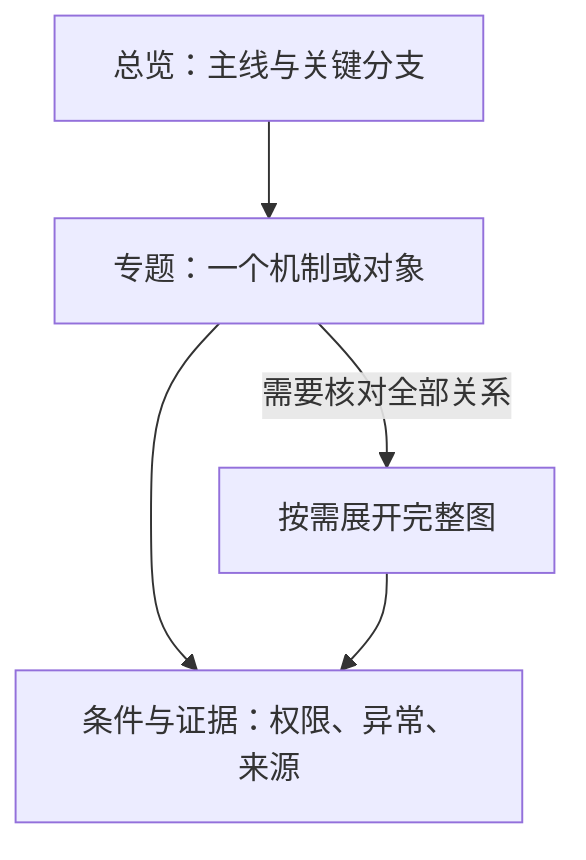

# ERP 设计依据 / ERP Design Rationale

统一界面的目标是让使用者快速识别当前对象、理解状态、完成动作，并能在失败或返回后继续工作。高保真外观、交互稿和正式实现共同服务这条操作路径；颜色或静态截图不能单独说明流程可用。

工作台默认用图解展示这些取舍：选择主题后调整边距、切换分层或操作虚构样例；详细解释在“规范原文”中按章节查阅。交互关系图与[交互设计说明](交互设计说明.md)同源，目录支持搜索与前进后退恢复。

## 空间与密度：为什么这样留白 / Spacing And Density

**桌面 ERP 以紧凑布局为基础**：页面外围使用 8px，独立区块间隔 6px，面板上下 6px、左右 12px。主要内容尽早进入首屏，关联控件优先同行，避免父子容器重复叠加留白。表格的“标准 / 紧凑”仅调整数据行，不能代替页面本身的紧凑布局。这些是当前工程基准，需要用实际页面核对可读性和操作空间。

状态快捷筛选同时提供数量分布和办理入口，直接展示能让使用者发现草稿、待提交等记录并单击进入。密度取舍同时考虑可见信息、操作步数和占用空间；现有有限状态组保留紧凑按钮，按实际宽度换行，客户、日期等细查条件集中在筛选面板。选项数量本身不足以决定是否折叠成下拉，后续状态增长须结合岗位使用频率与搜索、主要操作的可用空间评估。

手机版与电脑版表示[不同工作入口](../../engineering/前端实现与交互约定.md#work-entry-and-viewport)，宽屏与窄屏表示可用空间。任务与相关进度条目采用[同一信息层级与间距规则](交互设计说明.md#compact-work-items)：手机版用标题、图文摘要和责任/时间底部连续扫描，电脑版用身份、来源、状态与责任列横向比较。

关联计数退为辅助文字，卡片和标准表格使用 64px 图片，电脑版紧凑表格使用 48px 图片；表格标题与身份放在图片右侧，编号等短信息并排，普通行以标准 96px / 紧凑 76px 为基础，长内容自然增高；来源并入摘要，减少重复行和空分隔。核心字段占位保持语义位置，进度卡不再叠加整卡和子区最小高度来凑齐；数量下方保留一组短间距，无待办提示与负责人合并同行，缩略图去除遮挡主体的放大镜角标。

统一结构有助于跨入口辨认同一任务，保留字号、触区与异常信息，避免依靠压缩文字或套更多卡片实现密度。

### 1. 同一内容，边距改变了什么

在工作台“间距与密度”中保持内容不变，只调整左右空隙：

| 页面边距 | 相对当前 8px 的变化 | 观察重点 |
| --- | --- | --- |
| 4px | 两侧合计多出 8px 内容宽度 | 内容是否紧贴边界，分组是否难辨认 |
| 8px | 当前基准 | 组间可区分，宽表仍有空间 |
| 24px | 两侧合计少 32px 内容宽度 | 临界宽度上是否更早换行或出现横向滚动 |

### 2. 各处留白解决什么问题

| 尺寸与位置 | 设计原因 | 调整时核对 |
| --- | --- | --- |
| 页面外围 8px | 分开屏幕边缘、导航和内容，增加业务面积 | 容器边界、窄桌面、长字段、整页溢出 |
| 页头和操作区上下 6px、左右 12px | 控件有间隔，搜索、筛选、标题共用阅读边缘 | 父子 padding 不重复；焦点与错误不被裁切 |
| 独立区块间隔 6px | 职责可辨，条件与结果仍相邻 | 模块页头不再额外追加 margin，避免双倍留白 |
| 表单正文上下 10px、字段间距 10px × 12px | 连续录入保持紧凑，说明与校验仍完整 | 标签和输入之间 4px，辅助内容继续保留 6px；长文本自然撑高 |
| 侧栏展开 206px、收起 64px | 在扫描名称和扩大业务宽度之间切换 | 收起后仍有名称提示、选中态和全部入口 |
| 侧栏品牌区 48px、常用控件 34px | 账号固定侧栏底部，刷新随当前页标题；移除独立顶栏，让业务内容使用首屏高度 | 侧栏独立滚动、收起头像、窄屏导航与弹窗焦点恢复 |
| 表格标准 / 紧凑行高 52 / 42px | 适应阅读习惯，主要调整单元格留白 | 长文本可撑高，输入与校验仍完整 |

### 3. 调整尺寸的顺序

1. **先分组**：关联内容更近，独立组更远。
2. **再对齐**：相邻区域共享阅读边缘，不重复叠加内边距。
3. **按任务选密度**：文档需要受控行宽和段落间隔；业务列表需要可比较的数据面积。
4. **回到实际页面核对**：以上数值不构成强制 8px 网格，机械取整可能破坏控件与卡片的配合。

生产执行把订单选择、打开订单和展示切换放在同一工具行，搜索与事项筛选共用紧凑条件行。默认当前事项按产品对齐工序、状态、数量、负责岗位与办理入口，工序对照保留横向比较；等待前道的重复说明移除，真实批次和生产方式仍可追溯。窄屏自然换行，手机保持已有触控尺寸，文档阅读与打印仍按自身用途留白。

## 平面与层次：为什么不用更多装饰 / Flat And Hierarchy

平面风格靠**排版、留白、底色和细线**组织内容。减少普通容器的强阴影、大渐变与立体装饰，同时保留边界、选中、焦点、悬停和错误反馈。

页面导航、卡片和提示不以粗单侧色条作为通用强调。频繁切换的条目使用简洁列表，只给正在查看的一项浅底色；需要独立边界的内容使用 1px 细边框卡片；确有前后关系的流程使用序号、节点和连接线。岗位归属、起止状态和风险用可读文字或状态标签表达，避免多项同时出现主题色条而被误认为同时选中。业务端与效能工作台遵循同一原则，键盘焦点仍保留独立的轮廓反馈。

需要理解整条流程时，先看岗位在总链的位置，再点开具体职责。订单全流程保留全部 17 个位置，分成接单与备料、加工生产、入库与交付三段，节点使用短名称，默认收起详情。岗位底色与当前展开的轮廓分别表达职责范围和查看位置；切换岗位保留当前环节以比较分工。首款与分期单列为虚线条件分支，序号和连接符只辅助阅读，不伪造强制依赖。

详情直接显示当前步骤的办理说明，关键交接通过图中节点查看，完成条件只保留一份；已被节点引用的交接与审批不再整段重复。异常既可从相关环节直接进入，也能从“按业务查阅”内的“异常目录”查找，避免未挂主环节的来源被隐藏；返回恢复原来的查看位置。异常直接连接总链上的实际节点，不让用户在总链与独立异常主视图之间切换。

一次展开一条支路，原批终止与新批重开分开表达；岗位范围在主链与分工中同时高亮，步骤原地展开，避免重复位置条、第二张总览及交叉长线。岗位底色只说明职责范围，回归箭头必须带完成条件，不能为了画成闭环而给报废、退款或独立业务补造返回点。

Mermaid 用于当前环节内需要解释的办理分支及异常路径，点击节点查看说明。总览负责定位，子流程负责说明先后、分支与交接，简单点数保留直接说明；避免把所有环节与子步骤挤进一张需要缩小字体的大图。连线来自同一流程目录，不根据并列任务的展示顺序推断依赖；审批通过与实际执行结果分别呈现。文字步骤与完整说明保留，保证图示之外也能理解和选择步骤。

同一交接已有图中节点和步骤选择时，不再铺第三排交接按钮；岗位只在当前阅读对象旁说明。图表工具按需展开，背景与完整条件合并到一个说明入口，异常目录先定位类型再进入方案，减少反复阅读相同标题和选项。

客户流程导出用于快速对齐“谁做什么、交到哪里、异常如何继续或结束”。岗位与关键结果并入节点，异常只保留方案和出口；完整办理说明留在观察台。纸面删除导读、重复长表和跨业务附录，通过减少内容层次控制篇幅，保持正常字号。

| 视觉层 | 当前用法 | 设计原因 |
| --- | --- | --- |
| 页面底色与内容面 | 浅色页面底与白色内容面分开；暗色用不同黑阶 | 用明度说明归属，卡片间隙不再垫一层背景 |
| 内容 Tab 统一字重与下划线 | 选中 650、未选 500，2px 主题线明确当前位置 | 与登录方式保持一致；共用透明底和 1px 淡基线，避免多个外观竞争 |
| 工作方式与显示模式使用分段按钮 | 圆角底轨、中性细边框与主题浅色滑块，选中 650、未选 500 | 电脑 / 手机、表格 / 图形和外观选项需要明确的选择状态；登录页的工作方式与登录内容分开表达。手机任务、进度和流程跟踪仍属于内容导航，选项少也不改成按钮组 |
| 主题色 | 主动作、选中、键盘焦点 | 少量强调，避免高饱和区块争夺注意力 |
| 状态色与文字 | 状态、错误、待处理均有可读名称 | 颜色不单独表达意义，主题色不代表审批成功 |
| 1px 边线、10px 容器圆角、8px 控件圆角 | 区分包裹层级，约束内容边缘 | 圆角服务容器关系，不任意放大占用空间 |
| 浮层与固定栏 | 不透明底色、分隔、克制阴影 | 表达覆盖和固定关系，防止内容穿透 |
| 普通分组 | 较轻的底色、排版和边界 | 不与浮层、固定操作争夺层级 |

核对顺序：

1. 暂时去掉分层，观察区块和可点击对象是否难以辨认。
2. 恢复后检查当前项、键盘焦点和错误是否仍清楚。
3. 用共享变量和组件实现正式外观；“去掉分层作对照”只是讲解，不是另一套主题或业务状态。

## 排版与阅读路径 / Type And Alignment

阅读顺序应当是：**识别工作对象 → 查看条件与状态 → 比较记录或执行动作**。

| 元素 | 排列方式 | 原因 |
| --- | --- | --- |
| 主标题 | 只出现一次 | 避免重复定位，腾出首屏空间 |
| 同级分区 | 相同层级与样式 | 扫读时知道哪些内容可以并列比较 |
| 辅助说明 | 位于对应控件下方，保留 6px 间距；建议按钮、摘要和校验提示遵循相同规则 | 保持字段关联，同时避免辅助内容紧贴输入边框；不靠缩小字号降低干扰 |
| 文字 | 左对齐 | 形成稳定的阅读起点 |
| 日期、状态 | 同类列保持一致位置 | 便于横向与纵向核对 |
| 数量、金额 | 右对齐，必要时用等宽数字 | 按位比较大小 |
| 长名称、币种、单位 | 保留完整阅读入口 | 不能为整齐隐去业务含义 |
| 图标与按钮 | 图标辅助识别，按钮有名称 | 无需猜测图形的含义 |

### 复合信息何时上下排列

同一对象的两项相关信息需要一起识别，且有清楚的主次时，放在同一单元格内上下排列：上行识别对象，下行补充信息。姓名与电话、产品与规格因此各有稳定的阅读起点，减少横向占宽，也避免用斜杠拼接后在任意位置换行。

| 复合信息 | 上行 | 下行 |
| --- | --- | --- |
| 联系人 | 姓名 | 电话 |
| 收货信息 | 收货人及电话 | 地区与地址 |
| 物流信息 | 承运商及运输方式 | 运单号 |
| 产品与规格 | 产品名称及业务编号 | 规格 |
| 仓库与批次 | 仓库名称及编号 | 批次；需要核对时附单位 |
| 订单编号 | 销售订单号 | 客户订单号，注明“客户单号” |
| 客户与跟单 | 客户名称 | 业务员，注明“跟单” |
| 订单与用料 | 订单状态，注明“订单” | 用料审批状态，注明“用料” |

上下排列会占用行高，因此只用于需要成组识别的复合信息。金额、数量、单独日期和独立短状态继续保持各自列的比较方式；数值与单位、比例及原始字段中有含义的斜杠按原意保留，不机械拆行或删除。

销售订单把相关身份和状态成组展示，减少横向查找。订单状态与用料审批仍是两个独立判断，必须分别标明含义；订单总额已带币种，币种和数值留在同一行，无须再占一列。合并仅改变列表表达，详情和导出保留权限允许的全部原字段，两个订单号仍可分别复制。行高由内容与现有密度设置共同决定，不为容纳两行另设固定高度。

图解中的虚构联系人展示信息齐全、缺少电话和长内容三种情况，分别核对主次、缺项收起与自然换行。字号、颜色、缺值、复制和导出等具体规则沿用[表格对齐约定](../../engineering/前端实现与交互约定.md#表格对齐--table-alignment)，图解复用正式展示组件。

### 按信息关系选择表达

| 信息关系 | 优先形式 | 读者得到什么 |
| --- | --- | --- |
| 相同对象、同组维度 | 表格 | 逐列比较 |
| 连续办理 | 编号步骤 | 清楚的先后顺序 |
| 依赖、分支、交接 | 关系图 | 看见关联和异常去向 |
| 单一结论或条件 | 短段落 | 快速获得必要说明 |

卡片只在分组有用时使用，不作为所有信息的默认容器。

### 怎样判断调整有效

1. 保持数据相同，比较可用面积、行宽、对齐和分组。
2. 在真实浏览器核对默认、长文字、错误、返回和关键操作。
3. 将机制说明与使用效果分开：对照图不能单独证明“更快”或“更少误操作”，这类结论需要同任务的使用证据。

## 信息与动作 / Information And Actions

每个常驻元素应帮助使用者**判断对象、选择下一步或核对结果**。具体尺寸和操作条件见[交互设计说明](交互设计说明.md)，这里解释取舍。

### 1. 入口与标题：减少重复查找

| 设计选择 | 原因 | 核对标准 |
| --- | --- | --- |
| 全部业务模块同级直达 | 当前入口规模适合直接扫描 | 每模块一个入口；单页直达，多页内部切换 |
| 工作中心、常用工作优先 | 高频入口应容易找到 | 分组职责清楚；超高只在侧栏内滚动 |
| 默认页显式配置 | 数组顺序不应改变用户落点 | 仅实际入口规模影响查找时，再评估折叠 |
| 出货入口合并 | 出货单、放行和预留服务同一交付过程 | 模块内按权限切换；预留、放行不等于实际出库 |
| 财务同级独立 | 同时处理销售、采购与委外结算 | 不被误读为出货子功能 |
| 主标题只出现一次 | 顶栏与正文同名不会增加定位信息 | 由页面标题承载对象、帮助、视图、摘要与刷新；无独立页头时由共享布局提供标题 |
| 常驻说明精简 | 重复用途、排除清单、样例标签会挤占首屏 | 同类业务页、表单和交互稿标题结构一致；风险在相关判断处可见 |
| 仓库范围按需打开 | 属于低频岗位配置，常驻下拉占用功能工作区 | “数据范围”入口可发现；原设置、草稿、只读限制与整包保存保留，缺少仓库时明确提示 |

### 2. 列表与筛选：让条件紧邻结果

下拉控件的用途不能随着选中值消失。placeholder 只在空态出现，因而不能独自承担标签职责；表单保留已有标签，独立控件在值前显示短用途名称。有值时可见的 × 让取消筛选成为一步操作，清空后恢复明确提示，避免额外添加“全部……”占位选项。

输入、筛选和浏览选择统一提供清空。预览、专题与记录选择清空后回到可重新选择的空态；排序清空恢复默认顺序，URL 与刷新保留主动清空结果，不能自动选回首项。只有权限模式、统计币种、打印缩放等没有合法空态的操作参数保留当前值。必填表单的暂时空态交给原校验，清空来源同时清除依赖，防止显示为空但查询或关联仍然保留旧值。规则与验证见[下拉选择与清空](交互设计说明.md#select-controls)。

少量固定条件直接点选，长选项可搜索，减少反复打开下拉框和扫描长列表的负担。共享业务列表控件统一选择呈现方式；同一含义只保留一个入口，状态与截止时间分开表达，避免“已超时”占用两处条件。

待办保留列表作为默认处理入口，日历提供按处理截止日期查看的角度。月历只显示每日数量，具体任务集中在选中日期的列表中，避免同一天任务较多时挤满格子。日期数字、选中圆形与数量各自承担清楚的层级；空数量不占据选中标记内的位置，月份标题也不随两侧操作宽度偏移。轻量底色、统一列距和留白提供视觉完整度，不额外增加说明卡或装饰。

日期使用 18px、辅助数量使用 13px，保证手机扫读清晰；切换日期保留同范围的月统计并只加载当天任务，避免将整个月历清空成占位符。统计来自最近一次有效响应，切月或改变筛选与权限范围后重新读取，不用跨范围缓存掩盖变化。逾期与未设置截止日期的任务保留跨月入口，防止事项因缺少日期或切换月份而消失。

手机端把这两个入口合并进顶部筛选，跨日期结果直接显示任务并收起月历，避免用户在不相关的日期格子下寻找事项。已选条件具名且可逐项清除；短选项紧凑平铺、连续滚动，手机只保留当前岗位常用的状态、截止、来源和流转去向，选项直接平铺；人员与精确日期细查留在电脑端，手机不要求在筛选面板内输入或再打开选择窗口。异常沿用状态按钮，不再另开空筛选浮层。

岗位已有任务和权限范围，不再叠加业务模块、流程、环节三套通用分类；来自履约进度的明确环节范围显示来源并允许清除。日历只保留自身的日期选择，已办按常用处理时间段查询，避免重复日期条件。旧查询恢复时同步剔除撤下的条件。常用筛选不再另设命名和管理步骤，沿用当前视图的查询恢复。选项使用 44px 触区与 36px 内缩底色，兼顾点击和密度；日期入口放在组标题旁，重置与收起固定在底部。

电脑端长任务列表让月历与日期、数量摘要吸顶，方便随时切换日期并保留当前范围，共用页面滚动以减少滚动区域。仅在双列且视口高度至少 720px 时固定整块月历，确保六行月份与跨日期入口完整可达；矮屏只保留紧凑摘要吸顶，手机和单列窄屏让月历自然滚走，为任务留出阅读空间。工作台提供轻量入口，两端复用现有责任范围、任务详情和办理结果，不引入独立日程对象。

手机将全局清空放在筛选按钮右侧，用分隔线与打开入口区分；有条件时显示 ×，避免“清空全部”文字在条件行另占一行，位置也不随标签换行移动。任务管理与进度看板将首项条件与 +N 合入筛选按钮，完整条件在面板内调整；日历切换合入搜索行，窄屏移至导航旁，减少重复行且保留主搜索空间。流程进度采用相同的首项摘要与 +N；异常跟踪只有一组直接点选状态，搜索旁复用一键清空，不为同一组状态增加重复浮层。

入口计数和清空包含快捷条件，保持用户看到的状态与实际查询一致；搜索、视图和来源范围分别保留。统一由共享筛选入口提供全局清空、关闭与焦点恢复，两侧按钮各保留至少 44px 独立触区。

菜单数字只用于发现需处理事项，具体交互见[电脑版菜单数字提醒](交互设计说明.md#电脑版菜单数字提醒--desktop-navigation-counts)。

| 数字提醒选择 | 原因 | 核对标准 |
| --- | --- | --- |
| 首批只在任务管理显示 | 已有统一待办真源；模块总数不能说明当前用户需做什么 | 数字与“待我处理”的完整数量一致 |
| 普通待办低强调，明确风险才红色 | 保留风险色的识别价值，避免菜单处处告警 | 看数量与看风险能清楚区分 |
| 0 隐藏、99+ 收敛宽度 | 减少无效标记，折叠菜单仍放得下 | 完整数可通过悬停和读屏获取 |
| 失败保留旧数并明确待更新 | 网络异常不能制造“没有待办”的假象 | 初次失败、重试、账号权限切换均核对 |

#### 导航与列表

| 设计选择 | 原因 | 核对标准 |
| --- | --- | --- |
| 标题与主 Tab 共用页头 | 消除独立导航卡和重复标题卡，缩短进入正文的距离 | 业务模块、工作台与效能工作台一致；二级视图通过位置区分，切换持续挂载 |
| 清理重复及误导统计 | 当前页启用数不能代表全部启用数，页头条数又与分页重复 | 总数归分页；任务分类只在筛选处计数，功能预览去除硬编码数量；保留真实业务指标，查询范围和缺值明确 |
| 紧凑筛选与业务列表 | 查找、比较、处理需要数据面积 | 首屏看见对象、状态和下一步；数量筛选有明确结果 |
| 导航最多两层且区分轻重 | 减少连续选择与层级辨认成本 | 两层共用选中字重与下划线，通过位置和间距区分；状态筛选保持小型按钮，关联明细使用文字入口 |
| 操作区使用完整内容面 | 将切换、搜索与筛选归为一组 | 页面底与内容面区分清楚；内容 Tab 透明，内部不重复套卡片 |
| 库存台账分类与查询共用工具栏 | 合并独立二级页头，减少进入库存明细前的空白；限制搜索框宽度以留出导航与业务操作空间 | 宽屏为模块页头和查询工具栏两行；内容分类保留下划线页签，余额展示方式使用分段按钮。空间不足按内容换行，不缩小字号或隐藏必要入口 |

#### 控件与显示

| 设计选择 | 原因 | 核对标准 |
| --- | --- | --- |
| 同类控件跨模块共享 | 避免财务、生产、进度、权限与工作台各自造型 | 浅色白底、暗色随主题；结果条件仍使用筛选按钮 |
| 进度范围、交期与任务异常分开表达 | 避免同名按钮承担不同动作，支持交期与受阻交叉查询 | 桌面与手机共用筛选组件；交期单选，受阻独立开关；不适用条件清除并隐藏。选项数量预告保留其他条件时的结果，筛选角标统计全部非默认条件但不含搜索 |
| 数据表可选淡网格 | 宽表核对日期、数量和金额时，部分用户需要列边界 | 默认横线；淡竖线偏好与密度独立，固定列、长文、合计可读 |
| 手机卡片和打印独立 | 桌面列线不能直接套到其他媒介 | 保留各自版式 |
| 列设置包含可用业务列 | 税务、地址等低频字段仍需按任务查看 | 遵守字段权限；默认列支持常用判断，新增列不覆盖账号选择 |
| 列设置先调整、再统一保存 | 用户需要同时确认显示范围和排列，误点或尝试后可以放弃 | 显示已选数量及未保存状态，提供取消；拖动与快捷移动并存，复用账号按列表偏好，恢复默认也须完成保存 |

#### 状态与上下文

| 设计选择 | 原因 | 核对标准 |
| --- | --- | --- |
| 异常归入流程跟踪 | 进度和异常闭环属于同一追踪任务，减少任务管理的并列入口 | 两端提供流程进度与异常跟踪两个视图，各自恢复查询；范围选择进入筛选 |
| 业务状态筛选显示数量 | 直接判断各类结果数量，避免逐个试点 | 电脑与手机的流程、历史记录、任务状态、处理结果和异常沿用同一口径；保留权限及其他条件，忽略所选状态和分页；导航、日期、岗位不机械加数字 |
| 异常数量随筛选显示，关联明细按需进入 | 直接判断多少异常未处理完，减少逐个点击和重复统计 | 三个状态按钮带数量，统计忽略选中状态并保留其他条件；关联待办与订单用文字入口，返回恢复原列表，不再增加总数行或导航层 |
| 异常卡片聚焦当前待办 | 完整关联记录默认展开会让历史任务占据首屏 | 当前待办及岗位直接可见，完整记录按需展开；闭环仍以处置和检验记录判断 |
| 待办与风险优先 | 当前工作比通用说明更需要注意力 | 说明按需展开；默认只保留能帮助判断或操作的信息 |
| 空状态统一 | 无记录不应被黄色警告框暗示为风险 | 电脑、手机、工作台的图标、文案和间距一致；失败有独立重试 |

宽表的两种滚动入口分别服务发现与连续操作：

| 部位或状态 | 选择理由 | 必须保留 |
| --- | --- | --- |
| 顶部两个方向按钮 | 小步查看后续列，保留相邻列作为核对参照 | 每次最多移动 240px，窄屏缩小步幅；复用工具栏，有数据且溢出时出现，边界禁用 |
| 底部细拖动条 | 快速跨越多列 | 不重复方向按钮和文字；避开分页 |
| 纵向滚动中 | 减少遮挡 | 暂时隐藏，停稳后重新定位 |
| 横向拖动或悬停 | 保持连续操作 | 拖动中可见；悬停加粗不改变外层高度 |
| 翻页与加载 | 防止页面回跳 | 控件保持挂载，加载保留表格高度，响应后按行数恢复 |
| 表格周围 | 提供可辨边界 | 卡片边距和列设置入口仍在 |
| 桌面长列表 | 选中靠下的记录后可直接办理，随时知道作用对象和列含义 | 页名与页签滚走，查询工具栏、选中单号与操作、表头依次吸顶；共用主内容区纵向滚动，按工具栏实高避让。窄屏、矮屏或阅读空间不足时保留完整控件的自然滚动 |

### 3. 表单与详情：保留录入和核对上下文

| 设计选择 | 原因 | 核对标准 |
| --- | --- | --- |
| 主表单整页，局部操作弹窗 | 完整单据要连续输入；选择、确认、预览要保持上下文 | 明细内部横向滚动，主动作始终可达 |
| 控件设计放在主内容区 | 多类控件需要持续浏览、比较和操作；长抽屉会压缩示例宽度并遮住导航 | 与页面预览同级切换，按用途只展示当前示例；真实弹窗与抽屉仍作为局部交互演示 |
| 主数据只要求岗位可判断的资料 | 系统排序、提示和参考信息不应变成伪业务操作 | 加工环节顺序由系统追加；质检提示不触发质检，BOM 参考期不控制启用 |
| 详情支持精确来源和返回 | 跨单据核对后需要接着工作 | 对象正确，筛选、选择、滚动等上下文恢复 |
| 手机进度明细按判断路径分组 | 身份、生产执行、协同任务各有用途 | 只显示有记录的“产品信息 / 生产执行 / 关联任务” |
| 进度总览先看交期与当前关注 | 跟单先辨认哪单受阻、谁在处理，再核对各环节事实 | 桌面逐行比较，手机短卡片；取消重复侧栏与空进度条；列表复用 64px 代表产品图及语义占位，详情保留完整环节 |
| 手机受阻提示共用紧凑结构 | 同一任务在进度页和任务页有一致的识别方式与原因位置，减少固定占高，避免长原因将办理人与截止时间推到后面 | 进度卡名称、受阻标签与办理人优先同行；两页均将原因浅红条放在卡片末尾、责任与时间之后，保留完整文字和换行，入口至少 44px，按内容撑高 |
| 生产执行组内连续核对 | 生产单、批次、领料属于同一判断过程 | 生产和任务用手机原生下钻；电脑版原单从工作入口主动进入 |
| 材料汇总用紧凑产品摘要与宽明细 | 工程、审批需同时核对用量、库存和备注 | 多产品按宽度并排；部位与计算按需展开，关闭返回原任务 |
| 库存作为参考 | 材料申请和实际采购有不同口径 | 摘要不暗示自动抵扣 |

### 4. 任务：先看办理事项，再核对对象

| 设计选择 | 原因 | 核对标准 |
| --- | --- | --- |
| 办理事项为主标题，产品或物料在下方 | 同一产品的不同任务可直接区分，关联对象仍可核对 | 工作台、看板和手机一致；无关联内容仍有标题，长文自然换行 |
| 状态、风险、时间独立可读，核心字段缺值保留位置 | 这些信息决定优先级；明确的缺值提示可区分未设置、未知与失效，连续扫描时不必猜测 | 日期缺失、无关联和字段清空采用[统一规则](交互设计说明.md#compact-work-items)；长内容自然增高，键盘打开、图片独立预览和返回恢复可用 |
| 进度卡片显示具体任务摘要 | 负责人和待办总数不足以判断要办什么 | 名称、责任与首要事项来自现有进度投影 |
| 按待办数量决定下钻 | 单项可直达，多项需选择 | 一项开详情，多项看关联任务；零项无假入口，查看不扩大办理权限 |
| 任务处理与流程跟踪分工，发起与参与合并为范围 | 前者回答现在要办什么，后者回答交接后走到哪里；减少同级页签和常驻筛选高度 | 电脑保留待我处理、待我审批、全部任务和流程跟踪，手机保留待办、已办和流程跟踪；流程跟踪内部切换流程进度与异常跟踪，发起、参与和相关流程放入范围筛选，切换只更新下方内容。共用筛选浮层且不推挤列表，各范围独立恢复查询与分页，保留原有权限边界 |

“新建跟进任务”用于当前单据的资料补充、交期沟通和异常核实，最小闭环是：

1. 绑定来源单据，明确要补充或核实的事项。
2. 选择合格接收人和截止时间。
3. 在相关任务中跟踪办理与完成反馈。

名称与“提交订单 / 提交合同”区分；已有审批、入库和出货继续走各自流程。

任务处理在“交互设计 → 可交互设计”内保留独立专题入口，以便连续比较任务列表、来源、办理和结果；继续读取唯一 HTML，复用 ERP 导航与表单。业务运行时沿用已有任务管理入口，预览页签不产生新的业务模块或任务存储。

业务页就地办理入口同时保留：使用者在销售订单、采购入库等页面已掌握业务上下文，应能直接处理关联待办。任务中心提供集中找事的入口，业务页提供带着单据办事的入口；双方使用同一个任务和结果。BOM 等复杂编辑进入原有整页表单，审批、原因和仓库确认使用抽屉或局部弹窗，保存后回到来源位置。

| 操作设计 | 原因 | 核对标准 |
| --- | --- | --- |
| 列表与详情消费同一动作目录 | 避免只在一个入口补按钮，或两处状态条件不同 | 未选择、草稿、生效、历史、结束及多选各有明确行为；按钮不只有提示消息 |
| 按实际空间收纳记录动作 | 少量按钮固定藏入更多会增加寻找和点击成本，固定数量也无法适应长标签与侧栏宽度；只在代码或下拉内分类，直接按钮仍难以扫读 | 直接按钮按类别相邻排列，多类别以轻量标题和细分隔显式区分；标题与间距计入可用空间。放得下就全部显示，溢出时保留高优先级动作，关闭与取消集中在末尾且保留确认，质检成对判定不拆散；宽窄恢复不丢动作，加载不重排，打开的弹窗不因迁移触发按钮而消失 |
| 保留显式业务动作 | 完成协同责任与写入业务事实是不同操作 | 放行不等于出货；保存到货不等于入库；保存 BOM 不等于提交工程用料 |
| BOM 复制与历史独立 | 生效和已送审的材料依据需要保持可追溯 | 复制后不改原版；退回生成新草稿；同产品至多一个生效版本 |
| 打印与关联页面有来源和返回 | 深入办理后仍能回到原单据继续工作 | 返回保留筛选及选择；来源由明确关联确定，不猜单号 |

参考 [SAP My Inbox 的任务详情与 Open Task](https://help.sap.com/docs/SAP_FIORI/d2c296c4f32d4f2a9e3752f58d5ef222/41fd595461fce630e10000000a44538d.html) 以及 [Dynamics 365 的工作流参与者与审批动作](https://learn.microsoft.com/en-us/dynamics365/fin-ops-core/fin-ops/organization-administration/workflow-actions)，采纳集中待办、来源上下文、明确动作与退回再提交的交互原则。

表单容器、岗位、权限与事实边界仍按本项目合同；不引入外部产品的流程配置、任务认领或组织层级能力。

| 本项目取舍 | 原因 | 核对标准 |
| --- | --- | --- |
| 完整表单在原业务整页填写 | BOM 部位、材料、制表资料需要连续录入空间，现有组件已有对应骨架 | 复用左侧分区、统一表头和固定底栏；带入订单与产品，返回保留任务范围 |
| 简单审批和确认在上下文中完成 | 内容少、决策明确，重复跳页会打断办理 | 审批在抽屉内，入库确认使用局部弹窗；各自显示校验和处理结果 |
| 业务动作成功后更新任务 | 通用“完成任务”不能证明业务已生效 | 保存草稿不办结；正式提交依赖后端状态、权限与事实回执 |
| 样例与正式运行分别核对 | 交互可点不代表后端已实现联动 | 专题仅写隔离状态；后续实现再核对正式 API、恢复及业务验收 |

### 5. 工作台：工具、原理与证据分别展开

| 设计选择 | 原因 | 核对标准 |
| --- | --- | --- |
| 分组侧栏与工具表 | 开发入口需要快速扫描、搜索、进入 | 同一登记生成；全部工具、常用工具、使用指南按需切换 |
| 开发资源分为工具清单与项目关系图 | 工具清单保留接口与集成、项目文档、项目 Skill 三个直达入口；关系图先按任务主题直达图例，再按需阅读模型原理；按图模型浏览仍可选择 | 模型目录包含 DAG、有向有环图、无向关联和树／森林；项目示例与节点说明同源，跨目录引用和回路高亮只改变结构展示 |
| 来源与帮助就近展开 | 固定教程会占用工具首屏 | 风险确认在实际操作处，状态来自真实结果 |
| 规则与图回到所属入口 | 各工具应回答自己的问题 | 改动规则在项目文档，关系图在对应工具，页面说明检查在测试验证 |
| CI/CD 原理按需查看 | Job、Runner 槽位、内部并发和资源锁不同 | 质量门禁复用说明抽屉，四组图按需渲染 |
| CI 性能使用实际起止时间 | 机制图不能证明当前配置或实际结果 | 时间重叠可见，缺值、排队单列，领域明细可收起 |
| 版本中心复用发布说明 | 发布原理与实际回执各有来源 | 交互稿只演示机制 |

表达方式按问题选择：操作主线用编号；工具、检查、环境、演练用表格；发布、耗时、记录用稳定 Tab；权限与业务链用关系图。详情按需打开，真实阻断与未结束操作始终可见。

岗位理解以完整流程为主线：先选择关注岗位，再查看其负责的环节、完成条件与交接。业务分类通过“按业务查阅”辅助进入，异常从相关环节进入并返回原位置，减少范围、分类与异常情况并列造成的选择负担。目录按正式职责筛选并直接列出负责事项；进入具体业务后保留上下游，总关系图单独按需打开。全局异常查阅归入业务目录，与环节内直接处理形成清楚分工；保留跨环节和独立来源的全量查阅，减少总图页头重复入口。

### 6. 权限：横向比较操作，逐页核对访问

| 设计选择 | 原因 | 核对标准 |
| --- | --- | --- |
| 单岗位使用“对象 × 操作”表 | 查看、新建、编辑适合并排核对 | 每权限只有一个勾选控件；审批与专有动作名称独立 |
| 筛选与批量修改有范围 | 用户可能看不到被筛掉的权限 | 不误改隐藏权限；保存前可核对新增与撤销 |
| 岗位设置与表内筛选共用两行顶部 | 合并辅助设置行和独立统计行，把纵向空间留给权限核对；搜索宽度有上限，避免独占横向空白 | 宽屏第一行保留岗位、三个辅助入口与保存，第二行合并筛选、统计与展开操作；窄屏按空间换行，字号和控件尺寸沿用共享规范，改动摘要、只读与异常反馈保持可见 |
| 桌面正文单层滚动 | 短窗口下叠加页面、工作区和表格滚动会让操作离开视线 | 滚动权限表不移动页头、筛选和保存；手机使用连续正文滚动 |
| 当前岗位可全屏操作 | 大量权限和长操作名称需要更宽、更高的核对区域 | 同一份草稿和权限边界；进入、退出保留筛选及展开状态，保存读回一致；弹窗退出优先，退出后恢复原位置 |
| 导航按模块排列 | 同模块多页不应占满常用入口 | 默认页、模块顺序保存后可读回 |
| 页面访问逐页核对 | 岗位授权与公司启用范围可能不同 | 分类与业务导航一致；授权、访问结果分开，受限原因有检查方向 |

### 7. 登录：只保留进入系统所需判断

| 设计选择 | 原因 | 核对标准 |
| --- | --- | --- |
| 紧凑登录卡片 | 进入前只需辨公司、选电脑或手机、验证账号 | 工作方式与验证方式分层；装饰和表格密度不抢注意力 |
| 主题与失败反馈连续 | 用户应能就地修正 | 长名称不挤外观按钮，失败可改，提交不可重复 |
| 手机账号卡显示姓名和账号 | 长岗位名单重复已有切换功能 | 身份可核对，岗位和工作入口仍能直接切换 |
| 手机预览默认普通岗位 | 管理员跨岗位查看属于专用场景，常驻会误导员工页面评审 | 身份与岗位样例在画面外选择，管理员栏仅随超级管理员预览显示；切换时关闭旧任务并回到待办 |

## 视觉与可达性 / Visual And Accessible Behavior

可达性同时包含**看得清、点得到、用键盘可操作、失败后能继续**。视觉调整要与数据含义和恢复路径一起核对。

### 1. 动作怎样排序

| 动作 | 作用 | 边界 |
| --- | --- | --- |
| 完成 | 正常办理闭环 | 不替代事实入账 |
| 阻塞 / 解除阻塞 | 说明卡点，恢复继续办理 | 结果和原因可读 |
| 通过 / 退回 | 已有审批 | 沿用真实权限与状态 |
| 转交 / 催办 | 已有协作能力 | 不为补齐按钮扩展调度或消息系统 |

当前动作较少，电脑和手机直接展示全部可用项；键盘能选择、选中结果明确。权限变化后，不得用已失效的选择提交。

### 2. 先明确数据含义

| 容易混淆的内容 | 必须区分 |
| --- | --- |
| 工程申请与采购执行 | 申请不充当采购执行台账 |
| 委外合同与发回货 | 合同不证明已发货或回货 |
| 缺值、待处理、异常 | 各自表达，不能用同一种警告或零值 |
| 来源下钻与导出 | 同一记录身份、同一筛选口径；窄屏仍能读取后续记录 |
| 主题与状态 | 换主题不改变业务含义；打印沿用独立纸面合同 |

### 3. 外观与个人偏好

| 部位或选择 | 原因与实现边界 |
| --- | --- |
| 浅色主题 | 沿用最新 HTML 的蓝色重点、柔和灰绿页面底与白色内容面 |
| 暗色主题 | 接近纯黑底色；壳层、内容面、卡片、浮层依次抬高，避免挤成同一块黑 |
| 暗色中性层 | 不带绿或蓝色偏色；强调色留给选中、焦点、主动作 |
| 侧栏 206 / 64px | 展开扫描名称，收起释放宽度；品牌栏切换、选中态和全部入口保留 |
| 侧栏品牌区 48px、控件 34px | 业务页不再单独占用顶栏；表格密度只调留白，不改变控件和卡片目标大小 |
| 密度范围 | 共享于业务、权限、效能工作台数据表；编辑明细仍保留输入与校验空间 |
| 手机设置 | 卡片统一布局，只显示有直接效果的明暗与主题色；不改变桌面密度 |
| 样式职责 | 页面负责布局；共享变量、Ant Design 配置及样式负责外观与页签动效 |

个人设置按以下顺序恢复：

1. 未登录时使用设备外观。
2. 登录后读取账号偏好；没有设置时使用统一默认值。
3. “跟系统”保留当前设备的系统适配。
4. 设置即时预览；保存失败在原处提供重试，不能把预览当作保存成功。

### 4. 长表单与展开内容

| 选择 | 设计原因 | 核对重点 |
| --- | --- | --- |
| 关键资料 → 明细 → 补充资料 → 附件 | 尽早进入主要录入 | 目录只定位，不拆多次保存，不隐藏必填项 |
| 宽屏目录、窄屏跳转框 | 节省窄屏横向空间 | 字段和明细优先 |
| 短字段并排，长说明按内容增高 | 控制展开态高度 | 空备注不预留多行；必填原因直接可见 |
| 产品预览紧邻选择字段 | 避免下方重复展示 | 生产路线、客户验货保持原填写与校验 |
| 说明按需打开 | 不常驻占空间 | 入口可键盘访问 |
| 附件收紧默认占位 | 给正文留空间 | 待处理文件和错误仍可见 |

固定栏的层次另行核对：

| 部位 | 表达什么 | 外观与内容 |
| --- | --- | --- |
| 标题栏 | 当前编辑对象 | 单行标题与必要状态徽标 |
| 底部操作栏 | 保存与离开 | 比标题栏略强，保存是最突出的主动作 |
| 两个固定栏背景 | 当前外观主题 | 低比例主题色纵向渐变：靠正文浅，靠屏幕外缘深 |
| 固定栏边界 | 与滚动正文分开 | 分隔线与浅阴影，不额外加高或增加左侧色条 |
| 未保存提示 | 业务编辑状态 | 独立语义色的文字和圆点，不靠背景主题色表达 |
| 说明与普通分组 | 填写规则、定位 | 规则就近放正文；分组与目录保持较轻层次 |

### 5. 列表、数量与图片

#### 桌面操作与状态

| 对象 | 选择理由 | 核对重点 |
| --- | --- | --- |
| 状态、搜索 | 高频判断放第一层 | 其他条件按需展开；单条动作与整表动作分行 |
| 按作用对象分组按钮 | 导航、查找、整表工具与单条办理需要不同上下文 | 桌面常态优先 2–3 行，有实际用途的二级视图可到 4 行；保留导入、工程用料、追踪、附件与打印能力 |
| 常驻当前操作区 | 未选时可看见已授权的禁用入口，选中即可办理，减少发现成本和表格跳动 | 对象、清空和动作合为一行；多个类别显示轻量分类标题，单一类别省略重复标题，空列表与不可选记录不占位，加载保留已有空间与内部状态 |
| 任务协作直接入口 | 任务责任、协作和流程流转是来源单据的核心工作，不应随着辅助按钮增长而失去入口 | 复用已有任务窗口与权限，不把任务完成当作业务事实入账；常驻入口不额外查询任务数量 |
| 业务角色决定直接入口 | 按钮颜色不代表任务频率或状态适用性，忙碌也不应改变位置 | 主办理、查看与编辑优先，结束动作降低强调；按实测宽度收纳并在更多内分类，判定结果保持成组，失败恢复直接显示；菜单和弹窗打开时不移动入口 |
| 分类与主次分开 | 低频业务动作仍需按业务含义查找，次要按钮不等于其他操作 | 纠正复检、退货调整、生成应收 / 开票和复制 BOM 保留次要样式与优先级，分类归业务办理；权限、校验和实际办理链路不随归类调整 |
| 长状态组与表格工具 | 减少状态与辅助按钮挤占查询空间 | 当前状态与数量可见，完整选项仍可选；导出筛选范围、列设置、宽表滚动和有用视图保持原有含义 |
| 状态数量 | 帮助选择工作队列 | 覆盖查询全部记录，保留权限与其他筛选，不冒充当前页计数 |
| 协同进度 | 反映任务办理 | 不改写单据生命周期 |

#### 手机与产品识别

| 对象 | 选择理由 | 核对重点 |
| --- | --- | --- |
| 手机列表 | 扫描来源和产品 | 减少重复标题、逐字段复制；完整信息与复制放详情 |
| 手机顶部操作区 | 长列表中随时切换或重新查找，避免反复回顶；短屏优先保留阅读空间 | 正常高度固定主导航并将搜索、筛选与状态整体吸顶，不按滚动方向隐藏；滚离顶部时仅在下沿 10px 内轻微模糊后方内容，保持操作文字清晰；高度不超过 500px 时查询区随正文滚动并取消边缘效果 |
| 手机下拉反馈 | 拖动、松手和结果呈现连续，避免突然撞到位移上限 | 下拉越过释放距离后逐渐增大阻力，按帧更新；只让数据区移动并平滑回位，固定控件不动；减少动态效果时直接收拢 |
| 手机回到顶部 | 长列表和长详情需要快速回看概要，短内容保持简洁 | 统一滚动后显示；只操作当前滚动区，避开导航、提交栏和输入键盘，不刷新或丢失表单内容 |
| 产品图片 | 辨认正在判断的产品 | 紧凑 48px、标准 56px、关键摘要 64px；各入口真实图可放大 |
| 行与图片点击 | 两个不同动作 | 行命中层在内容下方，图片按钮在上方；不嵌套按钮，点图不触发行操作 |
| 多产品或无产品身份 | 不猜测图像归属 | 多产品显示代表图和数量；物料、财务等无权威身份时不配产品图 |
| 长名称、金额、币种 | 支持精确核对 | 名称可看全，数字对齐，币种逐行标记；宽内容仅在数据区滚动 |

### 6. 状态、键盘与关闭保护

| 情况 | 设计要求 | 原因 |
| --- | --- | --- |
| 状态、禁用、读取 | 文字与视觉差异并存 | 不能只靠颜色辨认 |
| 图标按钮 | 有可访问名称 | 用户不必猜图标 |
| 浮层 | 进入焦点、Tab 边界、Escape、关闭后焦点恢复 | 键盘能完成同一任务 |
| 普通上下文弹窗 | 允许点击遮罩退出 | 降低看完或取消的退出成本 |
| 有未保存内容 | 先确认；点击确认层遮罩只返回继续编辑 | 保留输入，避免意外丢失 |
| 保存、上传或执行中 | 保持阻断 | 结果尚未明确 |
| 法务确认、断连恢复 | 保持强制门禁 | 前置条件未满足，不能误回业务页面 |

效能工作台使用同一视觉语言，同时保留工具职责、验证证据与交付边界。

责任区负责选工具，具体工具负责办理。产品与业务聚合能力、链路、权限和交互；开发资源聚合接口、文档、Skill 与项目关系图，避免一个分类同时承载产品理解与工程参考。菜单、工具目录和页头使用同一登记，现有工具路径保持稳定。测试验证目录不直接承担测试执行的计划、覆盖与压力测试；交付运维先区分任务与环境证据，再进入配置、迁移、发布或恢复。这样侧栏选中项、页面标题和当前操作保持对应，来源详情也不会被误认为完整工具页。刷新与页头合并，外观和页面工具留在侧栏底部，减少重复横行并保证文字完整。

接口变更的差异、检查、样例执行和暂存范围集中在一个工作区，减少为同一改动跨页核对。测试执行保留检查摘要与入口，执行沿用同一固定动作和排他机制。正常结果用紧凑行，失败突出原因；历史回执按需查看，避免将历史通过与当前未验证并列成相互矛盾的结论。

选择测试需要同时看到验证内容、执行路径与证据位置，因此测试执行默认展示一张测试维度对照表，并在上方显示已有报告状态。总览复用正式测试策略和现有报告接口，不另建分类或合并通过率；缺报告不隐藏执行入口。测试指引仍与本轮验证、测试报告、压力测试并列，承载具体方法、场景和边界，避免默认页变成长篇说明。

链路实测报告从测试执行的“测试总览 / 测试报告”按需进入，减少没有报告时的常驻空入口。现有详情、批次结果、原始证据及按链路查看继续保留；当前业务链定义、历史实测结果和覆盖基线各自保持原有口径，菜单合并不改变证据含义。

### 7. 为什么手动指引使用决策图

| 指引 | 需要看见的关系 | 保留的边界 |
| --- | --- | --- |
| Git `index.lock` Mermaid 判定图 | 活动 owner、现场稳定性、候选内容、恢复读回；区分继续、隔离、停止 | 只用编号易误导为“所有锁都应删除”；命令与候选内容留在 Skill 和回执 |
| 非空锁候选 | 非空候选先保全再复核 | 既不永久阻塞，也不丢失可能唯一的暂存证据 |
| 自动续办交接图 | 等待型心跳与主执行共用聊天，需避免重复触发 | 不让工作台成为新的任务调度真源 |

自动续办图解释的顺序是：

1. 先删除并读回当前等待心跳。
2. 删除成功才在同一次续办中进入执行；删除失败保持未开始。
3. 执行期间不重建同目的心跳。

这些图只解释决策，不执行 Git、创建调度或维护第二套状态。

### 8. 动效与验证各自证明什么

| 观察项 | 要证明的行为 | 所需证据 |
| --- | --- | --- |
| 页签指示条 | 连续移动，框架稳定；快速反向不闪烁、不重置 | 实际动画中间帧与 DOM 位置 |
| 减少动态效果 | 直接呈现最终状态 | 对应系统偏好下的操作 |
| 窄屏 | 先重排，保留日期、数量、主动作 | 不靠隐藏关键内容或固定大高度腾空间 |
| 截图 | 遮挡、空白、层次 | 页面实际渲染 |
| DOM 测量 | 盒模型与点击范围 | 尺寸、位置、溢出 |
| 浏览器操作 | 返回、重试、焦点恢复 | 走完具体路径 |
| 对比度 | 文字与状态可辨认 | 单独测量，不能只凭观感 |

单张截图或测试数量不能代替具体路径的核对。

### 页面主次与重复表达 / Page Focus And Repetition

效能工作台也以开发者当前要做的事安排信息。工具表合并重复的用途与使用时机；权限先看关系图，版本来源按需展开；客户配置变化并排比较；CI 默认展开异常、未完成和最慢执行 Job 所属组。单个有效客户直接显示名称，预览页面用选择框切换，减少没有实际选择价值的控件。错误、结果性质、未完成操作和确认条件直接可见，精简说明不改变执行约束。

生产、交付与任务概览围绕“当前需处理什么”组织内容。状态只在筛选处表达一次；计划提醒与交付明细注明计数单位，避免把订单数与产品行数误认为同一指标。列表专属操作随视图切换，避免总览仍要求选择一条不可见的表格记录。

任务概览复用分类表格，优先显示异常与临近到期的预览，已结束任务保留分类查询；单独任务不再绘制重复状态的单节点进度。表单中的条数、数量采用中性文字，订单总额集中强调，金额构成按需展开；帮助页将步骤导航与正文合并，减少重复卡片和说明，同时保留完整办理与异常恢复路径。

生产管理按业务对象和办理结果收敛为四个同级入口：订单管理计划，执行管理工序批次，记录管理草稿与过账，异常管理申请与执行。任务与审批继续由任务管理集中承接，避免在生产中维护第二份待办队列。

生产执行默认先回答“当前需处理什么”，把工序对照作为同数据的另一种观察方式。工艺快照适合核对具体做法，主界面改用布料加工、缝制、手工制作和包装，原名收在追溯中。工序名按列对齐，内部顺序号不占岗位界面；窄屏用卡片名称继续保持可读。混合批次以“有不合格批次”和有效批次摘要表达，不把单批结论扩为整道工序结果。

抽屉先给数量、负责岗位和下一步，再按业务批次号核对批次及检验结果；不合格批次可单独定位，检验单沿用真实记录和权限入口。具体办理复用原业务表单并聚焦来源批次，避免把整单工作台再塞进单项办理。成品收仓草稿、检验结论和确认入库各自核对，不能由页面排列推定业务先后或库存结果。

任务直达保留具体来源身份，业务页仍从正式接口读取当前对象。成功回执只说明实际保存的结果；返回时重读原任务并恢复原筛选、分页和位置。完成事项暂留原行并明确标记，可减少办理后“任务消失了”的疑惑，且不改变服务端筛选数量。

## 可视化选择 / Visualization Choices

先确定读者要判断什么，再选择图形；每个业务视图都应能回到原始对象核对。

### 1. 业务问题与视图对应

| 要回答的问题 | 视图 | 数据边界 |
| --- | --- | --- |
| 已出货与订购相差多少 | 交付进度 | 使用实际出货和订购数量 |
| 哪天安排采购到货 | 到货计划 | 日期上的采购安排 |
| 哪些订单需要关注 | 生产订单筛选与同单执行入口 | 计划留在订单，批次进展在生产执行核对 |
| 某产品现在需处理什么、停在哪道工序 | 当前事项列表与工序对照共用真实批次 | 质检、入库保持独立结果；任务完成不等于入账 |
| 哪些未结账款应先处理 | 财务时间顺序 | 未结款项的时间优先级 |
| 从异常回查哪张单据 | 可选择的进度卡片与来源下钻 | 整卡可选，分页复用工作台控件 |

电脑弹窗与手机整页详情使用同一订单身份、阶段事实和当前关注结构，避免同一订单出现两套进度。

### 2. 经营统计为什么放在进度看板

阅读主线是：**发现交付问题 → 筛选或切换维度 → 核对来源订单 → 返回原结果**。

| 设计选择 | 依据 | 边界 |
| --- | --- | --- |
| 同一查询、同一结果区 | 图表与表格应支持同条件比较 | 维度切换不另造统计口径 |
| 汇总表优先 | 日常先核对客户、数量、金额和异常，默认让首屏直接显示汇总数据 | 图表可独立查看或放在表格之后，不删除来源核对入口 |
| 条件集中、状态紧凑 | 统计内容、交期、搜索与币种属于同一次查询；状态数字承担筛选作用 | 复用普通筛选尺寸，金额与查询时间作为辅助信息，不使用大数字卡片 |
| 横向条形对比 | 客户和产品名称通常较长，横向标签与同一基线便于对照 | 图形仅表达当前页的近似比例，精确数值和完整合计仍以表格为准 |
| 分段提示与来源核对 | 悬停和键盘聚焦补充色块的状态、准确数量 / 金额及本行占比，减少来回对照 | 分母限定当前筛选下同一客户 / 产品的本行合计；应收注明币种，点击继续使用同条件来源入口 |
| 图表 / 透视切换 | 参考 [Odoo Reporting](https://www.odoo.com/documentation/19.0/applications/essentials/reporting.html) | 采用适合本项目的维度与筛选 |
| 分组与明细核对 | 参考 [Business Central Analysis Mode](https://learn.microsoft.com/en-us/dynamics365/business-central/analysis-mode) | 来源下钻可返回 |
| 共享视觉 | 沿用主题色、标准控件、滑动分段与紧凑表格；普通数值使用正文色 | 强调色用于选中与交互，风险色只表达业务状态 |
| 指标独立溯源 | 交付、货品金额、出货金额、未结应收各有来源 | 默认图和数字均可回到单据核对 |

| 数据情况 | 展示原则 |
| --- | --- |
| 未知值、缺日期、尚未形成事实 | 直接说明，不用零值或模拟百分比填满 |
| 库存比例 | 先说明记录数还是同单位数量 |
| 财务多币种 | 不跨币种汇总 |
| 无可靠来源或无后续业务动作 | 不进入默认页面 |

### 3. 帮助图解为什么按办事场景组织

| 阅读层 | 要解决的问题 | 表达方式 |
| --- | --- | --- |
| 选场景 | 我要办哪件事 | 岗位与场景导航 |
| 办理概览 | 顺序、责任、结果、异常回到哪里 | 固定位置显示；交接用业务链，连续操作用编号，简单查询用短路径 |
| 当前步骤 | 现在看哪一步 | 数字表顺序，字母标操作位置；步数依场景，不补满五步 |
| 详细规则 | 字段、状态、计算、来源与异常 | 可复制、可搜索的独立参考正文，按需打开 |
| 页内求助 | 当前字段或页面怎么用 | “这页怎么用”和字段问号直达对应内容 |

1. 首页按岗位直接推荐办事场景，完整手册负责系统阅读；二者共用词条、搜索、目录与稳定地址。
2. 目录按业务模块分组，默认展开当前分组；图解只展开当前步骤，完整说明和关联术语按需查看，避免首屏重复长列表。
3. 桌面显示关系，窄屏从同一定义生成纵向步骤，保持可读字号。
4. 点节点联动操作或结果说明；教学高亮不代表真实进度，帮助不提交业务表单。
5. 概览、编号、当前说明共用场景数据；异常只补充起点、责任和恢复去向，不建立另一套业务引擎。

工程用料样板保留真实边界：**库存不自动抵扣；财务批准形成采购承诺；收货、库存与应付另行办理**。内容快照检查用于提示同步，再由维护者复核图形语义，不能自动发现全部后端逻辑变化。

完整手册补齐通用操作与岗位交接，并从同一份业务页内容生成线上章节、仓库业务册和离线下载。推荐岗位只改变首页推荐内容，可读范围由当前账号岗位并集决定，办理入口仍取实际菜单权限。管理员与技术运维手册由登录接口按当前账号筛选，获准后可直接在线阅读和下载。

手机帮助聚焦阅读、查找与下载，避免说明中的业务按钮成为完整单据的另一入口；跨册阅读后返回原页签与位置。帮助入口将操作图解与三册手册收为一层导航，直接选择内容，减少先选阅读方式再选书目的往返。图解目录沿用业务模块顺序分组，桌面分别约束目录和正文滚动，手机使用目录抽屉与单一正文滚动；推荐岗位留在图解首页，全文搜索和下载入口保持集中。

详细阅读沿用效能工作台文档的目录、章节工具与正文分层方式。三册共用章节卡片、章内导航和前后章入口，正文内容分别来自业务共享定义和管理、运维 Markdown。这样既能统一标题、留白和表格排版，也能保持线上、搜索与离线内容同源；具体约定集中在[阅读器与内容组织](../../manuals/README.md#阅读器与内容组织--reader-contract)。

### 4. 数量怎样保持可核对

| 内容 | 选择理由 | 规则 |
| --- | --- | --- |
| 件数类单位 | 对应离散数量 | 保持整数 |
| 长度与重量 | 对应实际计量 | 保留单位允许的有效小数 |
| BOM 单件耗用 | 与实际办理数量用途不同 | 精度规则分开 |
| 数字展示 | 避免制造精度或丢值 | 不补满小数位，不截掉有效值 |
| 单位切换 | 防止用户未察觉的数量改写 | 保留原输入，说明精度问题 |

### 5. 明细为什么保留行内编辑

| 设计选择 | 原因 | 核对重点 |
| --- | --- | --- |
| 共享表头、行内编辑 | 逐行弹窗割裂比较，逐行大卡增加高度 | 仅长说明和低频资料按需展开 |
| 参照联系人编辑调整密度 | 主字段需要连续比较 | 补充信息有真实摘要，已有紧凑模块保留结构 |
| 销售、采购收紧占位 | 同时减少纵向和横向成本 | 到货卷包、库存多行共享表头，差异、来源和数量关系可见 |
| 沿用主题、控件、骨架、字号 | 避免每页另造外观 | 独立草稿仅作交互输入；原表可核对，错误自动展开 |
| 数量、单位、日期用相对稳定宽度 | 输入长度较稳定 | 余量分给产品、材料和来源等长内容 |
| 系统维护默认列宽和窄屏重排 | 不将调宽、保存、恢复成本转交用户 | 不增加逐页列宽偏好 |
| 窄序号列或窄屏行首标记 | 低成本定位重复明细 | 不变成编号卡片或持久化业务身份 |
| 标题与底部同名新增入口 | 分别服务首次发现和连续录入 | 新增后滚动、聚焦、短暂反馈，明确新行位置 |

## 设计资产维护 / Design Maintenance

效能工作台“交互设计”（`/__dev/ui-design`）读取的 [index.html](index.html) 是唯一正式可交互设计稿。页面布局、控件状态和关键操作路径的设计评审与变更以该稿及配套说明为准。只维护这一份最新 HTML、设计说明和设计依据；工作台直接读取，分别提供交互、规则、原因和真实共享控件四个视角。

Figma 仅用于视觉探索、方案比较和可点击的参考演示，文件或演示入口须标明“设计参考，以效能工作台 HTML 为准”。Figma 中的修改不自动成为正式设计；采纳参考方案时，将相关结论落实到上述 HTML、说明及受影响的正式实现。日常迭代不要求回写 Figma，也不建立双向同步或第二套长期维护的交互稿。

交互稿只表达通用页面结构与关键路径，不逐页复制全部字段、权限和业务状态机。设计稿不替代正式代码、API、权限、状态、测试与运行证据，也不证明已发布或已验收。

| 资产或证据 | 能说明什么 | 不能据此推定 |
| --- | --- | --- |
| 虚构样例与交互稿 | 常见、异常和边界状态怎样呈现 | 已有真实业务结果 |
| 正式代码、API、状态、权限与测试 | 当前实现与检查范围 | 已上线或已验收 |
| Git 历史 | 设计修订 | 需要额外版本画廊、图片目录或生命周期标签 |

后续修改按以下顺序：

1. 说明要改善哪项判断或动作。
2. 同步设计、实现及受影响的测试。
3. 分别记录设计、实现、运行和验收证据。

### 待评审的反向建议 / Runtime Proposals

以下仍是提案，**尚未进入正式实现**；不影响已实现行为同步到设计稿。

| 提案 | 价值 | 当前建议 |
| --- | --- | --- |
| 系统操作记录：跨页风险筛选 | 全部匹配记录使用同一查询与导出口径 | 有跨页追查需求时优先评审；当前明确显示“本页”范围 |
| 系统操作记录：登录安全、成功 / 失败、网络地址 | 定位异常登录及失败操作的时间、来源、结果 | 暂缓；有明确排障或安全需求后单独评审 |

| 提案 | 复杂度与依赖 |
| --- | --- |
| 跨页风险筛选 | 中：服务端统一风险分类、查询、导出条件；补齐权限和分页回归 |
| 登录安全等事件 | 较高：先定义采集、脱敏、保留期限、查询权限，再设计界面；样例不证明已有审计能力 |

## 复杂关系的阅读层级 / Diagram Hierarchy

默认只展示主线或当前对象，按问题逐层展开：

| 层次 | 展示原则 | 核对边界 |
| --- | --- | --- |
| 总览 | 控制节点数量，保留主线 | 不将所有细节缩成小字 |
| 专题 | 一次回答一个关系问题 | 筛选同时作用于图和清单 |
| 聚合或完整图 | 保留当前范围计数与明细入口 | 不静默截断关系 |
| 条件与证据 | 说明依赖、分支、权限和来源 | 静态说明与运行结果分开，不能把着色当作执行成功 |

图的规模、同源维护和检查方式沿用[可视化表达规范](../../engineering/可视化表达规范.md)。

## 弹窗布局的取舍 / Dialog Layout Tradeoffs

[结构标注与留白对比](/__dev/ui-design?view=rationale&topic=dialogs) · [使用规范](交互设计说明.md#弹窗结构与尺寸--dialog-anatomy)

| 决策 | 原因 / 收益 | 代价与边界 |
| --- | --- | --- |
| 整页、弹窗、抽屉按任务选择 | 连续录入获得空间，局部动作保留来源上下文 | 不按是否有明细机械选择，已有详情路径继续沿用 |
| 按档位设置宽度 | 同类任务有稳定阅读范围，宽明细可以比较 | 宽度不能替代分组，也不要求填满视口 |
| 固定标题和操作区 | 长内容中仍可识别对象并执行动作，减少上下往返 | 正文少一部分高度，小屏需核对滚动与按钮换行 |
| 桌面整页表单可选全屏 | 多列、多明细录入可临时收回菜单和顶部导航占用的空间 | 默认普通布局，同一表单切换且保留输入、附件和阅读位置；短弹窗与手机不增加入口，不保存全屏偏好 |
| 桌面左右 24px、窄屏 16px | 分开边界与内容，同时保留字段宽度 | 来自现有样式，不是普适最佳值 |
| 次动作在前、主动作在后 | 阅读后自然到达本组主要动作 | 危险操作仍须明确文案，不能仅依靠位置与颜色 |

图解可把正文留白从 8px 调到 40px，观察同一任务的内容空间和分组边界。24px 为当前桌面值，其余只用于讲解；不改变组件配置，不写账号偏好。宽度直接读取 `modalSizes.mjs`，间距和高度核对共享样式。调整正式数值时同步说明、图解与浏览器证据。

## 反馈持续时间的取舍 / Feedback Lifetime

[反馈位置对比](/__dev/ui-design?view=rationale&topic=feedback) · [选择规范](交互设计说明.md#反馈选择--feedback-selection)

| 信息 | 为什么这样持续 | 另一种方式的代价 |
| --- | --- | --- |
| 已完成的轻量动作 | 结果留在页面，短提示读完即可消失 | 持续通知重复占用注意力 |
| 必填字段错误 | 用户需在准确位置修正，与字段一起保留 | Toast 消失后难定位，还会重复打断 |
| 保存失败、结果未知 | 输入、错误和恢复动作需要同时可见 | 自动消失可能使用户错过说明或误操作 |
| 需稍后处理的长说明 | 稍后阅读并主动关闭 | 通知不能承担业务状态存储，结果仍留在所属页面 |

3 秒、480px 和顶部 64px 是当前配置，用于短反馈阅读、避免铺满宽屏避开页面主要操作，不是外部研究结论。最多 3 条限制堆叠，同一操作通过 key 更新。重要状态仍留在页面。

文字、图标与语义色共同表达状态；成功 / 信息温和播报，警告 / 错误使用警报语义，Toast 不抢焦点。取消和过期读取不等于失败，同一错误避免在字段、区域、Toast 三处重复出现。

## 保留上下文与确认结果 / Context And Results

[提交与恢复操作](/__dev/ui-design?view=rationale&topic=submission) · [行为规范](交互设计说明.md#提交与恢复--submission-and-recovery)

| 情况 | 取舍 | 业务前提 |
| --- | --- | --- |
| 刷新、失败和返回 | 保留输入、筛选、选择及位置，减少重填 | 沿用已有列表状态与表单快照 |
| 正在保存 | 只禁用相关动作，避免连点与误离开 | 回调返回完整 Promise，业务仍守事务和幂等 |
| 响应不确定 | 先查询结果，再决定下一步 | 使用正式查询或幂等恢复，组件不推测是否执行 |
| 上传、预览、导出 | 分清已选择、处理中、已生成和失败 | 本地文件不能证明上传，也不能宣称浏览器已落盘 |

样例可以让首次保存失败或结果未知，观察输入保留和查询入口。它不新增业务状态、后台协调器或通用重试，正式业务继续使用自身主路径。

## 关闭保护与危险确认 / Dismissal And Risk

[关闭路径与焦点](/__dev/ui-design?view=rationale&topic=closing) · [行为规范](交互设计说明.md#关闭与焦点--dismissal-and-focus)

| 决策 | 原因 | 限制 |
| --- | --- | --- |
| 普通查看允许 Escape / 遮罩关闭 | 降低看完、取消后的退出成本 | 不机械增加“确定关闭吗” |
| 未保存表单才询问放弃 | 丢失输入需要主动决定 | 已有保护不再叠一层，确认层遮罩只返回编辑 |
| 提交中暂时禁止离开 | 防止结果未定时退出并重复办理 | 只持续到本次有结果，失败后恢复纠正入口 |
| 危险操作说明对象、影响和可逆性 | 用户需要判断具体后果 | 不仅写“确定吗”，普通保存不都视为危险动作 |
| 默认焦点停在保留动作 | 减少刚打开确认层便误按 Enter 的风险 | 正式场景可明确指定其他焦点 |
| 内层先处理 Escape，关闭回入口 | 键盘顺序与视觉层级一致 | 不全局拦截所有按键，不关闭无关浮层 |

`AlertDialog` 是单步说明，危险确认使用双动作语义。两者共享焦点与提交保护，保留各自任务结构；法务与断连恢复沿用既有门禁。

### 统一任务入口

跨岗位沟通通过任务详情的“复制任务链接”定位同一事项，减少反复描述单号、岗位和菜单路径。链接只保存原任务身份，打开时按最新流转与接收人的权限选择办理或查看任务链，便于原链接在交接后继续使用。电脑和手机复用任务读取、动作校验和既有办理界面；登录保留原入口，多个可办任务由本人选择。此能力复用现有任务关联，不增加分享授权表、第二套指派关系或站外通知服务。

任务管理复用现有任务看板及分类列表。工作台承担个人优先待办和摘要，任务管理承担跨来源筛选、处理与责任追踪，审批责任配置继续由权限管理承接。这样保持一个任务真源、一套办理抽屉和一处配置入口，避免工作台 Tab 与独立任务页重复。提交前展示服务端配置的审批去向，防止把同岗位的新审批误认为提交未成功；指定人员属于既定负责岗位内的承接方式，不改变流程节点或事实写入职责。

桌面流转记录采用页码分页，便于定位、跳页和返回原位置。总数来自相同权限与筛选下的服务端查询，默认每页 20 条；各范围分别保留页码和每页条数，条件变化回到第一页。移动岗位任务流和抽屉的历史时间线仍按各自的连续读取方式展示。

发起人和参与人需要在交接后继续看到进度，因此任务管理增加按现有流程实例汇总的只读记录，复用节点与不可变处理事件。提交结果、来源单据和任务详情指向同一投影，避免分别维护三份进度；读取失败只重读进度，不能触发重复提交。审批责任由管理员统一配置，普通岗位提交时只核对去向；不增加逐单选审批人、流程设计器或第二套任务链表。

移动端在已有任务管理内增加一个“流程跟踪”Tab，内部默认查询权限内“相关流程”，并保留“我发起的 / 我参与的”独立范围，避免尚未由本人处理的岗位任务无法搜索。沿用手机待办、已办、底部导航和三步办理；初始详情保留任务信息布局并显示三步引导，已有回执时开放回执入口，统一的是流转真源、责任表达和详情，不把桌面四组队列强行替换手机既有队列。

窄屏使用连续卡片和平铺筛选，与电脑端共用筛选字段，发起日期范围也可选择，下拉刷新与手机现有交互保持一致。效能工作台增加“移动端任务”预览入口，继续读取唯一 HTML，便于核对实际接入位置及返回关系。

追踪筛选围绕当前去向、流转状态、来源单据、逾期受阻和发起时间，复用现有流程、任务及来源识别投影，在服务端分页前筛选。两个个人页签分别保存条件，防止切换后丢失上下文；历史处理岗位不作为当前岗位匹配。日期选择和清空直接更新查询，共享日期时间输入也在每次选择时回填，省去没有额外业务判断的确认步骤。

记录整行作为进度入口，当前环节只读展示去向，固定底栏集中承接任务动作。服务端复用任务读取和动作检查，只有可访问任务才出现入口，可查看与可办理分别表达；多个任务先明确选择，避免默认进入错误任务。流转步骤与操作历史分别使用节点轨迹和时间线，不引入可编辑流程画布或第二套动作表单。追踪摘要和完整任务分开授权；打开办理前重新读取任务，返回时刷新进度，避免把旧任务状态带入下一次操作。

事项和来源单号不再作为重复的文字链接，整行入口与行尾键盘按钮承接查看操作。来源单号复制和产品图预览各自执行，避免误开流程。产品识别摘要复用任务的来源投影和图片组件，列表保持首项与数量，详情可展开全部；无明确产品关联时保留业务文字，不强行显示产品图。

## 全端任务与成品入库 / Task Fulfillment

桌面与手机复用办理能力，减少任务与来源页面之间的重复确认。具体入口、保存后读回及流程边界统一见[任务与成品入库交互合同](交互设计说明.md#全端任务与成品入库--task-fulfillment)。

信息减法先合并重复表达，再调整次要信息的位置。任务列表用来源、实际办理人、岗位和期限支持扫描；完整分类与进入岗位时间保留在任务信息中，搜索、筛选和追踪继续使用原真源。处理记录保留事件、责任、状态变化与意见，分类、秒级时间和版本从单条详情查看，历史排序与已有展开恢复不变。通用查看教程和默认值背景使用现有字段帮助；冻结、计量口径、重新确认、失败与操作后果继续明确显示。该取舍减少默认阅读负担，不通过缩小字号或触控区，也不通过减少业务校验、操作与追溯能力实现。

全局密度调整优先改变默认层级，不另造业务字段或合并权限不同的字段。财务与供应商保留原列键、排序和导出，仅降低低频字段的默认展示优先级，已有个人列偏好继续有效；取消记录和缺值仍可直接核对。空白出货单尚未进入计算，不与真实缺重异常使用同一警告；空明细不重复绘制零条分页。流程跟踪保留多产品行内展开和发起人与办理人的区别，附件保留撤销原因、失败和待确认结果；精确时间与完整审计通过单层帮助找回。

产品能力直接显示全部边界，只把其余完整范围收为逐项展开，搜索命中时自动展开。质量门禁只合并同源故障，不合并独立来源错误。

任务详情采用“当前优先”，让使用者打开后先看到轮到谁、卡在哪里和如何继续。保留原任务信息卡、来源与图片并排、责任与截止行、独立阻塞提示和三步操作引导。当前优先调整信息顺序与责任表达，材料汇总与附件集中在底部辅助入口，主操作保持突出，滚动阅读流程或记录时也能随时核对资料；任务信息区专注身份、责任与截止，减少一行独立按钮。

手机辅助入口采用短标签并保证触控空间；任务信息、任务链接与产品信息复制统一收在右上角更多操作，减少常驻辅助按钮；用清晰卡片边界减少重复当前节点；并行岗位仍保留可见。前序步骤和本任务记录通常较短，默认展开比增加一次点击更直接，较多内容仍可手动收起；密度通过行距和文字层级控制。

两端复用同一责任与原因投影，手机保留来源单号和必要摘要，底部集中放附件、适用的材料汇总与任务主操作；完整单据在电脑端查看和办理，手机不再提供来源单据跳转，包括生产交接专用按钮和帮助中的业务入口；旧链接回同岗位任务，改密后登录保留手机入口。只清理按钮已说明的通用提示，保留实际完成条件、动作后果与异常恢复信息。完整流程保持真实关联，读取失败不显示为无记录，展开或收起历史不改变业务状态。

任务详情默认只展示“本任务处理进度”：按本次异常、返工来源、流程实例、批次或来源单据的正式关联读取，直接显示当前任务及待处理记录，已结束的相关记录收为一个“已处理记录”入口。仅仅同属一张销售订单不足以进入本任务详情，其他单据任务即使受阻也不得混入；完整流程实例和用料审批沿用各自真实进度，避免重复展示。

点击“查看订单全流程”才读取整单任务，标记当前任务及异常分支，并提供“返回本任务”；切换任务恢复聚焦视图。完整订单中的并列任务按业务环节归组，不表示先后依赖。未知或无权查看的节点不伪装为已完成，摘要不能授予其他岗位办理权限。

返工、发货等未绑定正式流程节点的任务也采用相同的当前优先层级。当前责任不在关联区重复绘制；关联任务保持真实关系，已处理项默认展开并按结束时间倒序，标题仅保留名称、数量和折叠箭头，缺少关联时用一句空状态说明。流程编号只用于已有执行轨迹，关联任务不借用编号暗示前后依赖。两端折叠图标固定在标题右侧，省去重复的顺序文案。

任务详情中的前序步骤、关联已处理任务和本任务记录统一最近在前，便于紧接当前任务查看最近结果。前序步骤按真实结束时间倒序，缺时间放后，同刻按原执行位置倒序；序号保留真实步骤号，细线连接历史项，状态由颜色及文字共同说明。步骤间不再逐段绘制箭头，避免与节点状态标记混淆。历史节点详情按需展开，时间只取真实节点记录。整单总览保留阶段编号和连续细线，省去重复的顺序说明。

展开与收起使用同一图标旋转，保持与标题、状态文字居中对齐。异常使用分支符号、虚线边框与状态文字，既保留当前异常的优先位置，又能看出它与主线阶段不同；未知环节不接成末尾工序。标题仅保留名称、数量和折叠箭头，顺序文案、方向箭头和“最新”角标不再重复展示；记录时间和状态继续保留。

入库、检验、包装和发货分开表达，让岗位能判断目前缺的是哪项正式结果。设计稿只演示这些判断与恢复路径；实际准入由领域 usecase 控制，具体规则继续查阅上述交互合同及其领域来源。

## 帮助与手册阅读

项目手册采用同一套书目、目录、正文与下载工具栏，按真实账号开放阅读与下载。两栏阅读保持工具栏和正文对齐，章内导航按需展开；手机书目使用始终可见的短标签，格式名称完整可读。

## 工作中心布局的取舍 / Work Center Layout Rationale

工作中心的说明应帮助读者识别没有显式字段名的值及其条件差异，解释信息为何出现在这个位置。内容并入现有“设计说明”的图解主题，避免增加同级页签和另一套字段目录；本节保留跨页面的设计原因、适用边界及核对入口。

| 设计选择 | 原因 | 边界与核对 |
| --- | --- | --- |
| 办理事项固定作为任务主标题 | 同一产品可对应多个待办，先用动作区分任务，再核对关联产品；无产品时标题含义不变 | 业务界面与效能工作台采用同一标题层级；身份解析复用 `workflowTaskIdentity.mjs`，不可用来源不借用旧快照 |
| 进度列表默认显示代表产品图片 | 默认浏览也需要辨认对象，不应只有搜索结果才有图片 | 两端复用产品身份组件、64px 缩略图与独立预览；命中、清空、缺图和失效按真实关联切换 |
| 常规条目共用基础高度，缺关联保留语义占位 | 稳定关联区、来源与底部的位置，让单产品、多产品、物料、混合和无关联任务可连续比较 | 关联区保留共同基础尺寸，卡内间距统一收紧；整卡与窄屏底部不重复占空高，短摘要居中，缺值用明确提示；字号、长文本与异常原因可自然增高 |
| 名称、编号、关联订单分层 | 名称支持快速扫描，编号和订单支持精确区分；不是每一行都要加字段名 | 缺值按原规则提示，多项内容只显示首项及按种类计数，点击查看完整清单；唯一对象计数与采购明细条数分开 |
| 来源、当前责任与模拟标记分开 | 来源回答“从哪里来”，责任回答“轮到谁”；模拟性质另作中性标记，业务状态明确层级 | 指派状态决定显示“未指定办理人”或具体办理人，不能只凭姓名缺失判断；独立模拟任务明确未关联单据，模拟的业务单据仍保留类型与单号；窄屏允许自然换行 |
| 字段依靠层级与文字色区分 | 位置、字重和标签先说明含义，多色和斜体会增加记忆负担 | 字段名次要、值可读，风险才用语义色；责任与时间宽度足够时同排 |
| 风险原因靠近正文，期限放在辅助区域 | 卡点影响是否能继续，期限影响先后安排；正常任务无需为条件信息保留教程文字 | 有原因或期限才显示，不以风险颜色代替状态文字 |
| 办理先确认对象、再选动作和填写 | 动作决定意见、必填与附加输入，减少无关字段；固定主操作帮助长页面继续办理 | 权限、完成条件、提交锁、失败保留及未知结果核对不因精简而省略 |
| 进度保留分子、分母和单位 | 单独一个百分比无法说明交付还是生产，也难以核对 | 多单位、未知数量不造总比例；阶段、待办、订单数、金额、币种和账龄各自解释 |
| 当前环节、异常与历史分组 | 先看当前去向和卡点，再追溯已经发生的处理；避免整单任务淹没单项详情 | 本任务链只连接真实关联；并列任务不串成前后依赖，历史只来自已保存事件 |
| 回执先表达结果性质，再表达影响与下一步 | 使用者先判断能否相信结果，再决定返回、修正还是核对 | 任务与事实分层；结果待确认不能假定成功或立即重提 |
| 图解只讲易误认位置，一次展开一处 | 界面本身不可能标出所有字段名，说明也不应变成第二张表单 | 编号保留原布局；明确的列名和普通字段继续靠就地帮助，完整操作仍在交互稿 |

具体条件、两端图解与维护入口见[工作中心的信息与布局](交互设计说明.md#work-center-information)。电脑以分列支持比较，手机以卡片支持连续扫描，共用含义而不机械复制容器；读者不需要先理解代码字段、业务模型或内部状态键才能读懂界面。
