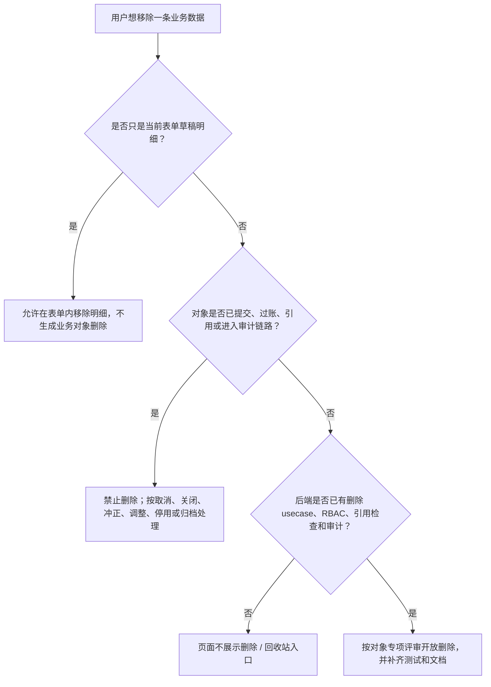

# 业务数据生命周期与页面动作规则 / Business Data Lifecycle UI Policy

本文定义当前产品页面、交互设计和实现必须共同遵守的业务对象生命周期与动作口径。

## 结论

当前业务页面不提供通用删除、批量删除、回收站或还原删除入口。页面动作必须表达真实业务生命周期：主数据走启用 / 停用，源单据走提交 / 取消 / 关闭 / 归档，事实和台账走取消 / 冲正 / 调整或只读，Workflow 只走任务状态和事件。

正式主数据、销售订单、采购订单、委外订单、生产订单和 BOM 列表统一提供“当前记录 / 历史记录 / 全部记录”只读范围筛选。`当前记录` 是页面默认值；`历史记录` 复用对象已有的停用、关闭、取消或归档状态；`全部记录` 只取消范围约束，不改变对象状态。系统另提供只读“历史记录中心”，按当前账号已有菜单和读取权限汇总这些对象，负责筛选、查看摘要、查看详情和跳回所属模块，不提供跨对象归档、恢复、删除或状态流转。

正式业务列表页还必须遵守统一的动作可用性合同：账号真正无权、所选对象或来源不适用、动作已经完成或记录进入终态时隐藏；有可选记录且未选择时常驻当前操作行并显示简短引导，选中后在同一位置显示有权限的当前记录动作，空列表不留占位；选中后，尚待满足可继续推进的前置条件、正在加载 / 保存或运行态暂不可办理时保留入口并置灰，以岗位语言说明原因。动作集合可以随所选对象、来源和生命周期合法变化，但不能因短暂 loading、重复请求或局部读回无理由闪烁、重排或左右跳动。

本文是页面设计和实现规则，不替代 `AGENTS.md`、`docs/当前真源与交接顺序.md`、Ent schema、后端 usecase、RBAC、测试或运行时代码。reference 文档只作为输入资料，未在本文列出的冻结、合并、替代、通用删除权限和通用软删除字段，都不能直接进入当前 runtime。

## 读者路径

| 你要做什么 | 先看本文哪里 | 再核对 |
| --- | --- | --- |
| 设计或评审一个列表页动作区 | [页面动作矩阵](#页面动作矩阵) | 对应 API / usecase / RBAC 和页面测试 |
| 安排业务列表的默认列顺序 | [列表信息顺序](#business-table-column-priority) | 对应领域列定义、账号列偏好和真实窗口宽度 |
| 判断能不能出现删除 / 回收站 | [删除进入条件](#删除进入条件) | `AGENTS.md`、`docs/当前真源与交接顺序.md` |
| 查询已关闭、取消或停用记录 | [历史记录查询合同](#历史记录查询合同) | 对应对象列表 API、菜单和读取权限 |
| 维护主题、偏好、控件、表单和读取恢复 | [前端实现与交互约定](../engineering/前端实现与交互约定.md) | 当前共享组件、API 与浏览器回归 |
| 更新 UI 交互设计 | [交互设计实施规则](#交互设计实施规则) | `docs/product/ui-design/README.md` 、交互设计说明和设计依据 |
| 补测试或浏览器回归 | [验收清单](#验收清单) | `web/README.md`、`docs/product/自动化测试策略.md` |

## 列表信息顺序

默认列顺序按岗位判断的重要性、查看频率和字段关联安排。常用桌面窗口不横向滚动时，应能识别业务对象、看懂主状态，并看到该页最关键的交期、数量或金额；按实际列宽验收，不以固定列数代替可见性。

| 信息 | 默认安排 | 页面差异 |
| --- | --- | --- |
| 单号、编号 / 名称、客户 / 供应商 | 最前面的识别信息 | 库存余额优先材料 / 产品、规格和仓库；变动记录优先发生时间和存货对象 |
| 主生命周期状态 | 紧邻识别信息，通常在前 2–4 个业务列 | 工序可委外 / 可内制等能力标记不是主状态；质检判定、异常审批和执行结果按本页任务保持清楚、相邻 |
| 关键交期、到期日期 | 在付款条款、地址、追溯说明之前 | 采购到货、委外回货、销售交付和出货日期优先；工程版本的生效区间相邻 |
| 关键数量、金额、责任人 | 在详细条款和审计信息之前 | 库存先看可用量；金额与币种、数量与单位保持邻近；只展示已有真实字段 |
| 备注、详细地址、税费拆分、创建 / 更新时间 | 通常靠后 | 审计、历史查询或专门核对页面按其任务安排，不机械套用订单顺序 |

前置解决默认打开时的信息可见性；固定列只用于横向对照时仍需保留的识别信息。固定区域应保持窄，不因前置状态而自动固定所有状态或整组字段。窄屏保留表内横向滚动，不挤压成不可读的文本，也不让整个页面横向溢出。

业务列定义用可选 `defaultPriority` 显式声明默认优先级，数值小的靠前，同优先级和未声明列保持原始相对顺序。共享 `moduleTableColumns.mjs` 先按原始列定义确定标识，再编排默认顺序；不通过字段名猜测优先级，不为换默认顺序搬动展示列的原始标识。

选填不等于无用。简称、报关资料、税号、详细条款等字段应先核对搜索、带值、打印和业务核对用途；没有证据时不能删除真源或改动必填规则。名称与简称相同时，客户和供应商选项只显示一次名称；独立简称继续参与识别和搜索。

仅在详情、编辑或导出时需要的辅助列，用列定义的 `listHidden: true` 退出主列表和列顺序面板，仍保留原字段及完整导出。该标记不保存新的账号偏好，不改变客户字段策略；权限策略隐藏的字段仍不得进入详情或导出。销售列表的完整收货信息可下沉，但出货列表仍保留用于核对送达对象的收货信息；各页按实际岗位任务选择，不按字段名或当前空值比例全局隐藏。列表列的展示标识、剩余个人顺序和恢复默认行为保持稳定。

账号主动保存的列顺序优先于默认优先级；新增可见列按默认优先级追加。没有个人设置或点击“恢复默认”后使用当前推荐顺序。列顺序只表达展示偏好，不改变事实、权限、明细业务顺序、打印模板或服务端记录排序。

## 页面动作矩阵

| 对象类型 | 页面默认动作 | 禁止默认出现 | 说明 |
| --- | --- | --- | --- |
| MasterData 主数据 | 新建、编辑、启用、停用、查看引用或历史 | 通用删除、回收站、还原删除 | 例如客户、供应商、产品、SKU、材料、仓库、工序。停用后不再进入新业务选择，历史单据仍可回显。 |
| Source Document 源单据 | 保存草稿、提交、审批、关闭、取消、归档 | 提交后删除、回收站 | 例如销售订单、采购订单、委外订单。草稿明细行可以在表单内移除，但不等同于列表级删除。 |
| Fact / Ledger 事实与台账 | 过账、取消、冲正、调整、只读查询 | 删除事实、清空流水、回收站 | 例如入库、出库、库存流水、出货、应收、应付、发票、对账。事实纠错必须保留可追溯反向记录或调整记录。 |
| Workflow 协同任务 | 完成、阻塞、驳回、催办、记录原因 | 把任务完成写成事实过账、删除业务对象 | Workflow task done 只代表协同任务状态变化，不代表库存、出货、财务、开票或收付款事实完成。 |
| Audit / Evidence 审计与证据 | 筛选、查看详情、导出受控证据 | 普通业务删除、静默清理 | 审计数据用于追责、排障和交付证据，不能被业务页动作绕过。 |
| 临时草稿 / 表单明细 | 添加、移除、清空当前草稿明细 | 把明细删除包装成业务对象删除 | 只在尚未形成正式业务事实前可移除；提交、过账或被引用后按所属对象生命周期处理。 |

BOM 这类版本型工程资料在页面上使用“历史版本 / 设为历史版本”表达，底层状态仍为 `ARCHIVED`。历史版本可重新激活，但不直接编辑；需要改版时应复制新草稿后修改。

## 表单必填与办理阶段

必填标记必须对应当前保存或办理动作的阻断校验；说明文字不能代替校验。基础身份、有效引用以及已录入数量和金额的合法性在保存时检查，前端定位具体字段，后端 usecase 仍是写入边界。草稿只允许暂缺后续环节才需要的信息，不允许保存已知无效值。

| 信息 | 强制检查时点 | 原因与允许的草稿边界 |
| --- | --- | --- |
| 单据编号、业务对象、日期、币种、已添加明细的对象与单位 | 保存 | 缺失会造成对象不明或无法计算；按所属单据的既有规则检查有效引用。 |
| 销售计税方式、运费口径及其条件字段 | 保存（含编辑和批量导入） | 金额含义必须明确。含税 / 未税需合法税率；另计运费需非负金额，允许显式 `0`。切换为不计税 / 含运费时清除失效的税率 / 另计金额。 |
| 订单数量、申请数量、处置数量及已填写的单价 / 金额 | 保存或生成申请 / 处置草稿 | 业务数量须大于零并符合单位精度；金额不得为负或超出精度。库存盘点的零数量和调整的正负数按各自动作规则处理，不共用正数限制。 |
| 销售完整明细、待定单价，委外交期、加工项目和合同责任方资料 | 提交 / 生效 / 对应办理动作 | 报价、合同未完成时可保留草稿；页面明确办理前条件，后端再次阻断。单价允许草稿留空不代表可填写负值。 |
| 备注、补充联系方式、后续物流及主数据选填资料 | 按实际用途和对应动作 | 不为了保存而要求猜测值；存在条件规则时仍按条件检查。 |

已有缺项草稿不自动补造商务选择；打开后可查看，重新保存时须补齐保存必填项，提交时继续执行完整性校验。缺项失败不得修改原记录、版本或推进流程。

## 历史记录查询合同

| 查询入口 | 范围 | 允许动作 | 明确不做 |
| --- | --- | --- | --- |
| 模块内“当前 / 历史 / 全部”筛选 | 当前模块和对象自己的分页列表 | 筛选、导出当前筛选结果、查看详情、按对象既有 usecase 办理合法动作 | 不新增统一 `archived_at`，不把“历史”解释成软删除 |
| 历史记录中心 | 当前账号已有菜单且具备读取权限的客户、供应商、材料、产品、SKU、加工环节、销售订单、采购订单、委外订单、生产订单和 BOM | 按一种对象类型筛选、导出当前类型的完整筛选结果、设置列表列、查看只读摘要与详情、跳回所属模块 | 不跨对象一键归档或恢复，不绕过所属模块的状态、RBAC 和引用检查 |
| Fact / Ledger 与审计记录 | 继续留在各自事实台账、库存流水、财务记录和系统操作记录 | 使用原页面查询、追溯、冲正或调整 | 不因历史中心而隐藏、复制或迁移事实与审计真源 |

列表 API 的 `lifecycle_scope` 只接受 `current / history / all`。未传该参数时保留原 API 读取合同，避免影响既有引用选择器和内部读取；正式业务列表页面会显式发送范围。显式状态筛选必须与范围兼容，例如“当前记录 + 已关闭”应拒绝或由页面清空冲突状态，不能静默返回误导数据。

历史中心不是新的数据台账。每次只读取当前选中的一个对象来源，沿用该来源原有分页、关键字、状态字段、读取权限和菜单可见性，避免在前端拼接不准确的跨对象总数。是否能重新启用、重新激活或重开，仍由所属对象自己的 usecase 和页面动作决定。

## 选择记录后的动作可用性合同

| 条件 | 页面处理 | 原因 |
| --- | --- | --- |
| 当前账号没有动作权限 | 隐藏动作入口 | 不泄露无权能力；后端 RBAC 仍是安全边界。 |
| 客户配置未开放、模块关闭或当前产品没有该能力 | 隐藏动作入口 | 不用禁用占位伪装未实现能力。 |
| 有能力但尚未选择记录 | 有可选记录时保留“当前操作 · 选中记录后显示可用操作”；空列表不留操作占位 | 新建、筛选、导入保留在查询区，导出筛选结果与列设置归入表格工具。切换未选占位时保留组件内部尚未确认的操作状态，不能以销毁组件丢失恢复入口。 |
| 所选记录的对象类型、来源类型或事实类型不适用 | 隐藏动作入口 | 结构上不属于当前对象的动作不占位，不用永久灰色按钮制造误导。 |
| 当前动作已经完成，或记录已进入不能再办理该动作的终态 | 隐藏动作入口，由状态列、详情或关联记录表达结果 | 例如已提交后隐藏“提交”、已关闭后隐藏流转动作、已生成退货后由关联退货记录表达。 |
| 有能力且动作仍可能继续推进，但当前状态、前置资料或版本尚未满足 | 保留动作入口并置灰 | 用岗位语言提示需要先完成的步骤；满足条件后在原位置启用。 |
| 有能力但正在加载、保存或办理 | 保留固定动作槽并置灰；完成后按最新读回恢复 | 防止重复提交或并发编辑，不因短暂等待改变布局。 |
| 当前状态允许办理 | 启用对应动作 | 点击后仍由后端 usecase、状态机、版本、幂等和 RBAC 再校验。 |
| 当前状态没有合法主生命周期动作 | 隐藏主状态动作 | 终态不保留没有业务含义的“状态办理”灰色占位。 |
| 当前状态没有合法次级生命周期动作 | 不展示对应状态动作 | 状态动作按各自权限与状态判断，不保留空的分类入口。 |

`BusinessActionTooltip` 是临时不可用原因的共享入口；鼠标悬停和键盘聚焦都应能读取原因。桌面最多常驻四个动作组，平板两个，手机一个；质检两个判定作为一组同时可见，按页面声明的业务角色和固定优先级选择，其他合法动作进入按钮旁的“更多操作”下拉菜单，沿用同一处理函数及确认弹窗。颜色不决定直接入口，相关、例外和普通重读收进更多；失败重读直接显示在错误旁。选中记录时，新建入口保持位置并降低强调。主动作跟随阶段：质检草稿先提交、待判定再判定，收付款先核对审批、批准后再核销，生产草稿先下达。清空已选放在当前记录标识旁，不挤占业务动作名额；源单的正常关闭、提前关闭、取消等次级状态动作直接与其他辅助动作同级排列，不再增加“其他状态操作”分类下拉；沿用原确认弹窗和原因必填规则。仅启用态变化不能参与窄屏排序，下拉菜单内当前合法动作的次序也不能因 loading 改变。切换业务对象类型、来源类型、事实类型、正式页签或生命周期阶段时，动作集合可以按当前对象合同变化；读权限只能展示“查看”入口，不能借只读权限展示“返工、过账、取消”等写操作文案。

## 正式页面覆盖矩阵

下表记录当前选择行操作条的覆盖面。它是交互合同清单，不替代各页面的后端状态机和权限真源。

岗位是当前默认分工的说明；实际入口由后端权限、客户有效配置、任务责任与当前记录共同决定。财务兼采购通过同时分配两个角色获得合同经办能力，不扩大纯财务权限。具体步骤见[业务与协同流程地图](../workflow/业务与协同流程地图.md)。

| 页面 / 对象 | 保留或补齐的按钮 | 默认办理岗位及条件 | 移除、隐藏或修正 |
| --- | --- | --- | --- |
| 主数据：客户、供应商、材料、产品、规格、仓库、工序 | 新建、编辑 / 查看、启用 / 停用、联系人和相关资料 | 各档案对应维护权限；读权限仅查看 | 不增加通用删除；停用不会抹除历史引用 |
| BOM 版本 | 新建、查看、编辑、复制、打印、激活、设为历史版本 | 工程；只编辑草稿，历史版本可按既有权限激活 | 已激活不再显示激活；不可编辑版本隐藏编辑；复制仍用于改版 |
| 销售订单 | 新建 / 导入、查看、编辑、工程与打样、用料汇总、预留库存、状态操作 | 业务建单；工程建档及提交用料；管理 / 财务办理用料审批；业务对生效订单预留 | 草稿显示提交，已生效显示合法关闭动作；终态隐藏流转和编辑。用料入口按能力称为“提交 / 审核 / 查看用料汇总” |
| 采购订单 | 查看详情、草稿编辑、补齐价格与交期、关联单据、登记到货、打印合同、状态操作 | 采购制单及合同办理；补价另需商业字段读取能力；仓库按已批准订单登记实际到货；财务可按读权限核对 | 提交后隐藏整单编辑；已批准单通过专用动作补缺价及维护交期，已关闭单只补缺价，已确认单价不能覆盖；“登记到货”生成待检记录，不代表库存入账 |
| 采购入库 | 查看、关联单据、确认材料入库、退货、调整、生成 / 查看应付、取消 | 仓库 IQC 登记来料并可取消未入库错误登记；仓库确认当前合格的未入库行；采购处理商务退货；财务在每行已入库或拒收处置完成后登记应付 | “部分入库”保留后续合格行的确认入口，同一行不重复过账；退货和调整只选已入库行；IQC 的取消草稿权限不能冲正已入库行 |
| 加工合同 / 委外订单 | 查看详情、编辑、关联事实、打印、状态操作 | 生产提出加工要求，财务兼采购补价和确认合同；仓库处理对应发料 / 回仓 | 补上独立详情按钮；已确认隐藏编辑和再次确认；合同确认不直接写库存、质检或应付 |
| 生产订单 | 查看、编辑、下达、工序办理 / 查看、完工申报、关联事实、关闭、取消 | PMC 建单与下达，生产申报；相关岗位查看路线；仓库确认完工入库 | 已下达隐藏编辑和再次下达；已关闭原批次只读，合法成品返工仍保留入口 |
| 生产工序弹窗 | 安排加工、拆分、开始工序、本厂完工、外发回仓、转下道、包材确认、返工 | 生产安排、开工、完工与转序；仓库登记外发回仓；业务确认包材；返工另受权限控制 | 按动作分别核对岗位；本厂与外发不互相展示完工按钮；已办理步骤、已拆分 / 取消批次隐藏对应动作；转序仍需质量通过 |
| 质量检验 | 查看、提交检验、判定合格 / 不合格、取消、不合格处置 / 查看 | 品质提交和判定；采购办理来料处置；生产处理在制异常；委外处置按专门权限 | 已判定隐藏提交和再次判定；不合格处置按来料、委外、在制来源和权限路由，完成后改由关联记录追溯 |
| 库存台账与作业 | 关联查询、盘点、调拨、人工调整、作业详情与合法确认 / 取消 | 仓库具备对应库存作业权限；人工调整按有效审批办理 | 余额 / 流水不提供直接编辑或删除；只有库存余额页保留作业入口 |
| 出货单 | 查看 / 关联、草稿编辑、出货前检验、核对放行、确认出货、作废 / 撤销、应收 / 开票来源 | 品质发起出货检验；财务审批；仓库出货；财务登记后续事实 | 进入财务流程的草稿隐藏编辑，双击也改为查看；已放行隐藏重复放行，已出货隐藏重复出货，审批驳回隐藏无法继续的动作 |
| 生产 / 委外 / 库存运营事实 | 查看、编辑草稿、确认作业、取消、返工、关联单据 | 按事实类型拆分生产申报、仓库过账及异常权限；成品入库由仓库确认 | 不按“能读事实”展示写动作；完成 / 取消后隐藏重复动作；合法返工与冲正保留 |
| 应收、应付、开票、对账 | 查看、确认、取消、关联来源、单笔对账、结清、打印 | 财务；只创建草稿，再由对应领域动作确认 | 非对账来源不显示单笔对账；已结清或取消隐藏重复办理；不由任务完成替代财务事实 |
| 收付款与红冲 | 核销过账、核对审批 / 取消、冲销、重新读取、红冲撤销、异常流程恢复 | 财务办理；异常恢复仅向具备专门权限的岗位开放 | 已批准隐藏重复审批；已冲销 / 取消不再保留无效按钮；隐藏无权恢复组件，避免空“更多操作” |
| 协同任务、排产 / 进度 / 异常 / 放行任务页 | 查看任务、来源办理、完成 / 批准、阻塞 / 恢复、退回、催办、列顺序 | 以服务端 action explain、owner / assignee 和动作权限为准 | 移除未实现的导出占位；终态不显示流转；到货、入库、工程等来源任务只能进入对应业务办理，不能泛化“完成任务”替代事实 |
| 工作台与经营看板 | 岗位任务、审批、查看进展和来源跳转 | 任务操作继续使用统一任务权限与状态合同；指标只读 | 不增加修改指标、跳过审批或一键完成业务链的入口 |
| 历史记录、审计、帮助 | 筛选、详情、返回业务页、受控导出 / 帮助导航 | 已有读取和菜单权限 | 保持只读，不增加删除、恢复或跨模块状态操作 |
| 打印中心与各打印工作台 | 选择来源、编辑打印草稿、预览、打印 / 导出、清空打印草稿 | 对应单据与模板读取 / 编辑权限 | 保留打印动作，不将打印保存解释为订单修改、合同确认或事实过账 |
| 权限与审批责任设置 | 查看配置、授权范围内调整、检查、保存生效 | 管理配置权限；生效前检查责任人有效性 | 普通岗位不展示管理写入口；配置不替代业务审批 |

“生成应付 / 应收 / 开票”等可重放来源动作仍由后端幂等和来源余量控制，不能仅凭单据进入下一状态就推断已经完成。重新读取用于不确定结果恢复，不执行第二次过账。多次到货、分批出货、返工和冲正继续保留各自合法入口。

## 删除进入条件

只有同时满足以下条件，某个对象才可以单独评审删除或恢复：

1. 对象仍是草稿、误建或临时数据，尚未进入正式业务链路。
2. 后端 usecase 已实现状态检查、引用检查、权限检查和审计记录。
3. 已完成 RBAC、API、前端提示、错误码或错误提示、测试和浏览器回归。
4. 已被引用、已提交、已过账、已发货、已产生财务事实、已进入 Workflow 或审计链路时，删除必须拒绝，并给出可读原因和替代动作。

页面不能为了视觉完整性补本地删除、软删除假状态、回收站空态或禁用按钮。尚未满足条件时，直接不展示删除 / 回收站入口。

## 决策路径

## 交互设计实施规则

- 交互设计中的标准业务页表达筛选、列顺序、当前记录动作、分页和协同入口，不再内置通用回收站。
- 局部动作弹窗样板承接来源选择器、列顺序、危险动作确认和生命周期动作说明；只有完成真实软删除 / 恢复 usecase 的对象，才能在对象专项设计里单独设计回收站。
- 业务表单样板里的“删除”只允许表达草稿明细行移除，应在说明里明确它不是业务对象列表级删除。
- 交互稿中的静态按钮不能反推 API、RBAC、schema、migration 或事实写入能力；进入运行时前必须回到当前代码和测试复核。

## 验收清单

| 检查项 | 通过标准 |
| --- | --- |
| 列表页工具条 | 不出现通用批量删除、回收站或还原删除；只保留真实共享动作，例如导出当前筛选和列顺序。 |
| 历史范围筛选 | 默认显示当前记录；切换范围会清空不兼容的状态筛选；历史深链刷新后仍保持范围；全部记录不改变任何对象状态。 |
| 历史记录中心 | 只显示当前账号有菜单且有读取权限的来源；无可读来源时不发业务读取请求；详情和跳转不展示原始内部 ID，也不提供归档、恢复、删除或跨对象状态动作。 |
| 当前操作区 | 无权限、结构不适用、动作已完成或终态动作不占位；有可选记录且未选择时显示常驻引导，选中后替换为对象与动作，空列表不留占位，内部恢复状态保留；可继续推进的前置条件不足或忙碌时置灰并显示统一原因；空“更多操作”隐藏。 |
| 表单明细 | 删除文案限定为“移除明细行”或等价语义，不误导成业务对象删除。 |
| UI 交互设计 | 唯一交互稿遵循业务生命周期，通用回收站须先有对象专项的后端闭环。 |
| 文档口径 | 规则必须直接由本文、当前真源、代码和测试承接；外部材料原文不进入仓库，也不作为实现依据。 |
| 测试守卫 | 前端测试至少覆盖无权限隐藏、未选择和清空选择后恢复常驻引导、空列表无操作占位、重新选中恢复当前动作及尚未确认的状态、结构不适用隐藏、可继续推进的前置条件置灰、可用启用、动作完成 / 终态隐藏、加载 / 保存和空“更多操作”隐藏；浏览器回归验证桌面 / 窄屏 / 暗色的 DOM 顺序、相对边界框和横向溢出。 |

## 对象专项实施边界

- 不新增 `deleted_at / archived_at / frozen_at` 通用字段。
- 不新增通用删除、恢复、回收站 API。
- 删除 / 恢复权限须随对象专项 usecase 评审，不引入通用删除权限码。
- 不改变现有 WorkflowUsecase、Fact usecase、schema、migration 或业务菜单权限真源；历史记录中心作为已登录工具入口，仅复用现有菜单可见性和读取权限决定其可查来源。
- 不把 reference 文档中的冻结、合并、替代、通用软删除策略直接落到当前 runtime。
