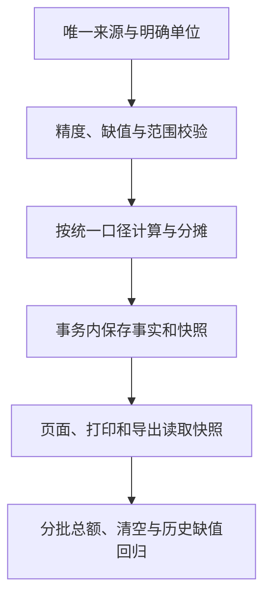
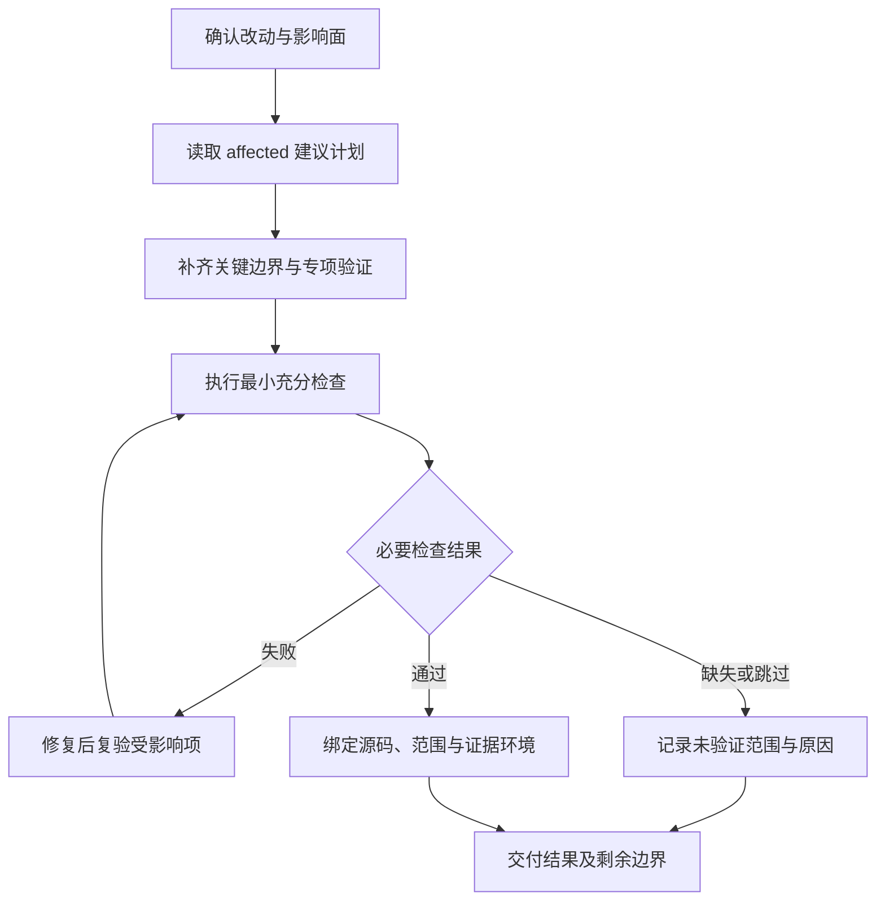
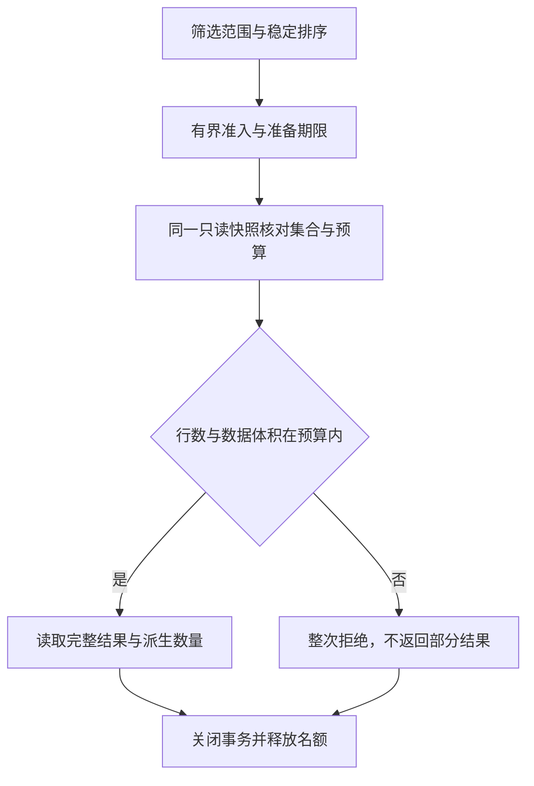
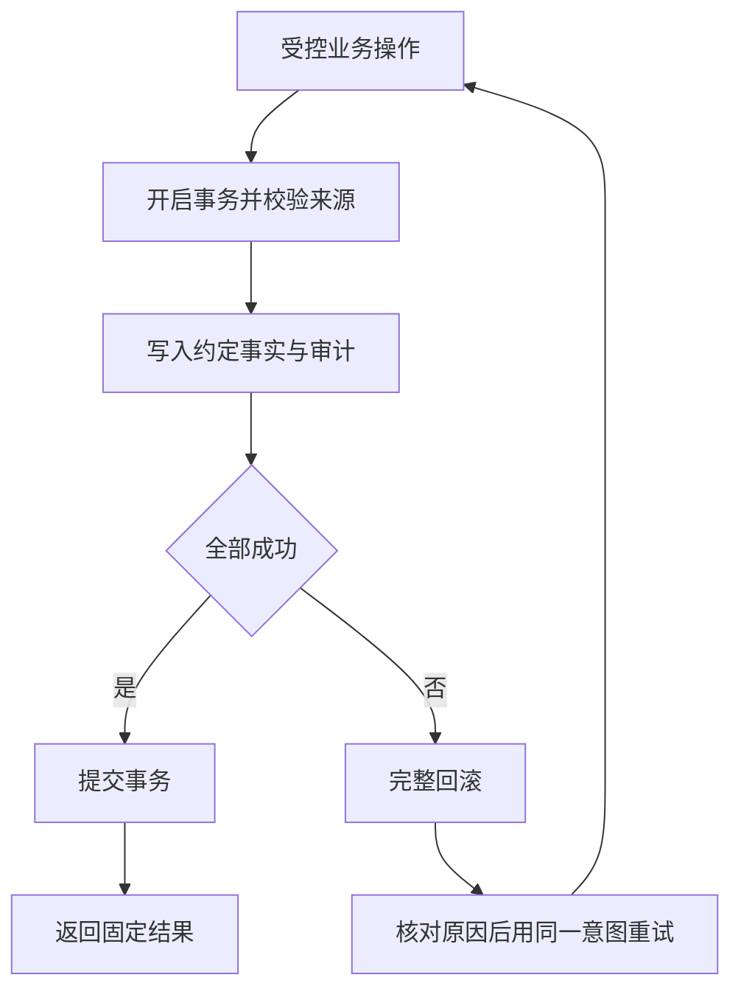
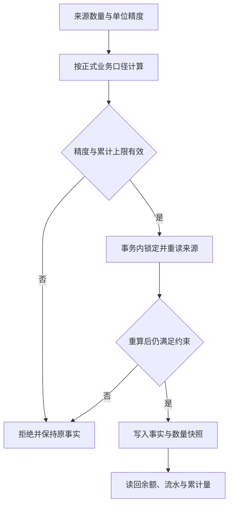
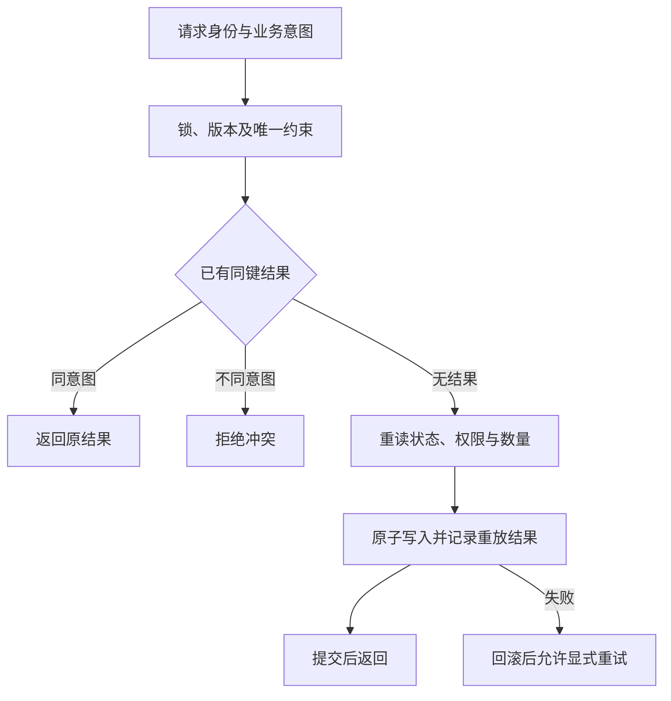
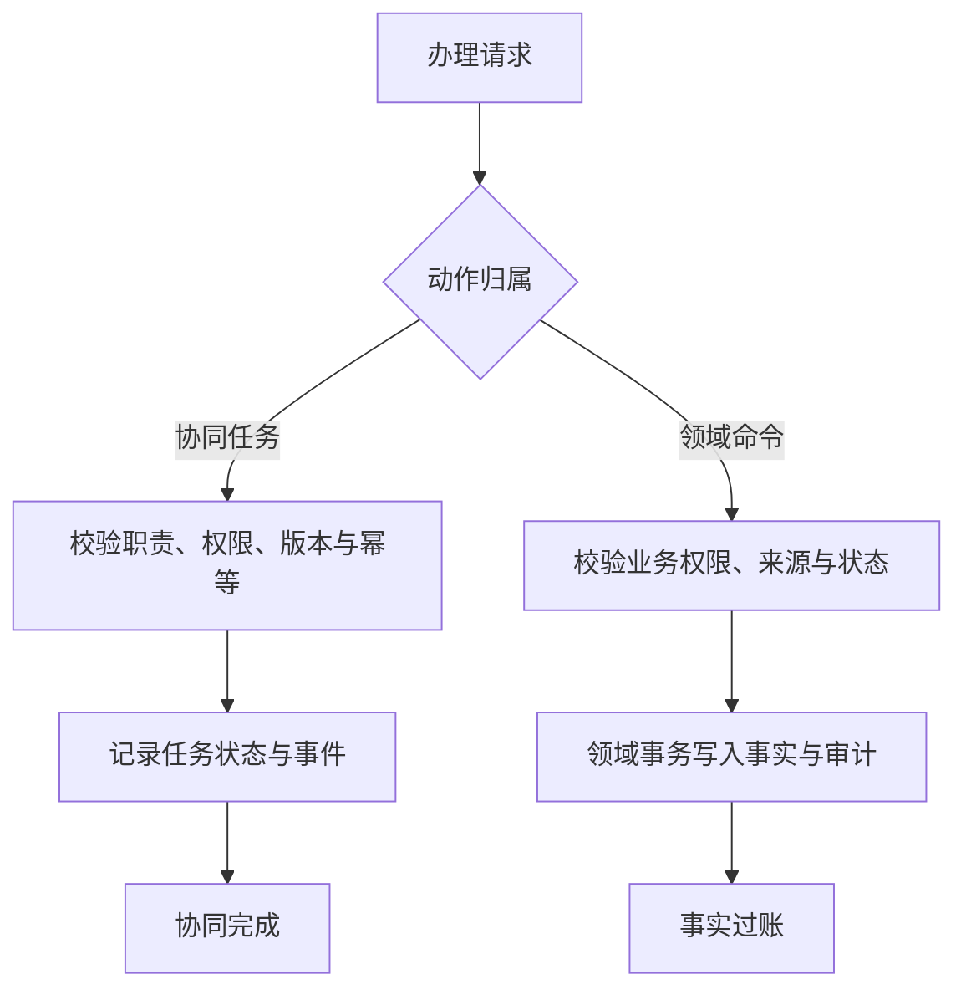

# 自动化测试策略 / Test Strategy

本文只回答三件事：这次改动要测什么、现有测试能证明什么、还缺哪类证据。当前能力状态看[产品能力进度台账](产品能力进度台账.md)，具体命令和脚本职责看 [`scripts/qa/README.md`](../../scripts/qa/README.md) 与各子系统 README。

日常开发先运行 `bash scripts/qa/affected.sh --plan`，确认建议范围后再执行 `--run`。不要求开发者或甲方记忆验证编号；`T0-T8` 只保留为工作台和报告的稳定机器键。

## 原则

- 按实际影响面选择最小充分验证，不因只改一个文件就降低风险，也不为普通改动机械跑全站。
- 验证授权遵循[项目 AGENTS](../../AGENTS.md#测试与验收)：实现授权包含当前目标所需的最小充分验证，按任务范围、资源预算和副作用决定是否另行确认；具体选择按 `$plush-test-governance` 执行。
- 单元、合同、真实数据库、浏览器和目标环境证据各自回答不同问题，不能互相冒充。
- warning、skip、未运行、环境缺失和 `0 tests executed` 必须单列，不能写成通过。
- 测试使用项目锁定工具链；不依赖调用者偶然安装的更高 Node、Go 或浏览器版本。
- 自动化通过不代表业务已经发布、恢复可用或客户验收完成。
- 边界用例围绕本次受影响的业务规则、关键失败路径和已知回归选择代表值；按等价类、临界值和实际状态转换覆盖，不穷举输入，也不机械展开角色、状态、页面的全组合。只有条件相互影响结果时才增加组合。
- 金额精度、权限、字段真源与残值、幂等、事务及恢复等关键约束保留行为验证。低风险页面优先验证可见结果；类名顺序、内部函数名和具体 CSS 写法只在它们本身是必要合同且没有更稳定的验证方式时作为断言。
- 条件选测在执行前决定范围；已选中的必要检查遇到环境缺失、零执行或跳过，必须报告未验证。相关验证通过且没有新改动、失败或未解决风险时停止，不为增加覆盖数量反复扩测。

<a id="business-data-consistency"></a>

### 业务数据一致性专项 / Business Data Consistency

在“关键规则与发布门禁”中选择“业务数据一致性”，或在固定验证中运行同名专项。目录沿用 `scripts/qa/lib/business-rule-catalog.mjs`，不另设一套业务公式。

| 维度 | 持续保护的口径 | 证据 |
| --- | --- | --- |
| 数量与金额 | 单位精度、六位定点、派生溢出、清空单价与未知金额 | 前端与 Go |
| 比例与物理单位 | BOM 百分数与 Excel 格式、不良比例六位、克与千克换算 | 前端与 Go |
| 日期 | 上海自然日筛选、显式时间戳、UTC 月结规则 | Go |
| 币种与快照 | 采购与加工合同币种、主数据改动、来源切换、历史缺值 | 前端、Go、PostgreSQL |
| 分批对账 | 税额和另计报价运费按货款占比、末批尾差、委外应付、取消与重试 | Go、PostgreSQL |

```bash
node scripts/qa/business-data-consistency.mjs --write
```

该命令运行登记的前端和后端用例，原子发布 `output/qa/coverage/business-consistency.latest.json` 并汇入现有覆盖报告。报告必须绑定当前 commit 与工作区内容指纹，精确用例缺失、重复、零执行、跳过或执行期间源码变化均不得算通过。前端同时核对完整执行摘要和嵌套子用例；父用例通过不能覆盖子用例的失败、跳过或待办。PostgreSQL 测试继续进入既有 critical gate，浏览器与 PDF 按影响面单独执行；一次专项绿色不代表数据库、全部页面或客户验收通过。



## 按改动选择验证 / Selecting Checks

下图用于选择范围，不表示每次都要执行所有测试层级；异常和缺失证据必须保留到交付说明。



## 证据怎么表达

| 维度     | 例子                                                        | 回答什么         |
| -------- | ----------------------------------------------------------- | ---------------- |
| 验证范围 | 文档、领域逻辑、API 与权限、页面、真实数据库、发布          | 这次需要测到哪里 |
| 测试形态 | unit、integration、contract、UI regression、E2E、smoke      | 测试证明哪类行为 |
| 证据环境 | static、local mock、local DB、browser、test env、target env | 结果发生在哪里   |

最终报告使用业务名称，内部需要追踪时再括注机器键，例如“领域逻辑（T3）”。不要只写 `T3-T5` 让读者自行查表。

<a id="test-methods"></a>

## 测试方式 / Test Methods

研发效能工作台的“测试验证 → 测试执行”默认打开测试总览，同屏列出测试维度、执行入口与报告位置。查看已执行结果进入“测试报告”，运行检查进入“本轮验证”或“压力测试”；总览中的专项命令只负责定位与复制，具体执行仍遵循所属脚本边界。

日常以代码、接口、真实数据库和浏览器脚本回归为主；设备相关改动按风险补真机。下表说明当前入口与适用范围，不表示这些检查已经对当前源码执行或通过。工作台默认“测试总览”与“测试指引 → 测试方式”直接读取本表，执行结果继续来自原有 runner 和报告。

| 测试方式 | 适用场景 | 当前入口 | 结果边界 |
| --- | --- | --- | --- |
| 领域逻辑与 fuzz | 数量精度、金额、状态、字段覆盖与清空 | Go、Node 同名测试；已有数量 fuzz 种子，持续 fuzz 按需执行 | 内存逻辑与固定种子通过，不能代替真实数据库并发或持续 fuzz |
| 接口与权限 | JSON-RPC 参数、错误码、角色、经办人与拒绝写入 | service / server 合同、接口样例与岗位权限专项 | handler 夹具、真实登录与目标环境分别取证 |
| 真实数据库 | 事务回滚、幂等、数量竞争、余额对账和迁移升级 | 隔离 PostgreSQL 与对应迁移 lifecycle | 空库、存量升级与共享或目标数据库分别取证 |
| 浏览器与模拟接口 | 表单、列表、布局、错误、加载和恢复 | Playwright / Style L1 的受影响场景 | 页面行为成立，不能证明真实后端写入 |
| 浏览器与真实后端 | 登录、审批、任务办理及业务事实读回 | 现有真实后端浏览器与隔离业务链 runner | 手机触摸视口属于模拟设备；结果限于报告声明的链路 |
| 布局、打印与导出 | 溢出、长文本、PDF 分页、导出字段和值 | 页面、打印及输出专项 | DOM、截图、PDF 与数据读回各自核对；像素相似不证明业务正确 |
| 压力、故障与恢复 | 数据增长、竞争、提交中断、恢复和清理 | 现有压力测试、故障场景与恢复专项 | 结论绑定源码、负载、数据、环境和阈值，不能外推未测容量 |
| 安全与可访问性 | 漏洞、凭据泄露、越权、标签、键盘和焦点 | 已有安全门禁与页面检查；可访问性按受影响交互补充 | 扫描、权限行为和真实辅助操作分别判断，不能互相补绿 |
| 手机真机 | 系统键盘、输入法、相机与文件选择、前后台和实际浏览器 | 按本机 iPhone / Android Skill 操作；项目尚未接入固定真机 runner | WDA / UiAutomator2 是控制通道；有固定场景与断言后才形成脚本回归 |
| Codex 探索 | 陌生路径、意外操作顺序、难复现问题 | 已授权的浏览器或设备通道，保留实际操作和发现 | 临场操作是探索记录；稳定问题应固化为可重复回归 |

加载态回归使用 `mobile-task-loading-light-390`、`mobile-task-loading-dark-390`、`mobile-task-loading-light-320` 与 `desktop-route-loading`：受控延迟覆盖首屏、分栏、刷新、失败重试、空结果和快速离开；比较占位与基准卡片几何，并验证导航节点保留。对应 `*-performance.json` 记录固定占位节点、动画数量、30 帧采样、稳定展示期间的长任务、数据放行后的可见耗时和分页请求。阈值由场景断言维护；这些数据证明本地浏览器在模拟接口下的加载开销与响应能力，不代表真实网络、后端性能或低端手机容量。

交互设计加载与恢复由 `dev-ui-page-states-controls`、`dev-ui-page-states-mobile-preview` 和 `dev-ui-page-states-desktop-preview` 覆盖。沿用工作台浅色桌面环境；手机示例在页面内核对 390 / 320px、样例深色及减少动态效果，不扩成工作台全站主题或设备矩阵。检查状态切换、卡片与页签保留、失败重试、清除条件、桌面等待时导航、设计说明入口及无业务请求，并保留各状态截图。HTML 与共享组件证据分开，不把演示通过等同真实后端验收。

<a id="growth-and-correctness"></a>

## 增长、并发与事务验证 / Growth and Correctness

按本轮实际影响选择能力与证据。功能扩展的设计判断、真实数据库的业务正确性和给定负载下的容量表现分别报告；不合并为系统总分或覆盖百分比。工作台总览提供“增长、并发与事务”直达入口，指引的增长验证读取下表，关键规则与压力报告继续消费现有目录和执行回执。

| 能力 | 检查与触发条件 | 验证入口 | 结论边界 |
| --- | --- | --- | --- |
| 功能可扩展性 | 动作、筛选、页签、关联项或模块职责增多时，核对分类、主要动作、权限、窄屏、返回恢复及依赖方向 | 所属设计审查、共享组件行为测试、受影响浏览器增长场景 | 设计依据与实际交互共同判断维护成本；单测数量不证明架构可扩展 |
| 数据与负载可伸缩性 | 查询、统计、导出、批处理或索引改变时，分别声明业务总量、单次范围、批次、并发和热点 | 查询与预算边界测试、隔离 PostgreSQL、同条件数据规模比较 | 有界回归只证明已测范围；规模未知保持缺口，不据此推断生产容量 |
| 并发正确性 | 改变版本、幂等键、锁、唯一约束或热点写入时，核对同意图重放、冲突赢家和数量上限 | 关键规则目录、真实 PostgreSQL 多连接与受控同步点 | 必须读回最终业务事实；内存并行或吞吐达标不能替代数据库竞争 |
| 事务一致性 | 改变聚合写入、只读快照、冻结来源、取消或冲正时，核对完整提交、失败回滚与恢复 | 关键规则目录、失败注入、快照与持久化对账 | 读写各自守住同一事实边界；Workflow 完成不代替 Fact 过账 |
| 性能、资源与恢复 | 改变处理成本、超时、准入或连接占用时，核对成功吞吐、分方法延迟、资源采样、取消释放及降载恢复 | 压力测试短档、按目标选择的容量档、原始报告 | 结论绑定源码、数据、负载、资源和阈值；短档不证明长期稳定性 |

日常先执行受影响的正常、边界、异常与恢复用例；涉及增长或负载的主路径，再选择既有隔离压力短档。比较规模时保持负载和环境可比，长容量档按明确目标及资源预算显式执行，不将全部档位加入每次提交。规模假设、处理边界与升级触发条件维护在所属模块设计，工作台只链接依据和展示实际证据。

<a id="evidence-categories"></a>

## 证据分类 / Evidence Categories

测试方式、执行环境与执行结果分别记录。同一场景可以有多类证据，但不能合成为“全部完成”。下表是分类口径，不是运行结果；报告没有明确环境、范围或执行记录时保留未证明，不按测试名称、文件名、设备预设或截图推断。

| 证据类别 | 必要上下文 | 能证明的范围 | 不能替代 |
| --- | --- | --- | --- |
| 静态与内存测试 | 源码身份、检查或用例、实际执行数 | 静态边界、领域函数、接口夹具或固定 fuzz 种子 | 真实登录、数据库持久化、真实页面和目标运行 |
| 隔离数据库 | 源码、数据库与 migration 身份、场景、对账和清理 | 对应数据库约束、事务、并发、升级与事实读回 | 真实页面、未测存量、正式目标库和客户验收 |
| 浏览器与模拟接口 | 浏览器引擎、视口、mock 范围、场景与结果 | 声明范围内的页面与交互 | 真实后端、实际手机系统和 Safari 真机 |
| 浏览器与真实后端 | 浏览器、视口、前后端身份、数据范围与结果 | 声明业务链的页面操作及真实后端读回 | 未测链路、手机真机、目标部署和客户验收 |
| 手机真机 | 机型、系统、浏览器、源码或固定版本、场景、执行方式与结果 | 对应设备和系统上的实际操作 | 其他机型、模拟设备、后台事实完整性和客户验收 |
| 目标环境与恢复 | commit / image / config、目标、migration、健康、业务 smoke 与恢复回执 | 对应版本在指定目标的运行或恢复 | 未执行的数据库、浏览器、真机和客户验收 |
| 客户验收 | 固定版本、业务范围、反馈来源与实际使用结论 | 客户对声明范围的使用认可 | 自动化测试细节、未测容量或其他环境的发布证明 |

<a id="real-device-regression"></a>

## 真机回归 / Real Device Regression

当前手机业务入口是浏览器中的 `/m/:roleKey/tasks`。Playwright 的手机视口模拟与 WebKit 检查继续承担高频回归；实际 iPhone Safari、Android 浏览器与系统交互由真机单独取证。

引擎模拟不升级为实际手机浏览器结果，见 [Playwright 设备模拟](https://playwright.dev/docs/emulation)与 [WebKit 边界](https://playwright.dev/docs/browsers#webkit)。

以下为固定场景范围，按改动选择；尚未接入真机 runner，也没有由本表产生的通过结果。场景复用现有角色、任务、业务动作和模拟数据，不为设备测试新增业务写入旁路。

| 场景 | 操作范围 | 判定与读回 |
| --- | --- | --- |
| 登录与会话恢复 | 登录、会话失效提示、重新进入任务入口 | 正常与拒绝路径清楚，恢复后仍是原账号和授权范围 |
| 查找与办理 | 岗位筛选、打开同一模拟任务、执行允许的动作、返回列表 | 核对对象、权限、办理结果及列表恢复；涉及 Fact 时由正式 API 读回 |
| 系统输入与布局 | 中文输入、粘贴长文本、键盘展开和收起 | 输入不丢失，当前字段和主要动作可达，无页面级横向溢出 |
| 相机与文件选择 | 仅对已有支持的附件动作检查选择、取消和失败恢复 | 取消不产生残值，成功时读回对应附件；不由说明推定已有拍照能力 |
| 中断与显式重试 | 在隔离场景验证提交中断、前后台切换及再次提交 | 保留首次结果，明确是否成功；任务、事实和审计不重复 |

接入固定 runner 时，优先复用现有 WDA / UiAutomator2 通道；确需统一跨平台执行接口时再评估 [Appium 官方驱动](https://appium.io/docs/en/latest/ecosystem/drivers/)，不因工具可用重复建设执行层。场景必须有固定步骤、独立断言和失败诊断；报告记录脚本回归或 Codex 探索、实际设备上下文、执行与跳过数、首次失败及重试、源码或制品身份和未证明项，按需保留脱敏截图或录像。

同一台手机串行操作，使用已授权的模拟数据与测试环境，设置有界超时、取消和清理读回；断连、锁屏、签名、凭据或环境缺失显示受阻，不能当作业务通过。设备解锁、配对、系统权限及凭据遵循对应 Skill；报告不包含 token、密码、设备唯一标识或客户原件。固定 runner、结果合同及恢复尚不具备时，工作台只展示说明与缺口，不提供可执行真机按钮。

## 验证层级 T0-T8

下表首列是开发工作台与 QA 报告使用的稳定机器键。选择最高受影响范围后，仍保留相关的低层关键测试；它不是要求每个任务从 T0 逐级走到 T8。

| 层级                    | 适用改动                                      | 最小验证                                                                                 |
| ----------------------- | --------------------------------------------- | ---------------------------------------------------------------------------------------- |
| T0 现场与静态           | 所有改动                                      | `git status --short`、`git diff --stat`、`git diff --check`，确认未跟踪文件和共享现场    |
| T1 文档与边界           | Markdown、README、AGENTS、Skill、目录职责     | 文档清单、链接与引用、相关 README、Skill validator 和定向合同测试                        |
| T2 数据结构与迁移       | Ent schema、constraint、index、generated code | `make data`、生成零漂移、schema/migration 定向测试、fresh/upgrade；目标库另行取证        |
| T3 领域逻辑             | 状态、金额、事务、Workflow / Fact、字段真源   | 相关 core、biz、data 单元与集成测试，覆盖正常、边界、异常、幂等和回滚                    |
| T4 API 与权限           | JSON-RPC、鉴权、权限码、角色和错误码          | 领域测试 + service/server 合同，覆盖未登录、disabled、无权限、角色边界和 super admin     |
| T5 页面与浏览器         | 页面、菜单、字段、表单、样式和错误提示        | Web lint/CSS/unit/contract；按影响面追加页面级浏览器回归（Style L1）或更广回归           |
| T6 配置、Seed 与导入    | 客户配置、客户包、fixture、模拟数据、dry-run  | manifest、数据隔离、extract/freeze/dry-run 和 cleanup 合同；不冒充真实客户导入           |
| T7 业务集成与真实数据库 | 库存、采购、质检、生产、出货、财务真链        | 隔离 PostgreSQL、JSON-RPC/RBAC 或真实浏览器链路；必须有真实执行数且 fail/skip 为 0       |
| T8 发布、恢复与回滚     | 制品、Compose、migration、目标环境、备份恢复  | `strict.sh`、固定制品、目标 migration、health/smoke、backup/restore 和 rollback evidence |

验证计划协议 v2 用 `affectedScopes` 表示本轮受影响的 T0-T8 范围，用 `maxAffectedScope` 便于摘要，并用 `localGate=focused|full` 独立表达本地门禁强度。本地 `full` 不会自动加入 T8；只有发布、部署、恢复或回滚证据确实受影响时，T8 才进入 `affectedScopes`。

## 日常入口

| 入口                                       | 用途                                                                      | 不能代替                                         |
| ------------------------------------------ | ------------------------------------------------------------------------- | ------------------------------------------------ |
| `bash scripts/qa/affected.sh --plan`       | 只读生成本轮验证计划和待补证据                                            | 实际执行                                         |
| `bash scripts/qa/affected.sh --run`        | 执行可自动选择的受影响测试                                                | 输出中的 required follow-up                      |
| `bash scripts/qa/fast.sh`                  | 高频本地守卫                                                              | PostgreSQL、真实浏览器、发布和 UAT               |
| `bash scripts/qa/prepare-push.sh`          | 默认 origin/main 校验范围、日志、secrets、源码并签回执，交 GitLab CI Gate。 | GitLab exact-SHA CI；发布需 CI Gate 终态成功后方可 |
| `bash scripts/qa/prepare-push.sh --full`   | 显式完整本地诊断；非标准 remote/ref 保持保守计划                          | GitLab exact-SHA CI 与目标环境证据                 |
| `bash scripts/qa/full.sh`                  | 独立诊断完整本地门禁                                                      | 推送授权、发布或客户验收                         |
| `bash scripts/qa/strict.sh`                | 发版候选的严格本地门禁                                                    | 目标 migration、health/smoke、恢复和回滚         |

`affected` 不自动执行会改写生成物的命令，也不能猜测普通业务页面的唯一浏览器场景；它会把这些步骤列为 follow-up。普通前端模块同时核对自身测试和调用方测试，不以存在同名测试作为影响范围完整的证明。

DEV 工作台是桌面内部工具：`web/src/dev-workbench/**`、`web/dev-server/**` 和 DEV Style L1 优先走同名或边界测试，页面变更只提示受影响桌面 smoke；涉及 migration、交付命令、凭据或安全桥接时仍追加更强的专项复核。未知路径、全局入口、发布执行逻辑或无独立测试的 QA 脚本可以保守升级，不能静默判为无需测试。

`fast` 是跨模块基础检查集合，不是每次小改的默认命令。命令编排、分组、回执、锁和 CI 细节只在脚本及 [`scripts/qa/README.md`](../../scripts/qa/README.md) 维护，不在本文复制。

正式代码和文档的历史 Phase/P 编号规则由 `affected` 只扫描本次变更文件；`fast` 不再为这条命名约定遍历全仓。`gate-profiles` 只登记 fast/full/strict 的语义层级和直接入口，实际执行与测试发现负责证明传递依赖，禁止再复制逐测试文件拓扑。

开发阶段只运行 affected、同名测试、受影响模块和单链浏览器。

clean exact SHA 冻结后，默认且仅限单一 `origin/main` 的 `prepare-push` 会按真实 push range 重新生成风险计划，但只执行并签名 clean HEAD/tree、remote/ref/range、git-log、严格 secrets 与源码完整性检查，不在 Mac 重复 affected/full/数据库/浏览器/构建。

显式 `--full` 和非标准目标继续保守执行本地计划。推送后的 GitLab Runner 对 exact SHA 执行高成本门禁；只有不可变 `CI Gate` 终态成功，才允许发布、制品提升或受保护部署。失败先定位原因并保留证据，修复后按影响面复验；同一目标和预算内沿用已有授权，结果重新绑定当前代码。无新修复或证据不重复运行失败门禁。

## GitHub 镜像与 GPT 审查

GitLab `main` 是唯一代码与 CI 主链。获得 commit 和 push 授权后，最终 clean HEAD 只推到 GitLab `origin/main`；GitLab CI 对 exact SHA 执行正式门禁，GitLab 再把 protected main 的同一 SHA 单向镜像到 GitHub `main`。GitHub 不保留仓库 CI workflow，也不接受本地直接更新 `main` 或额外审查分支。

| 用户表述 | 目标与顺序 |
| --- | --- |
| “推送代码”或“正式推送 main” | 只准备并推送 GitLab `origin/main`，等待 GitLab `CI Gate`，再读回 GitHub `main` 镜像 |
| “提交推送代码让 GPT 分析” | commit 与 push 仍只进入 GitLab `origin/main`；CI 成功并镜像后，再让 GPT 审查 GitHub `main` 的目标提交范围 |
| 只说“让 GPT 分析” | 不隐含 commit 或 push；审查当前本地 diff，或等待另行授权的正式推送完成后审查 GitHub 镜像 |

所有 writer 收口后，正式推送仍只执行：

```bash
git fetch origin
git merge --ff-only origin/main
bash scripts/qa/prepare-push.sh
git push origin refs/heads/main:refs/heads/main
```

`git merge --ff-only origin/main` 只在工作区干净且本地没有分叉时同步 GitLab 最新提交，不生成 merge commit；已经包含远端提交时是空操作。发生分叉、范围或归属不清、仍有活动 writer、检查失败时停止，不自动生成 merge commit，不 rebase、force 或扩大授权。

GitHub mirror 是否到达同一 SHA 必须另行读回；GitHub 可见提交和历史 Actions 记录都不能替代 GitLab `CI Gate`。

GPT 审查改为事后建议：按本次 GitLab 推送前的 base SHA 到已镜像 head SHA 比较，先列 findings，再列 TODO，并区分静态推断、已有测试与未证明项。评审意见仍须回到当前仓库核对；若发现影响正确性、安全、数据完整性、权限或恢复的缺陷，形成新的修复提交并重新走 GitLab main 门禁。生产目标只加载 GitLab CI 生成的不可变制品或镜像，不现场重建。

## 按改动选择

| 改动类型               | 必须关注                                                                |
| ---------------------- | ----------------------------------------------------------------------- |
| 文档、Skill、README    | 真源是否一致，入口、链接、索引和机器消费者是否仍可用                    |
| Schema / migration     | 生成物、版本化 migration、fresh/upgrade、旧数据和目标库 apply 边界      |
| 领域、Workflow / Fact  | 合法与非法状态、事务、幂等、取消/冲正、残值/缺值和事实一致性            |
| API / RBAC             | 未登录、disabled、无权限、角色/owner/assignee、super admin 和错误码合同 |
| 页面与样式             | 默认态、交互态、恢复态、错误/空/无权限态、相邻区域和真实浏览器          |
| Config / Seed / Import | 模拟与真实数据边界、批次身份、dry-run、readback 和可逆 cleanup          |
| 发布与恢复             | 固定 commit/image/config、migration、health/smoke、备份恢复和回滚点     |

业务专项的精确状态集合、公式、migration revision、fixture 数量和测试名称由对应代码、领域文档与测试守住。本文不维护第二份逐对象合同清单。

<a id="business-correctness"></a>

## 关键规则与发布门禁 / Business Correctness

数据增长与资源边界同时关联销售导出快照、完整结果、准入预算与取消释放测试；对应状态继续从实际用例与 PostgreSQL 原始回执读取。

工程用料的最新申请及指定申请读取还须在财务审批并发提交时保持同一数据库快照，不能返回审批前状态与审批后采购单的混合结果。该规则复用工作台的用料审批目录，由 PostgreSQL 阻塞点回归核对提交前完整结果及下一次读取的提交后结果；混合压力测试补充实际交错证据，不能替代定点回归。



事务、数量与金额、并发幂等、权限与事实边界的逐项对应关系集中维护在 [关键规则目录](../../scripts/qa/lib/business-rule-catalog.mjs)，由效能工作台“测试执行 → 证据与覆盖 → 关键规则”直接读取。目录是高风险回归索引，不能代替完整业务设计，也不按文件名或测试数量推断全部覆盖。

| 专项 | 必须保护的结果 | 验证方式 |
| --- | --- | --- |
| 事务与回滚 | 多表写入全成全败，失败无残留，显式重试不重复事实与审计 | 中途失败注入、完整回滚与恢复读回 |
| 数量与金额 | 单位精度、取整、累计上限、冻结快照和余额对账符合正式业务口径 | 独立预期值、临界值、持久化与并发数量竞争 |
| 并发与幂等 | 同意图重放原结果，不同意图冲突，旧版本不能覆盖新状态 | 真实 PostgreSQL 多连接与受控同步点 |
| 权限与事实边界 | 越权和非法状态没有业务写入，Workflow 完成不冒充 Fact 过账 | 拒绝路径、并发终态与副作用读回 |

普通 Go 测试由既有后端单元与合同门禁执行，关键 PostgreSQL 测试由既有隔离数据库门禁执行；两者按 package 与精确测试名检查目录，删除、改名、跳过、缺失父终态和零执行均不能由同族其他测试补成通过。固定 fuzz 种子随普通 Go 测试运行，持续 fuzz 与内存竞争检测按相关变化补充；数据库并发用例继续独立执行。

页面中的“用例通过”只表示所选证据环境中的该用例。普通 Go 证据沿用当前或历史覆盖报告；数据库证据复用隔离 lifecycle、原始 Go JSON 的摘要校验、执行前后源码身份及清理读回。源码变化、读取失败、证据损坏或缺失不能标绿。当前目录与旧报告不匹配时须重新验证，不从历史结果推断当前提交或发布可用。

每个新候选提交执行规定的正式门禁。发布复用同一提交的合格 CI 证据并验证实际制品；每次目标部署另做预检、迁移、配置、健康和关键业务冒烟。长时间压测、随机探索及恢复演练按相关变化和风险执行，不扩大每次开发验证的默认范围。具体发布要求见[发布门禁](发布门禁.md)。

以下图只解释校验边界，不代表运行结果，也不承诺所有模块使用相同锁实现；具体事务和锁顺序回到目录所列实现与测试核对。

### 原子写入与失败恢复



### 数量真源与最终对账



### 并发、版本冲突与幂等重放



### 协同办理与事实过账边界



## 页面、覆盖率与试用账号

造数的业务字段、自然文案与回执边界统一遵循 [造数的业务字段和值](../../scripts/qa/README.md#seed-business-values)，运行时与静态检查共同阻止性质标记进入业务对象。

普通业务页面或样式改动至少验证默认态、交互态、恢复态及受影响相邻区域；是否检查移动端、焦点和响应式按该页面真实支持范围决定。DEV 工作台只承诺浅色桌面 smoke，不把暗色或移动端列入验收矩阵：受影响页面在最小桌面宽度核对渲染、关键交互和 document-level 横向溢出，表格等受控内部滚动允许存在。

固定卡片数、页面总高度、通用键盘流程和每次成功截图不作门禁；键盘只验证真实自定义交互，截图留给失败诊断或人工视觉评审。业务岗位移动端 `/m/<role>/tasks` 的既有合同不受此 DEV 边界影响。

代码覆盖率回答“哪些语句和分支执行过”，业务场景覆盖回答“关键规则是否验证过”。关键业务场景在本轮声明范围内必须全部有结果；新增或修改的关键逻辑以 lines/statements `>= 90%`、branches `>= 85%` 作为辅助指标，但不能用百分比掩盖缺失场景。该目标只对可靠采集的改动范围判断，不将整个包的覆盖率当作改动覆盖率。

Go 原生 coverprofile 只提供语句指标；Node native coverage 只统计测试实际加载的模块，未加载页面不在分母中。覆盖基线按需运行：

```bash
node scripts/qa/test-coverage-collect.mjs --profile baseline --write
```

该基线不写 PostgreSQL、不运行真实业务浏览器、不部署目标环境，也不代替客户 UAT；缺少真实制品时保持 `missing`，不得写成 `0%` 或通过。

### 核心用料链路与测试维护 / Material Chain Test Maintenance

优先保护“订单和船头样 → BOM 算料 → 老板、财务审批 → 按厂商生成采购单”。库存与在途只作这条链路的参考，不抵扣应需量；具体公式和冻结边界以[业务公式](业务公式与计算口径.md)和[主链路字段规则](业务主链路数据流向与字段来源规则.md)为真源。其他已承担业务的高风险事实仍按其影响面验证。

| 业务合同 | 主要测试入口 | 维护方式与证据边界 |
| --- | --- | --- |
| 算料、精度、归并、溢出与库存参考 | `server/internal/data/engineering_material_calculation_test.go`、`server/internal/biz/unit_quantity_test.go` | 复用参数化 fixture，按等价类与临界值增加表驱动案例；预期数量独立给定，不调用生产公式生成预期值。大数及六位精度的持久化另用 PostgreSQL 验证 |
| 审批顺序、来源冻结、权限与任务身份 | `engineering_material_request_repo_test.go`、`engineering_material_workflow_test.go`、`server/internal/service/jsonrpc_engineering_material_request_test.go` | 按允许和拒绝的业务动作验证状态、版本、审核人和历史；不能借前端控件缺失证明后端权限 |
| 采购结果集、并发、失败回滚与安全重试 | 上述 data 测试中的 `TestSourceDocumentPostgresEngineeringMaterial*` | 在迁移后的隔离 PostgreSQL 上执行，按来源、厂商、材料、单位和冻结数量读回；验证任务和审计只完成一次。中途写明细或审计失败后验证整批回滚，再验证同一意图重试 |
| 草稿恢复、来源切换、异步旧响应与失败重试 | `web/src/erp/components/sales-orders/EngineeringMaterialTaskAction.test.mjs` | 挂载真实 React/Ant Design 组件，mock RPC 边界；用可见控件与提交内容断言，延期响应以可控 Promise 驱动，不用固定 sleep |
| 用户能完成代表性流程与读取汇总 | `web/scripts/style-l1/orderEngineeringScenarios.mjs`、`materialSummaryScenarios.mjs` | 使用已有 Style L1 的场景过滤运行少量浏览器链路；RPC fixture 只证明页面协作，不证明真实后端或客户验收 |

逻辑改动先定位受影响的合同：修缺陷时补能复现问题的用例，新增规则时增加代表案例，正式规则替换时同步业务文档和预期。内部重构通常保留原行为断言；不要通过放宽权限、数量或状态条件让旧测试继续绿色，也不把内部函数名、固定用例总数或 CSS 写法变成业务门禁。

Go 业务场景只在 `scripts/qa/test-coverage-collect.mjs` 的显式注册表登记，扩展现有 Source Documents、Workflow 和 RBAC/API 域；测试重命名时同步登记。

组件测试沿用现有 Node 自动发现，PostgreSQL 用例沿用 `TestSourceDocumentPostgres` family 进入正式 critical gate。完整审批与浅色汇总两个代表性浏览器场景已进入现有 CI browser lane，不新增流水线或要求全站穷举。工程用料和共享单位取整改动已纳入 `affected` 的 PostgreSQL 选择。

baseline 的场景通过只表示登记场景已执行，真实数据库、浏览器和发布仍独立取证，不用注册数量推断全部业务完成。

`fast/full/strict` 中的试用账号检查是无凭据守卫：它只证明本地 RBAC 检查形状、输入模板 / preflight no-write 边界、静态角色投影和入口脚本语法未损坏；不执行真实登录、不调用本地后端。真实账号和浏览器 smoke 同样包含上述无凭据单测和脚本语法守卫，仍需在本地后端与演示账号密码可用时单独运行。

`--print-input-template` 只打印所需环境变量、账号清单、可选报告路径、effective session 脱敏诊断读取计划和真实核对命令；不读密码、不登录、不调用后端、不启动浏览器、不启动 Vite、不读取客户配置脚本、不写报告、不写数据库。

```bash
node scripts/qa/trial-account-rbac.mjs --preflight-report output/trial-account-rbac/preflight.json
node web/scripts/trialDemoAccountBrowserSmoke.mjs --preflight-report output/trial-demo-account-browser-smoke/preflight.json
node web/scripts/trialDemoAccountBrowserSmoke.mjs --report output/trial-demo-account-browser-smoke/report.json
```

`trial-account-rbac` 的真实执行和浏览器 real smoke 都会通过 `admin_login` 创建正常认证会话；浏览器回归还会为尚未确认的演示账号写入法律告知确认回执。两者均不调用业务写入 RPC，不写 Source Document、Workflow 或 Fact；报告必须分开陈述数据库写入和业务数据写入，不得把真实登录写成完全 no-write。

真实浏览器报告必须保留逐页就绪耗时与 RPC 收敛证据：请求指纹忽略 JSON-RPC 随机 `id`，把语义重复、主动取消、失败和未收敛分开。语义重复、失败、未收敛非零或单页就绪超过 5 秒时必须失败，不能只凭最终 DOM 已显示判绿。Mock / Style L1 继续使用 React StrictMode 验证 single-flight；连接真实后端的本地 Vite 使用单次挂载，不向真实后端发送演练性双请求。

岗位任务端真实浏览器回归也先从 no-write 前置报告开始；具备本地演示密码后再生成脱敏读回报告：

```bash
node web/scripts/mobileWorkflowRuntimeBrowserSmoke.mjs --preflight-report output/mobile-workflow-runtime-browser-smoke/preflight.json
MOBILE_WORKFLOW_BROWSER_SMOKE_PASSWORD='<local-demo-password>' node web/scripts/mobileWorkflowRuntimeBrowserSmoke.mjs --report output/mobile-workflow-runtime-browser-smoke/report.json
```

前置报告不登录、不调用 JSON-RPC、不启动浏览器，也不创建任务或写数据库；显式前端地址不是 yoyoosun 入口时以 `external-base-url-not-yoyoosun-entry` 阻断。

真实报告覆盖老板阻塞 / 完成 / 退回、品质岗位完成、仓库岗位完成和跨角色催办，但只在现有 `trial_boss_work / trial_quality_work / trial_warehouse_work` 普通协同命名空间创建普通字段的任务。

老板完成按正式角色合同要求 `workflow.task.approve`，其他岗位完成要求 `workflow.task.complete`；这些模拟任务不占用正式来源任务组、不绑定正式领域命令，也不触发业务来源状态机。创建幂等键由 `runId + 场景任务码` 稳定生成。

报告只写本地脱敏结果，包含模拟任务计划 coverage 摘要和未证明项，不保存密码、token、Authorization header、raw customer package 或 action 列表，也不进入 release evidence；因此不证明目标环境发布、领域 Fact 或客户验收。

RBAC preflight 报告必须保留 `preflightOnly=true`；不调用 `admin_login / me`，不证明真实 RBAC、真实账号或有效客户配置已经可用。浏览器 preflight 不读密码、不登录、不调用 JSON-RPC、不启动浏览器、不启动 Vite、不读取客户配置脚本、不创建任务、不写数据库。真实执行生成的 real-smoke report 也不证明目标环境发布、真实客户导入或 release evidence 已完成。

## 发布证据边界

本地 `full/strict` 只证明绑定当前树的仓库质量门禁。目标发布还要分别证明：

1. commit、image digest 和客户配置 revision 可追溯；
2. 目标配置和 Secret 通过 preflight；
3. migration 在正式锁内执行并读回；
4. health/ready、关键业务 smoke 和必要浏览器回归通过；
5. 备份可恢复，回滚或前向修复路径明确。

低配服务器不执行构建。目标 evidence 不保存密码、token、完整 DSN、客户原始行或备份文件。客户是否认可实际使用结果仍由客户反馈、UAT 或签收证明。

## 最终报告

```text
验证范围：领域逻辑（T3）+ API 与权限（T4）+ 页面与浏览器（T5）
测试形态：unit / contract / browser regression
环境：project Node、local Go、local browser；未使用生产库
结果：通过 N，失败 0，跳过 M（原因）
已覆盖：状态、权限、默认/交互/恢复态
未覆盖：目标环境发布、真实客户数据、某外部依赖
```
