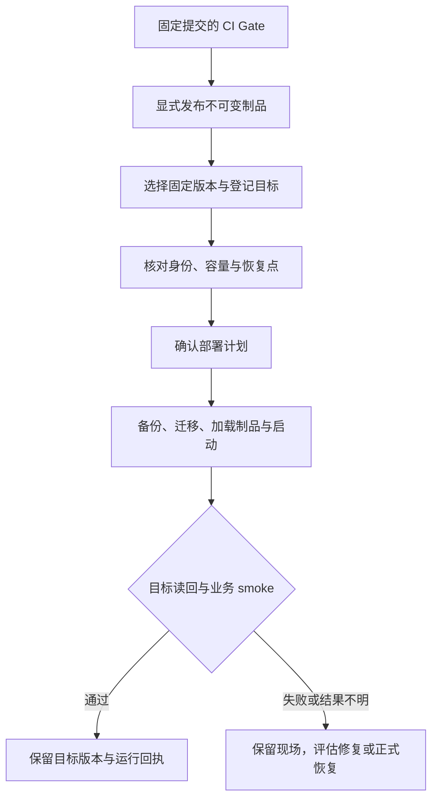

# 部署真源约定 / Deployment Conventions

## 当前口径

- 当前唯一部署真源：`server/deploy/compose/prod`
- 当前仓库只保留 `docker compose` 这一路径；业务服务与可选独立日志工作台均位于该入口，未初始化 `lab-ha` 或 Kubernetes
- 目标服务器配置较低，部署时不在服务器构建；服务端和前端镜像必须先在本地或 CI 构建完成，再上传到服务器加载运行
- 线上 migration 使用宿主机 `/usr/local/bin/atlas`，不要拉起 `arigaio/atlas:*` 临时容器，也不要把 Atlas 写入业务 Compose
- 如果后续确实需要第二套部署方式，先补文档和目录，再补脚本和发布流程

用户明确要求“部署”“发布并部署”或“修复 CI 后部署”，但未限定环境时，默认将同一不可变 release 部署到 `demo-133` 和 `customer-test-133`，无需再次询问部署环境或重复索取同一部署授权。用户明确指定单一环境时，仅部署指定目标。

默认先部署并验证 `demo-133`，成功后再部署 `customer-test-133`；普通部署保留各自现有数据。CI、制品验证、各目标的预检、回滚准备和部署后验证沿用本文件的正式流程。

## 目录职责

| 目录 | 职责 |
| --- | --- |
| `server/deploy/` | 业务 Compose 及 GitLab、Runner、工作台等服务的运行定义和配套配置 |
| `scripts/deploy/` | 共用发布、预检、smoke、采证、备份恢复与回滚执行逻辑，目标身份只取 `deployment-targets.json` |
| `deployments/<customer-key>/` | 客户运行与凭据合同、env 和必要差异、运维适配、runbook、checklist 与脱敏 evidence |

客户资料直接引用正式 Compose 和共用脚本，不复制完整服务定义，也不维护没有运行消费者的服务端或前端配置样例。历史 evidence 保留当时实际路径与结果。

### `server/deploy/compose/prod`

- 单机或单宿主机部署入口
- 保留 PostgreSQL、Jaeger、业务容器和线上迁移脚本
- 所有运行时参数优先通过 `.env` 覆盖，不要直接硬改 `compose.yml`
- 第三方基础镜像必须固定版本 tag；PostgreSQL、Jaeger 和业务镜像都不能使用 `latest`，生产 `.env` 由 `production-preflight.sh` 阻断浮动 tag、placeholder secret、debug 写入开关、PostgreSQL 非 loopback 暴露、后端 HTTP 非 loopback 暴露和 Jaeger 非 loopback 暴露。

  yoyoosun 的短信能力以 `deployments/yoyoosun/env/runtime.contract.json` 为部署级真源，env、容器与 `auth.capabilities` 任一不是 `provider / enabled / not-mock` 都不得发布
- 服务器侧只允许执行 `docker load`、`docker compose up`、宿主机 Atlas migration 与 smoke；不要执行 `docker build`、`pnpm build`、`go build` 或其他重构建命令
- 服务端镜像内置 Chromium / CJK 字体用于在线 PDF，PDF 浏览器路径、并发和容器内存预算统一从 `.env` / Compose 管理

## 不可变制品与本地演练

发布候选必须从 clean current HEAD 的 committed archive 构建。

`scripts/deploy/release-artifact-bundle.mjs --execute` 固定生成 `linux/amd64` Server / Web 镜像，并把 40 位 Git SHA、image content ID、loadable tar checksum、CycloneDX 依赖 SBOM、Atlas migration 序列和客户配置源指纹写入同一脱敏 manifest。

manifest 中的客户配置只证明 Product Core 已提交来源，不替代目标 active revision / effective session 读回。

`scripts/deploy/local-release-rehearsal.mjs --execute --manifest <path>` 只使用唯一 `server/deploy/compose/prod/compose.yml`。

每次创建 `plush_erp_release_<run-id>`，按 `status → validate / dry-run → apply → status / readback` 执行 migration，并验证 health、ready、release identity、管理员登录、本地测试配置的正式控制面协议、PDF、备份恢复和移除 bootstrap secret 后的重启恢复。

无论成功失败都执行精确 Compose 清理；长期 `plush_erp`、共享库和 133 不在该演练的写入范围。

正确顺序是：当前改动的最小充分本地验证与 clean commit → 非强制 push → GitLab 同 SHA 普通 CI 七分片、聚合和 `CI Gate` 绿色 → release 复用该 CI terminal，仅构建一次候选制品 → 用同一 bytes 完成隔离发布演练并冻结回执 → 登记含演练 digest 的不可变 Release → 只对正式登记目标执行 preflight / rollback point / backup / migration / Compose / smoke。

目标机只 load / pull 已构建制品，不从源码重建；任何 SHA、content ID、migration、active config 或 rollback 身份不一致都停止。九岗位生命周期验收和客户 UAT 仍是独立证据，不由 CI 或基础 smoke 代替。

## 部署后的备份闭环 / Deployment Backup

后续部署持续包含对应备份链的检查和运行部署。ERP promotion / rollback 沿用正式入口的新备份及隔离恢复；工作台更新保留 operation / receipt 与回滚目录。GitLab 升级执行 [PD-SSD 备份与恢复流程](../server/deploy/gitlab/README.md#pd-ssd-自动加密副本--external-backup-replica)，不恢复已撤销的异机备份暂缓条件。

发布前后，对涉及的 Mac 副本私有配置执行 `node scripts/deploy/backup-replica/cli.mjs check --config <private-config.json>`，把结果纳入本次发布证据；未通过时按原因修复、同步或恢复验证，不将旧回执写成当前通过。修改备份工具、配置或定时定义后，同轮安装已验证的固定内容快照，核对 timer / launchd 实际执行和状态，保留上一份运行制品及原备份。GitLab 版本升级必须强制验证新版本完整恢复；日常 ERP 发布不重复执行无关 GitLab 全量备份。

代码提交 / 推送与运维工具安装分别授权、分别记录。已授权的备份修复和运行部署不因共享 checkout 有其他未提交改动而停止：只打包本轮明确模块，记录内容 SHA-256、基础提交及 `content-snapshot` 来源；ERP 产品发布仍遵循不可变 committed release 合同。

<a id="retention-policy"></a>

## 记录与文件保留 / Retention

版本、部署、检查、备份、恢复与清理结果长期保留。发布制品保留最近 7 个完整可用版本；demo、test、erp、GitLab 的备份按各自环境、来源及完整恢复集保留最近 7 份。7 份表示生成次数，不保证覆盖 7 天；PG 专用备份不能挤掉 PG＋附件成套备份。

当前运行、必要的最近两个回滚版本、最近升级前恢复点及未闭环操作引用额外保护，实际文件数可超过 7。新输入完成并校验通过后才淘汰旧文件；保护或归属不清、校验失败、磁盘不足、活动发布或备份时停止相关清理。数据库、附件、运行 env、证书、Git 历史和操作回执不进入文件轮换。

使用 [统一轮换入口](../scripts/deploy/README.md#制品与备份自动轮换)，工作台版本页及恢复页分别显示保留、保护、清理和待核对状态。已清理文件不能继续提供部署或恢复动作；完整 CI 原始日志和大附件继续遵循既有时间归档策略，关键检查结论与正式发布证据长期保留。

## 下载缓慢时的来源与代理选择 / Download Routing

CI、构建或部署下载资源出现持续低速、停滞、超时或重复断流时，先对比可用来源与网络路径，再用实际传输最快且稳定、身份校验通过的组合继续下载。不在同一慢路径上反复延长超时或重跑整条流水线；进程仍在运行不算下载有进展。

| 资源 | 可比较的来源与路径 | 必须保留的合同 |
| --- | --- | --- |
| 公共工具、依赖、基础镜像和扫描数据库 | 原始官方源、发布方维护的镜像源或项目已批准缓存；分别比较直连和已授权的可用代理 | 固定版本、架构及 checksum / digest；动态扫描数据库另外核对格式与更新时间 |
| GitLab 发布包、私有依赖及客户材料 | 仅在原受控来源上比较已授权网络路径 | 固定内部 GitLab TLS 及制品身份；私有内容和凭据不发往公共镜像站 |

1. 在**实际执行下载的机器与进程环境**核对原 URL、版本 / digest、对象大小、有效代理、已收字节、耗时和错误。Mac 下载快不代表 Runner 快；宿主 shell 的代理也不代表 Docker 或 CI job 已使用同一路径。日志隐藏 token、代理认证和签名查询参数。
2. 对同一个不可变对象通常只比较 2–3 个可信来源与直连 / 代理组合，整轮测速（含复测）预设 2–3 分钟总预算，到期结束测速。开始或追加测速前，按剩余字节和近期持续速率估计当前下载的剩余时间；接近完成且继续下载预计更快时，优先完成当前下载。

   大文件可取相同的 8–32 MiB 范围；不支持 Range 时使用有硬超时的正文传输。可先设连接超时 10 秒、每组采样总时限 60 秒、连续 20 秒无有效字节即停止；这些是可调整的测速起点，复测也计入整轮预算，不能因等待而自动无限放宽。记录来源别名、路径、HTTP 状态、实收字节、耗时、平均速率和断流；ping、HEAD、连接成功或瞬时峰值不能替代吞吐证据。比较应避免同时抢占同一出口，差距接近或抖动明显时在剩余预算内最多再采样一次。
3. 从身份可核验且无持续停滞的候选中选择实际吞吐最高的组合继续下载。短样本只用于初选，不能证明完整下载稳定；下载过程中按 20–30 秒窗口检查新增字节、持续平均速率和预计剩余时间，既识别完全无进展，也识别长期只有零星字节的低速状态。结合已知正常速率、剩余文件量及切换 / 重新下载成本判断是否换用其他组合，不因单次短暂波动立即切换。完整下载的总时限按文件大小、持续吞吐和流水线截止时间单独设置，不套用采样的 60 秒，也不因零星字节不断延长。

   候选若仍失败，再根据新错误更换组合，不盲目重试原路径。续传须确认对象版本 / digest 未变、服务端正确返回 `206` 和预期范围；最终完整文件仍须通过 checksum / digest、架构与长度检查后才能使用。固定合同禁止备用来源的资源，仅比较路径或按该资源的正式冷种子 / 缓存流程处理。
4. 代理优先用当前下载进程的显式参数或环境变量。授权范围内需要切换共享代理节点时，先记录原选择、限定影响并在下载完成后恢复；不把进程代理选择扩大成系统代理、DNS、订阅、Docker daemon 或其他任务连接的配置修改。已有授权持续有效；没有共享设置变更授权时，继续比较允许的进程路径和来源。
5. 通过原工具的正式入口写入并验证缓存，核对 CI 的实际 cache key、恢复顺序和消费者路径，避免下一次 job 用旧缓存覆盖刚下载的数据。不伪造扫描数据库时间或关闭更新、校验、安全扫描来换取通过。保留脱敏测速结果、最终来源 / 路径、版本 / digest 与下载后验证；仅清理本次创建的临时文件和进程。

目标 promotion 仍由目标机从固定内部 GitLab TLS 下载同一 release 的七项资产与源码包；上述公共资源换源规则不引入 Mac 批量中转、任意镜像站或改变发布身份。资源自身已有更严格的下载、签名或缓存合同，以该合同为准。

## GitLab CI/CD、GitHub 镜像与固定目标 promotion

- `.gitlab-ci.yml` 是 canonical 验证与发布入口：merge request 运行 affected；main push 由唯一 prepare cache writer 之后并行 static、Node、Web、Server/PostgreSQL、resource-sensitive、browser 和 security 七个固定分片，aggregate 签发可复用 exact-SHA strict terminal，稳定汇总 job 为 `CI Gate`。

  受保护 release pipeline 只回读该普通 push CI 证据，不重跑 strict；同 SHA 只构建一次不可变候选制品，复用同一候选包演练并登记 GitLab Package/Release。
- GitHub 不保留仓库 workflow 或发布写入 helper；main 只接受 GitLab protected-main mirror，GPT 审查读取已镜像的目标提交范围。历史 GitHub Actions / Release 仅可只读审计和读取既有回滚输入，不能冒充当前 `gitlab-ci` 主链证据，也不能创建新的 publication。恢复任何 GitHub 写路径必须重新专项评审，不能仅靠开关或补回旧 workflow。
- 新 GitLab publication 固定使用 `plush.release-manifest/v2`，并把 checksums、artifact manifest、release manifest、SBOM、两个 loadable image tar 和同一 `release-rehearsal.json` 共七项固化到 Generic Package 与 Release。

  registry、Package、Release、演练回执和目标 promotion 必须绑定同一 40 位 SHA、artifact digest 与 rehearsal digest。

  旧 `plush.release-manifest/v1` 六资产只允许精确读取、目录展示、校验和既有回滚点兼容；不得补传、重新封装或作为新 promotion 输入，`promotionEligible` 必须为 false。
- promotion、smoke 和 rollback 复用已发布制品，不回到 strict 或 build。新 promotion 只接受 v2 七资产，校验并传递 manifest 绑定的同一 `release-rehearsal.json`；目标机只验证、归档和 load。Release 已存在且身份完整时幂等复用；同版本异 SHA、digest 或 rehearsal receipt 必须阻断。
- `scripts/deploy/deployment-targets.json` 登记 `demo-133`、`customer-test-133` 与 `production-133`。精确主机、用户、目录、Compose、数据库、附件及端口由固定合同校验；生产定义不代表目标已初始化。默认部署仍只选 demo/test，生产必须显式选择。
- `demo-133` 是项目方造数/演练环境，内部 `customer-trial-133` 数据合同只能在该目标重放模拟数据；`customer-test-133` 是甲方测试/验收环境，普通 promotion 默认保留现有业务数据，只有开始新一轮测试且明确选择干净基线时才独立重建，不能继承 demo 造数。
`production-133` 对应 `erp.yoyoosun.net`，仓库已支持独立初始化、预检、发布和代码回滚，但不能据此宣称服务器已启用。首次生产初始化前须准备独立凭据及异机恢复前提，完整上线清单见 [首次部署](../deployments/yoyoosun/runbooks/01-first-deploy.md)。根域跳转不是生产启用证明；退役 `admin.yoyoosun.net` 不进入任何目标矩阵。
- DEV-only `/__dev/version-center` 通过 loopback Bridge 默认调用固定 GitLab adapter 和固定目标执行器；只有服务端显式 `PLUSH_DELIVERY_PROVIDER=github` 才切到应急 adapter。所有写操作先形成 operation，再要求完整确认串；同一目标只能有一个执行器，终态和 `not_proven` 不自动重试。
- 任一目标需要 fresh 数据代时，独立走 `database-rebuild-controller.mjs` 的只读资格计划和 `database-rebuild-executor.mjs` 的精确确认。

  它绑定目标当前运行的 exact release，不要求先发布新版本；如果同次既要部署新版本又要建立干净基线，先完成默认保留数据的 promotion 并读回 exact release，再对该 release 独立重建。该路径保持目标登记的逻辑库名不变，fresh backup 恢复校验后保存旧物理数据目录并创建新数据代；不直接清表、不删除旧数据代、不自动 down migration。

  demo 可在重建后重放模拟数据；test 只建立最小可登录的干净业务基线。
- 普通代码回滚只允许 migration 序列与客户配置源指纹完全相同的旧 manifest；不自动 down migration，也不自动恢复数据库。schema 不兼容时改走 forward-fix 或单独评审、验证过的备份恢复。

### demo、test 与 production

三个登记环境各自隔离数据库、附件 bucket、Compose project、端口、runtime env、备份、回滚点和 operation。demo 用于模拟，test 用于甲方测试和预发布验收，production 用于正式业务；同批交付使用同一不可变发布包。普通升级保留各自数据，测试重建只对 demo/test 显式开放。

`production-133` 的定义、首次上线检查与执行主路径已经进入仓库，生产运行状态仍须独立证明。生产不支持测试数据重建、seed 或固定测试凭据合同；普通 promotion 保留数据，不隐含数据清理或真实导入授权。

当前远端 promotion / rollback 脚本能证明制品、备份恢复检查、migration、Compose、health、ready、Web health 和运行 SHA；数据库重建 passed 回执另外只证明 fresh 物理代、一次性管理员和空业务基线。客户配置、九岗位数据、50 项浏览器/PDF、带凭据岗位矩阵与客户 UAT 仍是独立未证明项，必须在真实发布后补齐，不能由基础 smoke 替代。

### 历史环境退役

2026-09-07，133 上历史 `plush-toy-erp-prod`、`plush-toy-erp-v5` 及对应旧公网前端、HTTP/gRPC 转发已停用，11 个容器关闭自动重启。

旧 FRP 服务 `plush-http`、`plush-grpc`、`plush-web-desktop` 在宿主机受控 Compose 中使用 `retired` profile 和 `restart: "no"`，不随默认 `compose up` 启动。当前 demo/test 及其他项目服务保持独立运行；历史 `prod` 名称不代表启用了未来 `erp` 生产 target。

退役采用停机保留：两个 PostgreSQL 数据目录、3 个历史业务库、容器、镜像、原配置和备份继续保留，不执行 DROP、卷删除或数据目录清理。

133 的恢复材料位于 `/data/ops-backups/plush-governance/20260907-01a0773d/retirement`；其中 `final-backup` 是停止旧应用后的备份，已完成角色、完整数据库恢复和 186 张表行数核对。

恢复旧入口前须重新核对端口、容器身份及后续配置改动，再按保存的 restart policy 和启动顺序恢复，不把旧库接到 demo/test。

Atlas 继续使用各登记目标自己的固定 `v1.3.0`，不升级或替换系统工具。目标预检完整读取版本命令输出，避免后续更新提示遇到提前关闭的管道而误报；版本不符及命令非零退出仍阻断。版本预检通过不替代真实 migration status，也不授权 apply。

## 固定版本交付路径 / Delivery Flow

图示只说明发布与部署关系；每次实际操作的授权、目标、恢复点和证据仍按本文件的正式入口核对。



<a id="devops-records"></a>

## 每次 CI/CD 与部署留痕 / DevOps Records

每次 CI、制品发布、目标部署、初始化、数据库重建和回滚都必须沿正式入口自动记录，包括失败、阻断和结果未证明的尝试。记录绑定不可变 commit / 制品摘要、目标、开始和结束时间、实际步骤、检查结论、问题及重试关系；成功标签不能替代这些证据。

| 查询内容 | 页面入口 | 正式记录及边界 |
| --- | --- | --- |
| CI 检查、测试、失败 Job、排队与重试 | 测试验证 → 质量门禁；版本发布 → 流水线耗时 | GitLab Pipeline / Job / artifact；页面摘要显示最近样本，完整历史沿 GitLab 链接查看 |
| 发布版本、源码、镜像和发布资格 | 交付运维 → 版本发布 → 版本与部署 / 发布检查 | GitLab 不可变 Release、Generic Package、严格门禁与制品清单 |
| 每次发布、部署、重建和回滚 | 交付运维 → 版本发布 → 操作记录 → 查看详情 | GitLab Environments / Deployments 与项目回执 Package；工作台保留原始 operation / receipt 的本地读取、项目检查汇总和操作入口 |
| 数据库升级与恢复 | 数据库迁移；安全与恢复；部署操作详情 | 本地迁移页管登记开发库；133 的迁移由目标 Atlas 回执证明，部署主回执和计划记录迁移步骤 / 发布要求。主回执未记实际版本号时明确显示未记录，不以发布要求替代实际读回 |

demo（`demo-133`）、test（`customer-test-133`）与 erp（`production-133`）的部署、初始化、重建和回滚记录必须按目标严格隔离：页面、列表、总数、耗时统计、详情请求和缓存使用同一 target；切换目标取消旧请求并关闭旧详情。历史页默认当前操作目标，不提供混合环境的“全部目标”。CI 与不可变制品属于同一提交的共享证据，制品发布记录单独查看，不复制成三个环境的部署成功记录。已退役目标保留原始 target，单列只读历史，不重命名成现役环境，也不用于新部署。此处的查询隔离不替代正式部署登记中的独立服务、数据库、配置与备份边界。

正式部署与回滚自动登记到 GitLab `demo`、`test`、`erp` 环境，项目检查回执归档至 `plush-deployment-evidence`。历史补录保持原始目标、UUID、结果与实际时间；GitLab 创建时间是登记时间。退役记录、数据库重建和共享制品发布只归档，不混入三个现役环境。登记重试不会重跑部署，创建响应不明时必须核对精确 GitLab ID；协议、凭据及恢复命令见 [GitLab 部署登记与回执归档](../scripts/deploy/README.md#gitlab-部署登记与回执归档)。

历史列表和详情直接读取持久化记录，不依赖 GitLab 或 SSH 预检成功。只读请求有超时和一次临时失败重试；校验失败不自动重试，写操作不套用读取重试。网络失败保留同环境、同筛选的上次结果并标明过期，首次失败不得显示为零条；损坏记录显示完整性警告，其余已校验记录仍可查询，统计不得声称完整。修复原始记录后无需重启即可重新读回。

CI 检查成功、制品发布成功、目标运行通过、数据库恢复通过、附件恢复和岗位 / 甲方验收分别记账。未执行、失败、缺失、过期与未证明不能汇总成通过；基础冒烟或数据库隔离恢复不自动代表完整业务验收或附件恢复。

GitLab 的 Pipeline / Job 与版本目录负责远端历史；CI 附件按 `.gitlab-ci.yml` 当前任务设置保留 30 或 90 天，不能称为永久留存。发布所需严格证据和制品清单随不可变发布保留。需要长期排障或统计的附件须在到期前归档到受控备份并保留 SHA、pipeline / job ID 和摘要，不通过无限保留全部大附件替代保留策略。

工作台 `output/dev-workbench/delivery-operations/`、目标 `operations/`、Atlas 锁目录下的 `receipts/` 和正式备份属于运维证据，禁止当构建缓存清理；迁移工作台或清理 checkout 前须备份并验证这些记录可恢复。Git 提交只保存代码和合同，不备份 ignored operation 或客户 / 目标运行证据。此约定不代表异地备份已配置，备份与恢复结果仍需独立回执。

排障从 operation ID 或 exact SHA 开始，在操作详情核对目标、失败步骤与回执，再沿链接查看对应 CI/CD、源码和制品。统计应注明样本范围、动作、目标和耗时口径；工作台操作历时包含准备 / 等待，不能与 CI 执行耗时混算。实现与受控补录边界见[Operation 真源](../scripts/deploy/README.md#operation-真源)。

## 单一真源规则

1. 同一环境只保留一条主路径，不额外再并存另一套同级部署脚本
2. 发布、迁移、烟测、文档都围绕 `server/deploy/compose/prod` 收口
3. 若引入新的部署方式，必须同步更新：
   - `README.md`
   - `docs/当前真源与交接顺序.md`
   - `server/deploy/README.md`
   - 对应脚本和验证命令

## 变更流程

涉及部署改动时，按这个顺序做：

1. 先确认改动是否属于 `server/deploy/compose/prod`
2. 优先修改 `.env.example`、`compose.yml`、发布脚本和对应 README
3. 再执行最小校验
4. 最后同步更新文档

## 最小校验

```bash
cd "$(git rev-parse --show-toplevel)/server/deploy/compose/prod"
docker compose -f compose.yml config

cd "$(git rev-parse --show-toplevel)"
bash scripts/project-scan.sh --strict
```

如改动触达发布脚本或应用运行配置，再补：

```bash
bash scripts/qa/fast.sh
node --test scripts/deploy/release-artifact-bundle.test.mjs \
  scripts/deploy/release-artifact-verify.test.mjs \
  scripts/deploy/local-release-rehearsal.test.mjs
```

## 不要做的事

- 不要在没有明确需求时补回 K8s、Helm 或 `lab-ha`
- 不要把真实密码、JWT 密钥或远端主机写死进仓库
- 不要只改 live 机器或手工命令，而不回收脚本和文档
